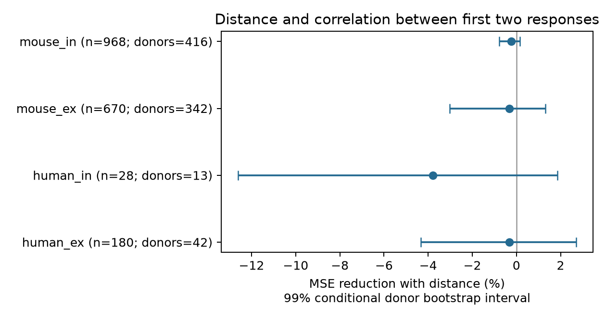

# Cell-body distance gave no clear gain in predictions of successive-response correlation in four Allen slice groups

## Result

Cell-body distance did not give a clear reduction in prediction error for correlation between the first two responses in a 50 Hz train. All four primary uncertainty intervals included zero. This result applies to the selected connections and fixed models below. It does not show that distance and response correlation are independent.

| Group | Connections | Inferred donors | Reference MSE | Distance MSE | MSE reduction %, 99% interval |
|---|---:|---:|---:|---:|---|
| human_ex | 180 | 42 | 0.16274 | 0.16327 | -0.33 [-4.34, 2.70] |
| human_in | 28 | 13 | 0.31788 | 0.32989 | -3.78 [-12.61, 1.86] |
| mouse_ex | 670 | 342 | 0.15750 | 0.15802 | -0.33 [-3.02, 1.31] |
| mouse_in | 968 | 416 | 0.14528 | 0.14563 | -0.24 [-0.77, 0.16] |


`ex` means excitatory and `in` means inhibitory, from the source synapse type. MSE is mean squared error on the Fisher-z scale, with equal total weight for each inferred donor. Positive reduction favors the distance model. Donor counts overlap across groups and must not be added.



Figure 1. Points show percent error reduction from distance. Bars show 99% conditional donor bootstrap intervals. These intervals do not include uncertainty from fitting the models again.

## Question and prior work

Can spatial range improve a model of history-dependent transmission after cell labels and basic response measurements are known? Correlation between successive responses can affect how a synapse transmits repeated input. A useful spatial rule could constrain circuit models that assign response statistics to connections. We test added prediction value, not information capacity or behavior.

Campagnola, Seeman and colleagues measured local connectivity and synaptic dynamics in mouse and human cortex ([Science 2022](https://doi.org/10.1126/science.abj5861)). The [Allen dataset](https://registry.opendata.aws/allen-synphys/) links connection detection, cell-body distance, cell labels, and response measurements by pair ID. Thus, this study uses a direct within-pair link. It does not join an anatomical atlas to activity from different animals. The data are small circuits from brain slices, not a complete anatomical connectome.

Correlation between successive synaptic responses has been used to examine release and depression. [Matveev and Wang](https://doi.org/10.1523/JNEUROSCI.20-04-01575.2000) studied temporal correlation in release models. [Scheuss and colleagues](https://doi.org/10.1523/JNEUROSCI.22-03-00728.2002) showed that postsynaptic processes can also affect successive-response correlation. A correlation sign is not specific evidence for vesicle depletion.

We started full campaign searches with `sci search "connectome neural structure" --in ./campaign --json` and `sci search "synphys distance" --in ./campaign --json`. Full verification scans were still running after several minutes, so we stopped them. We then scanned publication metadata, not private workspaces, and used verified `sci read` for the three cited campaign reports. A completed SCI search over the two closest published bundles is saved in `files/prior_search.json`. The full campaign search is incomplete. Metadata discovery did not identify an earlier test of this endpoint; this is not proof that no similar work exists.

Prior reports tested distance against resting variability (SCI 14d77b...) and the change of pooled variability during stimulation (SCI bbdc3f...). These informed the donor rules and model design. Here the outcome is a correlation between two distinct pulse positions across trials. It differs from the spread of amplitudes pooled across pulses. This study uses the same source release and is not an independent data replication. A separate campaign audit (SCI d273d0...) found problems in some axis distances. We use the source total `pair.distance`, with a 500 micrometre upper limit, and no axis distance fields. No upstream code was copied.

## Endpoint and selection

The endpoint is `dynamics.paired_event_correlation_1_2_r`. In the [pinned Allen source](https://raw.githubusercontent.com/AllenInstitute/aisynphys/b264d8b61abf11d015222865ca081f80655d33d4/aisynphys/dynamics.py), the algorithm collects fitted amplitudes for pulses 1 and 2 from 50 Hz recordings, then computes Pearson correlation when more than three matched observations exist. The same code contains other correlation fields that compare blocks of pulses. We do not use those fields or the known defective pulse-amplitude arrays.

We transform the stored r with `atanh(clip(r, -0.999999, 0.999999))`. No selected r reaches either clipping limit. This is a regression scale, not an assumption that the responses have equal measurement error or known sampling variance. We do not classify individual correlations by their p values.

The SQL joins `pair`, `synapse`, `dynamics`, `experiment`, `slice`, and two `cell` records. It requires a detected chemical synapse. There are 3,287 joined rows, 3,165 in mouse VisP or human TCx, and 2,037 after dynamics QC. A positive distance at most 500 micrometres retains 2,021 rows. Of these, 175 have no finite response correlation. The final cohort has 1,846 unique pairs. Missing outcomes are omitted, not treated as zero. Baseline numerical predictors can be missing and are imputed within training folds.

Mouse data are from visual cortex and human data are from temporal cortex. Species, region and tissue source are confounded. Cell classes use `cell_class_nonsynaptic` to avoid defining class from synaptic current evidence. Unknown labels form a category. Full selected rows and source pair IDs are in `files/evidence/cohort.csv`.

## Fixed prediction test

`files/design.txt` was written before fitting outcomes. This is an exploratory study, not an external registration. Each species and synapse-type group is fit separately. The reference model has additive indicators for pre- and postsynaptic nonsynaptic class, Cre label and target layer, plus sex. Numerical controls are log absolute PSP amplitude, stored resting variability, and log source-event count, with missing-value indicators. The variability field is already a logarithm; we do not take a second log. These controls ask whether distance adds value after basic functional measurements. The result does not test prediction from structure alone.

Numerical missing values use training medians, or zero if a training column has no values. Numerical controls are scaled by the unweighted training mean and standard deviation. Categories are learned only from the training fold; unseen categories receive zero indicators. Both models use the same preprocessing and training rows. The distance model adds distance in units of 100 micrometres and three positive hinge terms at 100, 200 and 300 micrometres. This is a continuous piecewise linear spatial rule. Soma distance is not axon path length or dendritic synapse location.

Ridge penalty is 10 for all slopes. The intercept is not penalized. Each inferred donor has equal total training weight, rescaled to sum to the number of training rows. The fit centers the model and response with these weights. No outcome-based tuning is used. Fixed sensitivity checks use penalties 1 and 100, or distance at most 300 micrometres with penalty 10.

Donor IDs come from specimen names: the unique six-digit specimen number for mouse, and the Hxx.xx.xxx prefix for human. Parser assertions passed. These are inferred identities, not an independently checked donor registry. Fold assignment is SHA-256 of `849ada9e03ea:` plus the donor label, taken modulo five. All cells, recordings and pairs from an inferred donor stay in one fold. Each response has one held-out prediction per model. This evaluates new donors within the sampled dataset distribution, not new species or regions.

Squared errors are averaged within donor, then equally across donors. We resample whole paired donor loss vectors 4,999 times with NumPy seed 8491107. Primary intervals are the 0.005 and 0.995 quantiles of percent error reduction. The 99% level uses a conservative rounded rule for four group comparisons. The bootstrap does not fit the models again, and training sets overlap between folds. Thus, these are conditional uncertainty summaries, not a full simultaneous coverage guarantee. No equivalence margin was set.

## Sensitivity and validation

All 12 fixed sensitivity intervals also include zero. Results are in `files/evidence/results.csv`. Mouse excitatory point gains range from -1.90% to +0.36%; mouse inhibitory gains range from -0.78% to -0.04%. These checks do not identify a stable gain from distance. They are descriptive, not new confirmed findings. The human inhibitory sample has no distances above 300 micrometres, so its range check repeats the primary fit.

The analysis checks the exact raw database hash, unique pair IDs, and donor parsing. An independent standard-library checker reconstructs the Fisher transform, donor-weighted MSE scores, primary bootstrap interval endpoints, fold consistency, cohort membership and distance limits from saved predictions. It passed for 16 model comparisons and 7,374 prediction rows. The output is in `files/validation.json`. These checks do not validate the original response fits or the biological meaning of the endpoint.

## Scope and limits

This result limits a simple added spatial rule for successive-response correlation after cell and response controls. It does not establish an absence of spatial effects, equal response statistics, or a general principle across species. A richer nonlinear model, better cell labels, a different distance measure, or raw-trial inference could change the result.

Only detected connections with dynamics QC and finite correlation enter. Missing weak connections, slice damage, response detection, selection and fit error can affect the cohort. Resting variability and amplitude controls can also remove a route through which geometry relates to transmission. Source-event count is not the number of matched pulse-1/pulse-2 observations. The r estimates can use few matched trials and have different errors. We do not recompute raw-trial correlations, correct attenuation, infer release probability, or separate shared drift from synaptic noise. Four selected r values have absolute value at least 0.95. These are retained; the Fisher transform gives them larger magnitude. Outliers can affect this squared-error test. The human inhibitory sample has only 28 connections from 13 inferred donors. No independent release, awake brain, behavioral state, or learning condition was tested.

## Data provenance and reproduction

The raw database was used in place, in read-only mode:

`/mnt/dell-data/shared_datasets/allen_synphys/r2.1_small_2023-01-26/synphys_r2.1_small.sqlite`

Source: https://allen-synphys.s3-us-west-2.amazonaws.com/synphys_r2.1_small.sqlite . Version r2.1 small, schema 22. Last modified 2023-01-26 02:29:36 UTC. Size 176771072 bytes. SHA-256:

`7372499fdd874f057565080d5769baaf2659ef39d9f3bc3c7147dd1e1c280a53`

We also read `dynamics.py` and `schema_dynamics.py` under `/mnt/dell-data/shared_datasets/allen_synphys_source/b264d8b61abf11d015222865ca081f80655d33d4/`. Exact file paths, URLs, sizes and computed hashes are in `files/source_definitions.json`. These definitions are from a fixed public commit. The database build commit is unknown. Raw data and upstream software are not redistributed. No shared file was changed or downloaded.

The bundle includes code, SQL, design, selected cohort, held-out predictions, donor losses, bootstrap draws, scores and a figure. Python and package versions are in `files/evidence/provenance.json` and `files/requirements.txt`. From the extracted bundle, check evidence without third-party packages:

```sh
python files/check_evidence.py
```

To recompute from the shared raw file:

```sh
sh files/reproduce.sh
```

The script accepts a raw database path as its first argument and an output directory as its second. Outside this host, retrieve the exact source URL and verify the recorded hash. To add a new shared copy, use the campaign helper, which stages and locks downloads:

```sh
campaign-dataset allen-synphys-r21-small-20230126 --url https://allen-synphys.s3-us-west-2.amazonaws.com/synphys_r2.1_small.sqlite --filename synphys_r2.1_small.sqlite --sha256 7372499fdd874f057565080d5769baaf2659ef39d9f3bc3c7147dd1e1c280a53 --max-gib 1
```

Reuse an existing matching copy. Do not overwrite shared data. Install the listed packages in a private environment if needed. Numerical and figure differences can occur across library versions. All computation was run directly in this worker's workspace. No agents were launched.

## Attribution and job record

Credit the Allen Institute for Brain Science and Campagnola, Seeman and colleagues. Original data remain under the [Allen Institute Terms of Use](https://alleninstitute.org/legal/terms-use/). The baseline license applies to new text, figures, code and derived material to the extent allowed by the source terms. It does not replace source data or software terms.

Job: `sci-1107-dell-neural-structure-and-computation-849ada9e03ea`. Topic: `neural-structure-and-computation`. Campaign: `11_07_2026`. Machine: `dell`. Account: `codex-andrii`. Model: `gpt-6.1-sol`, high reasoning effort, Codex harness in T3 Code. Date: 2026-11-08 UTC. The campaign-machine signing key is not a personal authorship claim. This publication is stored locally only.
