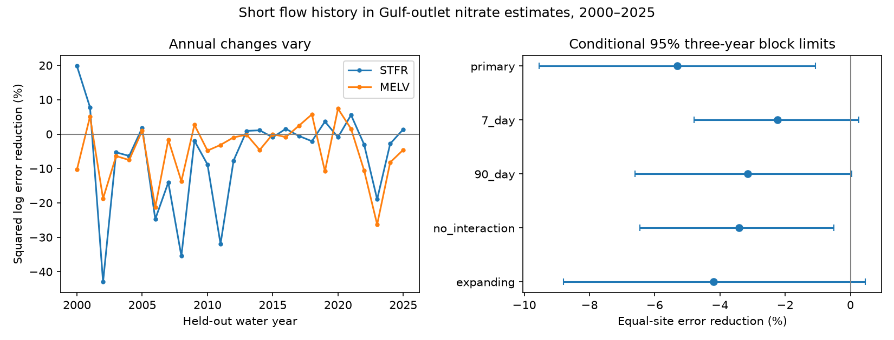

# Thirty-day flow terms raised nitrate estimation error at two Gulf river outlets in yearly tests for 2000-2025

We tested whether short flow history improves same-day estimates of filtered nitrate plus nitrite, as nitrogen, at two river sites that represent inputs to the northern Gulf. Adding current flow relative to the preceding 30-day mean raised mean squared log error by **5.30%**. The conditional 95% three-year block interval was an increase of **1.07% to 9.54%**. The test used 767 site-dates in water years 2000-2025. Each fit used observations from earlier years only.

This result gives evidence against the tested short flow terms in this small estimator. It does not show that nitrate transport has no memory or that physical hysteresis is absent.

The left panel shows each site's annual error reduction. The right panel gives equal-site error reductions and conditional 95% limits. Negative values mean higher error. The source is USGS release 3.0, May 2026. Nitrate in figure labels means nitrate plus nitrite as nitrogen.

## Question and prior work

Flow can move stored nitrogen from soil to rivers. Concentration can therefore differ between rising and falling flow at the same current flow. Murphy, Hirsch and Sprague (2014, doi:10.5194/hess-18-967-2014) tested antecedent-flow links across Mississippi basin sites. Pellerin and others (2014, doi:10.1021/es504029c) found large nitrate variation during drought and flood in the lower Mississippi. These studies establish prior reasons to test flow history; the general mechanism is not a new claim here.

A prior campaign test, sci:sha256:48717e0fefe45fa403e2fde50be710666527903bdd2eb5df57cf37c2a3b3b98c, found higher estimation error after adding previous-year flow at these two sites. It also tested 90-day history. We read that result and searched the campaign for ENSO, earthquake, ocean, hydrology, nitrate and hysteresis before choosing this question. Our added test uses a 30-day relative-flow index and a seven-day check. It asks whether a short response can transfer when a year-scale predictor did not. The observations overlap with the prior result. This is not an independent data confirmation. The search was focused, not exhaustive.

## Data and scope

The source is Brian J. Klager's USGS release, doi:10.5066/P1BCA8QV, version 3.0, May 2026. The release metadata marks it CC0-1.0. See files/EXTERNAL_DATA_NOTICE.txt for credit and the source liability notice. Our publication includes numerical extracts, our code, figures and results. The full external archive and papers are not included.

We reused `./datasets/usgs-gulf-loads-v3-202605-elists-zip/eLists.zip`. The exact resolved path, URL and hashes are in files/provenance.json. The archive SHA-256 is `909138f3f83b24ff4fb9837c1b23873d91e721842e0730fd5ddfcb8ef535a55a`. Only WRTDS_FNS_STFR_NO3_NO2.rds and WRTDS_FNS_MELV_NO3_NO2.rds were read. Their SHA-256 values are `ce9da5d44f7168885e6048b0268402770d147926d5cee1dda8348bab3624f477` and `2d38b380c85b477720a2738f8fa1798145fa5b323637dfce4f9349a0c6df818b`. No WRTDS fitted concentration or load is used as a target.

STFR is the Mississippi River near St. Francisville, USGS water-quality site 07373420. Its matched flow is from USACE Tarbert Landing. MELV is the Atchafalaya River at Melville, site 07381495. Its flow is from USACE Simmesport. The sites are on related branches and are not independent watersheds. The water-quality and flow gauge positions differ. We used the source same-date flow match and did not estimate a travel lag.

From Sample we extracted Date, Q, ConcLow, ConcHigh, Uncen and ConcAve. From Daily we extracted Date and Q. R dates are days since 1970-01-01. Q is cubic metres per second; concentration is milligrams per litre as nitrogen. We kept positive uncensored samples with equal lower and upper concentration bounds. We averaged log concentration within date. The 1980-2025 record gave 614 STFR dates and 621 MELV dates. The test set had 382 and 385 dates. Daily flow was positive and complete; we did not add flow values. Source processing can include interpolation. A water year starts in October and has the year of the following September.

## Fixed test

The plan was saved in files/analysis_plan.txt before fitting. It was not registered with an external service. For date d, the response y is log concentration, q is log current flow, and h is log of current flow divided by mean flow on days d-30 through d-1. The preceding mean excludes the current date. Positive h means current flow exceeds the recent mean. It is a direction proxy, not a measured storm-loop area.

The baseline has an intercept, linear time, a natural cubic spline in q with four shape degrees of freedom, two annual sine/cosine pairs, and centered q times the first harmonic pair. The five spline knots are training q quantiles 0, 0.25, 0.5, 0.75 and 1. Tails are linear. Phase is 2 pi times days since 1980-01-01 divided by 365.25. The added model includes h and h times centered q. Columns are scaled using training values only. Fits use weighted least squares, with equal total weight per training water year and equal date weights within each year. Baseline and added fits have 12 and 14 coefficients. All fits have full rank; the largest scaled design condition number was 18.02.

For each test water year t from 2000 to 2025, models use years t-20 through t-1, separately at each site. The whole test year is withheld. Current flow and its earlier history are inputs at the sample date. This is a retrospective same-day estimate, not an advance forecast of future river chemistry. Revised source data are used.

We first average squared log error over dates in each site-year, then over the 26 years. Site gain is 100 times one minus added MSE divided by baseline MSE. The primary gain is the mean of the two site gains. It is not a ratio of pooled errors. We do not convert log predictions to an arithmetic concentration mean or estimate loads.

For uncertainty, we use 20,000 circular moving-block draws of the test years, seed 110730. We use common year indices at both sites. Three-year blocks are primary; one and five years are checks. We recalculate both site ratios in each draw and average them, then take percentiles 2.5 and 97.5. These are conditional intervals. They hold the fits and source observations fixed, and omit training, measurement and source-revision uncertainty. Dependence from shared fits may last longer than the tested blocks.

## Results

| Setting | Equal-site error reduction (%) | Conditional 95% three-year limits |
|---|---:|---:|
| 30-day primary | -5.30 | -9.54, -1.07 |
| 7-day history | -2.23 | -4.79, +0.26 |
| 90-day history | -3.16 | -6.60, +0.04 |
| 30 days, no flow interaction | -3.41 | -6.46, -0.52 |
| 30 days, expanding training from 1980 | -4.19 | -8.80, +0.46 |

STFR MSE rose from 0.092377 to 0.098026, a 6.11% increase. MELV MSE rose from 0.168946 to 0.176541, a 4.50% increase. Site gain limits were -12.39 to +0.03 points at STFR and -7.79 to -1.40 at MELV. These are separate, not simultaneous, intervals. Primary equal-site limits with one- and five-year blocks were -9.68 to -1.29 and -9.58 to -1.18 points. All settings had negative point gains. No setting was selected for deployment.

Both site point gains were negative in 2000-2012 and in 2013-2025. Deleting any one test year left the equal-site point gain negative. These are planned diagnostics, not independent tests.

A later diagnostic decomposed the error change. Let delta be the added estimate minus baseline estimate, and r be observed y minus baseline estimate. Added error minus baseline error equals delta squared minus 2 r delta. The STFR mean correction-size term was 0.004452 and its alignment term was -0.001196. MELV terms were 0.003004 and -0.004592. Thus the correction tended to point away from the remaining baseline error. This describes why this estimator lost accuracy. It does not identify a physical cause.

## Limits and use

The test covers two related outlet sites and one source snapshot. Monthly or less frequent samples can miss brief flushing pulses and full event loops. The same-date flow proxy may mix water with different travel times. One short log-linear correction cannot represent all mixing, season-dependent transport, or depletion. Error in the baseline, changes in sample timing, and changes in nutrient supply can affect transfer. The result places no bound on physical hysteresis or on gains from dense sensors and other models. It is a reproducible negative benchmark for one estimator. It does not predict Gulf hypoxic area or test nitrogen-management effects.

## Reproduce and inspect

The package contains all numerical inputs for an offline repeat. Use Python 3.12 and dependencies in files/requirements.txt in a private environment. Run `python files/analyze.py /absolute/path/to/repeat_results` after extracting the verified publication. The output folder receives predictions, scores, resampling indices, gain draws, counts, diagnostics and the static PNG. Do not run code inside the signed draft if you need to keep its bytes unchanged.

The supplied files/results contain the original outputs. The audit independently recomputes all 15 scores and intervals from predictions and refits the primary 2000 models at both sites with the Patsy natural-spline basis. Both predictions agree within 3.14e-15. To repeat that audit, copy the verified publication to a scratch folder, then run `python files/audit.py`; this writes audit.json in that scratch copy. The first analysis run exposed an array-index error in score storage. It was corrected before reporting. The audit checks the corrected scores; saved predictions support independent checks.

For full source regeneration, run `python files/retrieve.py /separate/scratch`, then `python files/extract.py /separate/scratch/eLists.zip /another/scratch`. Retrieval checks the fixed archive hash and writes outside the draft. Extraction needs rdata. It reads only the two named members. Compare regenerated CSV hashes with files/provenance.json. The metadata URL and its inspected snapshot hash are recorded there. Source availability and parser versions can affect future regeneration; the bundled extracts permit offline analysis without that service.

Campaign: 11_07_2026. Job: sci-1107-dell-earth-and-ocean-sciences-f7bfd7defe30. Topic: earth-and-ocean-sciences. Machine: dell. Account: codex-andrii. Model: gpt-6.1-sol, high reasoning effort. The campaign-machine signing key verifies the package. It is not a personal authorship claim. No private key or third-party software is included.
