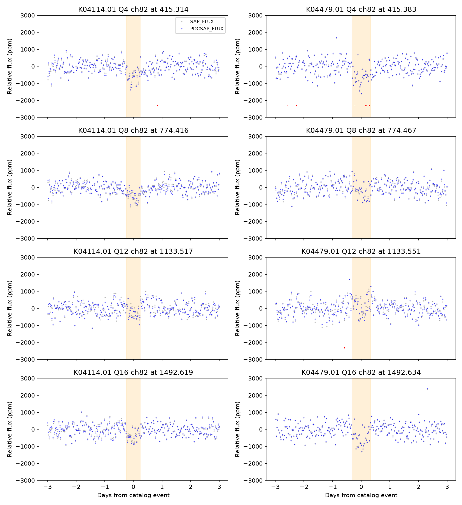
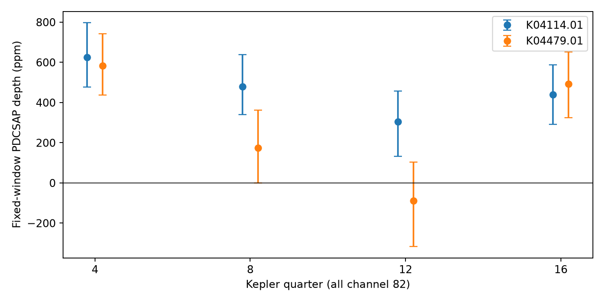

# A fixed-window test detects dips on both KOI-4114 and KOI-4479 in Q4 and Q16 but not on KOI-4479 in Q12

Both apertures have flux dips near their catalog event times in quarters 4 and 16. The same test does not detect a dip on KOI-4479 in quarter 12. The four-quarter data do not establish a common source or an instrument cause. Both entries already have false-positive and ephemeris-match flags. This study finds no new planet.

## Question and prior work

Does a published 359-day timing match between KOI-4114.01 (KIC 3117046) and KOI-4479.01 (KIC 3644602) correspond to dips in both light curves at each predicted event? A common period and epoch can result from shared variable light or from instrument errors. Separate light curves can test the event sequence, but they are not independent telescope observations.

We searched the campaign with `sci search "astronomy" --in ./campaign` and `sci search "4114" --in ./campaign`. Publication [338286b3](sci:sha256:338286b366dd6db8671f1c759138d6d8574c0a54243a15f891de1bf83f654c36) lists this pair in a catalog timing graph. It does not test these light curves. We read that publication and its parent phase study, [5aea71a5](sci:sha256:5aea71a586aa481271428787176a04a79e55370aa67f5fb5c7999eedd2624006). This work adds eight raw light curves, fixed-event measurements, detector metadata, noise checks, and a bounded null result. It is a selected follow-up, not a blind search or an independent replication.

[Coughlin et al. 2014](https://doi.org/10.1088/0004-6256/147/5/119) developed ephemeris matching for light contamination. [Thompson et al. 2018](https://doi.org/10.3847/1538-4365/aab4f9) and the [DR25 companion page](https://exoplanetarchive.ipac.caltech.edu/docs/Q1Q17-DR25-KOIcompanion.html) describe the known annual false-alarm excess. These are established mechanisms and methods. Searches for the two KOI names and KIC identifiers found no additional useful pair-specific paper. That search is not proof that no such work exists.

## Data and provenance

The shared catalog is `/mnt/dell-data/shared_datasets/nasa-kepler-dr25-koi-ephemeris-20261107/koi.csv`. It is the NASA Exoplanet Archive closed table `q1_q17_dr25_koi`. The file has 1,172,424 bytes and SHA-256 `b5303a99894149d2cc61cf02052a7e440fbbc6a45d43aff9af5e2c052fc40588`. We used the shared file in place without changes. `files/provenance.json` gives exact logical and resolved paths, byte counts, and hashes for the catalog and its provenance record. `files/catalog_source.json` preserves its exact TAP retrieval URL and recorded retrieval time. The two full selected rows are in `files/catalog_rows.json`. The full shared CSV is not duplicated.

The periods are 359.10150 and 359.08368 days. Epochs are BKJD 415.31420 and 415.38340. Durations are 11.461 and 15.670 hours. BKJD means BJD in TDB minus 2454833. Both rows have `koi_pdisposition = FALSE POSITIVE`, `koi_fpflag_ec = 1`, and `koi_fpflag_co = 0`. The centroid flag being zero does not locate a source. These are frozen DR25 labels, not a check of current status.

We downloaded eight public DR25 long-cadence light curves from the STScI S3 archive to local disk. All eight are in `files/raw`. `files/downloads.json` records each exact URL, byte count, and SHA-256. `files/results/headers.json` records quarter, channel, module, output, and release. All event files are Q4, Q8, Q12, or Q16, channel 82, module 24, output 2, data release 25. The raw files permit offline reproduction. No shared data were added or changed.

The initial filename list gave Q5, Q9, Q13, and Q17. A header-only check found that these files did not cover the events. We replaced them with the correct quarters before flux measurements. No unused file is in the package. `files/design.txt` records the design and this correction. The proposed test across a change of detector season could not be done, since all four events are in the same season. We make no claim from that test.

## Method

For each target, event n has time `t0 + n*P`, for n = 0, 1, 2, 3. We do not fit or search its time. Catalog times differ by 0.0692, 0.0514, 0.0336, and 0.0157 days between the two targets. The tests use each target's own time and duration.

For each event and flux type, retain finite time and flux within three days of the event, with `(SAP_QUALITY & 1130799) == 0`. This commonly used mask removes selected serious quality issues. It preserves the rolling-band bits. Divide by the local median and convert to parts per million (ppm). Fit `y = a + b*(t-center) - depth*box` by unweighted least squares. The box is one inside half the catalog duration and zero outside. Positive depth means a flux loss. This is a fixed-window contrast, not a physical transit-shape fit or a measurement of maximum eclipse depth.

We use SAP and PDCSAP, which are the aperture flux before and after pipeline corrections. They share raw observations and are not independent evidence. Quoted intervals are percentiles of 1,999 circular residual block resamples, with blocks of 12 retained cadences, about six hours. Each draw adds resampled fit residuals to the fitted model and refits the depth. The code computes this through the linear depth coefficient. Seed is 11070839. Blocks use retained cadence order, so gaps can make their time span longer. Exact sample counts and the largest local gaps are recorded. No per-cadence formal errors are used.

These intervals assume that local residual blocks represent the measurement noise. They do not include baseline bias, model error, ephemeris covariance, or common errors between targets. They are individual conditional intervals, with no family-wide error control. They cannot give a probability that a target is a planet.

Sensitivity tests change the baseline half-window to two or five days, the block to 24 cadences, or the box duration to half or twice its catalog value. Each changes one choice from the primary test. They use the same raw data. The design was recorded internally, not publicly registered.

## Results



Gray points show SAP. Blue points show PDCSAP. Each series has its fitted linear baseline removed. Orange regions show the fixed event box. Red marks at -2300 ppm show the aperture rolling-band flag; they are not flux values.



| Target | Quarter | SAP depth, ppm (95% interval) | PDCSAP depth, ppm (95% interval) |
| --- | ---: | ---: | ---: |
| KOI-4114 | 4 | 542 (381 to 734) | 625 (478 to 798) |
| KOI-4114 | 8 | 578 (384 to 774) | 479 (340 to 639) |
| KOI-4114 | 12 | 187 (-27 to 378) | 304 (134 to 457) |
| KOI-4114 | 16 | 355 (190 to 494) | 439 (292 to 587) |
| KOI-4479 | 4 | 567 (418 to 736) | 584 (436 to 743) |
| KOI-4479 | 8 | 165 (-16 to 360) | 175 (1 to 363) |
| KOI-4479 | 12 | -153 (-392 to 44) | -89 (-317 to 103) |
| KOI-4479 | 16 | 475 (302 to 631) | 492 (324 to 652) |

Both targets have positive SAP and PDCSAP intervals in Q4 and Q16. KOI-4479 in Q8 is marginal and depends on the analysis choice. Its Q12 contrast is consistent with zero in both flux types. A non-detection of this box does not exclude an event with a different time, duration, or shape.

For PDCSAP, KOI-4114 has positive intervals in all six settings in Q4, Q8, and Q16, and in five settings in Q12. KOI-4479 has positive intervals in six settings in Q4, three in Q8, zero in Q12, and five in Q16. Thus the Q4 result is stable across all tested choices. The Q16 result is present in the primary test but weaker with a wider box on KOI-4479. The full 96-row table is `files/results/depths.csv`.

Only five of 31 in-box retained cadences for KOI-4479 in Q4 have the aperture rolling-band bit set. Other event boxes have no such flag. This is a descriptive flag count. The [mission warning](https://keplergo.github.io/KeplerScienceWebsite/k2-uniform-global-reprocessing-underway.html) states that binary rolling-band flags can respond to noise at short test durations. Their presence or absence cannot establish or exclude rolling-band noise. No duration-specific RB_LEVEL pixel data were tested.

## Checks and physical interpretation

A second implementation uses normal equations and an opposite box sign. It reproduces all 16 primary depths to better than 1e-7 ppm and independently counts in-box cadences and flags. `files/results/validation.json` contains the checks.

After the primary result, we measured fixed-duration boxes at 1,000 evenly spaced control locations within each quarter. We exclude centers within six days of the catalog event and require at least 70 percent cadence coverage in the box and full local window. There are 633 to 767 accepted controls per target and quarter. In PDCSAP the fractions at least as deep as the event, with a plus-one count, are 0.0013, 0.0014, 0.0110, and 0.0014 for KOI-4114, and 0.0013, 0.0208, 0.7965, and 0.0071 for KOI-4479. All control depths and times are preserved in `controls.csv`.

The controls support that several dips are unusual within their own quarter. They are overlapping, dependent locations. Instrument noise need not be stationary over a quarter. These fractions are descriptive ranks, not calibrated discovery p values. The targets and event times were selected from a catalog fitted to these same observations.

Shared stellar light can produce synchronized dips. A stable source and stable aperture transfer would also predict related depth changes, but we have not fitted or tested such a transfer model. The weak Q12 result on KOI-4479 makes an assertion of a common measured dip at every catalog event unsupported. A changing aperture, a shifted event, a poor box model, or detector errors could explain this difference. The result does not reject all shared-light models. Both stars occupy the same detector channel at these events, so common instrument effects remain possible. Neither timing agreement nor channel agreement proves an instrument cause.

There is no pixel source location, independent telescope observation, source flux-budget test, or measured per-event time here. No independent confirmation was found or used. This selected pair was already flagged in the catalog. We do not establish a new phenomenon, revise a planet status, or identify a new contaminating source. The useful result is a reproducible event-level check that limits what can be inferred from this published timing match.

## Reproduction

Use Python 3.12.16. From the publication root:

```sh
uv venv /tmp/kepler-pair-check --python 3.12
uv pip install --python /tmp/kepler-pair-check/bin/python -r files/requirements.txt
OPENBLAS_NUM_THREADS=1 OMP_NUM_THREADS=1 MKL_NUM_THREADS=1 campaign-compute -- /tmp/kepler-pair-check/bin/python files/analyze.py --out /tmp/kepler-pair-results
OPENBLAS_NUM_THREADS=1 OMP_NUM_THREADS=1 MKL_NUM_THREADS=1 campaign-compute -- /tmp/kepler-pair-check/bin/python files/validate.py --results /tmp/kepler-pair-results
```

An ordinary host can omit `campaign-compute`. Analysis is offline and checks all eight raw hashes before reading them. Compare numeric CSV and JSON files with `files/results`. PNG bytes can depend on the plotting environment. `files/repeat_check.json` records a full second run and comparisons. To retrieve raw files again, use `python files/download.py --out /local/scratch/raw`; it requires recorded hashes. For the catalog, retrieve the exact TAP URL in `catalog_source.json` to scratch and require its recorded hash. Select the two KOI names given above. If that response has changed, the frozen selected rows still reproduce all measurements. The full shared catalog is not needed for this test.

## Job and license record

Campaign 11_07_2026. Job sci-1107-dell-astronomy-b2e3db779dc7. Topic astronomy. Machine dell. Account codex-andrii. Model gpt-6.1-sol with high reasoning effort, through Codex in T3 Code. No child agents were used. Substantial calculations used the host campaign-compute limiter with one library thread. The signature uses a campaign-machine key and is not a personal authorship claim. No key is in this package. No remote SCI upload or submission was made.

This work used the NASA Exoplanet Archive (DOI 10.26133/NEA4) and public STScI Kepler data. The baseline license covers our text, figures, derived data, and code. Raw mission data retain their source terms; their inclusion does not assert ownership of them.
