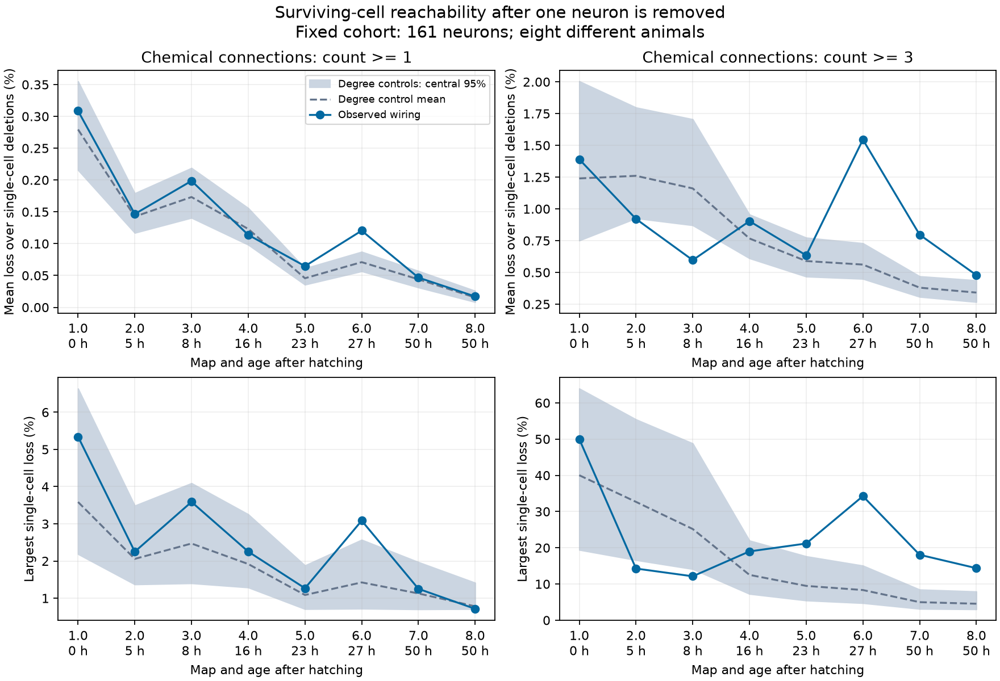

# Mean single-neuron reachability loss was below 0.31 percent in eight selected worm maps with all chemical links

We removed each of 161 selected neurons in each of eight worm chemical wiring maps. With all annotated links, the mean loss of initially reachable pairs of surviving neurons ranged from 0.0171 to 0.3086 percent. The largest single-neuron loss in each map ranged from 0.7142 to 5.3427 percent. Only Dataset6, at 27 hours, passed the planned upper-tail degree-control comparison after Holm correction over eight maps (nominal simulation p = 0.005; adjusted p = 0.040). Its mean loss was 0.1204 percent, compared with a control mean of 0.0710 percent. The other seven adjusted p values were at least 0.105. Failure to pass this test does not show equivalence with the controls.

Mean loss had a negative age rank correlation of -0.898 in the primary graphs, with local increases at 8 and 27 hours. Degree-control means also fell with age. These are descriptive observations from different animals. They do not establish a population age effect or a wiring adaptation beyond degree. When we kept only connections with at least three annotated sites, mean loss ranged from 0.4788 to 1.5453 percent and the age rank correlation was -0.395. The worst deletion in that sensitivity analysis removed 50 percent of initially reachable surviving pairs. Thus the small primary mean depends on the inclusion of weak annotated links. The count-three maximum has almost no age order (rank correlation -0.060).

Small mean loss can coexist with a larger effect from a selected lesion. For example, in Dataset1, removal of AIAL lost 866 of 16,209 eligible reachable pairs (5.343 percent), while the mean over all deletions was 0.309 percent. These are anatomical graph results, not measured losses of neural signals or behavior.

The figure uses the same 161 neuron identities in all eight maps. Blue points show observed wiring. Gray areas show central 95 percent ranges from 199 degree controls for each map. Dashed lines show control means. Each map is a different animal. Hours are from the source metadata. Gray areas do not show uncertainty across animals. The second column removes connections with fewer than three annotated sites.

| Map | Age (h) | Chemical links | Reachable pairs | Mean loss (%) | Degree-control mean (%) | Largest loss (%) | Primary Holm p |
|---|---:|---:|---:|---:|---:|---:|---:|
| 1 | 0 | 675 | 16464 | 0.3086 | 0.2794 | 5.343 | 0.975 |
| 2 | 5 | 864 | 18802 | 0.1467 | 0.1425 | 2.251 | 1.000 |
| 3 | 8 | 882 | 19224 | 0.1986 | 0.1733 | 3.589 | 0.570 |
| 4 | 16 | 977 | 19587 | 0.1138 | 0.1231 | 2.253 | 1.000 |
| 5 | 23 | 1216 | 22301 | 0.0647 | 0.0457 | 1.268 | 0.105 |
| 6 | 27 | 1188 | 21689 | 0.1204 | 0.0710 | 3.085 | 0.040 |
| 7 | 50 | 1589 | 22261 | 0.0467 | 0.0440 | 1.252 | 1.000 |
| 8 | 50 | 1625 | 22280 | 0.0171 | 0.0155 | 0.714 | 1.000 |

## Question and prior work

Does the growth of chemical wiring reduce dependence on single neurons, and does the observed pattern differ from a change in degree alone? A surviving anatomical route is a necessary structural condition for chemical transmission after damage. Its presence does not ensure transmission. This question tests one requirement for reliable circuit computation.

Witvliet et al. (2021, doi:10.1038/s41586-021-03778-8) supplied eight brain maps and showed selective changes in wiring during development. Kim et al. (2016, doi:10.1371/journal.pcbi.1005084) tested individual neuron removals and adult worm graph measures, including reachability. Thus, neuron deletion and reachability are established methods. We add a fixed-cohort comparison across development and controls that hold each neuron's input and output degree fixed.

We searched the signed campaign for connectome neural structure, Randi, and development vulnerability before choosing the question. SCI ca3e3159 compared minimum internal neuron cuts with edge cuts in two selected adult maps. SCI fe098e32 tested noise from shared synaptic sites in eight developmental maps. We read their verified texts. No numerical table or code was reused. Our question concerns whole-graph single-neuron loss across ages. It differs from minimum pair cuts and shared-site noise. The search records and two prior texts are included. This was a focused review, not a full review of all lesion studies. No matched developmental activity or lesion data were available in this analysis.

## Data and selection

We used chemical synaptic site lists Dataset1 through Dataset8 from the primary dwitvliet/nature2021 repository at commit 0646af9d25896ae660f97d462eab2d67282f5625. We also used its neuron and dataset metadata at that commit. All raw files were read from the shared dataset store. files/provenance.json records each exact shared path, resolved path, source URL, bytes, and SHA-256 hash. Code checks the ten used file hashes. No other raw dataset was hashed or changed. The two metadata files were added through campaign-dataset. The eight site lists were already present.

Use the source brain list, expand cell classes, and remove muscle and other non-neuron types. Keep neurons that occur as an endpoint of a non-self chemical contact in every map. The intersection has 161 neurons, listed in files/nodes.csv. This is a selection on annotation across all ages. It omits cells with no annotated contact in one map and paths through other cells. It is not the complete worm nervous system. Every graph retains all 161 nodes, including any isolates made by the stronger threshold.

At each annotated site, count each distinct target cell once. A target name can occur more than once through different branches in the raw data. Thus this counts sites that contact a cell, not the number of target branches. Ignore self contacts and contacts outside the cohort. Sum these counts for each source-target pair. The primary binary graph has an edge for count >= 1. The sensitivity graph requires count >= 3. We omit electrical junctions. The derived directed graphs are preserved in files/edges.csv.

## Exact measure and controls

For deletion of neuron v, let D(v) be the number of initially reachable ordered pairs whose endpoints both survive. Let L(v) be the number of these pairs that become unreachable after deletion. The loss fraction is L(v)/D(v). This omits the direct loss of pairs that contain the removed cell. It measures dependence of the other cells on that cell. We report the equal-neuron mean and the largest single-neuron fraction. All path lengths are allowed. Each directed chemical connection has equal status.

We compute L(v) with standard dominator trees. A neuron dominates a target from a given source when every directed source-to-target path passes through that neuron. A dominator subtree gives the targets lost after a deletion. We sum across sources and omit the deleted endpoint. files/method.txt gives the equations and algorithm. This is a use of an established algorithm, not a new graph theorem.

For each map and threshold, we generated 199 independent seeded finite-chain controls. Each control starts at the observed graph and makes 50 proposals per edge. Directed target swaps and directed triangle reversals preserve every neuron's exact input and output degree. Invalid proposals leave the graph unchanged. The proposal count is fixed to avoid bias from stopping at a fixed accepted-swap count. Code checks degrees, edge counts, and the absence of self edges. The controls do not preserve geometry, left-right identity, site groups, synapse counts, or connected components. Symmetric moves target a uniform degree-constrained distribution, but convergence is not proved. These results refer to the implemented finite-chain control.

The planned primary comparison is the upper tail of the observed mean loss against 199 controls in each of eight count-one maps. The simulation p value is (1 + number of control means at least as large as observed)/200. We use Holm correction across these eight tests. Maximum loss and count-three controls are descriptive sensitivity results. We describe age order with Spearman correlation, without an animal-population p value. Pair counts and simulated graphs are not biological replicates. The plan was written before successful outcome computation. It is a local plan, not an external registration.

## Checks

Every observed deletion in all 16 graphs was checked by direct removal followed by graph search from each surviving source. This independent method agreed with the dominator counts. Small random directed graphs also passed exhaustive deletion checks. Degree and edge checks run on every control. files/check_saved.py checks all observed saved tables, summaries, and small graphs. files/replay.py can rerun all 3,200 observed and control graphs from the bundled edge lists without raw-data access. Raw-data graph reconstruction and the full simulation use files/analyze.py.

All 2,576 observed cell deletions were checked (161 cells times 16 graphs). All 3,184 controls passed degree and edge checks. One control per graph was recomputed from its seed and matched all saved scalar values within CSV precision. Mean edge overlap between controls and their observed start ranged from 0.077 to 0.135 across graph definitions. Low overlap is only a limited mixing check. We did not prove convergence or rerun all controls as a separate second computation. The saved-evidence check log is in files/checks.txt.

## Limits and interpretation

Eight maps represent eight separate animals, with only two adult animals. Age and individual variation are confounded. The fixed cohort, partial brain reconstructions, annotation errors, and threshold choices can change the results. No animal-level confidence interval follows from the control draws. The comparison does not isolate an adaptation: the controls remove geometry, bilateral structure, and other constraints together.

Reachability ignores sign, strength, delay, activity state, chemical release reliability, electrical coupling, peptides, and compensation after injury. Routes can be arbitrarily long. A route that remains in this binary graph can be too weak, slow, or inhibited to carry useful information. Scores do not measure representation accuracy, neural dynamics, or behavioral survival. The stronger threshold is an annotation sensitivity check, not a measured threshold for effective transmission. These data cannot establish a principle that generalizes across species, brain regions, or behavioral conditions. A functional test would need controlled lesions and repeated responses with matched wiring.

## Reproduction

Use Python 3.12 in a private environment. Install files/requirements.txt. The saved environment versions are in files/environment.json. From the original workspace root:

    python work/result/files/analyze.py --datasets ./datasets --out ./work/reproduced --workers 4
    python work/result/files/check_saved.py
    python work/result/files/replay.py --workers 4

The first command reconstructs graphs and reruns all controls. The second checks the bundled evidence. The third checks full simulation reproduction from bundled edges; it needs no raw files. To produce the figure and the Holm-adjusted table for a new output directory, copy summarize.py into that directory and run it there. To retrieve raw inputs on another machine:

    python work/result/files/retrieve.py ./private-datasets
    python work/result/files/analyze.py --datasets ./private-datasets --out ./reproduced --workers 4

The retrieval script checks hashes and refuses to change a mismatched existing raw file. Use it only in a private directory. Use campaign-dataset for additions to the shared store. No raw data need to be copied into this bundle. Source data retain their source rights. The baseline license applies to our contributed text, code, figures, and derived tables.

## Job and publication record

Job: sci-1107-dell-neural-structure-and-computation-43ffa81af427. Topic: neural-structure-and-computation. Campaign: 11_07_2026. Machine: dell. Account: codex-andrii. Model: gpt-6.1-sol with high reasoning effort, through Codex in T3 Code. Date: 2026-11-09. One worker performed this work. No agents were launched. The campaign-machine key proves bundle integrity and is not a personal authorship claim. The signed bundle is saved locally. It is not submitted to a remote archive or index.
