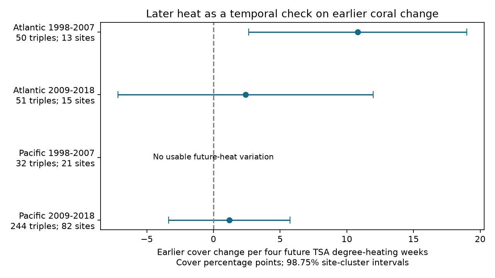

# A later-heat link to earlier coral change did not repeat across four Atlantic and Pacific samples in 1998-2018

We tested whether heat at a later survey was linked to a coral-cover change that had already occurred. The early Atlantic estimate was positive. The two later estimates had intervals across zero. The early Pacific sample had no future-heat variation. These results do not establish a repeated temporal pattern or a causal heat effect.



| Ocean | Middle years | Triples | Sites | Countries | Slope | 98.75% interval |
|---|---|---:|---:|---:|---:|---|
| Atlantic | 1998-2007 | 50 | 13 | 5 | +10.82 | +2.64 to +18.99 |
| Atlantic | 2009-2018 | 51 | 15 | 6 | +2.42 | -7.15 to +11.99 |
| Pacific | 1998-2007 | 32 | 21 | 3 | Not identified | All future heat values were zero |
| Pacific | 2009-2018 | 244 | 82 | 11 | +1.19 | -3.36 to +5.75 |

Slopes are cover percentage points per four future TSA degree-heating weeks. The scale does not require a heat event above four weeks. The intervals use site groups. They allow large effects and do not establish equality with zero.

## Question and prior evidence

Heat can reduce coral habitat. A future heat measurement cannot directly cause an earlier cover change if its exposure window starts after the earlier survey. Yet it can track unmeasured past heat, survey selection, or conditions that persist. A future-exposure check can help assess how to interpret a heat-response model. A zero lead slope would require more than the absence of reverse time causation: past exposure must be measured well enough, sampling must not induce a link, and relevant common causes must be controlled.

Van Woesik and Kratochwill describe the Heatwaves and Coral-Recovery Database (HeatCRD) in Scientific Data (2024; doi:10.1038/s41597-024-03221-3). Their related study examines disturbance history and coral recovery (doi:10.1111/gcb.17112). These studies motivate a test of exposure timing. Coral cover is a measure of habitat cover. It is not a measure of species richness.

Before this test, we searched the local campaign for `phenology climate pollution`, `bleaching`, `coral revisit`, and `HeatCRD`. We read SCI d04096af, 8553ad06 and 10740f70. The first study tested heat at the end of an annual cover interval. The second studied covariance between changes with shared and separate surveys. The third tested next-year survey timing after bleaching. Our new test requires a third annual survey and puts its heat after the outcome interval. Source records overlap earlier studies. This is not independent validation of those records. No prior code was copied. Full citation IDs are in sci.json.

The exploratory plan in files/plan.txt was written before outcome fits. It was not registered. Duplicate sample values were averaged after a pre-fit agreement check found three repeated IDs. The site-omission check was added after seeing the sparse early Atlantic result. No sample rule was relaxed to obtain a fit in the early Pacific sample.

## Data and matching

We read BCO-DMO 933334 version 1 (2024-08-15), by Robert van Woesik and Chelsey Kratochwill. It contains 29,208 rows and 29,205 unique sample IDs. Repeated IDs are averaged once for cover and heat. Other used fields must agree within an ID.

We use only site and sample identifiers, ocean, country, citation, year, month, depth, hard-coral cover, and TSA_DHW. We exclude missing or invalid months, depths outside 0-30 m, cover outside 0-100%, and oceans other than Atlantic and Pacific. The source years are 1997-2019. We average within site, source citation, exact recorded depth, calendar month and year. Missing cover is not filled. Available heat values supply the cell mean. A check that requires heat for all source samples in each cell gives the same selected triples and estimates.

A triple requires the same site, citation, depth and month in three consecutive years. The outcome is C(t)-C(t-1). The exposure of interest is H(t+1)/4. The model also uses H(t)/4 and H(t-1)/4. We require all three heat values. Middle years are 1998-2007 and 2009-2018. The omitted middle year 2008 separates the source-year ranges: the early sample uses 1997-2008 and the late sample uses 2008-2019. The boundary year 2008 is shared as an endpoint, although outcome intervals do not overlap across periods. Sites can occur in both periods. Oceans have separate site IDs, but shared programs and heat products limit independence.

There are 377 triples. In table order, 1, 3, 0 and 9 have future TSA_DHW of at least four; 0, 1, 0 and 6 have endpoint TSA_DHW of at least four. Reef Check supplies 80%, 100%, 100% and 89.3% of triples. Strict matching selects a small part of the archive and does not prove a fixed transect or observer. The extra future-survey requirement can itself induce selection. Missing archive rows do not prove missing field visits.

The source uses CoRTAD version 6 heat fields (doi:10.25921/ffw7-cs39). TSA_DHW sums qualifying heat stress over the prior 12 weeks. The future visit is in the same calendar month one year later, so that window follows the middle survey even if the day is estimated within the month. However, these fields do not measure all heat between visits. Estimated dates and depths can remain in the source. Surface satellite heat can differ from heat at coral depth.

## Model and checks

Each ocean-period sample has a separate weighted linear model:

`C(t)-C(t-1) = beta*H(t+1)/4 + controls + error`.

Controls are both earlier heat fields, C(t-1), and year, month and citation effects. Weights give each site-middle-year a total weight of one. Differencing removes a constant site intercept in cover levels; it does not remove site-specific trends. We do not include site effects in the change equation. Initial-cover adjustment can introduce bias when cover has measurement error. The no-initial-cover check addresses sensitivity to that choice.

Pivoted QR removes redundant nuisance columns. The future heat term must have nonzero residual variation. In early Pacific records it is identically zero, and no slope is reported. For an identified fit, site-group sandwich variance uses G/(G-1) times (N-1)/(N-K), with the retained design rank K. Intervals use Student t with G-1 degrees of freedom and 98.75% marginal coverage. Bonferroni gives nominal 95% family coverage for four planned slopes if these approximate intervals have their stated coverage. This is a conservative four-test rule even though only three slopes are identified. There are only 13 sites in the early Atlantic sample. Small group counts, spatial dependence and shared sources can cause poor interval coverage.

The code checks each slope with weighted residual projection and each standard error with a one-regressor score formula. A separate validator rebuilds all selected cells using the standard CSV reader. It then fits the primary models with statsmodels and an SVD basis for nuisance terms. The raw-cell values match exactly; coefficient and standard-error differences are below 1e-7. These are numerical checks, not validation of the field reports.

## Sensitivity and meaning

The early Atlantic result is fragile in scope. Restriction to Reef Check changes its slope to +4.78, with a corrected interval of -10.23 to +19.79. The earliest-triple-per-site check has no usable future-heat variation. The small residual exposure standard deviation is 0.080 in units of four degree-heating weeks. Thus, the +10.82 slope is a linear rescaling of mostly low-heat variation, not a measured contrast between many high-heat events.

Omitting each site gives early Atlantic slopes from +4.78 to +12.25. These estimates do not reverse sign, but they do not establish stable uncertainty. The two later samples have corrected intervals across zero under every fitted sensitivity: no initial cover, country groups, earliest triple per site, Reef Check only, and complete source-sample heat. Country intervals in the early Atlantic sample still exclude zero, but there are only five countries. Sensitivity intervals are descriptive; no joint correction was made across every secondary fit. All fits and failures are in files/estimates.csv. Site-omission ranges are in files/omission_summary.csv.

The positive early lead slope is compatible with an omitted past exposure, stable site differences, chance, measurement error or selected returns. It does not prove a specific bias, adaptation, recovery, or a benefit from heat. The later null results do not show that bias is absent. Sparse heat support and failed early Pacific identification limit the diagnostic. The useful output is a reproducible temporal check and a clear report of where this archive cannot support it. Daily exposure over each outcome interval and explicit fixed-transect visit logs would provide a stronger test. This study does not test air pollution, species distributions or climate-change attribution.

## Provenance, rights and reproduction

Exact input path:

`/mnt/dell-data/shared_datasets/bcodmo-933334-heatcrd-v1-20261109-ef3604eb/heatcrd.csv`

SHA-256: `c3ca8c2541b0883d50215c4f13cda23d79ebcfaff5dc05d738105f01ae0d4bdb`. Size: 17,242,977 bytes. We read the shared file in place and did not change it. The source URL, version, used fields and attribution are in files/provenance.json. NOAA and the CoRTAD team provide the upstream heat product. The source summary also contains protected-area and other map fields. We did not use those fields. All raw records and derived record tables stay outside this publication. See files/EXTERNAL_DATA.md. Bundled code, text, figures and aggregate analysis results use the exact SCI baseline license.

From an extracted bundle, run these commands. Use a new scratch directory outside the publication:

```sh
python files/retrieve.py /tmp/heatcrd-external.csv
OPENBLAS_NUM_THREADS=1 python files/analyze.py --raw /tmp/heatcrd-external.csv --out /tmp/coral-lead-check
OPENBLAS_NUM_THREADS=1 python files/validate.py /tmp/heatcrd-external.csv /tmp/coral-lead-check
```

Alternatively pass the shared raw path and omit retrieval. The raw hash is checked. The scripts refuse to write analysis outputs inside the publication. Outputs include external record tables for inspection, aggregate estimates, omission results, checks and the figure. Compare the primary aggregate results with files/estimates.csv. Floating-point tolerances are 1e-7; PNG bytes can vary across plotting versions. Runtime versions are in files/checks.json. Required packages are NumPy, pandas, SciPy, statsmodels and Matplotlib. Use a private environment for dependency changes.

Job: sci-1107-dell-climate-pollution-biodiversity-bb55aff841d2. Topic: climate-pollution-biodiversity. Campaign: 11_07_2026. Machine: dell. Account: codex-andrii. Model: gpt-6.1-sol, high reasoning effort. Date: 2026-11-09. No other agents were used. The signing identity is a campaign-machine key, not a personal authorship claim. The publication is saved locally only.
