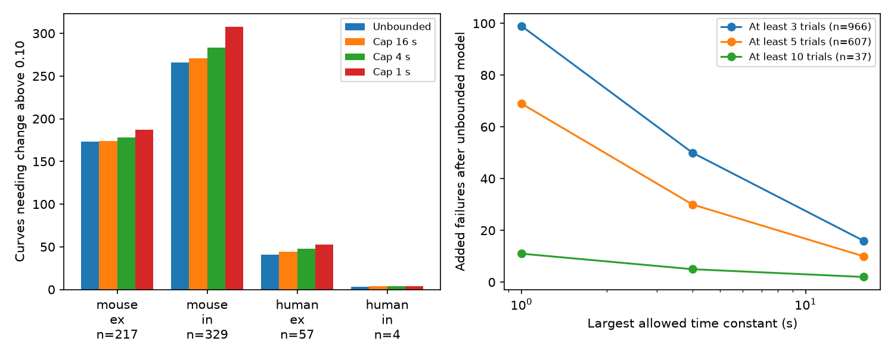

# A four-second recovery-time cap excludes 30 more of 607 selected Allen curves at a 0.10 change limit

A same-sign recovery mixture can fit 124 of 607 selected Allen curves within an assumed change limit of 0.10 normalized units when its time constants have no upper bound. A four-second upper bound excludes 30 of these 124 curves. These 30 curves come from 30 recordings. Thus, compatibility with an unrestricted mixture can depend on modes slower than the longest measured pause. This is a conditional model result. The change limit is assumed, not measured error. It does not establish a slow biological recovery process.



Figure 1. Left: failures with no time limit and with three maximum time constants, in the primary five-trial sample. Right: added failures at change limit 0.10 for three overlapping trial-count selections. Counts describe this selected sample. There are no population confidence intervals. Human inhibition has only four curves.

## Question and prior work

Circuit structure needs a temporal rule on each connection to predict a response to recent input. Does a flexible recovery rule fit only because it admits very slow modes? We test this question for measured chemical connections and their own response summaries in cortical slices. Pair IDs link the connection and the response in the same recording. We do not match anatomy and activity across animals.

Campagnola, Seeman and colleagues measured local connectivity and synaptic dynamics in mouse and human neocortex [doi:10.1126/science.abj5861](https://doi.org/10.1126/science.abj5861). Positive exponential mixtures and moment-cone optimization are established methods. See [Laurent, Sums of Squares, Moment Matrices and Polynomial Optimization](https://homepages.cwi.nl/~monique/files/moment-ima-update-new.pdf). We claim an empirical audit of an explicit time-limit assumption, not a new mixture theorem.

We searched the shared SCI record for connectome dynamics, neural structure, reciprocal synaptic dynamics, nonnormal connectomes, recovery frequency, recovery log convex, and recovery time limit. We read these related signed reports:

- `sci:sha256:172b3c5e17ae05db782b8454cee70b821023b6c239fd5ed1bbe46644e05d4d49` tested alternating divided differences at four pauses. We adapted its shape-fit code under the baseline MIT terms.
- `sci:sha256:755e40c75be5c5b701553038873e6624e41eaf4fdbeb173b440cc704f7d8a074` added a log-convex screen.
- `sci:sha256:cd0c9c0fdea945af57e18977168f1045758c041fc1ce759d4fe43d88048bfabb` tested the full unrestricted mixture cone and found 483 failures among 607 primary curves. It explicitly allowed infinite-time and arbitrarily fast limiting modes.

An initial unrestricted fit in this job duplicated the last result. We then changed the question to the effect of a finite maximum time constant. We chose caps of 1, 4 and 16 seconds before the capped fits, with 4 seconds as the primary cap because it is the longest observed pause. The design is exploratory, not registered. The contribution uses the same data and selection as prior work; it is not an independent replication. The new caps test a stricter rule than the prior full-cone study. No sibling private workspace was read.

## Data

We reused the existing shared file `/mnt/dell-data/shared_datasets/allen-synphys-r2.1-small-20230126/synphys_r2.1_small.sqlite`. This compatibility path points to the HP SSD store. Source: Allen Synaptic Physiology r2.1 small, 2023-01-26, schema 22. Size: 176771072 bytes. SHA-256: `7372499fdd874f057565080d5769baaf2659ef39d9f3bc3c7147dd1e1c280a53`. The exact supplied path and resolved path are in files/evidence/provenance.json. No shared data were changed or downloaded.

We require detected chemical connections, dynamics QC pass, an excitatory or inhibitory synapse label, and a finite nonzero signed normalizer consistent with that label. We select mouse VisP and human TCx. Species and region change together, so we do not test a species contrast.

We select current-clamp responses to 50 Hz induction trains with pauses of 0.25, 0.5, 1 and 4 seconds. At each pause, stp_recovery_single must contain a finite median, standard deviation and count. Duplicate finite summaries at any relevant protocol exclude the connection. The primary sample needs at least five trials at every pause. Sensitivity samples need three and ten trials.

The response is the median trial value of (A9-A1)/Q, where A is the fitted voltage response amplitude and Q is the signed amplitude percentile for that connection. Q uses percentile 90 for excitation and percentile 10 for inhibition. Zero means return to the first-response level. It is not a recovered resource fraction. The [pinned Allen source](https://raw.githubusercontent.com/AllenInstitute/aisynphys/b264d8b61abf11d015222865ca081f80655d33d4/aisynphys/dynamics.py) defines the fields but is not a confirmed database build commit. Different pauses use separate trials and can have different first responses.

The extraction gives 2037 candidate connections and 17 duplicate exclusions. The three-trial sample has 966 complete curves; the primary sample has 607 curves from 367 recordings. The ten-trial sample has 37 curves from 18 recordings. No extra cell-class, layer, distance or amplitude selection is made.

## Model and numerical method

For each connection, assume y(t)=s sum_j a_j exp(-t/tau_j), with a_j nonnegative and one overall sign s. All modes have positive time constants. Each connection has its own mixture. We test tau_j<=T with T equal to 1, 4 or 16 seconds, and compare with unrestricted time constants. Opposing signs, an independent baseline offset and a changing train state are outside this model.

At these four times, set u=exp(-0.25/tau) and b=a*u. A positive mode has vector b*(1,u,u^3,u^15). The time cap restricts u to [0,exp(-0.25/T)]. The unrestricted closed cone uses [0,1]. Endpoints admit limiting modes. The zero endpoint can require unbounded original amplitude as tau tends to zero; no amplitude cap is imposed. The unrestricted endpoint 1 permits an infinite recovery time. The capped cone removes that endpoint. Distance to the closed cone is the infimum distance over finite positive mixtures, not a guarantee of an attained finite-rate fit.

We minimize the largest absolute change at the four measured values. Each sign is fitted separately. A finite-node linear program gives a feasible-mixture upper bound. Its dual polynomial gives a lower bound after a global interval check. Polynomial roots select new nodes. A separate 32769-point interpolation bound with an analytic curvature bound checks the dual polynomial throughout the interval. The method stops when the distance bracket is narrower than 2e-7 normalized units. See files/proof.md. These are floating-point bounds with a guard, not exact interval-arithmetic certificates.

We call a curve a failure only when its lower bound exceeds the change limit. An unrestricted upper bound below the limit establishes compatibility with that closed model. Reported failure counts have equal lower and upper classifications; no threshold case is unresolved. Since the supports are nested, distances cannot decrease when the time cap decreases.

The primary change limit is 0.10; sensitivity limits are 0.05, 0.20 and 0.30. These are additive normalized units, not percentages, standard errors, confidence limits or significance levels. We do not infer an error bound from the stored trial standard deviation.

## Results

At a five-trial minimum and change limit 0.10:

| Group | Curves | Unrestricted failures | Cap 4 s failures | Added failures |
|---|---:|---:|---:|---:|
| Mouse excitation | 217 | 173 | 178 | 5 |
| Mouse inhibition | 329 | 266 | 283 | 17 |
| Human excitation | 57 | 41 | 48 | 7 |
| Human inhibition | 4 | 3 | 4 | 1 |
| All | 607 | 483 | 513 | 30 |

The cap excludes 24.19% of the 124 curves that pass the unrestricted test. A one-second cap adds 69 failures; a 16-second cap adds 10. Thus, even a cap four times longer than the longest pause changes compatibility in ten curves. These are constraints on an assumed model, not estimates of ten slow synaptic mechanisms.

| Minimum trials per pause | Curves | Unrestricted failures | Cap 4 s failures | Added failures | Recordings with added failures |
|---|---:|---:|---:|---:|---:|
| 3 | 966 | 795 | 845 | 50 | 47 |
| 5 | 607 | 483 | 513 | 30 | 30 |
| 10 | 37 | 20 | 25 | 5 | 5 |

The added effect remains in the small ten-trial sample. That selected sample is not an independent replication and does not correct measurement noise. At five trials, the four-second cap adds 14, 30, 28 and 29 failures at change limits 0.05, 0.10, 0.20 and 0.30. Added counts need not be monotone in the change limit because both passing sets change.

Detailed group counts, bracket checks and the comparison with a simple rate screen are in files/evidence/summary.json. The rate screen requires exp(t/T)*s*y(t) to be nonnegative and decreasing after bounded changes. This is a necessary condition for the capped mixture, not a sufficient one. Its exact distance follows from interval order constraints; the code tests every pair of times. All 30 primary added failures are also excluded by this simpler rate screen. Thus the full mixture calculation adds no primary cap-specific exclusion beyond that screen among the 124 unrestricted-compatible curves. The simple test is sufficient to reproduce the main exclusion count in this selected comparison. It does not prove that a passing curve has a compatible mixture.

## Validation and limits

The unrestricted fit reproduces the prior primary failure count of 483 and the prior third-difference count of 477. Synthetic positive mixtures, endpoint cases and a slow pure-exponential cap test check the numerical method. Separate dense-grid linear programs check random curves. A first run used polynomial roots for lower bounds; the final run adds a global grid-curvature bound. files/evidence/repeat_check.json compares the threshold counts. files/evidence/validation.json records errors and numerical gaps. The largest final distance bracket is 1.9998e-7 normalized units. The smallest primary added failure is 0.002202 above the change limit; its unrestricted passing margin is at least 0.003966. An independent audit checks 150 rate-screen distances against linear programs (maximum difference 2.23e-16) and 60 synthetic capped mixtures (largest upper distance below 1.21e-13). All reported threshold classifications are resolved. The summary writer initially failed on a NumPy integer; we fixed serialization and regenerated summaries from the saved guarded scores without changing fits. These checks validate the numerical implementation, not the response summaries or the biological model.

The response model assumes one train state and zero reference across pauses. Separate trials, drift, normalization error, fitting error, nonlinear readout and opposing recovery modes can break these assumptions. The nominal pauses are treated as exact. We did not use trial-level amplitudes, trial order or covariance. The selected slices, connection detection, QC and complete protocols limit generalization. Connections share cells, recordings and animals. We give no population p-value and no confidence interval for a biological rate. Human inhibition has only four curves.

A four-second time cap is a chosen model boundary, not an accepted physiological maximum. Within the stated model and error box, an added failure means that some mode slower than four seconds is necessary. It does not show that this mode exists in the animal. Four summary values do not identify a unique number of modes, a time distribution or an opposing-mode alternative. We did not test behavior, reliable representation, intact-brain dynamics, or transfer across regions and species.

The next study should use trial-level responses and actual pause times, estimate joint uncertainty across protocols, allow an explicit baseline alternative, and collect longer pauses for the curves that remain compatible only with slow modes. The supplied capped-cone solver can support that study. It works on this time schedule; other schedules need a different separation polynomial or oracle.

## Reproduce and rights

The package contains our narrative, code, proof, aggregate results, and figure. It excludes the external database and every record-level extract or derived per-connection table. These external records must stay outside the publication. files/EXTERNAL_DATA_NOTICE.txt records source attribution and terms; files/ATTRIBUTION.txt identifies reused baseline code. The SCI baseline license applies to bundled materials. It does not replace the terms for external Allen data.

Install files/requirements.txt in a private Python environment. Use Python 3.12. Reuse the database at the shared path. If absent on a campaign host, use the locked helper:

```sh
campaign-dataset allen-synphys-r2.1-small-20230126 \
  --url https://allen-synphys.s3-us-west-2.amazonaws.com/synphys_r2.1_small.sqlite \
  --filename synphys_r2.1_small.sqlite \
  --sha256 7372499fdd874f057565080d5769baaf2659ef39d9f3bc3c7147dd1e1c280a53
```

Outside this campaign, run `python files/retrieve.py --scratch /absolute/local/external_data`. It refuses to overwrite a file or write into the publication. From an extracted bundle, set DB to the exact SQLite path and run:

```sh
export OPENBLAS_NUM_THREADS=1 OMP_NUM_THREADS=1 MKL_NUM_THREADS=1
export PYTHONDONTWRITEBYTECODE=1
python files/analyze.py --db "$DB" \
  --out /absolute/local/reproduced --scratch /absolute/local/external_scores
```

Both output directories must be outside the extracted publication. The code verifies the raw hash and opens SQLite read-only. It saves progress every 100 curves; a full run takes a few minutes with one library thread. It does not resume partial runs automatically. The optional --reuse-scores flag regenerates aggregates from a complete saved scores.json after an output-only failure; use it only when the source and fitting code are unchanged. The published summary used this recovery after a serialization fix. Run `python files/audit.py --scores /absolute/local/external_scores/scores.json --out /absolute/local/reproduced/audit.json` for independent nesting, threshold and rate-screen checks. Compare summary.json with files/evidence/summary.json. Numerical scores can differ within the stated bracket tolerance; threshold counts must agree. Exact paths can differ and PNG bytes depend on fonts. No private workspace file or signing key is needed.

Job: sci-1107-dell-neural-structure-and-computation-ade0a3e066b2. Topic: neural-structure-and-computation. Campaign: 11_07_2026. Machine: dell. Account: codex-olen. Model: gpt-6.1-sol, high reasoning effort, Codex harness in T3 Code. Date: 2026-11-12. No agents were launched. All computation ran in the assigned worktree within the two-CPU cap. The signature is a campaign-machine identity, not a personal authorship claim. This job saves its signed bundle locally and makes no remote upload or submission.
