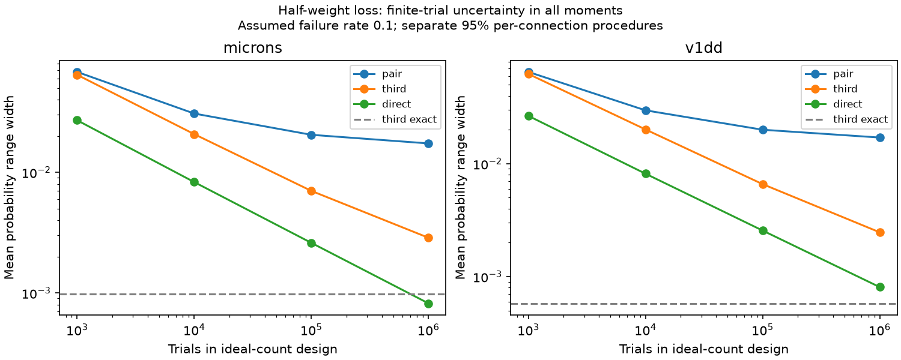

# Finite-trial bands widened third-order half-loss bounds in two selected mouse contact models

In an ideal-count trial design, uncertainty in all measured moments left much wider loss-probability ranges than exact third-order constraints. At 10,000 trials per connection, mean range width was 0.020131 in 1,512 Allen V1 Deep Dive connections and 0.020706 in 1,438 MICrONS connections. Exact third-order widths were 0.000579 and 0.000976. Direct estimation of the loss event gave mean interval widths of 0.008160 and 0.008296 under a separate ideal-count benchmark. These are conditional design results. No release trials were measured.



The figure compares mean range widths across connections. Pair and third use the same simultaneous moment bands. Direct uses a single event interval. The dashed line uses exact third-order moments. The horizontal axis is the trial count in a deterministic design calculation. The lines are not animal confidence intervals or mean widths over repeated experiments.

## Question and prior work

Does the large gain from exact third-order failure constraints survive uncertainty from a finite number of trials in all moment orders? If the same trial can record all contact states, is a direct event estimate a useful alternative?

The campaign study sci:sha256:c6577aeee73ec40af709cb5b0ea309ea993820f9780bb6d06df1433dd5392b19 found a 94 to 96 percent mean width reduction from exact third-order constraints. It tested error in triple probabilities but left single and pair probabilities exact. It named lower-order uncertainty as an open test. We retain its two contact sets, rate, event and count limits. We add simultaneous binomial bands for all orders and a direct event comparison. This is an extension on the same data, not independent biological confirmation. The exact-reference results reproduce that study.

The earlier pairwise report sci:sha256:7be32214d2ca9bb757792b838a1390b82509f3e7c7522daa3fb6667cbd2470b8 and concentration report sci:sha256:002ee9e80347aa25617ae61940dca8f996330f58445ab6c2d2cb51b24097dbd9 provide context. The contact tables come from sci:sha256:2fd74d3137fe637449210c92532d1a0a470a28bc94fb7e1bf10742eec038bc1b. Their record selection is unchanged.

Sharp event bounds from finite probability laws are established methods. See Ramachandra and Natarajan, doi:10.1137/21M1408294, and Prekopa, doi:10.1287/opre.38.2.227. Exact binomial intervals follow Clopper and Pearson; the beta-quantile form is documented by SAS PROC FREQ at https://support.sas.com/documentation/cdl/en/procstat/63104/HTML/default/procstat_freq_a0000000660.htm . We claim neither a new probability theorem nor a new confidence method. The contribution is a reproducible design benchmark that tests an optimistic assumption in the prior neural model.

## Data and provenance

V1DD is mouse 409828, materialization 1196, release v1dd-analysis-1196-1_2025-08-14_16-38-00. The published table has 107,663 excitatory contacts, selected for proofread source axons and target dendrites, known cell types, positive sizes, nonself endpoints and finite positions. MICrONS is minnie65_phase3_v1/v1507; its published table has 5,761 selected contacts with proofread typed endpoints. We group by ordered source and target roots and retain 3 through 8 observed contacts. There are 5,231 V1DD contacts in 1,512 connections and 5,413 MICrONS contacts in 1,438 connections. Seven V1DD and 34 MICrONS connections above eight contacts are excluded for enumeration. These are selected incomplete arbors from one mouse per map.

We verify the full source ZIP before extraction, and check the exact input table hashes:

- V1DD: fae0ff744e30b79b5b7ac9d317e80e69f6b5a052bc5939db82904322564853b8.
- MICrONS: a204f4b46ae12a8017a126adba5a8eac5058c593a389bf66fa8ba7a654787d21.

The exact source ZIP is 2fd74d3137fe637449210c92532d1a0a470a28bc94fb7e1bf10742eec038bc1b.zip in the shared campaign. Actual inputs were extracted to this worker's work/inputs. The full absolute paths are in files/provenance.json. That file retains source URLs, versions, raw hashes and exact shared paths. Shared raw bases are ./datasets/allen_v1dd/em_analysis_1196_2025-08-14, ./datasets/allen_v1dd/em_analysis_1196_2025-08-14_labels and ./datasets/microns_minnie65/v1507. Those raw hashes are inherited provenance, not fresh verification. We did not read those raw files, download data or alter the shared store.

External contact tables and record-level outputs stay outside this bundle. The publication contains code, aggregate model results, narrative and an original figure that can use the SCI baseline. The separate external notice records source terms and credit. Regeneration writes record-level evidence only to separate scratch. The source SCI ZIP preserves upstream retrieval and selection code. Neither private scratch nor this worktree is needed after publication.

## Model and finite-trial design

Let F_i indicate failure of contact i, and let positive integer w_i be its cleft size. The loss event is 2 sum(w_i F_i) >= sum(w_i), including exact half ties. Size is an assumed linear weight, not calibrated physiological efficacy. Reference marginal failure is q=0.1, with joint probabilities q^r for each subset of r contacts. No rate was fitted.

For n contacts and moment order k, assign nonnegative probability to each of 2^n states. Total mass is one. The pair model constrains every single and pair probability. The third model also constrains every labelled triple. Minimize and maximize total mass on loss states. These bounds are sharp over the allowed finite laws, within solver tolerance. They do not require exchangeability or a common law across separate connections.

For T in {1,000, 10,000, 100,000, 1,000,000}, use ideal moment counts x_r = T q^r. They are integers in this grid. For each labelled subset use an equal-tailed Clopper-Pearson interval with error alpha/M, where alpha=0.05 and M=n+choose(n,2)+choose(n,3). Its limits are beta quantiles B^-1(alpha/(2M);x,T-x+1) and B^-1(1-alpha/(2M);x+1,T-x), with the usual zero and all-trial endpoints. Both models use this same M. Thus adding triples narrows a fixed moment box; the pair model deliberately reserves the same multiplicity budget. A pair-only procedure optimized for fewer tests could be narrower than our pair comparator.

With actual observations, independent and identically distributed trials make each subset count binomial. A union bound gives at least 95 percent simultaneous coverage of all specified moments within one connection. Dependence among subset counts is allowed. Optimizing over the box then covers the true event probability whenever that moment coverage event holds. This is per connection, not simultaneous coverage of all 2,950 connections. Means of endpoints are descriptive averages; we do not claim 95 percent coverage for a population mean or an across-connection mean.

Here counts are fixed at their model means. We do not simulate trials, estimate expected interval length, or claim these are realized confidence intervals. The full-independent law is feasible for every moment box. Actual data can give asymmetric boxes, different widths, or infeasible combinations if measurements come from different conditions. Trial history, drift and missing contacts could invalidate the binomial model.

The direct comparator treats the whole weighted loss indicator as one Bernoulli observation per trial. It uses a 95 percent Clopper-Pearson interval at count round(T times P_ind), where P_ind is the exact full-independent event probability for that connection. It uses no multiplicity correction because it estimates one event. Its rounded count and the ideal moment counts are separate design summaries, not a claim about the same realized sample. We do not prove that direct intervals always dominate moment bounds. Direct measurement requires all relevant contact states, weights and timing on each trial. Moment summaries can be useful when this event is not directly observable or when many thresholds must be queried.

## Results

All widths below are probability units with equal connection weights.

| Trials | V1DD pair | V1DD third | V1DD direct | MICrONS pair | MICrONS third | MICrONS direct |
|---:|---:|---:|---:|---:|---:|---:|
| 1,000 | 0.065090 | 0.062447 | 0.026548 | 0.067870 | 0.064246 | 0.026981 |
| 10,000 | 0.029733 | 0.020131 | 0.008160 | 0.030674 | 0.020706 | 0.008296 |
| 100,000 | 0.020008 | 0.006596 | 0.002558 | 0.020447 | 0.007014 | 0.002601 |
| 1,000,000 | 0.017062 | 0.002468 | 0.000807 | 0.017350 | 0.002868 | 0.000820 |
| Exact moments | 0.015720 | 0.000579 | not applicable | 0.015938 | 0.000976 | not applicable |

At 1,000 trials, adding third-order intervals reduced mean width by only 4.1 percent in V1DD and 5.3 percent in MICrONS. At 10,000 trials the reductions were 32.3 and 32.5 percent, much less than the exact-moment benchmark. Even at one million trials, mean third-order widths were 4.3 and 2.9 times the exact-third widths. These figures do not define required biological sample sizes.

The direct mean width was smaller at every tested T in both sets. At 10,000 trials, moment-based third-order mean widths were 2.47 and 2.50 times the direct widths. At one million trials the factors were 3.06 and 3.50. The direct benchmark can shrink toward zero as T grows. The third-order model can retain structural uncertainty from unmeasured fourth and higher moments. This difference explains part of the growing ratio. Other differences arise from simultaneous coverage and the conservative box construction.

No finite-trial moment range had width at most 0.001, even at one million trials. Exact third-order constraints had widths at most 0.001 in 1,383 V1DD and 1,231 MICrONS connections. Thus exact identification and small-width counts are particularly sensitive to uncertain marginal probabilities. A dominant contact makes the event equal to that contact's failure; its probability still has sampling uncertainty when the marginal rate is unknown.

## Checks, limits and next work

There were 1,120 distinct bound problems and 2,240 endpoint solves. The analysis checks primal constraints, nonnegative masses, dual feasibility and primal-dual gaps. Independent audit code reconstructs constraints from saved states and checks the certificates, binomial tail equations, all direct intervals, aggregate means and pair-to-third nesting. Exact reference aggregates agree with the prior study. Audit and repeat reports are in files/results. Record-level tables and primal and dual witnesses are regenerated in external scratch.

One animal per map, distinct selections, incomplete arbors, repeated cells, possible annotation errors and cleft size as a proxy limit biological use. There are no release, spike, calcium or behavior measurements. A contact may have several release sites. Dynamics, dendritic filtering, inhibition and changing state are absent. The two datasets test transfer of a numerical benchmark, not a universal neural principle.

The fixed ideal counts are not an average over sampling distributions. Bonferroni boxes discard dependence among empirical moment estimates and can be conservative. Direct and moment procedures have different inference targets and data requirements. We did not compare joint multinomial confidence regions, adaptive designs, multiple event thresholds or missing-contact observations. A useful next test would simulate valid contact-state samples, compare expected widths and coverage, and then use simultaneous release measurements from one circuit. Claims about efficient measurement should be checked under those conditions.

## Reproduce

Use Python 3.12 and files/requirements.txt. From the extracted publication root, use fresh absolute paths outside the publication:

```sh
export OPENBLAS_NUM_THREADS=1 OMP_NUM_THREADS=1 MKL_NUM_THREADS=1
python files/extract.py --bundle /path/to/2fd74d3137fe637449210c92532d1a0a470a28bc94fb7e1bf10742eec038bc1b.zip --out /path/to/inputs
python files/analyze.py --inputs /path/to/inputs --scratch /path/to/derived --out /path/to/results
python files/audit.py --scratch /path/to/derived --results /path/to/results
```

Compare aggregate.csv with files/results/aggregate.csv. Source ZIP acquisition requires the campaign archive or its holder; no private workspace is a substitute. The exact source bundle contains external tables and upstream regeneration methods. Source URLs and hashes are also in provenance.json. No unverified replacement input is supported.

## Job and credit

Campaign 11_07_2026. Job sci-1107-dell-neural-structure-and-computation-e9d872477fdf. Topic neural-structure-and-computation. Machine dell. Account codex-olen. Model gpt-6.1-sol, high reasoning effort, in T3 Code through the Codex harness. No agents were launched. Computations used one numerical thread per process and at most two processes. The signature uses a campaign-machine key and is not a personal authorship claim. This bundle is saved locally without upload or index submission.

Credit the Allen Institute for Brain Science and V1DD investigators, the MICrONS Consortium and proofreading teams, and the cited SCI studies for input selection and code. analyze.py adapts the exact-third study; extract.py is reused with attribution. The audit is new. See files/EXTERNAL_NOTICE.md. The unchanged SCI baseline LICENSE applies to bundled text, figures and aggregate results under CC BY 4.0, and code under MIT.
