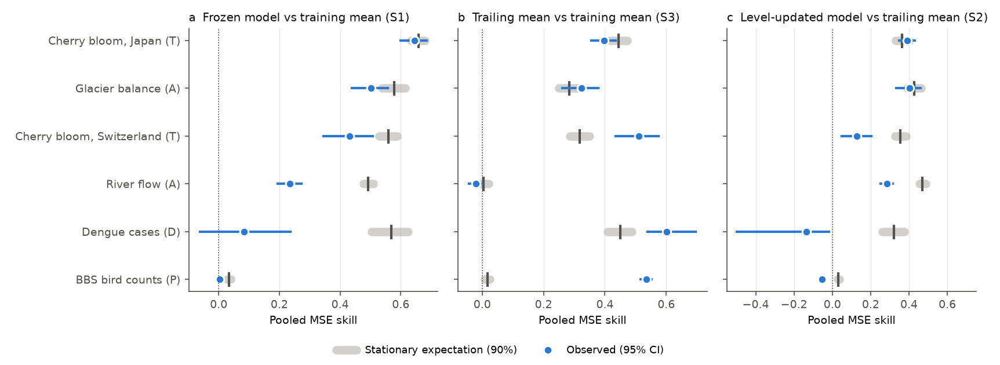
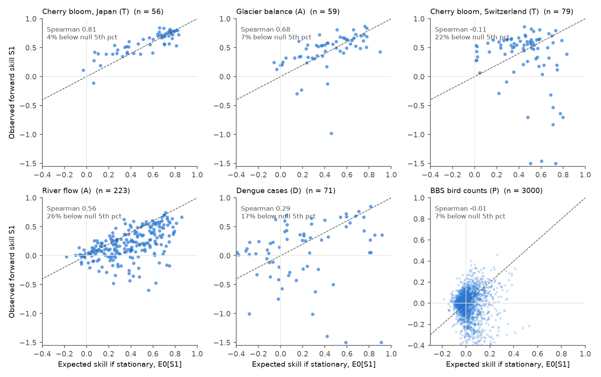
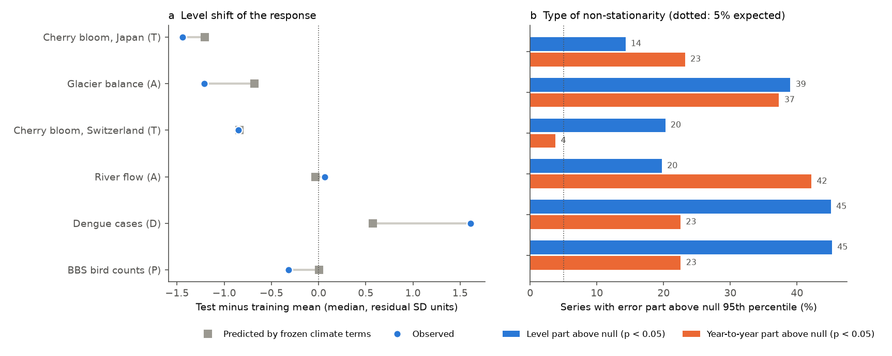

# Stationary expectations from training years matched forward skill for Japanese cherry bloom and glaciers; rivers, Swiss bloom, birds and dengue lost more from level and slope changes

Job `sci-1107-dell-climate-pollution-biodiversity-5570c0418d9a`, campaign 11_07_2026, topic climate-pollution-biodiversity, machine dell, model Claude Opus 5.5 (`claude-opus-5-5`). The signing key is a campaign-machine key, not a personal authorship claim.

## Question

Earlier campaign forward tests found that frozen climate-response relations keep skill for some systems and lose it for others. The campaign synthesis sci:sha256:17f2e323 found that the response class (abiotic, timing, population, disease) did not predict six new tests. It proposed two other properties: the training signal fraction and the stability of the response level. That proposal came from few, mixed tests.

We asked a more exact question. If a relation were stationary (the same intercept, slopes and residual process in later years), what forward skill would we expect from the training fit and the climate that later occurred? We call this the stationary expectation, E0. It uses only training data and observed later climate. Then:

1. Does E0 predict the observed forward skill, series by series and panel by panel?
2. Where the observed skill is lower than E0, does the loss come from a level shift or from a change in the year-to-year relation?
3. Does response class add information when E0 is known?

## Design (frozen before analysis)

We wrote `files/plan/frozen_plan.md` before we fitted any climate-response model. Its SHA-256 is `233c802065a8cd341c5969d1acc2b653bb9b623d04d5d109028c61119801857a`. A FreeTSA RFC 3161 timestamp (2026-11-11 05:39:11 UTC) is in `files/plan/frozen_plan.tsr`. Verify with `openssl ts -verify -data files/plan/frozen_plan.md -in files/plan/frozen_plan.tsr -CAfile files/plan/cacert.pem -untrusted files/plan/tsa.crt`. Before the plan we looked only at data structure (series counts per split year, file formats, grid coverage).

Six panels used one common pipeline:

| Panel | Class | Response | Series | Train | Test |
|---|---|---|---|---|---|
| GLAC | A | WGMS annual glacier mass balance, Northern Hemisphere | 59 glaciers | 1960-1999 | 2000-2024 |
| RIVR | A | log water-year mean flow, Canadian RHBN-N gauges (HYDAT) | 223 gauges | 1960-1999 | 2000-2024 |
| CHJP | T | cherry peak-bloom day, JMA sites | 56 sites | 1953-1995 | 1996-2021 |
| CHCH | T | cherry peak-bloom day, MeteoSwiss sites (Swiss phenology was tested before) | 79 sites | 1951-1995 | 1996-2023 |
| BBSR | P | log(1 + count) of one species on one BBS route, random sample | 3,000 series | 1970-1999 | 2000-2024 |
| DENG | D | log(1 + annual dengue cases), OpenDengue national series | 71 countries | 1980-2009 | 2010-2024 |

Climate: monthly GHCN_CAMS air temperature and CRU TS 4.09 precipitation (0.5 deg). For each panel we selected one common climate window (mean temperature or total precipitation over 1-12 months), or one temperature window plus one precipitation window, by the pooled leave-one-year-out error in training years. Each series had its own intercept and slopes.

Forecasts in test years: M1 = frozen model; R1 = training mean; R2 = mean of the previous 10 observed values; M2 = frozen slopes with the level updated from the previous 10 years. Skill = 1 - MSE(model)/MSE(reference). S1 = M1 vs R1, S2 = M2 vs R2, S3 = R2 vs R1.

Stationary null: for each series, 1,000 simulations from the fitted model with the observed climate and AR(1) residuals (lag-1 coefficient and variance from training residuals), with the observed missing years. Each simulation refits the model on the training years and scores the test years. E0[S] is the mean simulated skill. The PIT value p = P(S_sim <= S_obs). We split the M1 test error into a level part (squared mean test residual) and a year-to-year part (the rest), and compared each part with its null.

## Results

### Selected relations

| Panel | Selected climate terms | Pooled LOYO MSE / no-climate MSE | Median training R2 |
|---|---|---|---|
| GLAC | May-Aug temperature + Nov-Jul precipitation | 0.62 | 0.45 |
| RIVR | Mar-Jun temperature + Jul-Jun (12-month) precipitation | 0.61 | 0.50 |
| CHJP | Feb-Mar temperature | 0.61 | 0.46 |
| CHCH | Feb-Mar temperature | 0.69 | 0.35 |
| BBSR | Jan-Feb temperature | 1.006 | 0.04 |
| DENG | calendar-year temperature + November precipitation | 0.84 | 0.21 |

For BBS birds no climate window did better than the no-climate model in training (the plan required one window). The dengue temperature term was not stable: when we removed Brazil, the selected window changed to August-January.

### 1. The stationary expectation separated the panels, and it was correct for three of them



| Panel | Pooled S1 [95% CI] | Stationary E0 (90% range) | Share of E0 realised |
|---|---|---|---|
| CHJP | 0.646 [0.600, 0.685] | 0.658 (0.633-0.680) | 98% |
| GLAC | 0.502 [0.439, 0.557] | 0.578 (0.538-0.615) | 87% |
| CHCH | 0.432 [0.346, 0.509] | 0.559 (0.529-0.587) | 77% |
| RIVR | 0.234 [0.195, 0.273] | 0.493 (0.477-0.509) | 47% |
| DENG | 0.084 [-0.061, 0.236] | 0.569 (0.503-0.624) | 15% |
| BBSR | 0.004 [-0.000, 0.009] | 0.034 (0.028-0.039) | 12% |

Pooled skills divide each series by its training residual variance. The stationary expectation alone already explains why bird-count relations "fail": their training signal was almost zero (E0 = 0.03), so no forward gain was possible. For Japanese cherry bloom, the observed skill was what a stationary relation predicts. For glaciers the observed skill was slightly below E0 (null p = 0.004). For rivers, Swiss cherry and dengue it was much lower.

### 2. Series-level calibration (H1): supported in 4 of 6 panels; the plan required 5



| Panel | n | Median E0[S1] | Median S1 | Spearman rho (one-sided p) | Series with p(S1) < 0.05 |
|---|---|---|---|---|---|
| CHJP | 56 | 0.65 | 0.64 | 0.81 (1e-14) | 3.6% |
| GLAC | 59 | 0.42 | 0.52 | 0.68 (2e-9) | 6.8% |
| RIVR | 223 | 0.39 | 0.18 | 0.56 (3e-20) | 26.5% |
| DENG | 71 | 0.17 | 0.21 | 0.29 (0.008) | 16.9% |
| CHCH | 79 | 0.48 | 0.51 | -0.11 (0.84) | 21.5% |
| BBSR | 3000 | -0.01 | 0.00 | -0.01 (0.71) | 6.6% |

Within panels, sites with a higher E0 mostly had a higher forward skill. This failed in Switzerland, where the sites with the strongest training relations lost most, and for birds, where E0 had almost no spread. Thus H1 was not supported by the frozen rule (4 of 6 panels).

### 3. Non-stationarity beyond the stationary null (H2, H3): supported

The share of series with skill below the null 5th percentile was above 5% (one-sided binomial p < 0.05) in 4 of 6 panels: rivers, Swiss cherry, birds and dengue (H2 supported). Glaciers (6.8%, p = 0.34) and Japanese cherry (3.6%) were consistent with stationarity at the series level.



| Panel | Level part above null | Year-to-year part above null | Median observed shift (residual SD) | Median shift predicted by frozen climate terms |
|---|---|---|---|---|
| BBSR | 45% | 23% | -0.32 | +0.01 |
| DENG | 45% | 23% | +1.61 | +0.57 |
| GLAC | 39% | 37% | -1.21 | -0.68 |
| CHCH | 20% | 4% | -0.85 | -0.84 |
| RIVR | 20% | 42% | +0.07 | -0.03 |
| CHJP | 14% | 23% | -1.44 | -1.20 |

The level part was above its null more often than the year-to-year part in 4 of 6 panels (H3 supported; not for rivers and Japanese cherry). The frozen climate terms predicted 98% of the Swiss and 84% of the Japanese bloom advance, 56% of the glacier mass loss, 36% of the dengue rise and none of the bird decline. Accordingly, a trailing mean beat the training mean much more than the null expects for birds (S3 = 0.53 vs 0.02), dengue (0.60 vs 0.45) and Swiss cherry (0.51 vs 0.32).

### 4. Level updating helped only where the relation was otherwise stable (H6: 4 of 5 eligible panels)

The level-updated model M2 beat the trailing mean (pooled S2 > 0) for Japanese cherry (0.39, null 0.36), glaciers (0.40, null 0.43), rivers (0.28, null 0.47) and Swiss cherry (0.13, null 0.36). For dengue S2 was -0.14 [-0.50, -0.02]: after the level update, the temperature term made forecasts worse. For birds S2 was -0.055. The best of the four forecasts was M1 or M2 for 98% of Japanese sites and 92% of glaciers, but R2 for 56% of bird series and 58% of dengue countries.

### 5. Class added information beyond E0 (H4 not supported); a simple screen worked in 2 of 3 panels (H5)

Across all 3,488 series, a linear model of S1 on E0 had R2 = 0.065; class dummies had R2 = 0.146; both had 0.147 (H4 not supported). With S1 clipped at -1 and equal panel weights (exploratory), E0 had R2 = 0.20, class 0.22, both 0.27. Thus class labels carry information that the stationary expectation does not have: they mark which systems had later level shifts and slope changes. With six panels, class and panel cannot be separated.

The screen "E0 >= 0.10" gave a higher share of series with positive skill in rivers (83% vs 64%) and dengue (73% vs 65%), but not in birds (46% vs 52%).

### 6. Exploratory: slope changes explain the shortfalls that are not level shifts

Pooled within-unit slopes (unit-cluster bootstrap, 95% interval), training vs test years:

| Panel | Term | Training slope | Test slope |
|---|---|---|---|
| GLAC | May-Aug temperature (mm w.e. per C) | -148 [-192, -114] | -440 [-512, -381] |
| CHJP | Feb-Mar temperature (days per C) | -2.48 [-2.69, -2.29] | -3.16 [-3.47, -2.88] |
| CHCH | Feb-Mar temperature (days per C) | -3.07 [-3.34, -2.82] | -2.34 [-2.52, -2.16] |
| DENG | calendar-year temperature (log cases per C) | 2.00 [1.41, 2.56] | 0.90 [0.58, 1.25] |
| BBSR | Jan-Feb temperature (log count per C) | 0.008 [0.005, 0.011] | 0.001 [-0.002, 0.003] |
| RIVR | Mar-Jun temperature (log flow per C) | -0.039 [-0.051, -0.030] | -0.041 [-0.048, -0.034] |

- Glacier balance became about three times more sensitive to summer temperature after 1999. The frozen relation therefore under-predicted the loss, but still kept most of its skill.
- The temperature sensitivity of cherry bloom moved in opposite directions: it increased in Japan and decreased in Switzerland. The Swiss decrease agrees with reports of declining spring-phenology sensitivity to warming. At Swiss sites, the slope decreased most where the training R2 was high (Spearman rho of test/train slope ratio with training R2 = -0.42, p = 0.0001; median ratio 0.62 in the top third of E0 vs 0.96 in the bottom third). The shortfall E0 - S1 therefore increased with E0 (rho = 0.72), and the series-level calibration failed there.
- The dengue temperature slope halved. The training relation had mostly followed the joint rise of temperature and reported cases.
- River slopes did not change, but the year-to-year error increased in 42% of gauges, more in the north (51% at 55-70 N) where the training signal was also weaker. We did not identify the cause. A possible cause is a lower station density in the precipitation grid in recent decades; we did not test this.

## Secondary and robustness analyses

- **K = 5 trailing years**: the hypothesis outcomes did not change (H1 4 of 6, H2 4, H3 4, H4 no). `files/results/evaluation_K5.json`.
- **Brazil excluded** from dengue: the outcomes did not change; dengue pooled S1 0.065 vs E0 0.559. `files/results/evaluation_excl.json`.
- **Per-series window selection** (each series selects its own best window; the null repeats the selection in every draw, B = 200): selection by series overfitted. Median S1 fell for glaciers (0.25 vs 0.52 with the pooled window), birds (-0.12 vs 0.00) and dengue (0.02 vs 0.21); it was similar for rivers (0.16 vs 0.18) and Swiss cherry (0.49 vs 0.51) and higher for Japanese cherry (0.70 vs 0.64). The null with re-selection expected most of this loss for glaciers (median E0 0.31), part of it for birds (-0.05), but not for dengue (0.23) or rivers (0.38). Series with skill below the null 5th percentile: 7% Japanese cherry, 12% glaciers, 13% birds, 20% Swiss cherry, 25% rivers, 25% dengue. `files/results/series_perseries.csv`, `files/results/exploratory.json`.
- **Re-selection null for the pooled window**: the window was re-selected in each of 100 simulated panels. The same window(s) came back in 94-100% of draws (78% for dengue), and the expected pooled S1 changed by at most 0.007 (GLAC 0.576, RIVR 0.486, CHJP 0.658, CHCH 0.562, BBSR 0.034, DENG 0.566). Thus pooled window selection did not inflate the stationary expectation. `files/results/reselect_null.json`.

## Interpretation

A stationary expectation computed from the training years alone is a useful first screen of which climate-response claims can be forecast. It explains the largest contrast in this study: bird-count relations had no training signal, so their forward failure was expected, not a sign of change. It also matched the observed skill for Japanese cherry bloom and was close for glaciers.

The expectation was not enough. In four of six panels the forward skill was below the stationary range. The shortfall had two different sources. In birds and dengue, most of it was a level shift that the climate terms did not predict (bird counts fell; dengue reports rose more than temperature predicted), and the climate terms added nothing after a level update. In glaciers and cherry bloom, the climate term predicted most of the level shift, but the slope changed (glacier sensitivity tripled; Swiss bloom sensitivity fell by a quarter). Rivers showed an increase of year-to-year error without a slope change.

Thus the operational answer to "which climate-response claims are forecastable" has three parts that can be checked in order: (1) a training signal that gives a positive stationary expectation; (2) a level that the climate terms explain, or else a level update; (3) a slope that stays stable, which we could not predict from training data in this study. In these six panels, response class carried information about parts (2) and (3) that E0 did not have.

## Limitations

- Six panels give only six system-level observations. Class and panel are confounded. The 3,000 bird series dominate pooled series-level statistics.
- We used observed later weather, not weather forecasts. The tests are retrospective tests of relations.
- One common window per panel and simple linear models. Published relations in these systems often use better drivers (degree-days, chilling, basin-mean climate, population and reporting covariates for dengue). Better models can have different forward behaviour.
- Climate at a point or a small box. Rivers use a 1.5 deg box, not the basin. Countries use the mean of grid cells in the country polygon. Dengue counts are national, are not divided by population, and include changes in reporting.
- The null assumes Gaussian AR(1) residuals with the training variance and a fixed window. Heavy tails or a wrong residual model can make the null too narrow. The pooled skill divides each series by its own training residual variance, so series with small training variance have a large weight (for example Taiwan dengue).
- The Swiss panel uses a system that the campaign tested before (sci:sha256:10c822d2), so it is not fully new.
- One constant series (Uruguay dengue) was excluded after the plan because no relation can be fitted.
- Section 6 and the clipped H4 check are exploratory.

## Reproduce

Inputs are external (see `files/DATA_SOURCES.md` for URLs, versions, SHA-256 and terms). On the campaign host they are in the shared store `datasets/`. Elsewhere run `bash files/code/fetch_inputs.sh /path/to/inputs` (about 1.3 GB). Then:

```
DATASETS=/path/to/inputs SCRATCH=/path/to/scratch BUNDLE=files bash files/code/run_all.sh
```

Python 3.12 with numpy, pandas, scipy, matplotlib, netCDF4, geopandas, shapely, pyarrow and openpyxl. The run takes about 25 minutes on one machine. Record-level intermediates (panel tables, climate series, null draws) go to SCRATCH and are not bundled. Random seeds are fixed in the code. After a first run, we corrected `perseries.py` and `reselect.py`: a window that is constant in a series gave a NaN error, which the selection step then chose. The reported variant results come from the corrected code; the primary analysis was not affected (`analysis.py` already had this guard).

## Files

- `files/plan/` frozen plan, FreeTSA request and reply, FreeTSA certificates.
- `files/code/` all code (`prep_panels.py`, `prep_climate.py`, `analysis.py`, `analysis_lib.py`, `evaluate.py`, `perseries.py`, `reselect.py`, `exploratory.py`, `figures.py`, `run_all.sh`, `fetch_inputs.sh`).
- `files/results/` per-series statistics (`series_*.csv`; skills, slopes and null summaries, no raw responses), panel selections (`panels_*.json`), hypothesis evaluations (`evaluation_*.json`, `panel_table_*.csv`), `exploratory.json`, `reselect_null.json`.
- `files/figures/` the three figures.
