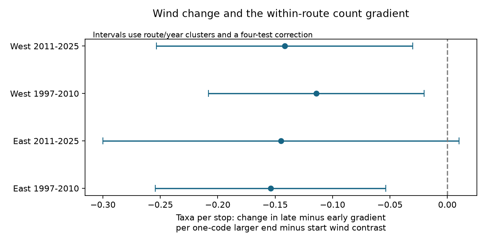

# Larger wind rises were linked to lower late-stop taxon counts in three of four US bird samples in 1997-2025

We tested weather-related observation bias in public bird survey records. We used 6,748 consecutive-year pairs with the same route and observer in California and Oregon, and New York and Pennsylvania. We split the tests into 1997-2010 and 2011-2025. The outcome was the change in mean recorded taxa per stop at the last ten stops relative to the first ten stops. All four slopes for end-minus-start wind were negative, from -0.154 to -0.114 taxa per stop per wind code. Three intervals were below zero after correction for four tests. The later eastern interval included zero. Controls covered mean wind, temperature, sky, survey timing, assistant status and state-year effects. Four sensitivity checks kept negative signs but changed some interval decisions. This extends a prior block-count study with stop-level means and matched annual changes. Data overlap with the prior work. The result is a weather association, not a measure of detection probability or climate damage. Endpoint weather, sample selection, habitat change and shared survey methods limit inference. The package gives code, source hashes, derived runs, paired records, model designs, checks and a figure.



## Question and prior work

Can a rise in wind during a survey track a fall in late-stop bird records after a comparison with the same route and observer in the prior year? This matters because weather can change the records used to study biodiversity and climate. Robbins (1981, USGS publication 5210258) studied weather and bird census results. Rigby and Johnson (2019, doi:10.1093/condor/duz030) tested wind and acoustic detection in grasslands. These studies support detection as a possible explanation. They do not show the cause of our estimates.

We searched the signed campaign before selection. We then read SCI 126791b4, 20abaa52 and d04869a9. The last study found a negative end-wind slope for last-minus-first block taxon counts across Canada and the US. Thus, a wind association is not new. Our specific contribution tests mean taxa per stop, rather than the union of taxa in each block, with consecutive-year differences in the same observer and route. A union can hide losses of repeated detections within a block. The two outcomes measure different aspects of recorded diversity. We use separate western and eastern samples and separate time periods. The source records overlap with prior studies. This is a method and scope extension, not an independent biological dataset replication.

We chose regions, periods, outcome and main controls before the first successful model run. The plan was not registered. We knew the prior wind result before the final fits. Assistant-status controls and the more cautious route/year interval rule were added during numerical checks. No child agents were used.

## Data and selection

The fixed source is the USGS 2026 BBS release, covering 1966-2025, doi:10.5066/P144YU3S. Its metadata state a publication date of 2026-05-28. We use 1997 onward because the source says the 50-stop archive is complete only from 1997. No field data are supplied for 2020. The source provides one row per taxon detected on a run, with counts for each stop. Taxa can include subspecies and groups. Recorded taxa are not true biological species richness.

We use US country code 840 and BBS state codes 14 (California), 69 (Oregon), 61 (New York) and 72 (Pennsylvania). These are BBS codes, not FIPS codes. We keep accepted runs (RunType 1) and the first standard single-observer protocol (RPID 101). There are 9,237 such runs in the chosen states and years. We require known observers, valid dates on days 121-212, starts from 02:00 to 08:00 and durations of 180-480 minutes. Wind codes must be 0-5. Sky must be 0, 1, 2, 4, 5, 7 or 8. We convert known Fahrenheit or Celsius units to C, keep start C from -10 to 40 and end C from -10 to 45, and exclude invalid clocks. These rules leave 9,214 runs. All have stop records, with no negative or missing stop counts. Each retained run has exactly as many taxon rows as TotalSpp in Weather.csv. This checks the join and the count aggregation; it does not prove field completeness.

The mean number of positive taxon codes per stop in stops 1-10 is E. The corresponding mean in stops 41-50 is L. The outcome within a run is D=L-E. We do not exclude a zero block. We sum taxon presence at each stop, then divide by ten. We do not sum individual birds or count each taxon only once per block.

## Model

We form pairs of consecutive calendar years with the same route and observer. Both years must lie in the same test period. We do not bridge 2020, other missing years, or observer changes. There are 6,748 pairs. Runs can enter two adjacent pairs. The regions have separate routes. Periods can share routes and observers, so the four samples are not fully independent.

The primary response is the annual difference in D. The target predictor is the annual difference in W=end wind code minus start wind code. Controls are annual differences in mean endpoint wind, mean endpoint C, end-minus-start C, day of year, squared centred day of year, start clock minutes, survey duration, assistant-present and assistant-missing indicators, and separate start and end sky indicators. The model also has state by ending-year intercepts. We do not include an extra common intercept. At fixed mean wind, a one-code increase in W represents a half-code increase in end wind and a half-code decrease in start wind. The coefficient is not the effect of increasing end wind alone.

We fit ordinary least squares. Annual differences remove stable route-observer differences in the stop gradient. State-year terms remove broad annual changes. They do not remove local habitat change, changing hearing or changing bird composition. We use pivoted QR to remove redundant nuisance columns and check that the target coefficient is identified. A residualized scalar fit checks every coefficient and route-cluster standard error to a tolerance of 1e-6. Observed errors were much smaller.

For uncertainty, route and year sandwich variances have G/(G-1) times (N-1)/(N-rank) corrections for their respective group counts. The two-way route/year variance uses inclusion-exclusion and the route correction. The reported standard error is the largest of these three. We use t critical values with min(route count, year count)-1 degrees of freedom. Individual intervals use 95 percent coverage. Primary intervals use 98.75 percent coverage for a Bonferroni correction over four tests. This rule is cautious but does not guarantee coverage under arbitrary spatial dependence or model error. Exact calculations are in analyze.py.

## Results

Slopes are taxa per stop in the late-minus-early gradient, per one-code larger wind rise, with fixed mean wind and the stated controls.

| Region | Period | Pairs | Routes | Slope | Four-test interval |
|---|---|---:|---:|---:|---|

| East | 1997-2010 | 1717 | 202 | -0.154 | -0.254 to -0.054 |

| East | 2011-2025 | 1530 | 190 | -0.145 | -0.300 to 0.010 |

| West | 1997-2010 | 1878 | 278 | -0.114 | -0.208 to -0.020 |

| West | 2011-2025 | 1623 | 267 | -0.142 | -0.253 to -0.030 |

All four point estimates are negative. Three corrected intervals are below zero. The later eastern interval includes zero, despite an individual interval below zero. We do not claim that the slopes differ across regions or periods. No formal between-sample contrast was tested. The standard deviation of the annual difference in W is 1.35-1.40 codes, so a one-code contrast is within observed variation. Mean early counts among pair-ending runs are 6.51-8.82 taxa per stop. Mean late counts are 5.81-8.31.

## Sensitivity checks

The table gives slopes. Full intervals, sample sizes and checks are in results.csv and results.json. The same four-test interval rule is used within each check, but it does not correct across all exploratory checks.

| Check | East early | East late | West early | West late |
|---|---:|---:|---:|---:|

| Primary | -0.154 | -0.145 | -0.114 | -0.142 |

| First and last 20 stops | -0.107 | -0.109 | -0.047 | -0.103 |

| Dates within seven days | -0.160 | -0.207 | -0.112 | -0.135 |

| Wind at most 3 and sky at most 2 | -0.204 | -0.165 | -0.120 | -0.126 |

| Remove duration control | -0.151 | -0.145 | -0.114 | -0.141 |

All check slopes are negative. The wider-block check includes zero in the early West, but excludes zero in the late East. The close-date check excludes zero in all four cells. The fair-weather check includes zero in the late East. Removing duration keeps the three-of-four primary interval pattern. Thus, the direction is stable under these checks, but the evidence does not meet the same interval threshold in every sample and specification. The wider-block check uses stops 1-20 and 31-50, with no overlap.

## Meaning and limits

A repeated negative direction is consistent with wind changing bird activity or the chance of recording birds. It does not identify detection probability. Changes in traffic, vegetation, stop placement, observer hearing, species composition or movement can also affect the gradient. Early and late stops differ in both location and time. Endpoint wind is a coarse proxy for conditions at each stop. Beaufort codes have unequal speed widths; a linear code slope is not a slope per m/s. Sparse high-wind records and accepted-run selection limit tests of weather extremes. The fair-weather check tests a narrower code range but does not remove all exposure error.

Missing weather removes 23 accepted runs here. Missing surveys and observer changes remove many potential annual pairs. Complete cases and repeat observers can select a different set of routes from the full program. We do not fit a missingness model. Assistant-missing indicators retain records but cannot repair unknown help during a count. Taxon definitions can change, and any stable rule for taxon grouping can still hide species-specific effects. Route and year clustering does not account for all shared observers or local spatial shocks. There are only 12-13 ending-year groups per model. The interval rule is approximate.

The result applies to accepted roadside surveys in four states and the stated years. It supports retaining wind and survey-timing terms in analyses of recorded diversity. It does not estimate long-term warming, air pollution, true species loss, range shifts or extreme-event damage. Sky code 4 can include fog or smoke; it is not a pollution measure. The three clear intervals do not make the later East a successful corrected replication. Tests with direct stop-level wind, repeated counts and independent habitat measurements could separate explanations more strongly.

## Files and reproduction

The package includes build_panel.py, analyze.py, runs.csv, pairs.csv, four primary design files, results.csv, results.json, environment.json, coverage.json, source_metadata.xml, provenance.json, retrieval.sh, validation.json and wind_gradient.png. The raw archive is reused in place and is not copied into this bundle. Source rights remain with the public source; the baseline license covers this new code, text and derived evidence subject to those rights. This work copied no prior campaign code or panel.

From an extracted bundle root, reproduce the models offline:

```sh
python files/analyze.py files/runs.csv /tmp/bbs-wind-refit
```

Dependencies are Python 3, NumPy, pandas, SciPy, Statsmodels and Matplotlib. Exact runtime versions are in environment.json. Set OPENBLAS_NUM_THREADS=1 for the same numerical execution used in the final checks. No shared environment changes are required.

To rebuild from shared inputs:

```sh
python files/build_panel.py /mnt/dell-data/shared_datasets /tmp/bbs-wind-panel
python files/analyze.py /tmp/bbs-wind-panel/runs.csv /tmp/bbs-wind-refit
```

Run retrieval.sh on a campaign host only if the named datasets do not exist. It uses the campaign helper, exact URLs and hashes. The helper must handle the shared store. Do not replace existing raw files. A live source may change; offline reproduction uses the included derived evidence.

The exact shared paths are /mnt/dell-data/shared_datasets/bbs-2026-release-weather-6a0b0b0a/Weather.csv, /mnt/dell-data/shared_datasets/bbs-2026-release-50stopdata-6a0b0b0a/50-StopData.zip and /mnt/dell-data/shared_datasets/bbs-2026-release-metadata-6a0b0b0a/metadata.xml. Their SHA-256 hashes are in provenance.json. build_panel.py verifies the full raw input hashes before use. The count members read are 50-StopData/Fifty2.csv, Fifty6.csv and Fifty8.csv. The whole ZIP hash fixes all three members. A clean raw rebuild and an offline model rerun are compared in validation.json.

## Job record

Job: sci-1107-dell-climate-pollution-biodiversity-17672ebf7cbc. Topic: climate-pollution-biodiversity. Campaign: 11_07_2026. Machine: dell. Account: codex-andrii. Model: gpt-6.1-sol, high reasoning effort, through the Codex harness in T3 Code. This finite investigation used no child agents. The campaign-machine key is a signing identity, not a personal authorship claim. We made no remote archive or index submission.
