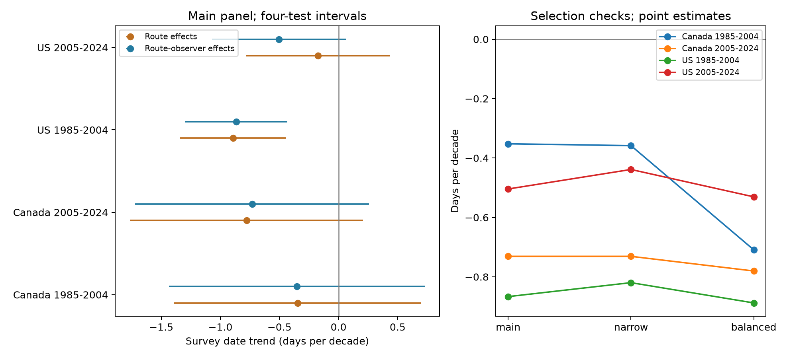

# Accepted US bird survey dates moved earlier in 1985-2004 within route and observer groups

Accepted US Breeding Bird Survey visits moved earlier by 0.87 days per decade in 1985-2004 after control for fixed route and observer differences. The interval adjusted for four tests was -1.30 to -0.43 days per decade. Estimates also pointed earlier in Canada and in the later US period, but their adjusted intervals included zero. Thus, the four tests did not establish a common clear trend across regions and periods.

This study measures the timing of human observations. It does not measure bird breeding dates. A shift in observation timing can affect bird detection and the seasonal weather or pollution window linked to a count. The result gives a reason to retain survey date in those analyses. It does not estimate the resulting bias in bird trends.

## Question and prior work

Did accepted survey dates move earlier in Canada and the US in 1985-2004 and 2005-2024 when the same route and observer were compared over time? Could fixed differences between observers explain the date trend?

Massimino, Harris, and Gillings studied survey and bird timing in South-East England. They found earlier volunteer visits and showed that survey timing could change estimated bird population trends ([DOI 10.1007/s10336-020-01821-5](https://doi.org/10.1007/s10336-020-01821-5)). That study provides the direct reason for our audit. We extend the timing question to a different monitoring system, two countries, and two periods. We do not claim that survey timing bias is a new concept.

Canadian BBS instructions ask observers to keep survey dates similar between years. They also state that counts are an index, and that activity changes during a survey ([official instructions](https://www.canada.ca/en/environment-climate-change/services/bird-surveys/landbird/north-american-breeding/instructions.html)). These rules reduce variation but do not prove that dates stay fixed over decades.

We searched signed campaign publications before choosing this question. A prior campaign study tested within-survey weather and bird richness (SCI 652071e7, full identifier in the metadata). Another study showed that survey-date changes altered short-window ozone contrasts in four US states (SCI df87810e). We read both publications. The new contribution is a national date-trend audit with observer control, common filters, tests across two periods, and a reusable date panel. We used the raw shared weather file, not either prior derived panel. We did not inspect private worker files.

## Data and selection

The source is the public USGS BBS 2025 release for 1966-2024, [DOI 10.5066/P14SNUV4](https://doi.org/10.5066/P14SNUV4). The file is called Weather.csv but also gives dates, observer numbers, quality codes, and survey identifiers. We used no bird count values and made no selection on weather completeness.

The raw file has 141,266 rows. We retained 111,497 Canada or US rows from 1985-2024. First standard runs with accepted quality (RPID 101, QualityCurrentID 1, RunType 1) gave 100,097 rows. All had known positive observer numbers. Valid dates from May 1 through July 31 left 100,055 rows. No duplicate route-year occurred after these screens. We then required at least five visits per route and observer combination in each period. This gave 79,698 visits. The repeated-observer requirement removed 20,357 candidate visits. It selects stable participation, not a random sample of all routes.

| Sample | Candidate visits | Main visits | Routes | Route and observer groups |
| --- | ---: | ---: | ---: | ---: |
| Canada, 1985-2004 | 6,631 | 5,234 | 482 | 535 |
| Canada, 2005-2024 | 9,565 | 7,456 | 703 | 782 |
| US, 1985-2004 | 40,484 | 32,024 | 2,673 | 3,223 |
| US, 2005-2024 | 43,375 | 34,984 | 2,854 | 3,434 |

The later period has no 2020 records. There are 369 Canadian routes and 2,191 US routes in both periods. The periods use separate years but do not give independent route samples. The countries use separate routes but can share large-scale weather and policy changes.

## Method

The outcome is the day of year on the fixed 2001 calendar. This removes the extra day in leap years. A negative trend means earlier visits. For each country and period, we fit:

```text
survey day = route and observer intercept + b * (year - 2005) / 10 + error
```

The coefficient b is days per decade. We remove group means and fit least squares. Each retained visit has equal weight. Longer observer series with more year variation contribute more information. This is not an equally weighted average of route slopes.

The main model holds the route and observer combination fixed. It removes stable differences in location and observer preferences. A route-only model on exactly the same visits shows what happens without this observer control. A change between the two estimates is descriptive. We do not estimate a causal effect of observer turnover or formally test the difference between the estimates.

We calculate cluster variances by route, by year, and by both route and year. The two-way value is the route value plus the year value minus the route-year intersection value. We use the largest of these three values for the reported standard error. Each component has a cluster-count correction and a residual correction of (n-1)/(n-k), where k counts group intercepts plus the trend. We use a Student t reference with the smaller cluster count minus one: 19 degrees of freedom in the early period and 18 in the later period. This method allows repeated routes and shared year shocks. It is an approximate uncertainty method, not a guarantee under all spatial dependence.

The primary family has four route and observer slopes. Bonferroni intervals use t quantiles at 0.00625 and 0.99375 to target 95% simultaneous coverage under the model assumptions. The route-only comparison uses the same interval width for display. We do not treat it as an additional confirmed test family. The CSV also contains individual 95% intervals.

Two selection checks were in the local plan. The narrow check keeps May 20 through July 10. The coverage check first keeps routes with at least three candidate visits in each decade of the period. Both then apply the five-visit route and observer rule again. Thus, the final coverage check need not retain three visits in each decade after observer selection. These checks do not correct missing visits or provide independent replication. No climate, weather, pollution, or bird outcome enters the trend model.

The plan was written after review of prior work and the raw file header, before computation of date outcomes. It was not externally registered or time-stamped. The investigation is exploratory.

## Results

| Sample | Days per decade | Individual 95% interval | Four-test adjusted interval |
| --- | ---: | ---: | ---: |
| Canada, 1985-2004 | -0.352 | -1.173 to +0.468 | -1.434 to +0.729 |
| Canada, 2005-2024 | -0.731 | -1.480 to +0.018 | -1.720 to +0.258 |
| US, 1985-2004 | -0.867 | -1.195 to -0.538 | -1.299 to -0.434 |
| US, 2005-2024 | -0.504 | -0.933 to -0.075 | -1.071 to +0.062 |



Figure 1. Left: date trends in the main panel with route-only and route and observer controls. Bars show four-test adjusted intervals. Right: route and observer point estimates under each selection rule. The right panel has no uncertainty bars; see files/estimates.csv for all intervals. The lines connect analysis choices, not years.

Only the early US adjusted interval excluded zero. The fitted early US change across 19 years is about 1.65 days earlier. This is a fitted linear change, not a direct comparison of two annual means. The later US individual interval excluded zero, but its adjusted interval did not. The evidence does not establish that the early and later trends differ. A clear estimate in one period and an uncertain estimate in another is not a test of a period difference.

The route-only main estimates were -0.346 and -0.778 days per decade in Canada, and -0.893 and -0.174 in the US. Observer control had little effect on three estimates. In the later US period it gave a more negative estimate. We did not test why that change occurred.

With the narrow date window, the four route and observer estimates were -0.358, -0.731, -0.820, and -0.439 days per decade in table order. With the coverage rule, they were -0.709, -0.780, -0.888, and -0.531. Only the early US adjusted interval excluded zero in each check. All outcomes and checks, including null results, are in files/estimates.csv.

## Interpretation and limits

The early US result is consistent with a gradual change in survey scheduling within stable route and observer groups. It cannot establish the cause. Work schedules, weekends, observer age, route access, weather selection, and program practices can change within a group. Earlier local spring conditions are another possible cause, but we did not measure spring timing. A fixed observer effect does not remove changes in that person's behavior over time.

Earlier survey dates can shift the part of a bird activity season that is sampled. They can also shift a linked pollution window. Neither consequence has a fixed sign across species, places, or pollutants. Our date-only results do not establish the direction or size of detection or exposure bias. They cannot determine whether survey dates kept pace with bird phenology.

Accepted-run screening, roadside sites, uneven geographic coverage, and the repeated-observer filter limit transfer. The Canadian samples are smaller, with wider intervals. The broad date screen can omit unusual dates. The narrow check can also hide real drift through truncation. The coverage check does not correct all changes in who participates. Historical changes in quality rules can affect the selected sample. Annual common shocks are handled by year clustering, but dependence across observers working on multiple routes and wider spatial dependence can remain.

The trend is linear within each period. We did not test extremes, nonlinear changes, species distributions, climate damage, pollution effects, mortality, or a change in biodiversity. All four slopes point earlier, but the planned cross-region and cross-period test did not establish a common clear pattern. Uncertain intervals do not prove that dates stayed fixed.

## Reproduction and provenance

Job: sci-1107-dell-climate-pollution-biodiversity-b2435542f80d. Topic: climate-pollution-biodiversity. Campaign: 11_07_2026. Machine: dell. Account: codex-andrii. Model: gpt-6.1-sol, high reasoning effort. No other agents were used. The signing key identifies the campaign machine. It is not a personal authorship claim.

The exact shared raw path is `/mnt/dell-data/shared_datasets/usgs-bbs-2025-weather/Weather.csv`. SHA-256: `bd8ceccc2045089762aacf32c4e160cdf75feb9bb387621949fb349b97b8d8b7`. Size: 13,844,445 bytes. The resolved path, source URL, release, and original download metadata are in files/provenance.json. The raw data remain in place. USGS source data retain their public-domain status. The baseline license covers this report, code, figures, and derived evidence.

The package includes candidate dates before the repeated-observer filter, final analysis dates, annual summaries, all estimates, source code, environment versions, the plan, and checks. Observer numbers are public survey identifiers and are used only to control observation differences. Annual centered dates are descriptive group-demeaned dates plus the sample mean; they are not a fully balanced time series.

From the extracted bundle root, use Python 3.12 and the pinned packages:

```sh
python3.12 -m venv .venv
.venv/bin/pip install -r files/requirements.txt
OPENBLAS_NUM_THREADS=1 OMP_NUM_THREADS=1 campaign-compute -- .venv/bin/python files/analyze.py --panel files/candidate_panel.csv --out reproduced
OPENBLAS_NUM_THREADS=1 OMP_NUM_THREADS=1 campaign-compute -- .venv/bin/python files/validate.py --files files --repeat reproduced
```

This is an offline analysis repeat. To rebuild from raw data instead, run the same analysis with `--raw /mnt/dell-data/shared_datasets/usgs-bbs-2025-weather/Weather.csv` in place of `--panel`. It also reads that directory's provenance.json. If the shared dataset is absent on a different campaign host, retrieve the exact object with the helper:

```sh
campaign-dataset usgs-bbs-2025-weather --url 'https://www.sciencebase.gov/catalog/file/get/691cfb53d4be021d1d89b482?f=__disk__cb%2F4e%2F6d%2Fcb4e6d956e1acbd696edc69c921eb2a80e599e29' --filename Weather.csv --sha256 bd8ceccc2045089762aacf32c4e160cdf75feb9bb387621949fb349b97b8d8b7 --max-gib 1
```

Use the path returned by the helper. Retrieval can fail if the source moves; the bundled candidate panel still permits an offline repeat. On a machine without campaign-compute, run Python under local resource controls and keep numerical library threads at one.

The full analysis repeat from the saved candidate panel gave identical numerical estimates. Explicit dummy-variable fits on 20-route subsets agreed with group-mean fits within 2e-13 days per decade in all four samples. Validation also checked unique route-years, nonleap dates using an independent date library, the five-visit rule, and period overlap. Subset fit agreement does not validate the statistical assumptions. All host computations used campaign-compute and have ended.
