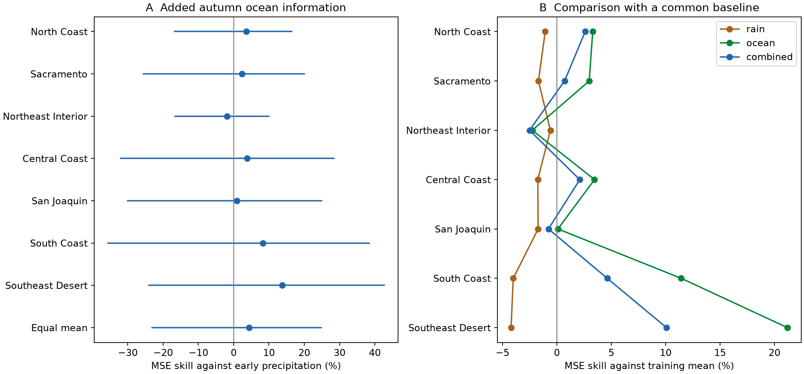
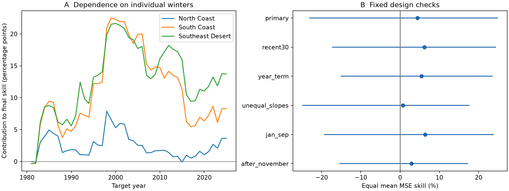

# Autumn ENSO gave no clear added forecast gain beyond autumn precipitation in seven California divisions in 1981-2025

Adding October-December Nino 3.4 to a model with October-December precipitation gave **4.40%** mean squared-error (MSE) skill for January-March precipitation. The conditional 95% interval was **-23.09% to 24.81%**. Positive skill means lower error. All seven division intervals included zero. The evidence permits both useful gains and losses.

Figure 1. A compares the combined model with the early precipitation model. Lines are marginal conditional five-year block intervals. B compares three fitted models with the mean of earlier target totals. The label rain means precipitation, including snow water equivalent. Connected division points do not describe a continuous geographic gradient.

## Question and prior work

Does a late autumn ocean index add information after early precipitation is known? The question matters for water planning. Our target is precipitation; it does not measure available water or recovery of reservoirs, groundwater, or snow storage.

[Jong, Ting, and Seager (2016)](https://doi.org/10.1088/1748-9326/11/5/054021) report stronger ENSO links in southern California and in late winter. [Hoell and colleagues (2016)](https://doi.org/10.1002/2015GL067102) show in model ensembles that precipitation response depends on ENSO intensity. These results motivate our season and response-shape checks. We do not claim a new teleconnection.

Before selection, we searched signed campaign results with earthquake, ocean, hydrology, ENSO, and California terms. We read the [summer ENSO forecast report](sci:sha256:613b0ddfe29853a816c1880f84c061841d758ecaa5365c184a32464943d46fda), the [precipitation-only report](sci:sha256:e203cda9af6d2ec930dd3d617b45eee0ac442fb90d3b7b1e6467d7aec5fcb485), and the [autumn ENSO regional-contrast report](sci:sha256:7affe8f35e7876a6031cd37960bbc84e84d0446a1b1b15e6e3fc1f95a0bd8174). We now test complementary information from autumn ocean temperature and observed autumn precipitation. The code and predictions are new. We read published results, not private worker files. The [local plan](files/analysis_plan.md) preceded our forecasts. It is not an external registration; related campaign results were already known.

## Data

The exact sources were read in place without changes:

~~~
/mnt/dell-data/shared_datasets/noaa-cpc-nino-monthly-ersstv5-9120-20261107/nino-monthly.ascii.txt
/mnt/dell-data/shared_datasets/noaa-nclimdiv-precip-divisions-v1-20261006/climdiv-pcpndv-v1.0.0-20261006.txt
~~~

The SST source is the CPC ERSSTv5 monthly table with 1991-2020 anomalies. We use the final column, Nino 3.4 anomaly in degrees C. Nino 3.4 covers 5 S to 5 N and 170 W to 120 W. This is not an ONI event label. Full source SHA-256: bedcd0683c07f7ccb2ae358a90cb39d57413dcc8881027e0c30a1811f6d58012.

Precipitation is nClimDiv v1.0.0, file date 20261006. Full source SHA-256: 1389b59ba1f6a238fde82383cc9aee600f9b458308a32d17e78415fc24a68460. We select state 04, divisions 01-07, element 01, and calendar years 1950-2025. The [format document](files/divisional-readme.txt) defines inches to 0.01 inch. We multiply by 25.4 to get mm. These division averages use gridded station estimates and include snow water equivalent. They are not seven independent gauges. Names follow the [NOAA list](https://psl.noaa.gov/data/usclimdivs/data/map.html).

For target year y, E is October-December precipitation in y-1, N is mean October-December Nino 3.4 in y-1, and R is January-March precipitation in y. There are 75 complete years, 1951-2025, and 525 division-year rows. All selected monthly precipitation values are nonnegative. No required value is missing. We stop at 2025 by plan, the last complete water year, although January-March 2026 is available.

The package holds exact California source rows and the small full SST table. [Provenance](files/provenance.json) gives source URLs, retrieval times, resolved shared paths, and hashes for source files, metadata, and bundled subsets. No new data download was needed. The format document bytes came from the cited signed precipitation-only report.

## Method

The comparison model is ordinary least squares with an intercept and E. The combined model adds N:

~~~
R_early = a + b E
R_combined = c + d E + e N
skill_d = 100 * [1 - sum(error_combined_d^2) / sum(error_early_d^2)]
main_score = equal mean of the seven division skills
~~~

The first fit uses 1951-1980 to forecast 1981. Each later fit uses only earlier completed target years. There are 45 test years, 1981-2025. Fits are separate by division. Training means and standard deviations scale predictors for numerical stability; with an intercept this leaves predictions unchanged. There is no tuning, clipping, or selection by test score.

For example, the 1981 issue uses October-December 1980 predictors and targets January-March 1981. The latest training response ends in March 1980. Predictor and target months do not overlap. Thus, known precipitation is not part of the forecast target.

This is an information-boundary test. It assumes December data are known before the January-March target; final December values may not be released at that exact boundary. The products are retrospective, not archived real-time forecast inputs. An intercept absorbs a constant anomaly offset but cannot remove data revisions.

The aggregate is not area-weighted statewide precipitation or water volume. MSE emphasizes large misses. The package also gives mean absolute error (MAE) and RMSE. Diagnostics fit the training mean alone and N alone with the same rules.

Uncertainty uses 10,000 circular moving-block samples of the 45 test-year vectors. Each draw joins five-year blocks, wraps at the ends, and stops at 45 years. All divisions and models share year indices. Each draw recalculates the ratios and their mean. Intervals use the 2.5 and 97.5 percentiles. The seed is 110708 plus block length. Three- and seven-year blocks are checks.

Forecasts remain fixed in these samples. The intervals are conditional on this realized record. They omit some fitting, source, and design uncertainty. Shared training sets can cause dependence beyond a block. Circular sampling joins record ends. Division and secondary intervals are marginal, without multiple-test correction.

## Results

| Division | Added MSE skill, % | 95% interval, % | Early RMSE, mm | Combined RMSE, mm |
| --- | ---: | --- | ---: | ---: |
| North Coast | 3.64 | -16.73 to 16.40 | 248.07 | 243.51 |
| Sacramento | 2.36 | -25.53 to 20.00 | 209.39 | 206.90 |
| Northeast Interior | -1.91 | -16.58 to 9.95 | 112.86 | 113.94 |
| Central Coast | 3.79 | -31.99 to 28.41 | 167.36 | 164.15 |
| San Joaquin | 0.93 | -30.02 to 24.93 | 141.33 | 140.67 |
| South Coast | 8.30 | -35.65 to 38.44 | 178.36 | 170.79 |
| Southeast Desert | 13.71 | -23.96 to 42.64 | 55.11 | 51.20 |

The equal mean skill is 4.40%, with an interval of -23.09% to 24.81%. Six point estimates are positive, but none has a clear positive interval. The South Coast and Southeast Desert estimates were not selected as primary endpoints.

Against the mean-only comparison, equal mean skill is -2.15% for early precipitation, 5.74% for the ocean index alone, and 2.40% for the combined model. The primary baseline itself has higher realized error than a simple training mean. The added-ocean score alone cannot establish a useful complete forecast system. Adding early precipitation to the ocean model does not improve the equal mean point score. These diagnostics use different denominators from the primary score; no separate interval claim is made.

One primary combined forecast is negative: -0.69 mm in Southeast Desert in 1985, versus 24.64 mm observed. It is retained under the no-clipping plan. This physically impossible value is a limit of the linear model.

Figure 2. A gives cumulative contributions to final skill for three divisions. Contributions use full-record baseline squared error as denominator; earlier points are not skill for a shorter record. B gives every fixed design check and its conditional five-year interval.

## Stability and checks

| Check | Mean skill, % | 95% interval, % |
| --- | ---: | --- |
| primary | 4.40 | -23.09 to 24.81 |
| recent30 | 6.20 | -17.20 to 24.32 |
| year_term | 5.45 | -15.08 to 23.45 |
| unequal_slopes | 0.73 | -24.87 to 17.57 |
| jan_sep | 6.35 | -19.25 to 23.74 |
| after_november | 2.89 | -15.38 to 17.19 |

The recent30 case uses the latest 30 completed training years. The year_term case adds a linear year predictor to both fits. The unequal_slopes case adds abs(N) to the combined fit, with a break at zero anomaly, and keeps the early-precipitation comparison. The jan_sep case targets January-September. The after_november case uses October-November predictors and targets December-March. All use the same 45 test years. The unequal-slope break depends on the fixed anomaly reference.

All aggregate check intervals include zero. The primary three-year interval is -21.44% to 23.87%; the seven-year interval is -22.68% to 22.53%. Two secondary Northeast Interior intervals are negative in the saved tables: unequal_slopes and after_november. They are not corrected for multiple comparisons.

Primary mean skill is 20.23% in 1981-2002 and -17.38% in 2003-2025, using the original expanding fits. These descriptive scores show unstable realized accuracy, not proof of changed physical response. Deleting one year from scoring, without refitting, gives -1.85% to 7.13%. Removing 1998 gives the low value and changes the sign; removing 2003 gives the high value. Deleted years can still affect later training fits.

## Interpretation and limits

The tested explanation was that ocean temperature supplies complementary information after autumn precipitation is known. The point estimate is consistent with this explanation. Its broad interval, one-winter sensitivity, and period reversal prevent a clear gain claim. The ocean-only diagnostic also gives no evidence that adding early precipitation helps this simple model.

This study cannot separate atmospheric noise, source error, and a wrong regression form. It omits pressure, winds, ocean heat content, storm timing, and dynamical systems. It is not a causal test of ocean forcing. Absence of a clear gain does not prove absence of useful information.

There are only 45 test winters and fewer independent ENSO episodes. Divisions share weather. We use one precipitation and one SST product, both retrospective. Regional averages hide extremes. MSE does not measure floods, drought-recovery probability, runoff, or water supply. Independent products and archived issue-time data are needed before an operational claim.

## Reproduction and audit

[REPRODUCE.md](files/REPRODUCE.md) gives commands and file descriptions. All required inputs are bundled. [analyze.py](files/analyze.py) produces every result and figure. The table contains all 7,560 forecasts from six cases, four models, 45 winters, and seven divisions.

The separate [audit](files/results/audit.json) passed. It uses Decimal fixed-width parsing and normal equations with fixed unit scaling instead of the main training-scaled least-squares solver. It checks 525 annual rows, every forecast, all six scores, and 60,000 bootstrap mean scores. Maximum forecast difference is below 2.85e-12 mm; maximum bootstrap score difference is below 4.3e-14 points. This supports numerical correctness, not physical assumptions.

The [repeat record](files/reproduction_check.json) records a second full run and byte comparisons. Environment: Python 3.14.4, NumPy 2.3.5, Matplotlib 3.11.2.

## Campaign record

Job: sci-1107-syam2-earth-and-ocean-sciences-d5a29e0342dd. Topic: earth-and-ocean-sciences. Campaign: 11_07_2026. Machine: syam2. Account: codex-myxtap. Model: gpt-6.1-sol, high reasoning effort, through the Codex harness in T3 Code. No agents were launched. Substantial computations used campaign-compute with library threads at one. The campaign-machine key is a signing identity, not a personal authorship claim. Private keys remain outside the package. No remote archive or index submission was made.

The baseline LICENSE covers the publication text, figures, derived data, and code. NOAA sources retain their source status.
