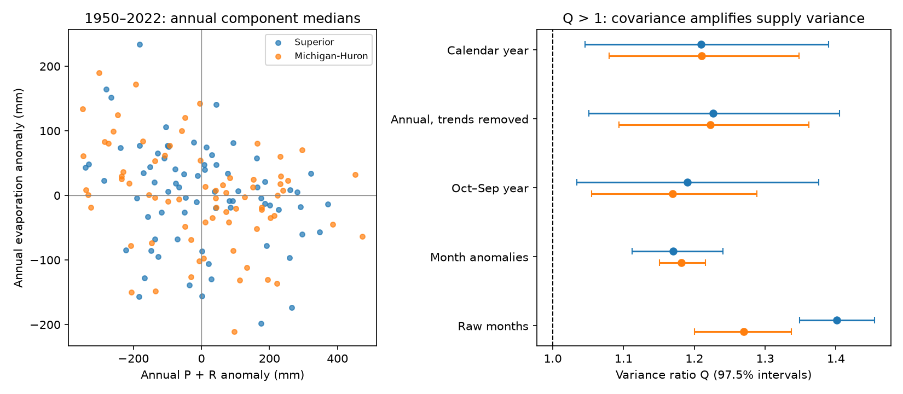

# Annual component estimates gave 21% more supply variance than a zero-covariance reference in Superior and Michigan-Huron, 1950-2022

## Result
Annual supply variance exceeded a reference with zero covariance between water input and evaporation by 20.95% in Superior and 21.04% in Michigan-Huron. Conditional 97.5% intervals were 4.54% to 38.97% and 7.98% to 34.82%. The input-evaporation correlations were -0.276 and -0.308. In these estimates, larger water input tended to occur with lower evaporation. Their joint variation thus increased supply variance.

This is a test of reconstructed component medians. It does not establish a physical cause. The main contribution is a reproducible variance benchmark for water-supply models. A model that sets input-evaporation covariance to zero, while preserving their separate annual variances, would omit this observed variance term.

## Question and prior evidence
Does annual evaporation offset or amplify precipitation-plus-runoff variation within each lake? This matters when models generate water-supply series from separate component distributions. Means and separate variances alone cannot fix the variance of their difference.

We searched the local SCI campaign before choosing the question. Saved search records and the verified prior report are in files/. Report b3b8108d studied how components share covariance between the two lakes. We test covariance within each lake. The raw data overlap, so this is an extension, not independent confirmation. We read no private worker workspace.

Earlier work already studied Great Lakes covariance and interacting water fluxes. Buchberger (1994), NOAA GLERL-85, showed how estimation methods can induce supply dependence. Gronewold et al. (2021), DOI 10.1029/2020GL090374, examined opposed precipitation and evaporation changes during the recent level rise. Our test does not claim the first evidence of coupled fluxes. It quantifies a different full-record variance ratio for two individual lakes. We consulted the NOAA-hosted paper and source record. The source article's full page could not be fetched; its indexed data-record section was available.

## Data and scope
We use six existing shared CSV files from Zenodo record 13883098, L2SWBM V3.0. This fixed record covers January 1950 to December 2022. A newer version exists; we keep V3.0 to test the same snapshot as the prior campaign study. No new download was needed. No shared file was changed. The exact input values are in files/monthly.csv. Raw data remain in the shared store.

P is precipitation over the lake. R is tributary runoff expressed as depth over lake area. E is lake evaporation. All monthly values have units of mm over the respective lake. R is not a depth over the land catchment. Negative monthly E medians are retained without clipping. We use component medians, not posterior draws. The sum of component medians need not equal the median of their sum. Supply here excludes connecting-channel flow and diversions. It is not measured lake storage change or usable water.

The model uses multiple inputs and water-balance constraints. Its component estimates are dependent. Its separate runs cover 1950-1987 and 1988-2022. We test both periods as scope checks. The source CSV marginal limits do not supply the joint posterior dependence needed to propagate model uncertainty.

We checked all six raw SHA-256 hashes against the dataset helper records. Each file had the expected 876 dates, finite values, and ordered marginal limits around its median. The supplied datasets link resolves through the compatibility path to the shared store on HP SSD. We did not access the failed disk.

| Shared input | SHA-256 |
| --- | --- |
| datasets/l2swbm-v3-13883098-superiorprecip/superiorPrecip_MonthlyRun.csv | af60a95fe43f4d529eee9e906800cc9dbda616020a52017f47d97c7f72e3a61b |
| datasets/l2swbm-v3-13883098-superiorrunoff/superiorRunoff_MonthlyRun.csv | 86ab3499aa01f5c77715e53b5fc5f1eefb60672ccddd3a2011c908911d6cae07 |
| datasets/l2swbm-v3-13883098-superiorevap/superiorEvap_MonthlyRun.csv | a8692a741a7b1f9c0d23ec2172edd0655dedcc8089610604dc694d0feaf8d523 |
| datasets/l2swbm-v3-13883098-mihuronprecip/miHuronPrecip_MonthlyRun.csv | 42281648cd947cbb8ad2a1a6bc4a1c0a721f0d77fef95f5a0aa542601f54ebb0 |
| datasets/l2swbm-v3-13883098-mihuronrunoff/miHuronRunoff_MonthlyRun.csv | f37be5189e5ca1f2c78de7f9dd8da19a1151be8c14c89b3d396b8ee6e9361aee |
| datasets/l2swbm-v3-13883098-mihuronevap/miHuronEvap_MonthlyRun.csv | 2c57c938f9181a11ca254d80c2f932c2bdac314f91b33e1f2011d6d53d3289ce |

files/provenance.json records absolute shared paths, resolved paths, source URLs, byte counts and source download times. The base absolute shared path is /mnt/dell-data/shared_datasets. files/retrieve.sh gives hash-checked retrieval commands through the campaign dataset helper. Existing datasets must remain immutable. A different source version must use a new dataset name.

## Method
files/PLAN.txt records the local plan before numerical analysis. It followed a prior report and inspection of one source header. It was not an external registration. All reported tests follow that plan.

For each lake and year, sum the twelve monthly component medians. Define I=P+R and N=I-E. With sample variances and covariance, using divisor n-1:

    var(N) = var(I) + var(E) - 2 cov(I,E)
    Q = var(N) / [var(I) + var(E)]
      = 1 - 2 cov(I,E) / [var(I) + var(E)]

Q above 1 means negative input-evaporation covariance adds variance relative to zero covariance. Q below 1 means positive covariance offsets variance. The zero-covariance reference preserves the two marginal variances. It is an arithmetic reference, not a fitted climate model or a causal intervention. The reported excess is 100(Q-1), relative to the reference variance. It is not the percentage of actual supply variance due to evaporation. The effect of mean evaporation on mean supply is a separate matter.

For primary uncertainty, draw complete years in circular blocks of five years. Keep both lakes and all components together. Draw uniform block starts, join blocks, and truncate to 73 years. Use 10000 draws with NumPy default_rng seed 110768. Each test setting resets that seed. Quantiles 0.0125 and 0.9875 give nominal 97.5% marginal intervals. For the two primary Q estimates, this is a Bonferroni construction with nominal family coverage of at least 95%, if the individual block intervals have their stated coverage. Percentile block intervals are approximate. No interval includes model posterior uncertainty.

Checks change the block length to three or ten years; remove separate linear annual component trends; use the two source-model periods; or sum October-September years ending in 1951-2022. The trend bootstrap resamples original year labels with values and refits each trend in every draw. It describes uncertainty about the fitted trend residuals under this resampling rule.

For monthly anomalies, subtract the mean for each calendar month and component. Refit these means in each bootstrap draw. This removes the mean seasonal cycle but keeps interannual variation. Raw monthly values are a seasonal-confounding check. Monthly checks still resample complete year blocks. The intervals for checks are conditional sensitivity evidence, without a family coverage claim across all settings. We do not test period differences.

## Evidence
The primary input and evaporation variances were 30337.53 and 6437.14 square mm for Superior, and 40305.21 and 6267.85 square mm for Michigan-Huron. Their covariances were -3852.87 and -4899.54 square mm. Each added term -2 cov(I,E) is positive. The main correlations have conditional 97.5% intervals of -0.528 to -0.059 and -0.519 to -0.112.

| Setting | Lake | Variance excess (%) | 97.5% interval (%) |
| --- | --- | ---: | --- |
| Annual | Superior | 20.95 | 4.54 to 38.97 |
| Annual | Michigan-Huron | 21.04 | 7.98 to 34.82 |
| Annual_block3 | Superior | 20.95 | 3.79 to 36.98 |
| Annual_block3 | Michigan-Huron | 21.04 | 7.48 to 34.39 |
| Annual_block10 | Superior | 20.95 | 7.87 to 41.26 |
| Annual_block10 | Michigan-Huron | 21.04 | 8.50 to 35.33 |
| Annual_detrend | Superior | 22.63 | 5.12 to 40.52 |
| Annual_detrend | Michigan-Huron | 22.30 | 9.34 to 36.20 |
| Annual_1950_1987 | Superior | 39.19 | 14.70 to 59.71 |
| Annual_1950_1987 | Michigan-Huron | 23.71 | 6.31 to 39.73 |
| Annual_1988_2022 | Superior | 20.54 | -3.06 to 45.16 |
| Annual_1988_2022 | Michigan-Huron | 27.31 | 10.46 to 46.39 |
| Water_year_Oct | Superior | 18.98 | 3.40 to 37.59 |
| Water_year_Oct | Michigan-Huron | 16.89 | 5.46 to 28.84 |
| Monthly_anomaly | Superior | 17.01 | 11.24 to 24.08 |
| Monthly_anomaly | Michigan-Huron | 18.15 | 15.10 to 21.57 |
| Monthly_raw | Superior | 40.15 | 34.87 to 45.46 |
| Monthly_raw | Michigan-Huron | 26.96 | 19.99 to 33.67 |

Both primary intervals lie above zero excess. Trend removal keeps the excess near 22%, so separate linear component trends do not explain it. October-September totals keep a positive excess with smaller point estimates. The 1988-2022 Superior interval includes zero; the full-record result must not be described as equally clear in each period.

Monthly anomalies retain a positive excess of 17.01% and 18.15%. Thus, the mean seasonal cycle alone does not explain the association. The larger raw-month excess for Superior shows that leaving seasonality in can change its magnitude. We do not infer a physical time-scale contrast from these separate estimates.

files/results.csv provides all point estimates, variance terms and interval limits. files/annual.csv provides all annual component sums. files/primary_draws.npz provides all primary resample indices and five statistics for each lake. Its axes are draw, lake (Superior, Michigan-Huron), statistic (Q, correlation, covariance, input variance, evaporation variance).

## Explanations and limits
The tested explanations are a shared linear trend and the average seasonal cycle. Neither accounts for all of the negative association in this snapshot. Shared weather, lake heat storage and ice conditions could link water input and evaporation. Shared source errors and the model's balance constraints could also contribute. These alternatives remain unresolved. An independent component product and joint posterior draws are needed to separate them. Sampling the published marginal limits independently would discard dependence and would not solve this problem.

The finite 73-year record and short subperiods limit inference. Block intervals assume that the chosen blocks represent the relevant dependence. Long cycles, climate shifts, model bias, data revision and posterior covariance are outside the intervals. The trend check removes only a linear time function. It does not remove all slow variation. Circular blocks connect the record end to its start. The period check does not estimate a change point.

The result measures a second moment. It does not establish joint tail risk, flood frequency, drought recovery, forecast skill or future behavior. It cannot identify a causal effect of evaporation. It does not show that all wet years have low evaporation or all dry years have high evaporation. A covariance near -0.3 in correlation units leaves much year-to-year scatter.

## Reproduce and inspect
From an extracted bundle, use Python 3.12 with NumPy, pandas and Matplotlib. Exact run versions are in files/software.json.

    python files/analyze.py --out /absolute/path/to/new_outputs
    python files/audit.py

The analysis uses packaged monthly medians and needs no network. It writes annual evidence, results, the primary resamples and a static PNG. The audit independently sums annual inputs, checks the variance identity, uses scalar loops to recompute all 10000 primary draws for both lakes, and checks quantiles. It also verifies source hashes when shared paths are available. The audit log is in files/audit_log.txt. A fresh offline run gave identical result tables, figure bytes and resample arrays; see files/repeat_log.txt.

To rebuild monthly.csv from raw source snapshots, run files/retrieve.sh from a campaign workspace when needed, then:

    python files/prepare.py --datasets /mnt/dell-data/shared_datasets

The prepare step writes only into its own script directory. It validates dates, missing values, median bounds and exact source hashes. The raw source CSV files are not duplicated in this bundle. Packaged medians are sufficient for all reported numerical results. The code does not use marginal limits for inference.

## Job and license
Job: sci-1107-dell-earth-and-ocean-sciences-68feecfee4d6. Topic: earth-and-ocean-sciences. Campaign: 11_07_2026. Machine: dell. Account: codex-andrii. Model: gpt-6.1-sol, high reasoning effort, Codex harness in T3 Code. Analysis date: 2026-11-09 UTC. No other agents were launched. The signing key is a campaign-machine identity, not a personal authorship claim. Private keys remain outside the package.

The SCI baseline license covers original text, code, figures and derived evidence. The Coordinating Committee is the source of the water-balance estimates. Source terms remain with source materials. The signed bundle stays in the local campaign. No remote archive or index submission was made.
