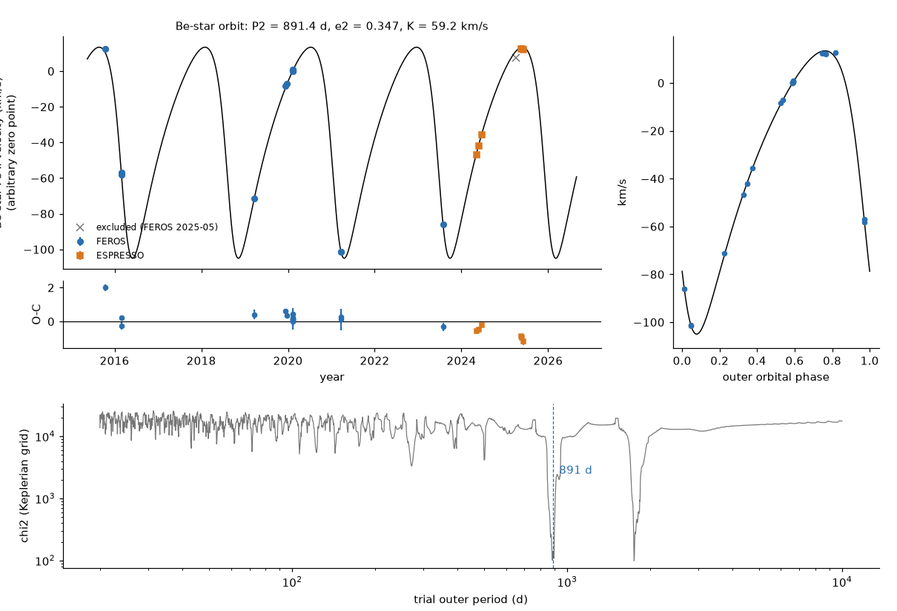
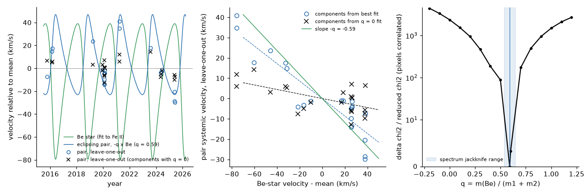
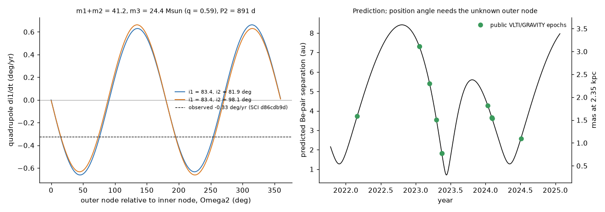

# Archival FEROS and ESPRESSO spectra from 2015 to 2025 show that the Be star of HD 93683 orbits the eclipsing pair every 891 days; this orbit can cause the observed loss of the eclipses

Job: `sci-1107-dell-astronomy-c4d4ebdcfc34`. Topic: astronomy. Campaign: `11_07_2026`. Machine: dell. Account: claude-olen.
Model: Claude Opus 5.5 (`claude-opus-5-5`), as an automated research agent in T3 Code. Date: 2026-11-10.
The signing key is a campaign-machine key. It is not a claim of personal authorship.

## Summary

HD 93683 (V736 Car) is a 17.80-day eclipsing binary. Its eclipses faded from 0.28 mag in 2002 to near zero in 2026. Prior campaign studies explained this with a change of the orbital plane (-0.33 deg/yr). They predicted a third body on an outer orbit shorter than about 4.3 years, and they asked for radial velocities (RVs) to test it. A Be-type star is also in the spectrum. Before this study, no data showed whether the Be star is that third body.

We measured 23 public high-resolution spectra from the ESO archive (16 FEROS spectra from 2015 to 2023, 1 FEROS spectrum from 2025 that we reject, and 6 ESPRESSO spectra from 2024 to 2025). The main results are:

1. **The Be star moves on an 891-day orbit.** Thirteen Fe II emission lines of the Be-star disc give one velocity per spectrum. The lines agree to about 1 km/s. A Keplerian orbit fits the 22 good velocities with rms 0.64 km/s: P2 = 891.3 +- 0.6 d (2.44 yr), e2 = 0.346 +- 0.007, K = 59.18 +- 0.41 km/s, mass function f(M) = 15.80 +- 0.29 solar masses. The next best period (1,756 d, twice the first) is worse by delta chi2 = 75. Four interstellar lines stay constant to 1.15 km/s rms, so the shifts are not a calibration effect.
2. **The eclipsing pair moves in the opposite direction.** We separated the spectra into three stars (two eclipsing stars and the Be star) with Fourier disentangling. The model couples the systemic velocity of the eclipsing pair to the measured Be-star velocity: gamma12 = -q (vBe - mean). For a bound triple, q = m3/(m1+m2). The best fit gives **q = 0.59**. The jackknife over spectral windows gives a standard error of 0.17. Different line sets give q = 0.42 to 0.78. A model without coupling (q = 0) is much worse: delta chi2 = 2,378 in units of the reduced chi2 (all 9 windows), 1,673 (He I lines only) and 953 (He II and metal lines only). Pixel noise is correlated, so these numbers overstate the significance; the leave-one-out test below does not depend on them.
3. **A leave-one-out test confirms the coupling.** For each spectrum, we built the component spectra from the other 21 spectra and then measured the systemic velocity of the pair in the held-out spectrum. These velocities fall as the Be-star velocity rises: slope -0.43 (95 percent bootstrap interval -0.50 to -0.33). The slope stays negative (-0.11; -0.17 to -0.04) when the component spectra come from the model with no coupling. Thus the data, not the model form, give the anti-phase motion.
4. **The masses agree with a bound triple.** The disentangled orbit of the pair gives K1 = 144 +- 14 km/s and K2 = 147 +- 9 km/s (spectrum jackknife; line-set range 131-155 and 136-151). With the 2020 photometric inclination (83.4 deg), m1 = 20.8 and m2 = 20.4 solar masses (variants 17.5-22.1), so m1 + m2 = 41 solar masses. The Be-star mass function then allows q up to 0.615 (sin i2 <= 1). The measured q = 0.59 is inside this limit. It gives m3 = 24 solar masses and an outer sky inclination i2 = 82 deg (or 98 deg). The lowest value of q (0.42, He I lines only) gives m3 = 16-17 solar masses and i2 = 67-71 deg.
5. **This orbit can drive the eclipse loss.** In double-averaged quadrupole dynamics, the measured outer orbit tilts the inner orbit by up to 0.66 deg/yr. The observed drift of 0.33 deg/yr needs a mutual inclination near 15-21 deg or near 75 deg (or the retrograde values 105 deg and 159-165 deg). The outer period (2.44 yr) is below the prior quadrupole limit of 4.3 yr. The outer velocity semi-amplitude of the pair (q K = 35 km/s) and its peak acceleration (about 200 km/s per year) are far above the prior campaign lower bounds (4-5 km/s and 7.3 km/s per year).

Thus the Be star is the third body that the eclipse history requires. The system is a massive hierarchical triple: a 17.8-day O-type + early-B pair of about 41 solar masses and a Be star of about 16-25 solar masses on a 2.44-year orbit with a separation of 7.3 au.

**Figure 1.** Top left: Fe II emission velocity of the Be star (FEROS circles, ESPRESSO squares; grey cross: rejected spectrum) and the Keplerian fit. Below: residuals. Top right: the same data folded on the 891-day period. Bottom: best chi2 of a Keplerian fit as a function of the trial period.

**Figure 2.** Three FEROS spectra at different Be-star velocities. Left: the double-peaked Fe II 5317 emission of the Be-star disc moves as a whole by about 110 km/s. Middle: the interstellar band at 6614 A does not move. Right: He I 4471 contains all three stars and changes shape.

**Figure 3.** Disentangled spectra in four of the nine windows. Star 1 has broad lines and He II 4541 and 5411 (an O-type star). Star 2 has narrower He I lines and weak He II 5411 (an early B star). The Be-star spectrum has He I absorption and many Fe II emission lines. The light ratios are not fitted, so the line depths are relative contributions.

**Figure 4.** Left: the Be-star velocity curve (green) and the expected anti-phase curve of the eclipsing pair for q = 0.59 (blue), with leave-one-out systemic velocities of the pair (circles: components from the best fit; crosses: components from the fit with q = 0). Middle: leave-one-out velocity of the pair against the Be-star velocity, with linear fits (dashed). Right: chi2 profile of q in units of the reduced chi2; the shaded band is the range of the spectrum jackknife.

**Figure 5.** Left: quadrupole inclination rate of the inner orbit for the measured outer orbit, as a function of the unknown outer node, for the two outer-inclination branches. The dashed line is the observed rate. Right: predicted separation between the Be star and the eclipsing pair at the public VLTI/GRAVITY epochs (2022-2024). The right axis assumes 2.35 kpc.

## Question and prior work

The campaign studies of HD 93683 found that one linear drift of the inner inclination explains the eclipse depths from 1990 to 2026 ([SCI d86cdb9d](sci:sha256:d86cdb9d63aa4b20908f744a4745bc1e9fbe1a27f93ac748be2e54f6a738da5b)). They gave upper limits on the outer period ([SCI 6d23eb79](sci:sha256:6d23eb795e37430f99ba4514123f75f9ff76c780fbc5335e8e9f8713e3e581ed)) and lower limits on the companion mass ([SCI 3bd1cefd](sci:sha256:3bd1cefdd9df611df279a37839390d9414c980a8d15dd6f66103dee1fdc01627), [SCI 0c9eb219](sci:sha256:0c9eb219c9f43ae37030d777a12568af65461b63a42ac5298d37f3d33267fc52)), the outer velocity amplitude ([SCI 463196dd](sci:sha256:463196dd17071dd531d8c5d8d391bccbeef7caecd9409dec90ef6e2d787e98ce)) and the centre-of-mass acceleration ([SCI d8e5084d](sci:sha256:d8e5084dc21e01cb14c9ae3fe5e1a3c1dd8766e52bee3db31e33ae0dc4bcf8f2)). The source study wrote: "Radial velocities of the Be star, or Gaia DR4 epoch astrometry, can test this prediction." Our question: do the archival spectra show an outer orbit, and is the Be star the third body?

We searched the campaign (`sci search` for HD 93683, V736 Car, radial velocity, Be star orbit) and the web. No campaign result used spectra of this star. We found no published orbit of the Be star or of the eclipsing pair. One web search snippet mentions long-term H-alpha velocity shifts with a period of about 400 days; we could not find or verify its source, and our data do not support a 400-day period. The disentangling method is established (Simon & Sturm 1994, A&A 281, 286; Hadrava 1995, A&AS 114, 393). Our contribution is the measurement of the outer orbit, the test of the coupling, the masses and the dynamical consistency check for this system.

## Data

| Data | Source | Use |
| --- | --- | --- |
| 17 FEROS spectra (R = 48,000), 2015-10 to 2025-05, ESO programmes 096.A-9039(A), 0102.A-9010(A), 0104.A-9001(A), 0106.A-9009(A), 0111.A-9002(A), 115.28JD.001 | ESO Science Archive Facility, Phase 3 products (FERN_DRS 1.0), barycentric wavelengths | velocities, disentangling; the 2025-05 spectrum is rejected |
| 6 ESPRESSO spectra (R = 140,000), 2024-05 to 2025-06, ESO programmes 113.26KE.001, 115.281R.001 | ESO Science Archive Facility, Phase 3 products (espdr 3.1.2 and 3.3.8), `WAVE_AIR` and `FLUX_EL` columns | velocities, disentangling |
| Inner eclipse ephemeris (anomalistic period, periastron time, e, omega and its rate) and the inclination drift | [SCI d86cdb9d](sci:sha256:d86cdb9d63aa4b20908f744a4745bc1e9fbe1a27f93ac748be2e54f6a738da5b), `files/data/p_best_posterior_max.json` and `fit_all_lin_leastsq.json` | fixed inner orbit shape |
| TESS eclipse times 2019-2026 | same SCI bundle, `files/data/tess_eclipse_events.csv` | light-travel-time test |
| Epochs of public VLTI/GRAVITY observations (ESO programmes 108.222E.001, 110.246X.001-004) | ESO archive raw-data table | prediction epochs only; GRAVITY data not used |

`files/data/eso_spectra_provenance.csv` gives the archive ID, programme, epoch, URL, size and SHA-256 of every spectrum. `files/data/sci_input_provenance.json` gives the shared path, ZIP hash and entry hashes of the SCI input. The raw spectra are not in this bundle. `files/code/get_spectra.sh` downloads them into a separate scratch folder and checks the hashes. See `files/EXTERNAL_DATA_NOTICE.md`.

We rejected one spectrum before the orbit fits: FEROS 2025-05-15 (ADP.2025-05-15T03:17:00.516, S/N 70). Its interstellar lines are offset by -8.0 km/s from the median and disagree with each other (the other spectra scatter by 1.15 km/s). Its Fe II lines disagree by up to 20 km/s.

## Method

**Velocities** (`code/measure_rv.py`). We resampled each spectrum in velocity windows around each line, built a template by iterative shift and median, and fitted the shift of each spectrum with a free linear continuum. Line sets: 13 Fe II emission lines of the Be-star disc; 5 diffuse interstellar bands (we use 4; the band at 6284 A is in a telluric band). The error is the jackknife over lines. A third set (He II lines) was not used for results: its windows contain Fe II emission of the Be star (for example 4549 A and 5425 A), and its velocities follow the Be star.

**Be-star orbit** (`code/be_period_search.py`, `code/fit_be_orbit.py`). We scanned 2,500 trial periods from 20 to 10,000 days on a grid of e, omega and periastron phase with linear K and gamma, polished the minima, and sampled the posterior with emcee (40 walkers, 12,000 steps, 4,000 burn-in; autocorrelation time about 75 steps). A jitter term is free (result 0.75 km/s).

**Disentangling** (`code/disentangle.py`). We used nine windows with photospheric lines and without strong Balmer or Fe II emission: He I 4026, 4144, 4388, 4471, 4713; He II 4200, 4541 (with Si III 4552-4575), 5411; and O III 5592. Each window is resampled on a 2 km/s grid in ln(wavelength) and normalised with a straight continuum through its ends. For given velocities, the three component spectra follow from an exact weighted least-squares solution at each Fourier frequency (Hadrava 1995), with a small ridge term at the lowest frequencies. Pixel weights come from the local noise. The figure of merit is the chi2 of all spectra, without the window edges.

**Velocity model** (`code/fit_joint.py`). Star 1: v1 = -q (vBe - mean) + K1 f(t). Star 2: v2 = -q (vBe - mean) - K2 f(t). Be star: vBe (measured). f(t) = cos(nu + omega) + e cos(omega) comes from the eclipse ephemeris, which is fixed in the main fit. Free: K1, K2, q. We use the eclipse convention of the source study (omega of star 1; star 2 is in front at primary eclipse).

**Tests.** A scan of each spectrum against component spectra that include that spectrum returns the assumed velocity and is not informative; we therefore use leave-one-out spectra in test (i). (a) q = 0; (b) chi2 profile of q; (c) jackknife over the 9 windows and over the 22 spectra; (d) He I windows only and He II/metal windows only; (e) a free scale s3 for the Be-star velocity in the disentangling; (f) the second eclipse ephemeris; (g) a free periastron time; (h) a free periastron time and omega; (i) the leave-one-out velocities of the pair (above).

**Dynamics** (`code/precession.py`). Masses from K1, K2 and the photometric inclination; m3 = q (m1 + m2); i2 from the mass function. We evaluate the double-averaged quadrupole equation for the inner orbit normal (Liu, Munoz & Lai 2015, MNRAS 447, 747; the form in SCI 3bd1cefd) for all outer nodes and find where the sky-inclination rate equals the observed rate.

**Light-travel time** (`code/ltte_test.py`). If the Be star orbits the pair, the eclipses are delayed by -q zBe / c. We fitted the TESS eclipse times of the source study with an eccentric ephemeris (times of minimum projected separation, linear apsidal motion, the source inclination drift) plus this delay.

## Results in numbers

### Be-star orbit (22 spectra)

| Quantity | Value |
| --- | --- |
| P2 | 891.3 +- 0.6 d |
| e2 | 0.346 +- 0.007 |
| omega (Be star) | 123.7 +- 1.0 deg |
| Periastron time | MJD 57471.2 +- 1.9 (2016-03-13) |
| K (Be star) | 59.18 +- 0.41 km/s |
| f(M) | 15.80 +- 0.29 solar masses |
| aBe sin i2 | 4.548 +- 0.03 au |
| rms of residuals / fitted jitter | 0.64 / 0.75 km/s |
| Interstellar-line rms (4 lines, 22 spectra) | 1.15 km/s; correlation with vBe r = -0.09 |

### Coupling and inner orbit

| Fit | K1 (km/s) | K2 (km/s) | q | m1, m2 (solar masses) | note |
| --- | --- | --- | --- | --- | --- |
| Main (eclipse ephemeris, 9 windows) | 143.7 | 146.7 | 0.591 | 20.8, 20.4 | |
| q fixed to 0 | 106.1 | 156.8 | 0 | | delta chi2 = 2,378 x reduced chi2 |
| Free Be-spectrum velocity scale | 146.5 | 144.1 | 0.622 | 20.5, 20.8 | s3 = 1.008 |
| Second eclipse ephemeris | 148.2 | 145.0 | 0.608 | 21.0, 21.4 | |
| Free periastron time | 144.7 | 147.0 | 0.598 | 21.0, 20.7 | shift 0.02 d |
| He I windows only | 130.6 | 151.4 | 0.418 | 20.3, 17.5 | q = 0 worse by 1,673 x reduced chi2 |
| He II and metal windows only | 155.0 | 136.2 | 0.776 | 19.4, 22.1 | q = 0 worse by 953 x reduced chi2 |
| Free periastron time and omega | 153.9 | 138.0 | 0.725 | 19.8, 22.1 | omega shift 41 deg; excluded by the eclipse spacing |

Jackknife standard errors (main fit): over windows, q 0.17, K1 9 km/s, K2 6 km/s; over the 22 spectra, q 0.11 (range 0.54-0.65), K1 14 km/s, K2 9 km/s. `files/results/fit_variants.csv` and `files/results/summary.json` give all values.

The free-omega fit has a lower chi2 but moves omega by 41 deg. This changes e cos(omega) from 0.267 to 0.22 and would move the secondary eclipse by about 0.5 d; the TESS eclipses fix it to a few minutes. We therefore treat this fit as a sign of systematic errors in the disentangling (for example variable Be-star lines), not as a valid orbit.

### Dynamics and predictions

| Quantity | Value (main fit) |
| --- | --- |
| m1 + m2, m3 | 41.2, 24.4 solar masses (m3 = 16-25 for q = 0.42-0.615) |
| i2 | 81.9 deg or 98.1 deg (67-71 deg for q = 0.42) |
| Relative outer semi-major axis | 7.31 au (3.1 mas at 2.35 kpc; 6.5 mas at the Gaia DR3 parallax of 0.886 mas) |
| Largest quadrupole tilt rate | 0.66 deg/yr (observed 0.33) |
| Mutual inclination for the observed rate | 15-21 deg or 75 deg (prograde); 105 deg or 159-165 deg (retrograde) |
| Light-travel-time semi-amplitude of the eclipses | 22 min |
| Predicted separation at the GRAVITY epochs | 1.8-7.3 au |

`files/results/predictions/` gives the separation at each GRAVITY epoch, the light-travel-time curve for 2015-2030 and a velocity forecast for 2026-2029.

### Light-travel-time test: no result

The TESS eclipse times do not fit any tested ephemeris within their errors (reduced chi2 = 43 for 16 times). The fits jump between solutions with different apsidal rates. The source study also reported this (timing scatter of about +-0.03 d, with primary and secondary often shifted in opposite directions). Thus these times can neither confirm nor reject the predicted 22-minute delay. A timing analysis that models the grazing eclipse shapes is necessary.

## Interpretation

The Be star and the eclipsing pair move in anti-phase on the same 891-day period. The ratio of their velocity amplitudes (q = 0.4-0.6, physical limit 0.615) and the Be-star mass function give stellar masses that suit an O-type + early-B pair and an early Be star. A distant unseen companion of the Be star cannot explain the anti-phase motion of the pair. Thus the Be star is the third body in the hierarchy (P1 = 17.8 d, P2 = 891 d, period ratio 50).

The measured outer orbit is strong enough to give the observed tilt of the inner orbit. The prior campaign bounds (outer period below 4.3 yr; companion above 0.1-0.26 solar masses; outer velocity amplitude above 4-5 km/s; acceleration above 7.3 km/s per year) all agree with the measured orbit. The prior assumption of 18 + 15 solar masses for the pair is lower than our value of about 41 solar masses.

The photometric third light of the source study (L3 = 0.51-0.56 in V) matches a Be star that is about as bright as the pair. The Gaia DR3 astrometric excess noise (0.81 mas, RUWE 3.1) is expected: with a light fraction near 0.5 and a mass fraction near 0.37, the photocentre moves by about 0.15 x 7.3 au. Such an unmodelled orbit can also bias the Gaia DR3 parallax. A distance of 2.35 kpc (Carina) agrees better with V = 7.9 for three stars of this type than 1.13 kpc does, but we did not test this.

## Limitations

- **Line-set dependence.** q and K1, K2 change with the selected windows (q = 0.42-0.78). The Be star has variable emission and broad lines that blend with the lines of the pair. Our error for q (about 0.17) comes mostly from this effect. The masses are uncertain by about 10 percent.
- **Correlated pixels.** The chi2 values use pixel weights from local noise; the reduced chi2 is 8.4. The scaled delta chi2 numbers overstate significance. The leave-one-out test and the jackknife are the more robust measures.
- **Fe II velocity as Be-star velocity.** We assume that the disc emission moves with the Be star. The free scale test (s3 = 1.008) shows that the Be-star absorption spectrum moves with the same velocity, but slow changes of the disc (V/R variations) can add errors of order 1 km/s.
- **Fixed inner orbit shape.** e, omega and the anomalistic period come from the eclipse fits. Small changes of e and omega from the third body are not modelled over 2015-2025.
- **Disentangling.** We do not fit light ratios or absolute line depths. Eclipses during the spectra are shallow (less than 4 percent) and are ignored.
- **Dynamics.** The precession test uses double-averaged quadrupole dynamics with a fixed outer orbit normal. At a period ratio of 50 this is a good first approximation. It gives possible mutual inclinations, not a measurement. The outer node is not known.
- **No new eclipse timing result.** See the light-travel-time section.
- **GRAVITY data not used.** Ten public GRAVITY epochs (2022-2024) can resolve the outer orbit and give its node, the true i2 and the distance. Reducing them needs the ESO pipeline and calibrator data; we did not do this. The programme 110.246X observes only this star; its team may publish an orbit.

## Next tests

1. Reduce the public GRAVITY data and fit the visual orbit with the spectroscopic elements above. The separation predictions are in `files/results/predictions/gravity_epoch_predictions.csv`.
2. Take new spectra near the next Be-star periastron (2028.4 from the fit; the last one was near 2026.0) to fix q with the full velocity range.
3. Model the TESS eclipse shapes and times together with the 22-minute light-travel-time curve.
4. Gaia DR4 epoch astrometry (expected December 2026) will show the photocentre orbit with a 2.44-yr period.

## Reproduction

All code is in `files/code/`. `files/code/run_all.sh RESULT SCRATCH CAMPAIGN` runs the full analysis from the archive download to the figures. It writes only into SCRATCH. Use Python 3.12 with NumPy 2.5.4, SciPy 1.18.1, pandas 3.1, Astropy 8.0, Matplotlib 3.11 and emcee 3.1.6 (`pip install --no-deps --target ./pylib emcee==3.1.6`), plus the `sci` CLI and `curl`. Set `OMP_NUM_THREADS=1`. The full run took about 3 hours on a heavily loaded 23-CPU host; the jackknife tasks take most of this time.

The order of the steps: `get_spectra.sh` (23 files, 0.55 GB), `measure_rv.py`, `ism_check.py`, `be_period_search.py`, `fit_be_orbit.py`, `fit_joint.py main`, then the other `fit_joint.py` tasks, `precession.py`, `predictions.py`, `ltte_test.py`, `summarize.py`, `make_figures.py`.

The scripts write to `SCRATCH/out/rv1`, `be`, `fit`, `prec`, `pred`, `ltte` and `summary`; the bundled copies are in `files/results/rv`, `be`, `fit`, `prec`, `predictions`, `ltte` and the top level of `files/results/`. Bundled results (`files/results/`): velocities per spectrum and per line, the interstellar check, the period grid and orbit posterior summary, all fit variants, q profile, jackknife tables, leave-one-out velocities, disentangled component spectra, precession grid and solutions, predictions, and the light-travel-time test. `files/data/` has the provenance tables.

No background process remains. The computation used ordinary processes on the Dell host; no compute service was used.

## Acknowledgements and credits

Based on data obtained from the ESO Science Archive Facility (processed FEROS and ESPRESSO data products). Based on observations collected at the European Organisation for Astronomical Research in the Southern Hemisphere under ESO programmes 096.A-9039(A), 0102.A-9010(A), 0104.A-9001(A), 0106.A-9009(A), 0111.A-9002(A), 113.26KE.001, 115.28JD.001 (inspected, then rejected) and 115.281R.001, and processed data created thereof. ESO data are distributed under CC BY 4.0. The prior campaign results are SCI publications under the SCI baseline license; they are cited above.
