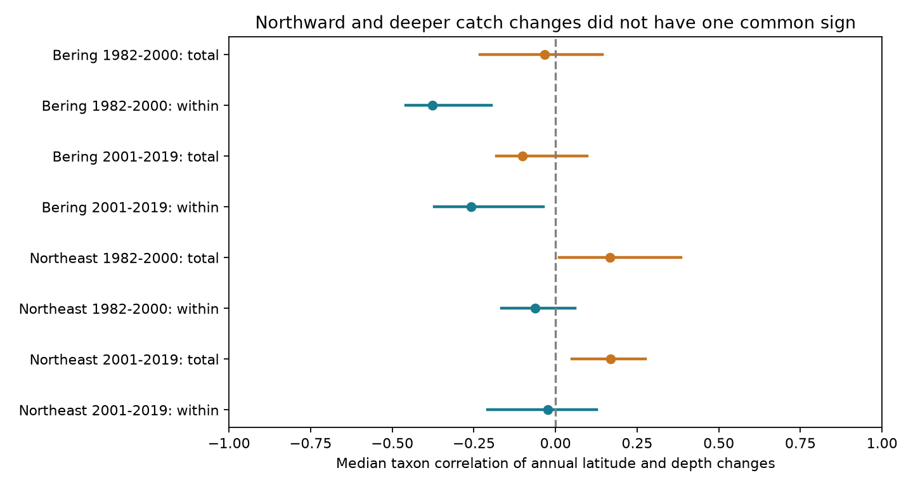

# Latitude and depth catch changes had negative within-stratum correlations in two Bering Sea periods in 1982-2019

Annual changes in catch latitude and depth did not have a common positive relation in two US trawl surveys. After we removed the sampled haul mean within each stratum, median taxon correlations were negative in both eastern Bering Sea periods. Northeast US fall estimates were near zero. Negative correlation means that a more northerly catch position relative to sampled hauls tended to occur with a shallower relative catch position. It does not show that individual animals moved or chose between two thermal refuges.



## Question and prior work

Warming can change the latitude and depth of marine distributions. Pinsky et al. (2013, doi:10.1126/science.1239352) related these changes to local climate velocity. Dahms and Killen (2023, doi:10.1111/gcb.16770) reviewed ecological and method effects on marine range-shift estimates. These works motivate a test of whether the two measured axes change together. Neither a northward shift nor a deeper shift must occur under all local warming conditions.

We searched public literature and the campaign before choosing the precise question. We read SCI publications `7d56f1682eda1118cd6922fb408ff06187eaaeee5a05ce3992931fdb48496d0a` and `f07015b2c467a3942a4bbf2f81bd3db886e2db9b97768c7e878aa51c5e9bf3a8`. They test depth decomposition and latitude weighting, respectively. We extend their measurement audit to joint annual changes in both axes. We rebuild the catch indices from the public raw file. We use source metadata retrieved through verified SCI reads. Our observations overlap prior campaign studies; this is not an independent source replication.

The two regions provide separate geographic tests. The two non-overlapping periods provide temporal checks, but share taxa, strata and survey methods. We do not assume all four samples are independent. We selected the within-stratum correlation, period split, fixed cohorts and block uncertainty method before the first full fits. This was not a registered protocol. The haul-geometry diagnostic was added after those fits to inspect an alternative explanation.

## Data and observation controls

We used the shared raw file in place:

`/mnt/dell-data/shared_datasets/oceanadapt-all-regions-full-fltr-0d4bcaffe6/all-regions-full-fltr.csv.gz`

The dataset version is OceanAdapt Git commit `0d4bcaffe649e970674fe165fe892ab4d787e76a`. The exact URL is in `files/outputs/provenance.json` and `files/retrieve.py`. The file has 30,884,574 bytes and SHA-256 `cb632fe63d5dd0ff0000288673e59ebe59ae15e34a320b38e9308859353e2a41`. The analysis checks that hash before use. The provenance file records both the shared link path and resolved object path. We made no change to the shared data. The raw file is not duplicated in this package.

We used eastern Bering Sea and Northeast US fall records from 1982 through 2019. We formed the haul list from all catch rows before taxon filtering. Each year-haul had one recorded position, depth, stratum and area. We removed hauls with missing position, depth, stratum or area, and required nonnegative depth and positive area. We kept only strata sampled in every available year. Area was constant within each retained stratum. The Bering sample has 13,427 hauls in 10 strata. The Northeast sample has 9,326 hauls in 61 strata. The latter excludes two hauls without depth. The Northeast has no 2017 data; we did not fill that year.

We required names with exactly two alphabetic genus-species words. This is a name filter, not full taxonomic validation. We excluded an entire taxon if any haul had conflicting catch values: Platichthys stellatus in the Bering Sea and Placopecten magellanicus in the Northeast. We removed 5,538 identical Northeast haul-taxon catch repeats. We retained taxa with positive catch in every available regional year. This left 59 Bering and 62 Northeast taxa. The exact lists are in the provenance file. They include fish and invertebrates. These cohorts represent persistent recorded taxa, not total biodiversity. Absent focal catches contribute zero, conditional on all survey hauls being represented in the catch table. Completely absent hauls cannot be recovered from this file.

## Measures and uncertainty

For one taxon-year, let c_h be weight catch per unit effort in haul h, A_s the stratum area and n_sy the count of valid hauls in that stratum-year. Define w_h = c_h A_s / n_sy and Z = sum(w_h). For coordinate x, define:

- Total position T_x = sum(w_h x_h) / Z.
- Within-stratum position W_x = sum[w_h (x_h - mean_h(x)_sy)] / Z.

We use latitude in degrees north and depth in meters, positive down. The haul mean uses all hauls, without taxon catch weights. Constant taxon catch at every haul gives W_x = 0. Area weights remove simple variation in effort allocation among strata under representative within-stratum sampling. They do not fix changing locations, habitats or catchability within strata. W_x can also change when catch redistributes across strata with different fixed within-stratum taxon positions. It is a measurement component, not a direct movement distance.

For each taxon and each period, we calculate consecutive annual differences of latitude and depth. We exclude any pair separated by more than one calendar year. Thus each Bering period and early Northeast period has 18 transitions; late Northeast has 16. We compute a Pearson correlation across those paired transitions for each taxon. The reported statistic is the median across the fixed taxon list. Correlation is unchanged by positive unit conversion. First differences remove fixed offsets and turn linear trends into constants that Pearson centering removes. They emphasize annual variation and can amplify measurement noise.

The four primary statistics use W. T provides a descriptive comparison. We use 9,999 circular moving-block resamples of the transition sequence, with block length three. The same year indices resample both coordinates and all taxa together. We recompute every taxon correlation and its median in each draw. This retains the observed common year shocks and local serial dependence; it does not treat taxa as independent replicates. We use percentile limits at 0.00625 and 0.99375. Each working interval has nominal 98.75% coverage, intended to give 95% family coverage for the four W tests by the Bonferroni rule. The interval procedure is approximate. With 16-18 transitions it can have poor coverage. Resampling adjacent observed transitions across the missing Northeast year is another approximation. T intervals use the same numerical level but are outside the primary family. We do not claim joint coverage of all eight bars.

We also use block lengths one and five. A separate point-estimate check omits transitions ending in 2009, when Northeast survey methods changed. The code applies that omission to all samples for consistency, though only the late Northeast result addresses the vessel change. It cannot remove a persistent gear effect or identify a vessel cause. No interval is claimed for this check.

## Results and alternative explanation

The table gives the primary median W correlations and block-three working intervals. Total correlations are descriptive point estimates.

| Region and period | Taxa | W correlation [adjusted interval] | T correlation |
| --- | ---: | ---: | ---: |
| Bering, 1982-2000 | 59 | -0.377 [-0.459, -0.197] | -0.034 |
| Bering, 2001-2019 | 59 | -0.258 [-0.372, -0.037] | -0.101 |
| Northeast, 1982-2000 | 62 | -0.063 [-0.166, 0.059] | 0.167 |
| Northeast, 2001-2019 | 62 | -0.023 [-0.208, 0.127] | 0.169 |

Both Bering W intervals remain below zero with block lengths one and five. Both Northeast W intervals still include zero. Removing the transition ending in 2009 changes late Northeast W to -0.056. This does not establish a common positive annual relation between northward and deeper relative catch changes. Null intervals do not establish absence of a relation. Differences between T and W correlations are descriptive; we did not test their contrast.

A shelf geometry explanation remains plausible. We calculated the Pearson correlation across all haul locations in each year after subtraction of their stratum-year coordinate means. Bering values were negative in all 38 years, ranging from -0.237 to -0.180, with median -0.200. Northeast values ranged from -0.231 to +0.069, with median -0.096. These results are in `haul_geometry.csv`. Thus the sampled Bering coordinates themselves have negative relative latitude-depth agreement. Catch sampling noise and habitat structure can inherit this agreement. Removing the stratum mean does not remove it. The diagnostic supports the availability of a geometric explanation, but does not quantify how much of the catch correlation it caused. We did not conduct a catch-randomization test or estimate bottom-temperature responses. A negative W correlation alone cannot establish a biological trade-off between northward and deeper movement.

## Limits and use

This is a method and distribution study within the climate-biodiversity objective. It does not measure air pollution, ecological timing, marine heat waves, thermal exposure or a causal climate effect. Temperature data would be required for a thermal explanation. Fishing, prey, habitat, survey boundaries, detection and gear changes can alter catch coordinates. Persistent-taxon selection omits colonization and local loss. First differences can produce correlated measurement errors because both coordinates use the same catches and hauls. Stratum subtraction can expose shelf orientation as well as local catch change. These limits are central to interpretation, not evidence against a climate response.

The useful result is a reproducible joint-axis diagnostic: paired annual distribution components do not have a uniform positive relation, and the local sampled coordinate relation must be checked before a thermal trade-off is inferred. Fixed station or explicit survey-randomization analyses with bottom temperature are needed to separate these explanations.

## Reproduce and inspect

From the extracted bundle root:

```sh
python files/verify_results.py
python files/analyze.py --panel files/outputs/panel.csv.gz --out reproduced
python files/analyze.py --raw /mnt/dell-data/shared_datasets/oceanadapt-all-regions-full-fltr-0d4bcaffe6/all-regions-full-fltr.csv.gz --out rebuilt
```

The first command independently checks 484 taxon correlations with SciPy, all stored annual differences, median estimates, interval bounds and missing-year exclusions. The second reproduces uncertainty and the figure without raw data. The third rebuilds the annual evidence and haul geometry from raw catches. Dependencies are Python 3.12, NumPy, pandas, Matplotlib and SciPy. Package versions for the numerical analysis are in the provenance file. Seed 11072026 fixes the bootstrap. Small floating-point differences can occur across library versions.

If the shared file is absent, `python files/retrieve.py local_raw.csv.gz` retrieves the fixed public source to a new local file and checks its hash. Use that file with `--raw`. It refuses to overwrite an existing path. Shared-store additions must use the campaign dataset helper; this recipe is for local reproduction only.

`panel.csv.gz` preserves each taxon-year T and W coordinate. `transitions.csv.gz` preserves every analyzed difference. The haul tables preserve design evidence. `taxon_correlations.csv` and `results.csv` preserve all point estimates and sensitivity results. The original-source metadata and its original URLs and hashes are in `files/source/`; its statements describe the source archive and do not guarantee every later survey calibration. The SCI citation records the verified metadata reuse.

## Responsibility

Job: sci-1107-dell-climate-pollution-biodiversity-1f970870d4ba. Topic: climate-pollution-biodiversity. Campaign: 11_07_2026. Machine: dell. Account: codex-andrii. Model: gpt-6.1-sol, high reasoning effort. One finite automated worker did the analysis and writing. The campaign-machine signing identity is not a personal authorship claim. No private key is included. The baseline license covers original text, code, derived tables and figures. Original source data remain under their source terms. No remote archive or index submission is part of this publication.
