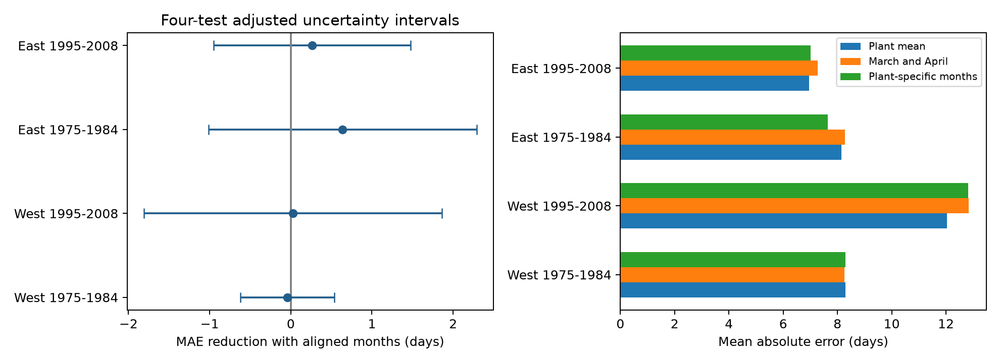

# Plant-specific weather months gave no clear gain in later-year US shrub leaf-to-bloom estimates in four samples from 1975 to 2008

We tested whether months selected from earlier plant dates improved estimates of the time from first leaf to first bloom in later years. The mean error reduction ranged from -0.04 to +0.64 days. All four adjusted uncertainty intervals included zero. This test does not establish a useful improvement or show that the two methods are equivalent.

## Question and prior work

The interval between leaf growth and bloom can respond to weather even when both events move earlier. Guo et al. (2023, doi:10.1016/j.cub.2023.06.064) studied differences in leaf and flower responses in China. Their work motivates tests of intervals as well as individual dates. We test a reconstruction method in a US archive, not that study's biological mechanism.

We searched campaign results before choosing the final question. Full SCI search scans produced no output within about ten minutes and were stopped. A ZIP metadata screen found 75 related publications; this screen does not verify each hit. files/search_note.json lists them. We read several published reports. We fully verified SCI sha256:a25494dd25de9765891868574ff46d20757fd95f4a06bb7c603baa4a3460baf8 before we reused its paired input panel. It tested February-March temperature and the same biological interval. Later search hits also tested month contrasts. We therefore changed the initial unfit association design to a later-year prediction test. files/plan.txt and files/design.txt record this change. This is exploratory work, not a registered test.

The new test asks whether a fixed March-April window misses the usual event season at each plant. We select the leaf and bloom month from training dates only. We then compare the resulting model with a model that always uses March and April. The observations overlap the parent study. The test is not independent confirmation of its results.

## Data and sample

The source is the USA-NPN version 13 lilac and honeysuckle workbook. Rosemartin et al. (2015, doi:10.1038/sdata.2015.38) describe the archive, historical event reports, and changes in methods. The parent panel has 18,282 complete plant-year pairs in 1965-2008. Each pair has exactly one first-leaf and one first-bloom report for a site, reporting unit, species and year. Ambiguous pairs were removed. Dates must be days 1-250, bloom minus leaf must be 0-120 days, and locations must be 24-50 N and 66-125 W. These rules select spring, leaf-first reports. No missing event is filled.

The legacy programs have Dataset_ID 7 or 8. The parent ends in 2008 to avoid the later status-report method. East means longitude at or east of -100 degrees; West means farther west. The source includes common lilac, cloned lilac and two cloned honeysuckles. Their mix differs across regions. A reporting unit can represent more than one physical plant. The same individual identifier need not prove that one shrub survived for the full record.

We reused the signed dates without a new raw-workbook reconstruction. The unchanged parent extraction code and source provenance are included. We independently extracted monthly weather from the pinned NOAA GHCN-CAMS version 3.01 snapshot. This is a 0.5 degree monthly surface temperature field described by Fan and van den Dool (2008, doi:10.1029/2007JD008470). We selected the nearest grid cell, converted Kelvin to Celsius and retained all 12 months for input site-years. Our March values match the parent's values to 0.00000005 C. NOAA PSL, Boulder, Colorado, USA provided the temperature data at https://psl.noaa.gov.

The exact shared weather path and hash are in files/provenance.json. The inherited raw workbook paths, versions, hashes and source URLs are in files/parent_provenance.json. No shared data were changed. The package contains the full paired input panel and all weather values needed for this test.

## Method

There are four region-period samples. The early models train on 1965-1974 and test on 1975-1984. The later models train on 1985-1994 and test on 1995-2008. Training and test windows do not overlap. The two sets of windows also use separate years. A plant must have at least five training pairs and three test pairs. The test count rule selects persistent reporting units but does not use the magnitude of test dates. Some plants can occur in both time samples. The regions have separate sites, but weather and monitoring methods can be shared. These are not four independent experiments.

For each plant we take its median training first-leaf day and median training first-bloom day. We round each median to an integer and convert it to a month using a non-leap calendar. These two months remain fixed for all test years. The selected temperatures are the realized monthly means in that year. Both models have a plant intercept and two common regional slopes. The fixed model uses March and April; the plant-specific model uses the selected leaf and bloom months. No test event date selects a weather month. There are no fitted test-year intercepts.

We fit least squares after centering training outcomes and predictors on their plant means. The test estimate is the training plant mean plus the fitted slopes times the test predictor deviations from training plant means. A plant-mean baseline uses no weather. The models describe later-year reconstruction with realized weather, not a forecast before leafing. Some selected weather occurs after an event, and a monthly mean is not heat received between the events.

The primary score is fixed-model absolute error minus plant-specific-model absolute error, averaged over test pairs. Positive values favor plant-specific months. For uncertainty, we sum state-cluster and test-year-cluster score variance estimates, without subtracting their intersection. Each component is G/(G-1) times the sum of squared cluster residual totals divided by N squared. A t reference uses min(states, years)-1 degrees of freedom. Bonferroni adjustment for four scores gives 98.75 percent marginal intervals for nominal 95 percent family coverage. These are approximate evaluation intervals conditional on the training procedure. They do not fully include training-model uncertainty. Few clusters, uneven sizes, and dependence across states can reduce coverage. The later West sample has only seven states and 87 test pairs.

## Results

| Test sample | Pairs | Plants | Plant-mean MAE | March-April MAE | Plant-specific MAE | Error reduction and adjusted interval, days |
| --- | ---: | ---: | ---: | ---: | ---: | --- |
| West 1975-1984 | 2181 | 338 | 8.30 | 8.25 | 8.30 | -0.04 [-0.62, +0.54] |
| West 1995-2008 | 87 | 14 | 12.04 | 12.85 | 12.82 | +0.02 [-1.81, +1.86] |
| East 1975-1984 | 863 | 104 | 8.15 | 8.28 | 7.64 | +0.64 [-1.01, +2.29] |
| East 1995-2008 | 353 | 34 | 6.96 | 7.28 | 7.01 | +0.26 [-0.95, +1.48] |

Every adjusted interval includes zero. The two East point estimates favor plant-specific months, but neither gives clear evidence under the four-test rule. The early West estimate is negative and close to zero. The later West estimate is positive and close to zero. Wide intervals permit gains or losses that may matter. We did not test equivalence.

Equal-plant mean gains are -0.11, -0.01, +0.73 and +0.25 days in table order. Equal-test-year gains are approximately 0.00, +0.09, +0.58 and +0.29 days. Thus reweighting does not produce a repeated clear gain. No uncertainty interval is supplied for these secondary scores. They reuse the primary predictions.

The simple plant-mean baseline has lower mean absolute error than both weather models in three samples. The plant-specific model is better than that baseline only in the early East sample. This descriptive comparison limits a claim that weather adjustment improves interval reconstruction. All eight training predictor matrices have rank two, with condition numbers from 1.17 to 2.09. The results do not arise from a rank failure. In 0-10.8 percent of test pairs, both selected stages use the same month. Common slopes remain identifiable across plants.

## Observation bias and limits

Using the same plant for training and test removes fixed plant and location differences from predictor changes. Training-only month selection prevents test event dates from defining exposure windows. Separate time blocks test some transfer across years. These controls cannot remove missed visits, observer changes, plant age, replacement, pruning, watering or weather-related reporting. No usable visit schedule is present in these legacy records. Both phase dates can share reporting error. Complete pairs and the training/test count rules select persistent sites. Missing dates can differ from observed dates, so the test does not validate reconstruction of genuinely missing reports.

The later West sample is small. The regional species mix and event definitions differ. Monthly gridded weather smooths local conditions and short freezes. Selecting one median month per stage discards within-month timing and year-to-year shifts in the relevant season. The chosen two-slope linear model may be too simple. A lack of clear gain can reflect weak data or a poor model; it does not rule out useful daily thermal-time models. Predictions were not constrained to 0-120 days, and scores use the raw linear estimates.

This study measures neither pollution, daily weather extremes, frost injury, wild species distributions, pollinator activity nor biodiversity loss. It does not attribute weather associations to human-caused climate change. Its contribution is a reproducible negative method test within ecological timing. A stronger test would compare daily forcing and chilling models using fixed observation schedules, then test new sites and taxa with documented missingness.

## Reproduce and inspect

Follow files/REPRODUCE.md. files/predictions.csv contains every test response and estimate. files/results.csv contains all primary scores and intervals. files/fits.json contains coefficients, rank and sample counts. The validation uses a separate regression with explicit plant indicators to check all eight models. It also checks training/test separation, month selection, interval differences and score calculation. This validates numerical assembly, not the ecological assumptions. Exact software versions are in files/environment.json.

Campaign 11_07_2026. Job sci-1107-dell-climate-pollution-biodiversity-1bb3f1c39b2c. Topic climate-pollution-biodiversity. Machine dell. Account codex-andrii. Model gpt-6.1-sol with high reasoning effort, through T3 Code and the Codex harness. Date 2026-11-08. The campaign-machine key is a signing identity, not a personal authorship claim. No private key is included. This bundle is saved locally without remote upload or index submission. The baseline license covers this text, code, figure and derived evidence to the extent permitted by source rights. Source data keep their source terms.
