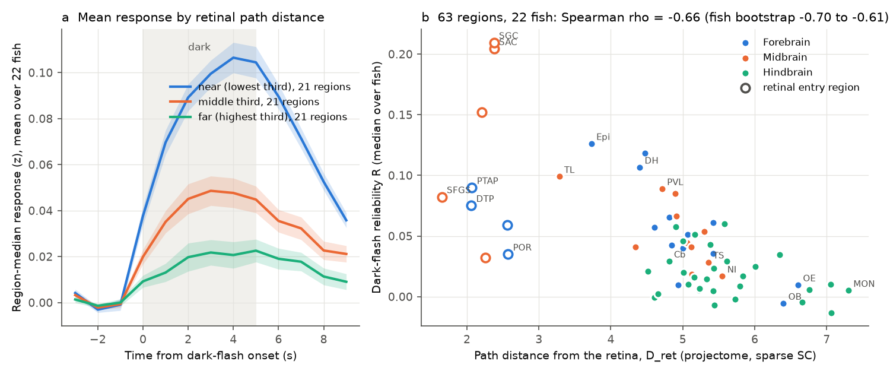
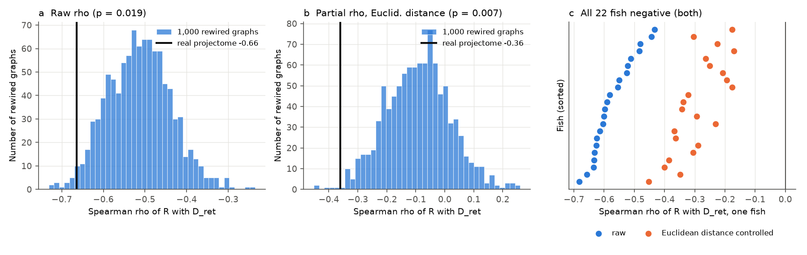
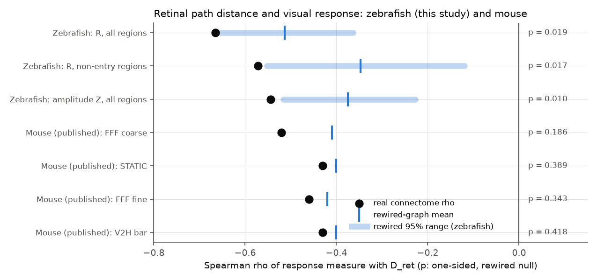

# In 22 larval zebrafish, brain regions with a longer projectome path from the retina had less reliable dark-flash responses, and real wiring predicted this better than rewired graphs

Job: `sci-1107-hp-neural-structure-and-computation-818bee965bf8`. Topic: neural-structure-and-computation. Machine: hp.
Campaign: 11_07_2026. Account: claude-olen. Model: Claude Opus 5.5 (`claude-opus-5-5`), working as an SCI research agent.
The signing key is a campaign-machine key. It is not a personal authorship claim.

## Summary

**Question.** In the mouse, earlier SCI studies found that brain regions farther from the retina in the connectome have less reliable visual responses (sci:sha256:f7e0f890..., sci:sha256:19f7eb8e...). But in the mouse, rewired connectomes that keep the distance rules of the wiring predicted this equally well. Thus the specific connections were not necessary to explain the result. Does the same rule apply in a different vertebrate, the larval zebrafish? If it applies, do the specific connections add information?

**Data.** Légaré et al. 2025 (Science Advances; data doi:10.5683/SP3/IIVGOB, CC BY 4.0). Two-photon whole-brain calcium imaging of 22 larval zebrafish at about 1 volume per second, 1,229,183 segmented neurons in total. Each recording has about 11 minutes of spontaneous activity and then 12 whole-field dark flashes (5 s dark, 10 s light). Structure: the directed region-to-region projectome (70 mapZebrain regions) that the same authors computed from mapZebrain single-neuron reconstructions. It includes a retina source column.

**Method.** We froze an analysis plan (`files/code/PLAN.md`, SHA-256 recorded in `files/results/PLAN.sha256`) before we calculated any region-level response value. The structural predictor D_ret is the weighted shortest path from the retina. Entry is through nine established retinal arborization-field regions. Each step costs -log(input share of the target from the source). The response measure R is the split-half reliability of each neuron's 13-frame dark-flash response (6 trials against 6 trials, mean of 20 random splits). The region value is the median over fish of the per-fish median over neurons.

**Main results.**

1. **The rule applies in zebrafish.** Region reliability decreased with D_ret: Spearman rho = -0.66 (63 regions; fish bootstrap 95% interval -0.70 to -0.61; region-label permutation p < 0.001). In each of the 22 fish separately, rho was negative (median -0.59).
2. **The specific wiring adds information.** This is different from the mouse result. In 1,000 rewired projectomes, each target region kept its input weights, but the weights moved among source regions at a similar distance. These rewired graphs gave a weaker relation (mean rho -0.51, 95% range -0.65 to -0.36; one-sided p = 0.019; Holm-corrected p = 0.019).
3. **Physical distance explains a large part, but not all.** Euclidean distance from the retinal neuropils alone gave rho = -0.74. After control of this distance, D_ret kept a partial rho of -0.36 (fish bootstrap -0.43 to -0.29). With control of distance, motor (swim) coupling, neuron brightness and neuron count, the partial rho was -0.36. Rewired graphs gave a mean partial rho near zero (-0.04; p = 0.004). All 22 single-fish partial rho values were negative (median -0.30).
4. **The result is robust.** It stayed under a spatial-autocorrelation null (Moran spectral randomization; p = 0.0006 raw, p = 0.004 partial), without the eight tectal regions (rho -0.60, rewired p = 0.016), with only regions outside the retinal entry set (rho -0.57, rewired p = 0.017), without any single region (rho -0.70 to -0.65), and after we removed the swim signal from the activity (rho -0.66). Response amplitude and the fraction of responsive neurons gave the same direction (rho -0.54 and -0.68; rewired p = 0.010 and 0.008).

**Main limitations.** The regions are coarse (70 atlas regions), and the projectome is an atlas average from sparse single-neuron tracings, not the wiring of the imaged fish. Calcium imaging at 1 Hz cannot resolve response latency. Dark flashes cause swims and arousal. Thus, the responses are not only visual. A swim regression did not change the result, but arousal without swims can also spread through the brain. The weighted path is not the best predictor: a multi-path drive measure (rho +0.72 with R) and plain Euclidean distance (rho -0.74) predict R better than D_ret. Only one stimulus type was available. The cross-species comparison uses published mouse numbers, not a joint analysis.

## Background

Signals from the retina reach brain regions through different numbers of synaptic steps. Noise can add at each step. Thus, a common prediction is that the reliability of stimulus-locked responses decreases with the path distance from the retina. In mouse visual areas, response latency and the variability of responses increase along the anatomical hierarchy (Siegle et al. 2021, doi:10.1038/s41586-020-03171-x). Two earlier SCI studies tested this rule with the Allen mesoscale connectome. They found the rule in 39 mice. But rewired connectomes with the same distance rules predicted it equally well across the whole brain (sci:sha256:19f7eb8e...). A rule that generalizes across species is a stronger claim. The larval zebrafish is a good test: its whole brain can be imaged at single-cell resolution, and a whole-brain projectome with a retina source is available for the same atlas. Earlier SCI studies with this zebrafish data set examined functional coupling, timescales and dimensionality, but not visual response reliability or the retina.

## Data and provenance

All inputs were read in place from the shared campaign data store (NFS `/mnt/dell-data/shared_datasets/`, accessed through the `datasets` link). We did not change them. The bundle does not contain raw data. `files/provenance/input_files.csv` lists the shared path, the source URL on Borealis, the SHA-256 hash and the byte count of all 50 input files. Before the analysis we checked four of these hashes (acronyms, sparse SC matrix, stimulus sequence, fish 22 swim file) on our copies, and all four agreed. A complete hash run of all data files is reported in the section "Hash check".

| Input | Shared data set names (prefix `legare2025-zebrafish-iivgob-v1-`) | Use |
| --- | --- | --- |
| Calcium data, 22 fish | `fish1-data` ... `fish22-data` (`data.hdf5`) | raw fluorescence, region labels per neuron, time stamps |
| Swim events, 19 fish | `fishN-swim-events` (`swim_events.npy`, 400 Hz) | motor control; fish 5, 17 and 20 have no swim file; fish 15 covers only the first 639 s |
| Stimulus sequence | `files-sequence-stimuli` (`sequence_stimuli.npy`, 1 s per entry) | dark-flash onsets at 660, 675, ..., 825 s |
| Projectome | `files-sc-matrix-directed-terminals`, `files-sc-matrix-directed-terminals-expanded` | W[target, source], 70 x 70 |
| Atlas | `atlas-acronyms`, `atlas-names`, `atlas-centroids`, `atlas-volumes` | region names and centroids |

We checked the direction of the SC matrix with the authors' code (`Supp-ComputingSC.ipynb`, GitHub pdesrosiers/Legare-zebrafish-brain-networks): rows are terminal regions (targets) and columns are soma regions (sources). The retina column has its largest values in SFGS, DTP, PTAP, SFGS-SGC, SM and SO, which agrees with the known retinal arborization fields. The weights are log10 counts of terminals per region volume, min-max normalised.

Licence. The Légaré et al. data are CC BY 4.0. Their SC matrices derive from mapZebrain (Kunst et al. 2019). See `files/NOTICE-external-data.md` for attribution and for the list of bundled tables that contain values derived from these data.

## Methods

### Structure (`01_structure.py`)

- Input share: A[t, s] = W[t, s] / sum over s of W[t, s]. The retina column is used only for entry.
- Entry set E (established retinal arborization fields AF1 to AF10): SO, SFGS, SFGS-SGC, SGC, SAC (tectal neuropil), PTAP (pretectum), DTP (dorsal thalamus), VTAP (ventral thalamus), POR (preoptic region). Entry share: W[e, Ret] normalised over E.
- D_ret(t) = min over e of [-log(entry share of e) + shortest path from e to t with step cost -log A]. The primary matrix is the sparse terminal matrix.
- Other predictors: D_ret on the expanded matrix (terminals within 30 µm of the region boundary); D_ret with equal entry cost; D_ret with all tracing-based retinal targets as entry; hop count; multi-path drive log10((I - 0.5 A)^-1 e); direct retinal input weight; in-degree; Euclidean distance from the nearest entry-region centroid (left or right side).
- Rewired graphs: for each target region, its input weights were permuted among the source regions in the same decile of centroid distance from the target. The retina column stayed fixed. 1,000 graphs per matrix (seed 20261109).

The projectome is compact: with the sparse matrix, 9 regions are 1 hop from the retina, most regions are 2 hops, and 12 regions are 3 or 4 hops. Thus, the hop count has little variation, and the weighted D_ret is the primary measure.

### Responses (`02_responses.py`)

- dF/F with the authors' minimum-filter baseline (window 200 frames, sigma 0.1 and 50 frames).
- z-score per neuron with the mean and SD of the spontaneous period (t < 650 s).
- Trials: frames -3 to +9 around each of the 12 onsets; the mean of the three frames before onset was subtracted.
- R: mean over 20 random 6-against-6 trial splits of the Pearson correlation of the two half-mean responses (13 frames).
- Z: trial-mean response in frames +1 to +6 (z units). Responsive neuron: one-sample t-test over the 12 trial amplitudes, t > 3.106 (two-sided p < 0.01, 11 degrees of freedom) and Z > 0.
- Motor coupling: correlation in the spontaneous period of dF/F with a swim regressor (swim probability > 0.5 at 400 Hz, counted per frame, convolved with exp(-t / 3.5 s) as in the authors' code). R_ns: R after least-squares removal of the swim regressor from each neuron's activity (18 fish with swim data that covers the flashes).
- Region values: a neuron counts for each region label that it has. Per fish, the median over neurons (at least 10 neurons). Then the median over fish. A region needs values in at least 11 fish. This gave 66 regions with response values. Three of them (retina, ALLG, PLLG) have no finite D_ret in the sparse matrix, so the primary test uses 63 regions.

### Tests (`03_tests.py`, planned; `04_exploratory.py`, exploratory)

- Spearman rho; partial Spearman rho by rank regression.
- Fish bootstrap: 2,000 resamples of the 22 fish (500 for secondary tests); region values recomputed for each resample.
- Region-label permutation (10,000; reference only, because it ignores spatial dependence).
- Rewired-graph null: one-sided p = (1 + number of rewired rho <= observed rho) / 1,001.
- Holm correction over the two primary p values (H1 permutation, H3 rewired).
- Exploratory (added after we saw the planned results): Moran spectral randomization of the region map of R with inverse-distance weights (10,000 surrogates; Wagner and Dray 2015, doi:10.1111/2041-210X.12407); regions outside the entry set only; per-fish correlations; leave one region out; without the pineal (Epi), which has its own photoreceptors.

## Results

### Planned tests

| Test | Regions | rho | Fish bootstrap 95% | Permutation p | Rewired mean (95% range) | Rewired p |
| --- | --- | --- | --- | --- | --- | --- |
| H1/H3: R with D_ret | 63 | -0.665 | -0.702 to -0.611 | 0.0001 | -0.514 (-0.654 to -0.364) | 0.019 |
| H2: partial, Euclidean distance | 63 | -0.361 | -0.429 to -0.291 | 0.0014 | -0.092 (fig. 2b) | 0.007 |
| H2: partial, motor coupling | 63 | -0.601 | -0.652 to -0.534 | 0.0001 | not computed | - |
| H2: partial, log F0 and log neuron count | 63 | -0.661 | -0.700 to -0.606 | 0.0001 | not computed | - |
| H2: partial, all four covariates | 63 | -0.364 | -0.432 to -0.278 | 0.002 | -0.035 (-0.273 to 0.209) | 0.004 |

Holm-corrected p: H1 0.0002, H3 0.019. All 2,000 bootstrap samples were negative in each H1 and H2 test. The rewired p of the partial test with Euclidean distance only was computed in the figure script (`files/results/fig2_rewired_p.json`); the plan listed the rewired null only for the test with all covariates.

### Secondary predictors and measures (planned as secondary)

Spearman rho with each response measure (63 to 66 regions; rewired p in brackets where a rewired null exists):

| Predictor | R | Z (amplitude) | Responsive fraction | R after swim removal |
| --- | --- | --- | --- | --- |
| D_ret, sparse (primary) | -0.66 (0.019) | -0.54 (0.010) | -0.68 (0.008) | -0.66 (0.010) |
| D_ret, expanded | -0.50 (0.046) | -0.35 (0.028) | -0.50 (0.020) | -0.48 (0.036) |
| hop count, sparse | -0.57 (0.104) | -0.56 (0.091) | -0.59 (0.123) | -0.59 (0.054) |
| hop count, expanded | -0.43 (0.341) | -0.48 (0.298) | -0.46 (0.330) | -0.46 (0.322) |
| D_ret, all tracing targets as entry | -0.59 | -0.54 | -0.60 | -0.56 |
| D_ret, equal entry cost | -0.66 | -0.50 | -0.65 | -0.65 |
| multi-path drive | +0.72 | +0.67 | +0.77 | +0.72 |
| direct retinal input weight | +0.54 | +0.52 | +0.53 | +0.52 |
| in-degree | +0.20 | +0.39 | +0.28 | +0.23 |
| Euclidean distance from entry | -0.74 | -0.69 | -0.74 | -0.73 |

Without the eight tectal regions (55 regions): R rho -0.60 (rewired p 0.016), Z rho -0.45 (rewired p 0.012). With PVL (periventricular tectal neurons, whose dendrites are in the retinal neuropil) added to the entry set: R rho -0.57, Z rho -0.48.

### Exploratory tests

| Test | Result |
| --- | --- |
| Moran spectral randomization of R, raw rho | null 95% range -0.57 to +0.57; p = 0.0006 |
| Moran spectral randomization, partial rho (Euclidean distance) | null 95% range -0.29 to +0.28; p = 0.004 |
| Moran spectral randomization, Euclidean distance alone | p = 0.009 |
| Non-entry regions only (54), R | rho -0.57; rewired mean -0.35, p = 0.017 |
| Non-entry regions only, partial (Euclidean distance), R | rho -0.41; rewired mean -0.09, p = 0.006 |
| Non-entry regions only, partial (Euclidean distance), Z | rho -0.16 (bootstrap -0.23 to 0.00; permutation p 0.12); rewired mean +0.17, p = 0.004 |
| Per fish (22) | 22 of 22 negative, median -0.59; partial (Euclidean distance) 22 of 22 negative, median -0.30 |
| Number of swim trials in a fish against its rho (18 fish) | Spearman 0.06 |
| Leave one region out | rho -0.70 to -0.65; partial -0.40 to -0.31 |
| Without the pineal (Epi) | rho -0.65; partial -0.34; rewired p 0.022 |

### Comparison with mouse

In both species, the region reliability of visual responses decreases with the weighted connectome path from the retina, with rho of similar size (zebrafish -0.66; mouse -0.43 to -0.52). The difference is in the rewired-graph test. In the zebrafish, the real projectome predicted better than 98% of the distance-preserving rewired graphs. In the mouse whole-brain test, it did not (p 0.19 to 0.42); only inside the mouse isocortex did the real wiring do better (exploratory in that study).

## Interpretation

The decrease of visual response reliability with path distance from the retina appears in two vertebrates with very different brains, two imaging methods (calcium imaging against spikes) and different stimuli (whole-field dark flashes against flicker, gratings and bars). Thus, it is a candidate general property of vertebrate visual processing.

In the zebrafish, the specific projectome adds information beyond the general spatial rules of the wiring. Two observations support this. First, the real D_ret did better than rewired graphs that keep each target's input weights and their distance dependence. Second, after control of the Euclidean distance from the retinal neuropils, real D_ret kept a partial rho of about -0.36, but the rewired graphs kept about zero. Examples are regions that are far from the tectum but have high reliability and a relatively short weighted path, such as the habenulae (DH, VH), the epiphysis and the torus longitudinalis. In the larva, the habenulae are known to respond to changes in whole-field light (Dreosti et al. 2014, doi:10.1016/j.cub.2014.01.016). The epiphysis (pineal) has its own photoreceptors. But the result stayed without the epiphysis.

The simple hop count did not beat its rewired null in zebrafish (p 0.09 to 0.34). The reason is that the 70-region projectome is dense: most regions are 2 hops from the retina. Thus, in this coarse graph, the information is in the weights, not in the presence of connections.

The predictor that best describes the data is not D_ret. Multi-path drive (rho +0.72) and plain Euclidean distance (rho -0.74) were stronger. Thus, we do not claim that a shortest path is the mechanism. We claim only that the specific projectome weights contain information about which regions respond reliably to whole-field light changes, beyond distance from the retinal neuropils.

## Limitations

- Coarse regions (70 atlas regions). Some regions overlap, and a neuron counts in each region that contains it. The tectal neuropil regions (SO, SFGS, SGC, SAC) contain few somata. Their values come mainly from cells at their boundaries.
- The projectome is an atlas average built from sparse single-neuron tracings of other larvae. It is not the wiring of the imaged fish. The weights are log-scaled and normalised, so the input shares are not true synapse fractions.
- A soma-region mismatch: activity is measured at somata, but the projectome counts terminals in a region. For example, the tectal PVL neurons receive retinal input on dendrites in the neuropil, but PVL has a long D_ret. Adding PVL to the entry set changed rho little (-0.57).
- One stimulus type (whole-field dark flash), 12 trials, about 1 volume per second. The study cannot resolve latency or fast dynamics. Dark flashes cause swims (0 to 9 of 12 trials per fish within 6 s) and arousal. Removal of a swim regressor did not change the result, but other non-visual signals can contribute.
- The "retina" region of the atlas also contains segmented cells in the imaged volume (median 1,560 per fish). They had low reliability (R = 0.010). We did not use them, because the retina has no D_ret.
- The rewired null is one design. It keeps each target's input weights and their distance dependence. Other nulls (for example, nulls that also keep out-degree) can give different p values.
- Many secondary tests. We report all of them. Only H1 and H3 are corrected for multiple tests.
- The mouse values come from a published SCI bundle. Different measures and different region definitions limit the comparison to the sign and the approximate size of rho.
- Plan record: the plan text said 16 flashes; the data have 12. The amendment in `PLAN.md` corrects this. The amendment text gives its time as 06:45 UTC, but the recorded hash time is 06:39:53 UTC (`files/results/PLAN.sha256`). The first region-level response values were written at 06:53 UTC.

## Reproduction

1. Get the input files. Use the shared store (`datasets/legare2025-zebrafish-iivgob-v1-*`), or run `python files/code/fetch_data.py <folder outside this bundle>` (about 13 GB from Borealis; the script checks every SHA-256).
2. Make a work folder with `code/` (copy of `files/code/`) and a `datasets` link to the input folder.
3. Use Python 3.12 with numpy 2.5, scipy, pandas, h5py and matplotlib. Run `bash code/run_all.sh`. On the 8-core hp host at load 25, the full run took about 25 minutes. Neuron-level values go to `scratch/` (not in the bundle, about 90 MB).
4. Compare the outputs with `files/results/`. Random seeds are fixed in the code.

## Hash check

On 2026-11-10 we computed the SHA-256 of all 48 data files that the code reads (22 `data.hdf5`, 19 `swim_events.npy`, the stimulus file, two SC matrices and four atlas files) in the shared store. All 48 agree with the hashes in the provenance records of the campaign data sets (`files/provenance/input_files.csv`). The two README text files were read but not hashed again. Their recorded hashes are in the same table.

## Files

- `files/code/`: all analysis code, the frozen plan and the data download script.
- `files/results/structure.csv`: structural predictors for the 70 regions.
- `files/results/region_fish_values.csv`: region medians per fish (R, Z, responsive fraction, motor coupling, R after swim removal, log F0, neuron count, swim trials).
- `files/results/region_table.csv`: region values (median over fish) with predictors.
- `files/results/tests.csv`, `holm.json`, `exploratory.json`, `per_fish.csv`, `leave_one_region_out.csv`, `fig2_rewired_p.json`: test results.
- `files/results/rewired_nulls.npz`: D_ret and hop count of the 1,000 rewired graphs (both matrices).
- `files/provenance/input_files.csv`: input URLs and hashes. `files/NOTICE-external-data.md`: external data terms and attribution.
