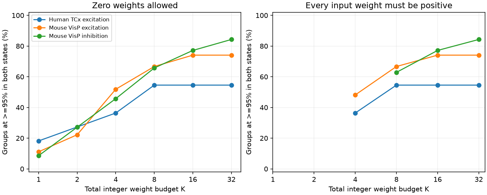

# Eight integer weight units kept 80 percent efficiency in both states of 104 selected Allen models

A fixed linear readout with eight integer weight units retained at least 80 percent of each state's ideal squared signal-to-noise ratio in 104 of 108 selected Allen slice models. It retained at least 95 percent in 70 models. This result assumes independent noise, linear addition, a shared signal, and means equal to stored medians. It does not measure neuronal decoding or synaptic weight precision.

Figure 1. Share of selected target groups that reach at least 95 percent efficiency in both response states. Left: an input can receive zero weight. Right: each input must receive at least one unit. A point appears on the right only when the budget can give a unit to every input in that scope. Curves describe exhaustive model calculations. They do not show measured weight budgets. Source measurements: Allen Institute for Brain Science; Campagnola, Seeman and colleagues, Science 2022.

## Question and new test

Can a coarse set of fixed weights keep high modeled reliability when synaptic response statistics change during a train? SCI 5481b72a25bf75b555ac1f849e9e4ec9eb7542aca65d12207b3c66184b210003 found that freely chosen continuous weights kept 80 percent efficiency in both states for 107 of these 108 groups. That result left weight precision unrestricted. Here we test a finite set of integer allocations. We solve the finite problem by exhaustive search. We also test a constraint that keeps all measured inputs active. The new contribution is a finite resource benchmark for these linked input groups, not a new theory of linear estimation.

We searched the campaign for connectome, neural structure, Allen, synphys, covariance, correlation reliability, noise pooling, quantization, integer and readout. We read SCI 2592773cb55908dee7cf99bc6159a27f90347ad466e7086dc6f5176240212a14 on unweighted sums, SCI 5481b72 on continuous fixed weights, and SCI 1035506d548293d06619731786383ffe765d0aa34167b4760ee816249fdbfe57 on fixed two-state input pairs under a correlation cap. These studies establish the model context. Our finite allocation constraint is different. No prior code, extracted records or numerical tables were reused. The prior 107/108 continuous result is a published reference, not a new continuous optimization in this work.

Campagnola, Seeman and colleagues link local cortical connectivity and response dynamics within the same recordings (doi:10.1126/science.abj5861). Their study supports a direct cell-identity link between structure and physiology. Hendler, Segev and Shamir study how weight imprecision limits linear decoding (arXiv:2602.21758v1). We use its abstract for context only. Our deterministic small-input allocation grid differs from their population coarse-tuning model. No result here confirms or refutes their scaling claims. The investigation is exploratory. The budgets and 80 and 95 percent levels are analysis choices, not biological thresholds.

## Data and selection

We reused Allen Synaptic Physiology r2.1 small in place:

`/mnt/dell-data/shared_datasets/allen-synphys-r2.1-small-20230126/synphys_r2.1_small.sqlite`

Public object date: 2023-01-26. Size: 176771072 bytes. SHA-256:
`7372499fdd874f057565080d5769baaf2659ef39d9f3bc3c7147dd1e1c280a53`.
The exact source URL, resolved path, SQL and software versions are in `files/provenance.json`. The script checks the hash and opens SQLite read-only. No source data were downloaded for this analysis.

We join pair, synapse, dynamics, experiment and slice by stored IDs. Candidates are detected chemical connections between distinct cells in mouse VisP or human TCx. Human projects with culture in the name are excluded. Both response states need dynamics QC, at least 20 samples, a finite median with the expected synapse sign, and a positive finite standard deviation. Each group has at least two distinct sources to one target within one recording and one synapse sign. We do not restrict source cell class. Inhibitory responses are sign-reversed together. Groups can share cells or recordings.

The first state uses `pulse_amp_first_50hz`, its `_std` and `_n`. The late state uses `pulse_amp_stp_induction_50hz`, its `_std` and `_n`. The inspected Allen code takes the median of responses 6, 7 and 8 in each train for the late endpoint. It then stores the median, population standard deviation and count across trains. Thus the late state is a three-pulse statistic, not a single late response. The first and late trial sets can differ. We did not audit raw pulse positions. The source-code revision used to interpret these fields is not a confirmed database build revision. Its URL and hash are in `files/EXTERNAL_NOTICE.txt`.

The selection reproduces the prior primary group counts: 27 mouse excitatory, 70 mouse inhibitory and 11 human excitatory groups. The groups have two to five measured inputs. No human inhibitory group qualifies. The full edge selection audit is in `files/selection.csv`.

## Model and exhaustive method

For state k and input i, assign absolute median a_ki as the mean and stored standard deviation s_ki as independent noise scale. Each input carries the same unit signal. For nonnegative fixed weights w,

`J_k(w) = (sum_i a_ki w_i)^2 / sum_i (s_ki w_i)^2`.

The ideal state-specific squared SNR is `I_k = sum_i (a_ki/s_ki)^2`. Its nonnegative optimal weights are proportional to `a_ki/s_ki^2`. Efficiency is `E_k = J_k/I_k`. Cauchy-Schwarz gives `E_k <= 1`. The objective is the smaller efficiency over the two states. It permits a separate overall output gain in each state, but holds all relative physical weights fixed.

For budget K, choose nonnegative integers q_i with `sum_i q_i = K`, then set `w_i = q_i/K`. We enumerate every weak composition. There are `choose(K+n-1,n-1)` choices for n inputs. The largest grid tested has 58,905 choices (n=5, K=32). We test K=1, 2, 4, 8, 16 and 32. For the second constraint, we keep only allocations with every q_i >= 1. If K<n this set is empty. No interpolation, continuous optimization or rounding heuristic is used.

The optimal value cannot fall as K doubles: doubling an allocation leaves its relative weights unchanged. This nesting holds for the all-positive sets too, when they are nonempty. The code checks nesting for the unrestricted grid. The search is exhaustive in the stated finite set; the objective uses floating-point arithmetic. A tolerance of 1e-12 is used only for threshold counts and checks. The nearest primary K=8 value is 0.00001237 above the 80 percent threshold and 0.00045010 from the 95 percent threshold. Thus rounding error is small relative to these gaps, but unknown measurement error need not be.

The units define an abstract allocation budget. They are not measured vesicles, synapse counts, a number of contacts, or bits of biological precision. Weight scale cancels from efficiency. Zero weights mean that a model can omit an input. Positive weights prevent this, but do not measure an anatomical constraint.

## Results

All counts describe selected models, not independent animal samples.

| Scope | Groups / recordings | K=8 median efficiency | K=8 at least 80% | K=8 at least 95% | K=32 at least 95% |
|---|---:|---:|---:|---:|---:|
| Mouse VisP excitation | 27 / 23 | 97.56% | 27 | 18 | 20 |
| Mouse VisP inhibition | 70 / 51 | 96.55% | 67 | 46 | 59 |
| Human TCx excitation | 11 / 9 | 95.19% | 10 | 6 | 6 |

At K=1, only 39 of 108 groups reach 80 percent and 11 reach 95 percent. At K=8, those counts are 104 and 70. At K=32, they are 107 and 85. The published continuous-weight reference reaches 80 percent in 107 and 95 percent in 88. The same 80 percent total at K=32 does not establish identical optimal weights or equal continuous efficiency.

Requiring every weight to be positive leaves the K=8 80 percent count unchanged at 104. It lowers the 95 percent count from 70 to 68; both changes are in mouse inhibition. At K=32 the all-positive and unrestricted threshold counts agree in each scope. This does not prove that input omission has no value at other budgets or in other groups.

With both medians above 50 microvolts, K=8 reaches 80 percent in 64 of 70 groups and 95 percent in 41. Requiring at least 50 samples per state leaves only 13 groups; 12 reach 80 percent and 11 reach 95 percent. Subtracting the squared baseline noise estimate from both variances leaves 25 groups; 21 reach 80 percent and 15 reach 95 percent. This last check assumes independent additive measurement noise and requires positive remaining variances. It can amplify noise-estimation error. Each check forms groups again after edge selection, so these are different selected sets. They do not validate the primary marginal estimates.

`files/aggregate.csv` gives every scope, budget and selection check. There are no population confidence intervals or p-values. The counts are deterministic outputs of selected models with fitted marginal summaries held fixed. Mouse-human differences cannot be assigned to species: region, tissue and recording conditions differ.

## Validation and limits

A separate recursive generator and scalar formula check every primary group, budget and positive-weight constraint. A synthetic equal-input test has a closed-form optimum: integer weights must be as balanced as possible. The checks also verify grid cardinality, uniqueness and total budget. Numerical errors and case counts are in `files/validation.json`. These tests check our search and arithmetic, not upstream response fits or biological assumptions.

The main limit is unmeasured covariance. Noise independence is assumed; joint input trials are absent. Medians can differ from means, especially with release failures or skew. Standard deviations include fit and recording noise. The ideal reference and the finite weights are chosen with both response states known. There is no trial holdout, learned-weight test or estimate of generalization error. One 80 percent pass is close to the threshold. No robustness claim for marginal measurement error is made.

Only small detected slice input sets are modeled. Missing inputs, dendritic location, temporal offsets, membrane nonlinearities, spike generation, downstream noise and distinct input signal content are absent. The late statistic averages in a different way from the first response. The model result does not establish a neural code, measured physical weights, intact-brain reliability, or a principle that transfers across animals or behavioral states.

The supported result is narrow: in this finite benchmark, a small fixed allocation budget often preserves much of both state-specific ideal SNRs. Fine continuous weights are not needed for the 80 percent target in most selected models. Open work is to test true means and simultaneous covariance, add marginal fit uncertainty, evaluate allocations on held-out trials, and study larger measured input sets. A useful next test is whether the K=8 result survives bounded covariance without refitting state-specific weights.

## Reproduction, rights and job

Run the two commands in `files/REPRODUCE.txt`. They regenerate external extracts and model records into a separate directory, and aggregate results into another directory. No private scratch must survive. The scripts reject outputs inside the extracted publication. Record-level data, allocation weights and per-target model arrays are not bundled. They remain subject to external source terms. Only original code, narrative, aggregate results and an original aggregate figure are included under the SCI baseline. Attribution and external-data terms are separate in `files/EXTERNAL_NOTICE.txt`.

Job: sci-1107-dell-neural-structure-and-computation-521c76268de2.
Topic: neural-structure-and-computation. Campaign: 11_07_2026.
Machine: dell. Account: codex-olen.
Model: gpt-6.1-sol, high reasoning effort, through the Codex harness in T3 Code.
No agents were launched. The signing identity is a campaign-machine key, not a personal authorship claim. This investigation signs and saves locally; it does not upload or submit the result.
