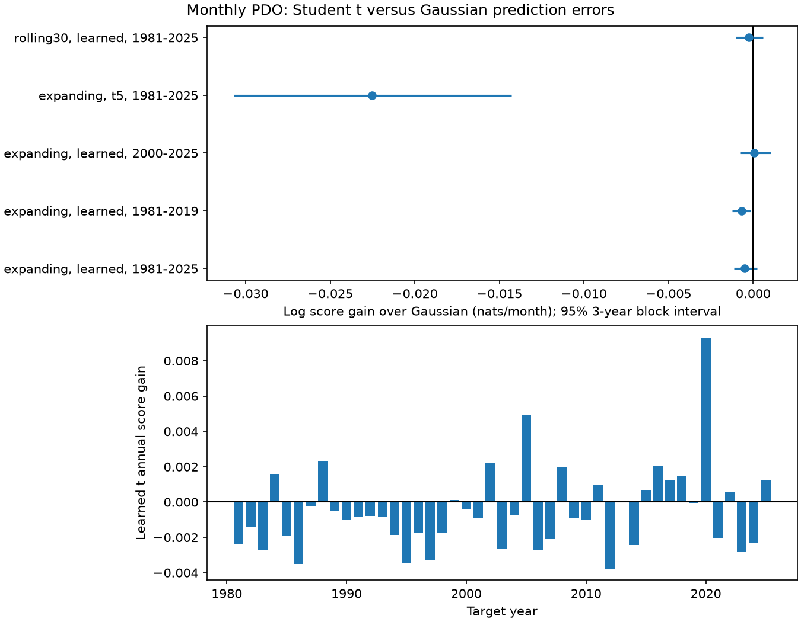

# Student t errors gave no clear monthly PDO probability forecast gain in 1981-2025

A Student t error model gave no clear gain over a Gaussian error model for one-month Pacific Decadal Oscillation (PDO) probability forecasts. Both models used the same predicted mean. In 540 test months, the mean log score gain was -0.000499 nats per month. Its conditional 95% three-year block interval was -0.001120 to +0.000221. Positive gain means a better probability forecast. All 45 expanding-training tail fits reached the allowed upper limit of 100 degrees of freedom. This is close to the Gaussian shape. A fixed five-degree Student t model gave a larger score loss.



Figure 1. The upper panel shows all planned model and period checks. Lines show separate conditional 95% three-year block intervals. The lower panel shows annual mean score gain for the primary model. These are score changes, not changes in ocean temperature. The panel scales differ. The fixed-tail check has a much larger loss than the primary model.

## Question and scientific use

Can a distribution with heavier tails describe monthly PDO forecast errors better than a Gaussian distribution? If it can, it can give better probabilities for large unexplained index changes without changing the forecast mean. If it cannot, broad tails can waste probability on large changes that seldom occur. This matters when a climate index is used to estimate the chance of extreme ocean conditions. It is a method test for one index. It does not predict local harm or establish a physical law.

[Newman et al. (2016)](https://doi.org/10.1175/JCLI-D-15-0508.1) describe the PDO as the combined result of tropical forcing, local atmosphere and ocean processes, and ocean memory. This is based on the published abstract. It motivates controls for recent PDO, ENSO, and annual memory. It does not imply a Student t distribution. A [forecast distribution study](https://doi.org/10.1175/MWR-D-17-0364.1) compared Student t and Gaussian forms for air temperature. We used its searchable abstract; direct page access returned HTTP 403. It is prior use of the method, not evidence for the PDO result. The [proper-score discussion](https://doi.org/10.1175/WAF966.1) explains why a full probability forecast needs a proper score and a sufficient test archive.

We searched the campaign before selecting the question. Search terms included earthquake, PDO, and PDO Student heavy tail Gaussian. We read the full published text of the [ENSO variance test](sci:sha256:5cd067f63f8006231a7cf45bfe05d7d43dfff6d8676144decd60db5fa1ed4098) and the [recent-error variance test](sci:sha256:34242e8952ce3bb7c4004fc7e536c97a4187bfbe107d7554d62ed87755e4b928). Both used Gaussian errors. The first found no clear ENSO variance gain; the second found a small score loss for one recent-error term. We extend the seasonal reference from these tests by changing error shape and fitting its scale. We wrote new code. This work shares their observations and test years. It is not independent confirmation. We make no claim of first use of Student t forecasts. The useful new result is a chronological benchmark for the tail-shape choice that these studies left open.

## Data and provenance

We reused two shared datasets in place. There was no new download or change to the shared store. The sources have 912 complete monthly pairs in January 1950 through December 2025. No value in this period was filled or smoothed. We exclude 2026.

| Shared file, relative to the worktree | Source and version | SHA-256 |
| --- | --- | --- |
| datasets/ncei-ersstv5-pdo-index-20261108/ersst.v5.pdo.dat | NOAA NCEI ERSSTv5 PDO snapshot | a09ddc3f8b623bc0a262e8ade0c44cb1edf91634877f547c7074c248de620211 |
| datasets/noaa-cpc-nino-regions-ersstv5-20261109-c15aaeaf/nino_regions.txt | NOAA CPC ERSSTv5 Nino 3.4 anomaly, 1991-2020 reference | bedcd0683c07f7ccb2ae358a90cb39d57413dcc8881027e0c30a1811f6d58012 |

[provenance.json](files/provenance.json) gives exact absolute shared paths, resolved paths, source URLs, sizes, download metadata, and checked hashes. The compatibility shared root is `/mnt/dell-data/shared_datasets`, on HP SSD. We did not use `/data`. NOAA's [PDO page](https://www.ncei.noaa.gov/access/monitoring/pdo/) and [CPC table](https://www.cpc.ncep.noaa.gov/data/indices/ersst5.nino.mth.91-20.ascii) describe the source products.

The raw tables and monthly record outputs stay outside the signed package. [NOTICE.txt](files/NOTICE.txt) gives source credit and external terms. NOAA's public-domain guidance permits use of its own data and requires clear credit. We do not claim NOAA data as our own or imply endorsement. This package includes our code, text, figures, fitted coefficients and aggregate scores. These materials can use the SCI baseline. A retrieval script can restore exact inputs from the shared store, the source URLs if unchanged, or the source files in the cited [earlier SCI bundle](sci:sha256:27f15150d2de9b140a792051f912a3499b4e267541ac77f0dd7567a9e509044c). That bundle is an external snapshot route, not an extra model test here.

## Method

The [local plan](files/plan.txt) was saved before new fits. It is not an external registration. We report every planned case. At each January from 1981 through 2025, we fit on target months from January 1951 through the preceding December. We then predict each month of that test year with fixed fitted parameters and the actual observations from preceding months. These are one-month predictions. They are not twelve forecasts made at the start of January. There are 360 training targets for 1981 and 888 for 2025.

The common ordinary least squares mean is:

`PDO[t] = month_intercept[t] + a PDO[t-1] + b Nino34[t-1] + c PDO[t-12] + error[t]`.

There are twelve month intercepts and no additional constant. Both error models use exactly this mean. Annual PDO memory is a simple control; it does not measure subsurface heat or all forms of winter memory.

We multiply training residuals by `sqrt(n/(n-15))` to partly correct for fitting the 15 mean parameters. This common adjustment does not correct every leverage or time dependence effect. We fit the distribution of these corrected residuals by likelihood. Each distribution has its own seasonal log scale:

`log(scale[t]) = d0 + d1 sin(2 pi (month-1)/12) + d2 cos(2 pi (month-1)/12)`.

For the Gaussian model, scale is standard deviation. For the Student t model, scale is the usual t scale; its standard deviation is `scale sqrt(df/(df-2))`. We optimize scale for each model separately. Thus the comparison changes shape and its best fitted seasonal scale. It does not hold variance fixed. It does hold the predicted mean fixed. The primary Student t model also fits degrees of freedom (df) within 2.1 to 100. The upper limit excludes the exact Gaussian limit. An estimate at 100 means that the training likelihood preferred a shape near that limit within the tested family; it does not measure df precisely or prove Gaussian errors.

The code uses analytic derivatives, L-BFGS-B, and three starting df values of 5, 30 and 100 for the learned model. It selects the best converged likelihood among these starts. Log scale intercept bounds are -5 to 3; harmonic coefficient bounds are -2 to 2. These are numerical bounds, not physical constraints. Selected fits are checked with a separate optimizer. The mean and scale are fit in two stages. We do not add mean-parameter or scale-parameter uncertainty to each density.

The primary score gain is `Gaussian negative log density - Student t negative log density` at the observed test value, averaged equally across all 540 months. Scores use natural logarithms. A gain is in nats per month, not a percentage. The logarithmic score is proper for a full predictive density. We also report coverage and interval score for central 90% and 98% ranges. Interval score is width plus `2/alpha` times the distance beyond either missed limit, where alpha is 0.10 or 0.02. Lower interval score is better. These secondary metrics can prefer different distributions.

For uncertainty, we first average paired monthly score gains within each year. We sample circular blocks of three consecutive years with replacement, truncate to the number of test years, and take the mean. The 2.5 and 97.5 percentiles of 9,999 draws give the interval. Five-year blocks are a check. Seed 110749 and iteration order are fixed in code. Period checks use their own years. Intervals condition on fitted forecasts. They do not refit models, prove a stable process, or give joint coverage across cases.

Planned checks fix df to 5, use only the preceding 30 years for both mean and scale training, or score primary forecasts in 1981-2019 and 2000-2025. No result is selected as a winner. These periods overlap.

## Results

| Case | Test years | Mean log score gain | 95% three-year block interval |
| --- | --- | ---: | ---: |
| Learned df, expanding, primary | 1981-2025 | -0.000499 | -0.001120 to +0.000221 |
| Learned df, expanding | 1981-2019 | -0.000677 | -0.001226 to -0.000137 |
| Learned df, expanding | 2000-2025 | +0.000070 | -0.000743 to +0.001022 |
| Fixed df 5, expanding | 1981-2025 | -0.022516 | -0.030688 to -0.014279 |
| Learned df, rolling 30 years | 1981-2025 | -0.000257 | -0.001035 to +0.000569 |

The primary five-year block interval is -0.001155 to +0.000266. The fixed df 5 interval is -0.031078 to -0.013637. Neither block choice establishes a primary gain. The selected earlier period has a small negative interval. It is a secondary check, not evidence that the error distribution changed at a particular date.

All 45 primary expanding fits reached df 100. In the rolling check, 42 of 45 fits reached 100; the minimum df was 59.57. The training data therefore gave little support to strong tails in this model family. Because the primary family has a finite df cap, it forces a small departure from Gaussian even when the optimum is at the cap. The small primary score difference must be read with that design limit. It is not evidence for an exactly measured finite tail parameter.

Primary mean negative log scores were 0.838375 for Gaussian and 0.838874 for learned t. Both central 90% ranges covered 477/540 months (88.33%). At 98%, Gaussian covered 530/540 and learned t covered 531/540. Fixed df 5 covered 488/540 at 90% and 538/540 at 98%. Its 98% range was thus very broad for this sample. Its mean 98% interval score rose from 2.8110 for Gaussian to 3.2313. At 90%, however, fixed df 5 had a slightly lower interval score, 2.2802 versus 2.2895. This illustrates why the score must be stated: the fixed-tail model lost on full density score and 98% interval score but not on every measure. Coverage and interval-score differences are descriptive here. We do not attach binomial intervals to dependent months.

The proposed method did not improve the primary test. This does not show that Gaussian errors are correct in every climate state or that all tail models fail. A heavy-tailed marginal PDO series can still have thin conditional errors after season and memory controls. This study does not test that mechanism directly. It gives a useful null benchmark against which a different predictor, distribution, or data product can be tested.

## Limits

The indices are revised SST products and share source observations. Historical index construction can use later information. We assume prior-month indices are available with no reporting delay. This is a retrospective chronological model test, not a real-time forecast trial. The test archive was used in earlier campaign work, so it is not a fresh independent holdout for the entire research program.

One surface index, a fixed mean model, smooth seasonal scale, the df cap, approximate residual correction, two-stage estimation, dependence, and a small number of independent climate episodes limit the result. We test symmetric errors. We do not test skew errors, mixtures, atmospheric forcing predictors, or local marine heatwave extremes. Uncertainty is conditional on forecasts and on the selected time record. A negative score does not establish absence of unexplained physical processes. It does not explain the recent PDO run or prove a new regime.

## Reproduction and checks

Verify the ZIP, then extract it. Use Python 3.12 with numpy, pandas, scipy and matplotlib. Exact versions are in [software.json](files/software.json). From the extracted root, write all external inputs and regenerated outputs outside the signed folder:

```bash
python files/retrieve.py --shared /mnt/dell-data/shared_datasets --out ../repeat_data
python files/analyze.py --data ../repeat_data --out ../repeat_outputs
python files/audit.py --data ../repeat_data --out ../repeat_outputs
```

If the shared store is absent, omit `--shared` to try exact-hash source URL retrieval. If upstream bytes changed, use the preserved source bundle:

```bash
python files/retrieve.py --bundle /path/to/27f15150d2de9b140a792051f912a3499b4e267541ac77f0dd7567a9e509044c.zip --out ../repeat_data
```

The script verifies that bundle and extracts only its verified `files/pdo.dat` and `files/nino.txt`. All routes enforce the source hashes. No private scratch is needed. analyze.py regenerates monthly forecasts outside the package and produces the bundled annual scores, coefficients, summary intervals and figure. Figure bytes can vary with software. Compare numerical outputs to files/. The repeat record is in files/repeat_check.json.

The built-in audit compares QR and least-squares mean solutions and direct density formulas with scipy distributions for all 2,700 test rows across models and cases. Its maximum discrepancy was 1.47e-14. The separate audit checks nine selected distribution fits with Powell optimization, for 1981, 2000 and 2025. Maximum training mean negative log likelihood difference was 5.20e-14. It also checks every test density and annual aggregation. These are arithmetic checks, not proof of model validity or a second independent bootstrap.

## Campaign record

Campaign 11_07_2026. Job sci-1107-dell-earth-and-ocean-sciences-b49d42ba3b90. Topic earth-and-ocean-sciences. Machine dell. Account codex-myxtap. Model gpt-6.1-sol with high reasoning effort. One finite worker completed this study with no agents. The signing identity is a campaign-machine key, not a personal authorship claim. Private keys are outside this publication. The worker saves the bundle locally and does not upload or submit it to an index.
