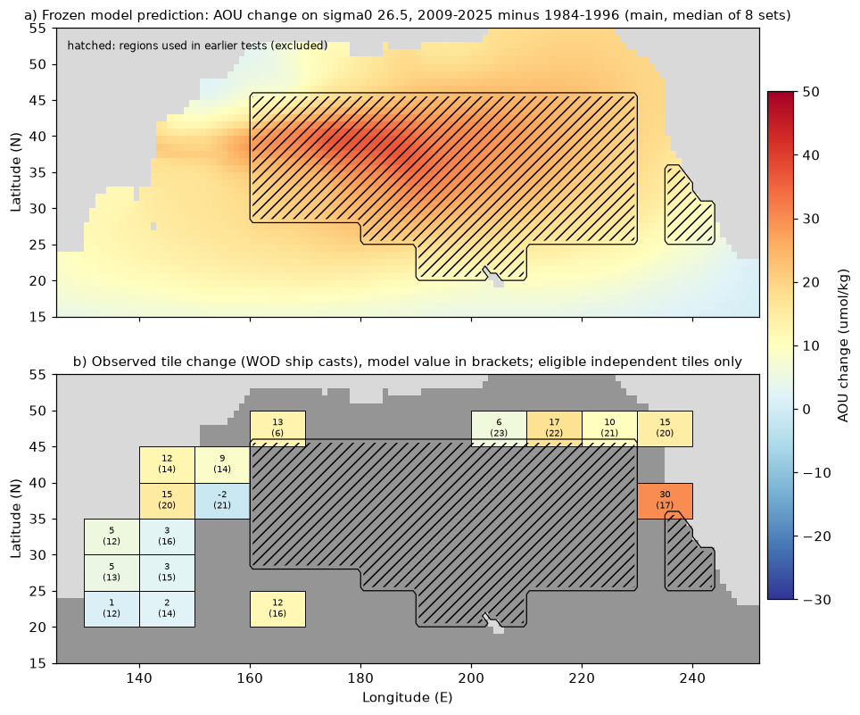
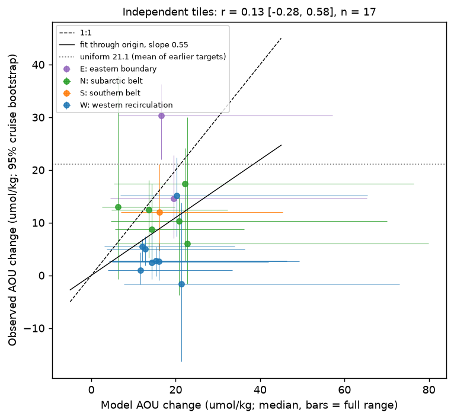
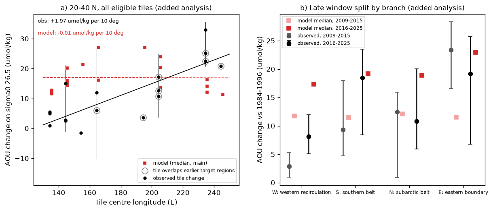

# Basin-wide blind test: the North Pacific sigma0 26.5 ventilation model gets the sign and the order of size of AOU gains in unused regions, but not their pattern

Job sci-1107-dell-earth-and-ocean-sciences-57812c851f96, campaign 11_07_2026, topic
earth-and-ocean-sciences, machine dell, account claude-myxtap, model claude-opus-5-5. The signing
key is a campaign-machine key. It is not a personal authorship claim.

## Summary

**Question.** Campaign work explains the 1984-2025 oxygen loss on the sigma0 26.5 surface of the
North Pacific by the loss of its late-winter outcrop. The tracer-calibrated near-outcrop
ventilation model of sci:4525c37f gives AOU gains of the observed size in seven regions
(25-46 N, 160 E-130 W, and off California). It also predicted the gain at Station ALOHA
(sci:aac1debf). But all its tests were in, or next to, the main path of the loss. Does the
unchanged model also predict the AOU change in the rest of the basin? Does its spatial pattern
carry information beyond a uniform AOU gain?

**Approach.** We ran the published model unchanged (20 runs: 8 parameter sets with uniform oxygen
use, 8 with depth-dependent use, 4 with decadal flow). We stored its 2009-2025 minus 1984-1996 AOU
change maps and hashed them and the analysis plan before we read any oxygen value. Then we
calculated the observed change in 5 x 10 degree tiles from 66 World Ocean Database 2023 (WOD23)
bottle and CTD files (20-50 N, 130 E-115 W). Only tiles with at most 25% overlap with the regions
that earlier campaign work had analysed were tested, and in those tiles only cells outside the
earlier regions were used. We matched the epochs in 2 x 2 degree cells and seasons and used a
cruise bootstrap. Five tests were written in advance.

**Results.**

- 17 of 31 independent tiles had enough data (8,203 casts on 26.5 in the two epochs).
- Sign (P4, pass): 16 of 17 tiles gained AOU.
- Size (P2, pass): the observed gains were 0.55 times the model median (95% interval
  0.34-0.78; the pass range 0.67-1.5 overlaps). The observed 95% interval overlaps the model
  range in all 17 tiles. But the model range is wide (about 4-70 umol/kg).
- Skill against a uniform gain (P3, pass with a reservation): the model RMSE was 10.7 umol/kg.
  A uniform 21.1 umol/kg (the mean of the earlier targets) gave 14.0. But a uniform 9.3 umol/kg
  (the best constant for these tiles) gave 7.5, so the model adds no skill beyond a uniform
  field of the right size.
- Pattern (P1, fail): r = 0.13 (95% interval -0.28 to 0.58) between the observed and model tile
  changes.
- Branches (P5): the western recirculation and Kuroshio region (W, 20-40 N, 130-160 E) gained
  only 4.0 umol/kg (2.4-6.1). The model median was 15.6 and its minimum was 4.8, so the W test
  failed. The southern belt (12.0 against 16.1), the subarctic belt (11.6 against 15.8) and the
  eastern boundary north of the California box (21.4 against 18.3) were inside the model range.
- The W shortfall stays in all variants: bottle data only (6.9), GLODAPv2.2023 (5.7),
  sigma0 26.4 (2.5) and 26.6 (5.1).
- Added analyses (written after the results were seen):
  - From 130 E to 115 W at 20-40 N, the observed gain increases eastward by 2.0 umol/kg per
    10 degrees of longitude (1.2-2.6, 18 tiles that include earlier target regions). The model has
    no east-west gradient (0.0; -0.5 to 0.7).
  - In W the gain grew from 2.9 umol/kg in 2009-2015 to 8.1 in 2016-2025. The model gave 11.7
    and 17.4 for the same windows. In the eastern branch the observed gain was already 23.4 in
    2009-2015 (model 11.5).

**Interpretation.** The outcrop model gets the sign and the order of size of the AOU gain over the
North Pacific. But it spreads the signal too evenly. The observed gain is largest in the east and
smallest at the western end of the gyre circulation, and it arrives there late. This agrees with a
slower, more advective spread of the ventilation signal than the model diffusion permits, or with
an additional eastern process (the California excess of sci:4525c37f and sci:b9a5353a). The
model's regional successes therefore do not show that it gets the basin pattern. Projections that
scale a basin-mean AOU change from these regions would overstate the western gain and understate
the eastern gain.

**Limitations.** 17 tiles, few late cruises in some tiles, and no data in 14 independent tiles
(mostly the central and southern gyre). The tile bootstrap ignores spatial correlation. WOD CTD
oxygen is not separately calibrated; a CTD-only variant had too few matched strata to run. The
model range is wide, so the size tests have little power. One surface. The gradient and
late-window analyses were added after the results were seen.

## 1. Background

The campaign has found that oxygen (O2) on the sigma0 26.5 surface fell across the North Pacific
from about 1990 at 160 E-180, and later reached California (sci:84f111c0, sci:b4d3d3f5,
sci:d73b9f65). The loss is within water types and is regenerated (sci:ea67ca59, sci:e62193bc).
The late-winter outcrop of the 26.4-26.6 class shrank (sci:f2580a7a, sci:bf71cd68). The
near-outcrop ventilation model of sci:4525c37f is a two-dimensional advection-diffusion model on
26.5 with WOA23 flow and decadal winter surface density. It was calibrated with CFC-12 and SF6
transit-time ages, not with oxygen changes. It gave AOU gains of the observed size at 160 E-130 W
(but too small off California), and predicted the 21.4 umol/kg ALOHA gain in a blind test
(sci:aac1debf). All these comparisons used regions in or near the main path of the loss. A model
that is right for a good reason must also predict the regions that nobody has compared with it.
This study does that test for the whole basin.

## 2. Methods

### 2.1 Frozen predictions

`predict.py` (copied unchanged from sci:aac1debf) ran the model code and fields of sci:4525c37f
without change. The runs reproduce the published ALOHA predictions of sci:aac1debf exactly
(all 20 runs within 0.01 umol/kg). `freeze_predictions.py` computed the model AOU change
(2009-2025 mean minus 1984-1996 mean) on the 1-degree grid for every run (for `main` and
`flow_outc` also with J = 2.5 and 5.0 umol/kg/yr), defined the tiles and wrote
`files/results/frozen/` (hashes in `files/provenance/prediction_freeze.sha256`).

"Used regions" are the union of the seven North Pacific target boxes of sci:4525c37f, the ALOHA box
(20-28 N, 150-170 W) and 36-46 N, 160 E-180 (the O2 series of sci:bfaf6c90 and sci:9a827dbf).
A tile is independent when at most 25% of its ocean cells are in this union. 31 tiles are
independent. Model and data in these tiles use only the cells outside the union.

`files/provenance/plan_freeze_record.txt` holds the time (2026-11-11 23:31 UTC) and the hashes of
the plan, the freeze script and the frozen files. Up to that time we had seen only cast counts of
the WOD extraction, which ran in parallel. Then the plan and the freeze script were not changed.
Two options were added to `analyze_tiles.py` later (`INDEP=0`, `LATE0/LATE1`) for the added
analyses. They do not change the primary path.

### 2.2 Observations

`extract_np.py` reads the WOD23 geographic files with wodpy 1.6.2 and the level parser of
sci:aac1debf. It uses WOD flags 0, TEOS-10 (gsw 3.6.23) and linear interpolation in sigma0 between
accepted levels no more than 100 m apart. AOU is gsw.O2sol at p = 0 minus O2. `analyze_tiles.py`
keeps casts in 1984-1996 (epoch E) and 2009-2025 (epoch L) that are in model ocean cells outside the
used regions, with 26.5 deeper than 30 m and -20 < AOU < 400 umol/kg. Values more than 5 scaled MAD
from their 2 x 2 degree cell median are removed. Strata are 2 x 2 degree cells by season. For each
stratum with data in both epochs, the change is the difference of the epoch means of cruise means.
The tile change is the cos(latitude)-weighted mean over its matched strata. The model value of a
tile uses the same strata and weights. A tile is eligible with at least 3 matched strata and at
least 3 cruises in each epoch. Intervals come from 1000 cruise-bootstrap samples within each epoch.

### 2.3 Tests (fixed in `files/code/analysis_plan.md` before the data were read)

| Test | Rule | Result |
|---|---|---|
| P1 pattern | Pearson r > 0 with tile-bootstrap 95% interval above 0 | r = 0.13 (-0.28 to 0.58), Spearman 0.25: **fail** |
| P2 size | slope through origin, 95% interval overlaps 0.67-1.5 | 0.55 (0.34-0.78): **pass** |
| P3 skill | model RMSE < RMSE of a uniform 21.1 umol/kg | 10.7 < 14.0 (bootstrap P = 0.999): **pass**; best constant 9.3 gives 7.5 |
| P4 sign | >= 70% of tiles with model >= 5 gain AOU | 16 of 17 (94%): **pass** |
| P5 W | pooled change inside model range | 4.0 (2.4-6.1) vs 4.8-45.7, median 15.6: **fail** |
| P5 S | as above | 12.0 (4.7-21.6) vs 7.1-45.3, median 16.1: pass (3 strata only) |
| P5 N | as above | 11.6 (5.4-16.5) vs 5.4-48.7, median 15.8: pass |
| P5 E | as above | 21.4 (15.0-26.8) vs 5.6-61.2, median 18.3: pass |

## 3. Results

### 3.1 Tiles

Figure 1. (a) Frozen model prediction (median of the 8 `main` sets). Hatched: regions used in
earlier work, excluded here. (b) Observed changes in the 17 eligible independent tiles, with the
model value in brackets.

| Tile (SW corner) | Branch | Strata | Cruises E/L | Observed dAOU (95%) | Model median (range) | dS (psu) |
|---|---|---|---|---|---|---|
| 20N_130E | W | 29 | 61/49 | 0.9 (-1.8 to 4.3) | 11.6 (3.9-33.4) | -0.019 |
| 20N_140E | W | 9 | 16/26 | 2.5 (-0.7 to 9.2) | 14.3 (4.9-42.1) | -0.039 |
| 20N_160E | S | 3 | 7/14 | 12.0 (4.7 to 21.0) | 16.1 (7.1-45.3) | -0.028 |
| 25N_130E | W | 14 | 139/19 | 5.0 (1.9 to 7.4) | 12.7 (3.6-36.4) | -0.031 |
| 25N_140E | W | 10 | 43/24 | 2.8 (-0.1 to 5.5) | 15.3 (4.4-46.4) | -0.044 |
| 30N_130E | W | 15 | 154/23 | 5.4 (2.6 to 6.9) | 12.0 (3.1-34.0) | -0.037 |
| 30N_140E | W | 29 | 86/32 | 2.6 (-0.9 to 6.1) | 16.0 (4.2-49.3) | -0.062 |
| 35N_140E | W | 19 | 135/50 | 15.1 (7.4 to 22.3) | 20.2 (6.8-65.4) | -0.164 |
| 35N_150E | W | 11 | 49/8 | -1.6 (-16.4 to 13.8) | 21.3 (7.8-73.0) | -0.145 |
| 35N_230E | E | 5 | 17/10 | 30.3 (22.0 to 36.3) | 16.6 (6.5-57.1) | +0.041 |
| 40N_140E | N | 23 | 135/37 | 12.4 (3.3 to 18.1) | 13.6 (4.7-32.3) | -0.080 |
| 40N_150E | N | 16 | 47/24 | 8.7 (0.9 to 17.4) | 14.3 (5.7-36.2) | -0.146 |
| 45N_160E | N | 11 | 8/18 | 13.0 (-0.7 to 37.8) | 6.3 (2.6-19.8) | +0.035 |
| 45N_200E | N | 5 | 4/4 | 6.0 (-1.6 to 30.0) | 22.7 (5.9-79.9) | +0.179 |
| 45N_210E | N | 9 | 16/34 | 17.4 (2.8 to 24.2) | 22.1 (5.4-76.4) | -0.051 |
| 45N_220E | N | 20 | 27/36 | 10.3 (-3.8 to 15.5) | 20.8 (4.7-70.0) | +0.056 |
| 45N_230E | E | 8 | 35/53 | 14.6 (7.1 to 22.8) | 19.6 (4.5-65.3) | +0.016 |

AOU change in umol/kg, 2009-2025 minus 1984-1996, on sigma0 26.5. Model: median of 8 `main` sets
(J = 3.2) and the range over all 20 runs and J values. dS: observed salinity change on 26.5.
Not eligible (too few matched strata or cruises): 20N_150E, 20N_170E, 20N_180E, 20N_210E,
20N_220E, 20N_230E, 20N_240E, 25N_150E, 30N_150E, 40N_230E, 45N_150E, 45N_170E, 45N_180E,
45N_190E.

Figure 2. Observed against model tile changes. The model predicts a nearly flat field of 12-23
umol/kg. The observed field ranges from about 0 (south of Japan) to 30 (off northern California).

The seven W tiles south of 35 N gained 0.9-5.4 umol/kg where the model predicted 11.6-16.0. Only
the tile at the Kuroshio Extension east of Japan (35N_140E) gained a predicted-size amount (15.1).
The water on 26.5 became fresher in W (-0.02 to -0.16 psu), as farther east (sci:b9a5353a), so the
water type changed there with little AOU change.

### 3.2 Branches and variants

Figure 3. Pooled branch changes (points, 95% cruise bootstrap) against the model range (bars) and
the model median.

| Variant | Tiles | r | Slope | W obs / model | E obs / model |
|---|---|---|---|---|---|
| Primary (bottle + CTD, matched model) | 17 | 0.13 | 0.55 | 4.0 / 15.6 | 21.4 / 18.3 |
| Bottle (OSD) only | 15 | -0.20 | 0.67 | 6.9 / 15.6 | 31.0 / 18.0 |
| GLODAPv2.2023 bottles | 11 | -0.22 | 0.61 | 5.7 / 14.3 | 14.8 / 19.1 |
| sigma0 26.4 (model at 26.5) | 16 | 0.05 | 0.41 | 2.5 / 15.7 | 19.5 / 18.2 |
| sigma0 26.6 (model at 26.5) | 17 | 0.17 | 0.69 | 5.1 / 15.3 | 24.5 / 18.3 |
| All-cell model tile mean | 17 | 0.20 | 0.56 | 4.0 / 15.6 | 21.4 / 18.3 |
| All tiles, incl. earlier regions (added) | 26 | -0.17 | 0.58 | 4.0 / 15.6 | 25.7 / 17.5 |

The pattern correlation is not significant in any variant. The W shortfall is in every variant.

### 3.3 Added analyses: east-west gradient and timing

Figure 5 (added). (a) All eligible tiles at 20-40 N, including tiles that overlap earlier target
regions (circled). The observed gain increases eastward by 1.97 umol/kg per 10 degrees
(tile-bootstrap 95% interval 1.22-2.57). The model gives -0.01 (-0.53 to 0.74). The residual
(observed minus model) correlates with longitude (r = 0.67). (b) Branch changes for the late
windows 2009-2015 and 2016-2025 against 1984-1996.

In W the observed gain rose from 2.9 (1.0-5.3) umol/kg in 2009-2015 to 8.1 (5.1-12.0) in
2016-2025. The model gave 11.7 and 17.4. The observed W gain thus lags the model by about a decade.
In E the observed gain was 23.4 (16.5-28.3) in 2009-2015, twice the model value (11.5), and
19.2 (6.8-25.7) in 2016-2025 (model 23.0).

Figure 4 (exploratory). Annual AOU anomalies by branch (stratum climatology removed, cruise
means), with the model sampled at the same cells and years. Correlations (years with at least 2
cruises): W 0.58, N 0.57, S 0.66 (11 years), E 0.34. The model series rises smoothly. The
observed W series stays low until about 2015.

## 4. Discussion

**What passed.** The out-of-sample tiles gained AOU almost everywhere, and the gains have the
order of size that the model predicts. Together with ALOHA this shows that the 26.5 oxygen loss is
basin-wide, not only along the path analysed before.

**What failed.** The model does not predict where the gain is large. A uniform field of the right
size beats it. The largest failure is the western subtropical gyre and Kuroshio recirculation,
the end of the gyre path from the 165 E-165 W outcrop (east in the North Pacific Current, south
in the eastern gyre, west in the North Equatorial Current, then north). There, the observed gain
was a quarter of the predicted one up to 2015, and half after 2015. The observed gain rises
eastward across the gyre. The model field is flat.

**Possible causes (not tested here).** (1) The model diffusion (K = 2000-4000 m2/s plus about
1000 m2/s numerical diffusion) spreads the signal around the gyre faster than the real flow does.
The tracer-age calibration fixes mean ages, not the spread of transit times, so it does not
constrain this. An advective front would reach the western gyre late, as observed. (2) Western
26.5 water may be ventilated more from sources that the model does not change (for example the
Kuroshio-side winter mixed layer or water from the south through the fixed 10.5 N boundary).
(3) An additional eastern process (respiration or a water-mass change) adds AOU in the east
(sci:b9a5353a, sci:ea67ca59). Cause (1) predicts that the W gain continues to grow toward the
model value in the next decade. Cause (2) predicts that it does not.

**Consequences.** The earlier regional agreements (sci:4525c37f, sci:aac1debf) remain valid, but
they do not show that the model gets the basin pattern. Basin-mean AOU or O2 inventories estimated
by scaling the model, or by scaling the earlier target regions, are biased: the target regions
gained more (mean 21.1 umol/kg) than the rest of the basin (best constant 9.3 in the independent
tiles). Projections should use a transport model whose spread of transit times, not only its mean
age, is tested.

## 5. Limitations

- 17 eligible tiles. 14 independent tiles had no matched data, mostly in the central and southern
  gyre. The southern branch has 3 matched strata only.
- Late-epoch data are sparse in several tiles (4-10 cruises). Early data are dominated by
  Japanese sections in W.
- The tile bootstrap of r, the slope and the gradient ignores spatial correlation and the tile
  errors, so these intervals are too narrow.
- WOD CTD oxygen is used with WOD flags only. The bottle-only and GLODAP variants agree on the main
  results. The planned CTD-only variant had too few matched strata to run.
- The model range is wide (factor of about 10). Size tests against the range have little power.
- One surface (26.5; 26.4 and 26.6 only for observations).
- The gradient, late-window and all-tile analyses were added after the results were seen.

## 6. Reproduce

1. Install gsw 3.6.23 and wodpy 1.6.2 into a private folder:
   `pip install --no-deps --target PYLIB gsw==3.6.23 wodpy==1.6.2`.
2. Get the inputs: the shared campaign dataset folders listed in `files/provenance/wod_inputs.tsv`
   and `glodapv2-2023-pacific-ocean-csv-ncei0283442`, or download them into separate scratch with
   `bash files/code/fetch_inputs.sh SCRATCH/raw` (checks the SHA-256 hashes).
3. Run `bash files/code/run_all.sh SCRATCH CAMPAIGN_DIR DATASETS_DIR PYLIB` (about 45 min with
   2 CPUs). It unpacks the cited ZIPs sci:4525c37f and sci:aac1debf, runs the model, checks that
   the frozen predictions are reproduced (hash compare), extracts the data, runs all tests and
   draws the figures. Record-level extracts stay in SCRATCH.

## 7. Files

- `files/code/`: `analysis_plan.md` (pre-registered plan), `predict.py` and `fastwod.py` (from
  sci:aac1debf, unchanged), `freeze_predictions.py`, `extract_np.py`, `glodap_extract.py`,
  `analyze_tiles.py`, `timing.py`, `figures.py`, `run_all.sh`, `fetch_inputs.sh`.
- `files/results/frozen/`: frozen model change maps (`pred_maps.npz`; keys `exp|set|J|dAOU` and
  annual maps 1980-2025 for J = 3.2), tile definitions, tile predictions and `freeze.sha256`.
- `files/results/tests/`: test results of the primary run and all variants; `eastwest_gradient_added.json`.
- `files/results/tiles/`: tile changes and counts for each variant.
- `files/results/timing_branches.csv`: annual branch anomalies (observed and model).
- `files/provenance/`: input hashes and URLs, the freeze record.
- `files/NOTICE_external_data.md`: external data sources, licences and what is not bundled.
