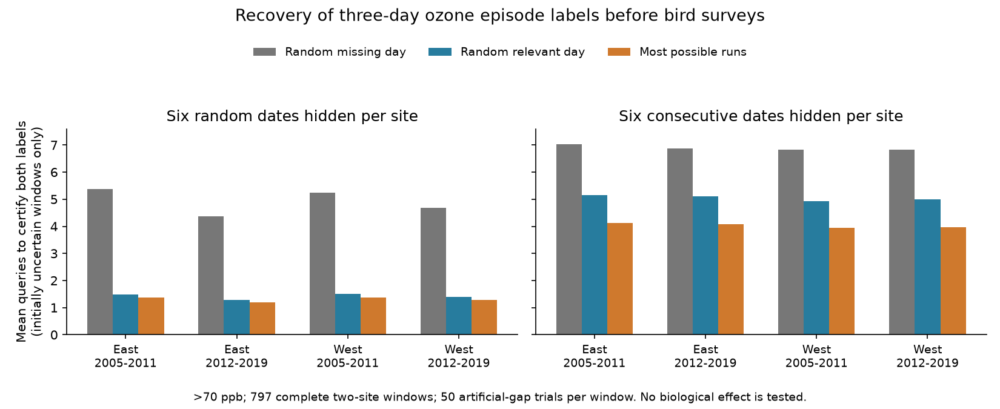

# Run-based day recovery used fewer queries for masked ozone episode labels in four US bird-survey samples from 2005 to 2019

## Result

A rule that first recovers days in the largest number of possible three-day ozone runs used fewer queries than random recovery of relevant days in all four region-period samples. With six consecutive dates hidden at each of two sites, mean query savings were 19.8-20.4%. With six random dates hidden at each site, savings were 6.5-8.3%. These percentages compare total query counts for the same trials. They do not measure a change in bird exposure or health.

The experiment used 797 complete two-site windows before US Breeding Bird Survey dates in 2005-2019. Each trial hid known data, then recovered days until both site episode labels were certain. A three-day episode had three consecutive dates above 70 parts per billion (ppb). We tested 50 gap draws per window. The rule had no fitted parameters.

The table gives mean queries among trials with at least one uncertain site label at the start. Trials with both labels already known needed zero queries. The initially uncertain count is the mean per draw, out of 177, 316, 94 and 210 windows in the four groups.

| Region and period | Gap | Initially uncertain, mean | Random missing | Random relevant | Most runs |
|---|---|---:|---:|---:|---:|
| East 2005-2011 | block | 173.1 | 7.04 | 5.14 | 4.12 |
| East 2005-2011 | uniform | 73.1 | 5.38 | 1.48 | 1.37 |
| East 2012-2019 | block | 316.0 | 6.87 | 5.12 | 4.09 |
| East 2012-2019 | uniform | 94.9 | 4.38 | 1.28 | 1.20 |
| West 2005-2011 | block | 87.8 | 6.83 | 4.92 | 3.95 |
| West 2005-2011 | uniform | 35.3 | 5.25 | 1.50 | 1.38 |
| West 2012-2019 | block | 198.4 | 6.84 | 4.99 | 3.97 |
| West 2012-2019 | uniform | 66.8 | 4.69 | 1.40 | 1.29 |

This is a test of a data recovery method. It does not test climate change, biological harm, species distributions or ecological timing. Its use is to reduce work when an ecological study must check multi-day pollution labels.

## Question and prior work

Can a rule based on possible runs reduce the number of missing days that must be recovered to certify an event label? EPA describes ozone effects on vegetation and its risks from severe weather. Liang and colleagues studied air pollution regulation and bird abundance (doi:10.1073/pnas.2013568117). These sources motivate careful exposure records; they do not validate the present method.

Active feature acquisition is an established field. The 2026 review by Aronsson, Rahbar and Chehreghani (doi:10.24963/ijcai.2026/860) describes sequential choices of values to obtain. We make no claim to invent active acquisition. The contribution is a simple run-based rule, an exact label certificate, and a paired test on public ozone records linked to biological survey dates.

Prior campaign publication sha256:6f8e86044c7fe38f3f2e7d4bc9bf76253c0ab8a258c08fcb14201f3b768587db tested bounds on site disagreement with natural missing days. We reuse its verified daily evidence. It did not test which hidden days to recover first. The present complete records overlap that archive and are not independent validation of it. We searched the campaign for climate, phenology, weather, biodiversity, ozone, birds, acquisition and recovery before this experiment. The local plan is in files/analysis_plan.txt. This was exploratory work, not a registered study.

## Data and selection

The parent linked USGS North American Breeding Bird Survey dates, release 1966-2024 (doi:10.5066/P14SNUV4), to EPA Air Quality System daily maximum eight-hour ozone summaries for 2005-2019. East is New York and Pennsylvania; West is California and Oregon. Periods are 2005-2011 and 2012-2019. These groups have separate records. Sites and weather events can repeat within a group.

The parent started with accepted standard-protocol surveys and filters on times, dates, weather, assistant status and recorded taxa. It selected the nearest two sites with valid seasonal data. The inherited eligible set has 1,599 windows with both sites within 50 km of the route start and at least 24 common valid days in the 30 days before the survey. We retain only windows with all 60 daily site values observed. This gives 177/341 early East, 316/629 later East, 94/174 early West and 210/455 later West windows: 797/1,599, or 49.8%. Selection is part of the target, not a missing-data correction.

Ozone source files were daily_44201_YEAR.zip. The parent used Ozone 8-hour 2015 standard, 8-HR RUN AVG BEGIN HOUR duration, ppm units, at least 75% daily coverage, values 0-0.3 ppm, and event types None or Included. It removed duplicate site-instrument-date-value rows, averaged instruments by site-date and converted ppm to ppb. These inherited choices were not retested. The three-day threshold is an analytical label, not a regulatory compliance test or a bird injury threshold.

files/selection_audit.csv compares counts, survey start temperature, survey day and nearest-site distance for complete and incomplete eligible windows. We do not weight the complete windows to represent incomplete ones. Monitor access, roadside survey design, observer choices and survey date can all select the records. Bird counts are not an outcome here, so a detection model for bird abundance is not fitted.

## Method

We hide exactly six dates at each site. Uniform gaps sample six of 30 dates without replacement. Block gaps choose a start from days 1-25 and hide six consecutive dates. Sites have independent gap draws. Gaps do not wrap around the window. The same masks and random tie priorities apply to all recovery rules and thresholds. We use 50 repeats with NumPy seeds 38757 plus repeat number.

For a site, each three-day run is possible if it has no observed low day. It is confirmed if all three days are observed high. The label is certain positive if any run is confirmed. It is certain negative if no run is possible. Otherwise it is uncertain. This is an exact certificate when missing high/low values are unrestricted. A high value exceeds the threshold plus 1e-9 ppb.

Random missing selects any still-hidden site-day, including days that cannot affect the answer. Random relevant selects only hidden days in possible runs at an unresolved site. Most runs selects the hidden site-day that occurs in the largest number of such runs. It recalculates scores after each query. All ties use the same fixed random priorities for a paired trial. Each query reveals one true high/low state, not an inferred value. Costs are equal. The code reads hidden truth only to reveal a selected day and to check the final answer.

We stop when both site labels are certain. This also certifies their disagreement label. With independent unrestricted missing values at the sites, disagreement cannot be certain while either site label is uncertain. We do not share recovered values across windows; each window is a separate recovery task. This deliberately differs from the parent's joint-window bounds.

The result is the mean number of queries to obtain exact labels. We report conditional means for initially uncertain trials and unconditional means across all windows. files/repeat_totals.csv preserves all paired totals. files/summary.csv gives paired mean differences and central 95% ranges across gap draws. Those ranges describe mask and tie randomness for fixed observed windows. They are not population confidence intervals, do not treat sites as independent, and do not establish a causal effect.

## Explanation and sensitivity

The main benefit for block gaps has a structural explanation. In an all-low window with six hidden consecutive days surrounded by low observations, four internal triples remain possible. A middle query can break several triples. Enumeration of all 720 priority orders gives mean queries per site of 2.00 for most runs, 2.50 for random relevant and 2.80 for random missing. Most runs always needs two queries in this reference case. The reference is an exact calculation over priority orders, not a claim of global policy optimality.

Thus, a gain can occur without any ozone episode. It is evidence for efficient certification under this task, not an emerging ecological pattern. The public-record test shows how much that logic helps with actual selected exposure sequences. The weaker random-missing comparator gives larger gains partly because it spends queries on irrelevant dates. The random-relevant comparison is the more useful test.

Thresholds of 60 and 80 ppb use the same records, masks and run length. All results are retained in files/summary.csv. These are sensitivity checks, not independent replications. A different run length, season, cost structure or missingness process can change the policy ranking. The method uses no distribution of ozone and has no general optimality guarantee.

## Checks, rights and reproduction

The code checked the recovered labels against hidden complete truth in all 717,300 policy runs. Separate scan-based enumeration checked 500 four-unknown label-bound cases. Another 1,500 synthetic recovery traces checked stopping and query relevance. All passed. A separate one-repeat rerun reproduced the 24 aggregate rows exactly. This is a partial rerun, not a second full 50-repeat experiment.

No new source data were downloaded. No shared raw dataset or failed-disk data were read. The two direct inputs were extracted from the fully verified parent SCI ZIP. files/input_provenance.json records its exact path, ZIP hash, SCI ID and the two input hashes. files/upstream_provenance.json and files/upstream_weather_provenance.json preserve source URLs, versions, historical shared paths and hashes. Some historical paths may no longer exist. They are provenance, not required private workspace dependencies.

External records are not bundled. The baseline covers our own code, narrative, figures and aggregate algorithm results. files/EXTERNAL_DATA_NOTICE.txt identifies external materials and terms. No grant over external source records is asserted. The exact immutable parent tables can be obtained with files/prepare_inputs.py, which verifies the parent and writes only into separate scratch. This is the preferred reproduction route. To rebuild the parent's tables from original agency data, use its preserved retrieve.py, build.py and build_base.py, with the source hashes in its provenance. Mutable agency URLs can require an archived snapshot for exact bytes.

From a verified and extracted publication root, run:

    bash files/reproduce.sh /path/to/6f8e86044c7fe38f3f2e7d4bc9bf76253c0ab8a258c08fcb14201f3b768587db.zip /absolute/external-scratch

This recomputes the experiment, plot, audit and algorithm checks, then compares all analysis tables. It requires Python, NumPy, pandas and Matplotlib; exact used versions are in files/environment.json and files/requirements.txt. Use a private environment for extra dependencies. The main experiment takes several minutes on this machine.

## Limits and job

These gaps are artificial and independent of hidden pollution. Actual missingness can follow heat, instrument failure, power loss or extreme pollution. Recovery can be impossible or have unequal cost. The experiment assumes observed and recovered labels are correct. It does not address instrument error, whole-route exposure, habitat or monitor location bias. Complete-window selection and overlapping records limit generalization. Separate regions and periods test transfer of a fixed rule within four selected samples; they do not supply four independent ecological experiments. Climate and weather mechanisms remain untested.

Campaign: 11_07_2026. Job: sci-1107-dell-climate-pollution-biodiversity-387f57b83425. Topic: climate-pollution-biodiversity. Machine: dell. Account: codex-andrii. Model: gpt-6.1-sol, high reasoning effort, through the Codex harness in T3 Code. Date: 2026-11-09. No agents were launched. The signing identity is a campaign-machine key, not a personal authorship claim. The bundle is saved locally without remote upload or submission.
