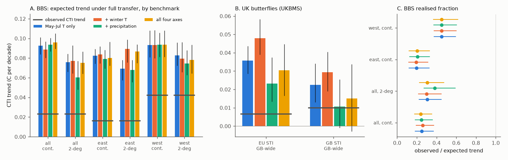
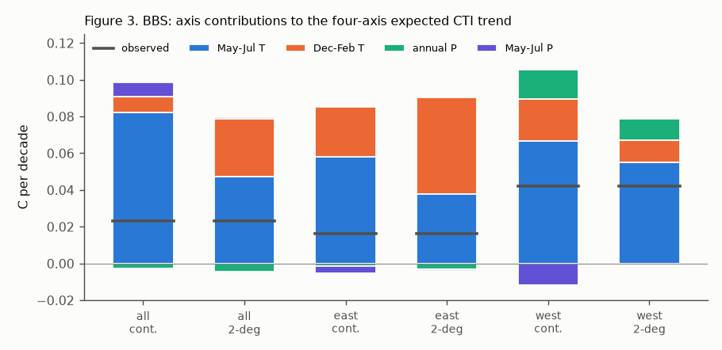
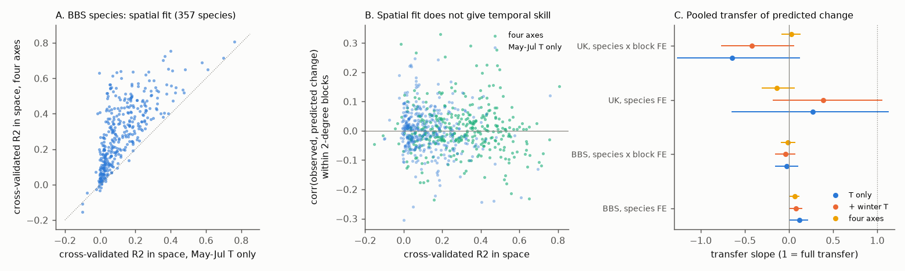

# Adding winter temperature and precipitation to the spatial benchmark did not close the US bird thermal-tracking gap, and better-fitting niche models did not predict local change (BBS 1966-2025)

Job: sci-1107-dell-climate-pollution-biodiversity-3b6de07cda8e (campaign 11_07_2026, topic
climate-pollution-biodiversity, machine dell, account claude-sci). Model: Claude Opus 5.5
(claude-opus-5-5). The signing key is a campaign-machine key. It is not a personal authorship claim.

## Summary

Campaign work measured weak thermal tracking of communities with one yardstick: the spatial slope
of the community temperature index (CTI) on summer temperature, multiplied by the local summer
warming. Species ranges are set by several climate axes. In the US, from 1966 to 2025, winters
warmed faster than summers (0.37 against 0.23 C per decade on BBS routes), the East became wetter
and the West became drier. If the summer-only yardstick is wrong, part of the "gap" can be an
artefact. Prior work did not test this.

We tested it with the North American Breeding Bird Survey (BBS; 3,960 routes, 107,922 standard runs,
467 species with a temperature index) and nClimGrid temperature and precipitation. We repeated the
community test with the UK Butterfly Monitoring Scheme (UKBMS; 1,253 sites, 16,722 site-years,
55 taxa) and E-OBS. The pre-analysis plan is in `files/PLAN.md`.

Main results:

1. **A multi-axis benchmark gives the same expected bird CTI trend.** With May-July temperature only,
   the spatial benchmark expects a CTI increase of 0.093 C per decade (continental slope). With
   May-July temperature, December-February temperature, annual and May-July precipitation together,
   it expects 0.096 C per decade. The observed within-route, within-observer CTI trend was 0.023 C per
   decade. The four-axis
   benchmark closed -5% of the gap (95% bootstrap interval -19% to +2%). The realised fraction was
   0.25 (0.18-0.37) with one axis and 0.24 (0.18-0.35) with four axes. Inside 2-degree blocks the
   fractions were 0.31 (one axis) and 0.31 (four axes).
2. **Precipitation trends are too small to matter; the axes share the temperature slope.** The direct
   part of the expected trend that came from precipitation change was at most 0.016 C per decade in
   any subset. When winter temperature enters the model, it takes part of the summer-temperature
   slope. Winters warmed faster, so the total expectation stays about the same. For all routes, only
   one of six alternative benchmarks changed the gap by more than 10%: summer temperature plus
   precipitation inside 2-degree blocks closed 29% of the gap (10% to 50%). (Summer plus winter
   temperature, continental, closed 5%, 1% to 9%.) This variant lost its effect when winter
   temperature was added (1%; -18% to 18%), so we treat it as a collinearity effect, not a robust result.
3. **The East/West difference stays.** Western communities followed 0.45 (about 0.37-0.60) of the expected trend
   with all four continental benchmarks; eastern communities followed 0.19-0.21 (about 0.12-0.33). Different climate axes do not
   explain why the West tracks more. In the East, benchmarks with winter temperature inside
   2-degree blocks made the gap larger (closure -0.33 to -0.38).
4. **Better spatial niche models do not predict better in time.** For 357 species we fitted
   cross-validated quadratic climate models to route mean abundance. The four-axis models explained
   much more spatial variation than the summer-temperature models (median cross-validated R2 0.28
   against 0.08). But neither model predicted which routes gained or lost a species from 1971-1990
   to 2006-2025 inside 2-degree blocks: pooled transfer slopes were -0.02 (95% CI -0.15 to 0.10) and
   -0.01 (-0.09 to 0.07); full transfer is 1. Prediction reliability was 0.96-0.98, so noise in the
   predictions does not explain the zero. Across species, spatial fit did not predict temporal skill
   (Spearman -0.00). Species national means of predicted change correlated only weakly with USGS
   1966-2025 trends (Spearman 0.08-0.10, p 0.07-0.14).
5. **UK butterflies give the same answer with European species indices, but the benchmark is
   unstable.** In Great Britain, summer temperature and precipitation are strongly collinear in space
   (r = -0.80). Butterfly communities followed 0.19 (one axis), 0.14 (+ winter), 0.28 (+ precipitation)
   and 0.22 (four axes) of the expected trend; all intervals are wide. With GB-internal species indices
   the fractions were higher (0.34-0.93), as in prior work, and less stable. Species niche models fitted
   GB butterflies poorly (median cross-validated R2 0.02-0.04), so the UK species test cannot decide.

Conclusion: the weak space-for-time tracking of US bird communities is not an artefact of a
summer-temperature-only yardstick. A benchmark built from four climate axes expects the same CTI
change, and multi-axis niche models that describe spatial distributions much better still do not
predict where species changed. This removes "wrong climate yardstick" from the list of processes that
can set the gap (together with day/night temperature in sci:sha256:e8e31ffb and colonisation
distance in sci:sha256:b83e5597). The gap is in the
temporal response, not in the choice of climate axes.

## 1. Question

Prior campaign results (sci:sha256:0037934e, b41e4848, a1ea58ba, e8e31ffb) show that the BBS
CTI follows about 3-30% of its spatial slope in time. The spatial slope is mostly thermal
(b41e4848), and day/night temperature does not explain the gap (e8e31ffb). But all these
benchmarks used one temperature axis. A species temperature index (STI) and a CTI are on a
temperature scale, but species distributions also follow winter cold and moisture. These axes are
correlated with summer temperature in space but changed differently in time.

Questions (from `files/PLAN.md`, written before any temporal result):

- Q1. Is the expected CTI trend smaller (artefact) or larger (gap even larger) with a multi-axis
  spatial benchmark?
- Q2. Do species changes follow multi-axis spatial niche models better than summer-temperature models?
- Q3. Do the multi-axis benchmarks explain the stronger tracking in the West?

## 2. Data

| Input | Use |
| --- | --- |
| BBS 2026 release (1966-2025), USGS ScienceBase 6a0b0b0ab66b0188da36aedd | counts, runs, observers, route start points |
| USGS BBS core trends 1966-2025 | national species trends (US1 region) |
| NOAA nClimGrid monthly tavg and prcp (about 5 km) | route climate axes (20 km disc around the start point) |
| UKBMS site indices 2024 and site locations 2024 (EIDC) | butterfly abundance indices, GB sites |
| E-OBS v32.0e tg and v31.0e rr (0.25 degree) | site climate axes |
| European STI of British butterflies, `sti_europe.csv` from sci:sha256:814f6d39 | butterfly STI not taken from GB sites |

Hashes, licences and attribution are in `files/NOTICE-external-data.md`.

Climate axes (per route or site and breeding year y): Ts = May-July mean temperature (May-August
for butterflies); Tw = December (y-1) to February mean temperature; Pa = precipitation total from
August (y-1) to July (September to August for butterflies); Ps = precipitation of the Ts months.
Precipitation enters as log(P + 10 mm), because some Californian summers have no rain.

## 3. Method

**CTI.** BBS: RunType 1, primary observer, contiguous US, one run per route-year. The STI is
cross-fitted: the log(1+count)-weighted mean May-July climatology of the routes in one random half
(5 stratified splits); each run's CTI uses the STIs from the other half (the method of
sci:sha256:b41e4848, which gives the same 107,922 runs). UKBMS: log(1+index)-weighted mean STI of
taxa with a valid index; site-years with at least 5 taxa and at most 20% of present taxa without an
index. Two STI sources: European (fixed per taxon, from 814f6d39) and GB-internal (cross-fitted
between random halves of 50 km blocks).

**Spatial benchmarks.** Route-mean CTI (routes with at least 5 runs; 3,712 routes) on route
climatologies 1966-2025. Four models: Ts; Ts + Tw; Ts + log Pa + log Ps; all four axes.
Continental OLS and 2-degree block fixed effects (BBS); GB-wide and 100 km blocks (UKBMS).

**Expected trend.** For each route r, E_r = sum over axes of b_k x trend_k,r, where trend_k,r is the
OLS trend of axis k over 1966-2025 (UKBMS 1976-2024). The expected network trend is the run-weighted
mean of E_r.

**Observed trend and transfer.** Run CTI = route FE + observer FE + O x (year - 1995.5) + anomalies of
the four axes (from each route's trend line) + first-year-observer flag + day of year. O is the
observed trend. The transfer slope beta replaces the year term by the expected path E_r x (year -
1995.5). beta is the realised fraction with route-level weighting; O/E is the simple ratio. A variant
adds national year fixed effects (only differences between routes identify beta). UKBMS: site FE
instead of route and observer FE.

**Gap closure.** G = (E_Ts - E_model) / (E_Ts - O). G > 0 means the alternative benchmark expects
less and closes part of the gap.

**Species models (Q2).** Species on at least 50 routes that have at least 5 runs in both 1971-1990 and
2006-2025 (357 species, 1,580 routes). Domain: routes in 2-degree blocks where the species was
recorded. Gaussian models of route-mean log(1+count) (1966-2025) with linear and quadratic terms of
(a) Ts, (c) Ts and Tw, (b) all four axes, standardised. Models were fitted on one half of the routes
and evaluated on the other half (cross-fitted). Predicted change = f(climate mean 2006-2025) -
f(climate mean 1971-1990). Observed change = route mean log(1+count) 2006-2025 minus 1971-1990.
Pooled transfer = slope of observed on predicted change with species FE, or with species x 2-degree
block FE (only local differences). Reliability: correlation of the predictions from the two
half-fits for the same routes. UKBMS: 44 taxa, 240 sites with at least 5 years in 1990-2004 and
2010-2024, 50 km blocks.

**Uncertainty.** BBS community: bootstrap of 4-degree super-blocks of routes; spatial models,
trends and temporal fits are all refitted in each draw. BBS species: 200 draws of 4-degree blocks.
UKBMS: 200 draws of 50 km blocks. Intervals are percentile intervals. Point standard errors are
clustered by route (site).

## 4. Results

### 4.1 Climate change on the routes (Figure 1)

| Axis, trend per decade 1966-2025 | All routes | East of 100 W | West of 100 W |
| --- | --- | --- | --- |
| May-July temperature (C) | 0.23 | 0.22 | 0.25 |
| December-February temperature (C) | 0.37 | 0.45 | 0.24 |
| log annual precipitation | +0.003 | +0.012 | -0.014 |
| log May-July precipitation | +0.007 | +0.018 | -0.013 |

In Great Britain (1976-2024) May-August temperature increased by 0.32 C and December-February
temperature by 0.41 C per decade; log precipitation increased by 0.02-0.03 per decade.

### 4.2 BBS: expected and observed trends (Figure 2, Figure 3)

| Subset | Spatial slope | Benchmark | E | O | O/E | beta | G |
| --- | --- | --- | --- | --- | --- | --- | --- |
| all | continental | Ts | 0.093 (0.084 to 0.101) | 0.023 | 0.25 (0.18 to 0.37) | 0.24 (0.17 to 0.37) | - |
| all | continental | Ts + Tw | 0.089 (0.081 to 0.097) | 0.023 | 0.26 (0.19 to 0.37) | 0.25 (0.18 to 0.38) | 0.05 (0.01 to 0.09) |
| all | continental | Ts + P | 0.094 (0.087 to 0.100) | 0.023 | 0.25 (0.18 to 0.36) | 0.23 (0.16 to 0.37) | -0.02 (-0.11 to 0.04) |
| all | continental | all four | 0.096 (0.090 to 0.105) | 0.023 | 0.24 (0.18 to 0.35) | 0.22 (0.15 to 0.36) | -0.05 (-0.19 to 0.02) |
| all | 2-degree blocks | Ts | 0.076 (0.066 to 0.084) | 0.023 | 0.30 (0.22 to 0.45) | 0.29 (0.20 to 0.43) | - |
| all | 2-degree blocks | Ts + Tw | 0.077 (0.065 to 0.093) | 0.023 | 0.30 (0.22 to 0.45) | 0.28 (0.19 to 0.42) | -0.02 (-0.31 to 0.22) |
| all | 2-degree blocks | Ts + P | 0.060 (0.048 to 0.077) | 0.023 | 0.38 (0.27 to 0.59) | 0.36 (0.26 to 0.50) | 0.29 (0.10 to 0.50) |
| all | 2-degree blocks | all four | 0.075 (0.064 to 0.086) | 0.023 | 0.31 (0.23 to 0.47) | 0.29 (0.21 to 0.44) | 0.01 (-0.18 to 0.18) |
| east | continental | Ts | 0.082 (0.075 to 0.089) | 0.016 | 0.20 (0.12 to 0.33) | 0.18 (0.10 to 0.29) | - |
| east | continental | Ts + Tw | 0.084 (0.075 to 0.091) | 0.016 | 0.19 (0.12 to 0.31) | 0.18 (0.10 to 0.29) | -0.02 (-0.08 to 0.03) |
| east | continental | Ts + P | 0.079 (0.070 to 0.088) | 0.016 | 0.21 (0.13 to 0.33) | 0.18 (0.10 to 0.29) | 0.05 (-0.10 to 0.17) |
| east | continental | all four | 0.080 (0.073 to 0.096) | 0.016 | 0.20 (0.12 to 0.33) | 0.18 (0.11 to 0.30) | 0.03 (-0.22 to 0.14) |
| east | 2-degree blocks | Ts | 0.069 (0.058 to 0.078) | 0.016 | 0.24 (0.15 to 0.39) | 0.21 (0.12 to 0.33) | - |
| east | 2-degree blocks | Ts + Tw | 0.089 (0.076 to 0.099) | 0.016 | 0.18 (0.12 to 0.29) | 0.17 (0.10 to 0.27) | -0.38 (-0.55 to -0.27) |
| east | 2-degree blocks | Ts + P | 0.068 (0.056 to 0.078) | 0.016 | 0.24 (0.16 to 0.38) | 0.21 (0.12 to 0.32) | 0.02 (-0.13 to 0.22) |
| east | 2-degree blocks | all four | 0.087 (0.075 to 0.094) | 0.016 | 0.19 (0.12 to 0.30) | 0.17 (0.11 to 0.27) | -0.33 (-0.52 to -0.15) |
| west | continental | Ts | 0.093 (0.081 to 0.108) | 0.042 | 0.45 (0.37 to 0.59) | 0.44 (0.37 to 0.59) | - |
| west | continental | Ts + Tw | 0.093 (0.080 to 0.108) | 0.042 | 0.45 (0.37 to 0.60) | 0.43 (0.35 to 0.58) | 0.00 (-0.04 to 0.06) |
| west | continental | Ts + P | 0.094 (0.081 to 0.106) | 0.042 | 0.45 (0.37 to 0.60) | 0.43 (0.35 to 0.59) | -0.01 (-0.16 to 0.14) |
| west | continental | all four | 0.094 (0.081 to 0.108) | 0.042 | 0.45 (0.37 to 0.62) | 0.40 (0.32 to 0.61) | -0.01 (-0.28 to 0.25) |
| west | 2-degree blocks | Ts | 0.083 (0.073 to 0.096) | 0.042 | 0.51 (0.42 to 0.69) | 0.50 (0.41 to 0.67) | - |
| west | 2-degree blocks | Ts + Tw | 0.079 (0.066 to 0.096) | 0.042 | 0.53 (0.44 to 0.75) | 0.51 (0.41 to 0.69) | 0.09 (-0.18 to 0.38) |
| west | 2-degree blocks | Ts + P | 0.074 (0.063 to 0.088) | 0.042 | 0.57 (0.48 to 0.75) | 0.51 (0.42 to 0.68) | 0.21 (0.08 to 0.42) |
| west | 2-degree blocks | all four | 0.078 (0.065 to 0.093) | 0.042 | 0.54 (0.46 to 0.74) | 0.50 (0.41 to 0.68) | 0.12 (-0.08 to 0.38) |

Expected (E) and observed (O) trends are in C per decade. O/E and beta are realised fractions. G is the
gap closure relative to the Ts-only benchmark. Intervals are 95% bootstrap intervals
(186 draws).

With national year effects, beta was Ts cont. 0.13 (-0.06 to 0.30); Ts + Tw cont. 0.14 (-0.02 to 0.30); Ts + P cont. 0.09 (-0.11 to 0.27); all four cont. 0.06 (-0.14 to 0.24); Ts 2-deg 0.16 (-0.07 to 0.36); Ts + Tw 2-deg 0.15 (-0.14 to 0.36); Ts + P 2-deg 0.21 (0.03 to 0.39); all four 2-deg 0.12 (-0.14 to 0.34).

### 4.3 Species niche models (Figure 4)

| Quantity | Ts only (a) | Ts + Tw (c) | four axes (b) |
| --- | --- | --- | --- |
| median cross-validated R2 in space | 0.08 | 0.18 | 0.28 |
| pooled transfer, species FE | 0.12 (0.01 to 0.21) | 0.08 (0.02 to 0.14) | 0.07 (0.01 to 0.11) |
| pooled transfer, species x 2-degree block FE | -0.02 (-0.15 to 0.10) | -0.04 (-0.15 to 0.07) | -0.01 (-0.09 to 0.07) |
| reliability of predictions (species FE / block FE) | 0.99 / 0.98 | 0.98 / 0.98 | 0.97 / 0.96 |
| median within-species skill (corr inside blocks) | 0.003 | -0.001 | -0.001 |
| Spearman: spatial R2 vs temporal skill | -0.04 | -0.01 | -0.00 |
| Spearman: mean predicted change vs mean observed change | 0.07 | 0.11 | 0.11 |
| Spearman: mean predicted change vs USGS trend (340 species) | 0.09 (p 0.11) | 0.10 (p 0.07) | 0.08 (p 0.14) |

The species-FE slopes (0.07-0.12) include broad regional differences in change, which also contain
the national CTI trend; inside 2-degree blocks, where the climate change differs only locally,
transfer was zero for all models. In a joint model, the four-axis prediction added little to the
summer-temperature prediction (species FE: 0.04, SE 0.02; block FE: -0.01, SE 0.04).

### 4.4 UK butterflies

| STI | Benchmark | E | O | O/E | beta | G |
| --- | --- | --- | --- | --- | --- | --- |
| EU | Ts | 0.036 (0.029 to 0.043) | 0.007 | 0.19 (0.03 to 0.37) | 0.19 (0.02 to 0.38) | - |
| EU | Ts + Tw | 0.048 (0.039 to 0.058) | 0.007 | 0.14 (0.02 to 0.27) | 0.14 (0.02 to 0.27) | -0.42 (-0.73 to -0.20) |
| EU | Ts + P | 0.023 (0.013 to 0.037) | 0.007 | 0.28 (0.03 to 0.73) | 0.28 (0.03 to 0.67) | 0.43 (-0.06 to 0.86) |
| EU | all four | 0.030 (0.017 to 0.045) | 0.007 | 0.22 (0.03 to 0.60) | 0.22 (0.03 to 0.56) | 0.18 (-0.30 to 0.77) |
| GB | Ts | 0.022 (0.013 to 0.034) | 0.010 | 0.45 (0.26 to 0.79) | 0.43 (0.24 to 0.80) | - |
| GB | Ts + Tw | 0.029 (0.019 to 0.040) | 0.010 | 0.34 (0.21 to 0.56) | 0.34 (0.20 to 0.56) | -0.56 (-3.11 to 0.05) |
| GB | Ts + P | 0.011 (-0.001 to 0.025) | 0.010 | 0.93 (-1.57 to 10.52) | 0.64 (-0.57 to 1.09) | 0.94 (0.12 to 3.58) |
| GB | all four | 0.015 (-0.003 to 0.034) | 0.010 | 0.67 (-3.84 to 5.22) | 0.55 (-0.62 to 0.95) | 0.60 (-1.19 to 2.65) |

GB-wide benchmarks only. Inside 100 km blocks the spatial slopes were small and the expected trends
were near zero (0.003-0.022 C per decade), so the fractions are not defined in a useful way
(`files/results/uk_community_benchmarks.csv` gives them). UK species models: median cross-validated
R2 0.02 (Ts), 0.04 (Ts + Tw), 0.04 (four axes); pooled transfer with taxon FE 0.27 (-0.64 to 1.13),
0.39 (-0.17 to 1.05) and -0.14 (-0.30 to 0.06); with taxon x 50 km block FE -0.65 (-1.26 to 0.12),
-0.42 (-0.76 to 0.05) and 0.02 (-0.08 to 0.12). These intervals are wide, and the four-axis
predictions had low reliability (0.60-0.71).

### 4.5 Year-to-year responses (exploratory, not in the plan)

From the same temporal models (two-way clustered SE), the BBS CTI changed by +0.0095 C (SE 0.0019)
per 1 C May-July anomaly, +0.0019 (0.0010) per 1 C winter anomaly, and -0.018 (0.0055) per unit of
log annual precipitation anomaly (about -0.0017 C in a 10% wetter year). The butterfly CTI showed no
clear anomaly response (`files/results/fast_responses.csv`). Thus a wet year moves the bird CTI a
little toward cool species, but this is small and short-term.

## 5. Interpretation

The hypothesis that a one-axis yardstick inflates the expected change (H-artefact in the plan) is
not supported for US birds. The plan's alternative (H-real) holds: the gap closure is near zero, and
transfer is the same with all benchmarks. Two facts explain why. First, precipitation changed little
on average (under 2% per decade), so even large spatial precipitation slopes add little expected
CTI change. Second, winter and summer temperature are correlated in space (r = 0.79); a model with
both axes shares the slope between them, and because winters warmed faster, the expectation does
not fall.

The species test is stronger than the community test. Multi-axis models explain the spatial
distributions of birds much better, so if weak tracking came from missing climate axes, these
models should predict at least part of the local changes. They predict none. This agrees with
prior species-level results (sci:sha256:b41e4848, 91f371b5) and extends them to multi-axis niches.
It also limits how far published climate-suitability indicators (Stephens et al. 2016) can be read
as local tracking: in our data the national association between predicted and observed species
change was weak (Spearman about 0.1) and the local association was zero.

What remains? Earlier campaign results point to processes in the temporal response itself: slow
colonisation and persistence of species (3f5200e4, b640c9c8, 814f6d39), habitat that changes slowly
(1f25ce5b, 096d8e50), and national changes that local warming does not predict (b41e4848). Distance
to a warmer climate does not set the gap either (b83e5597), which points to establishment. The
West/East difference (0.45 against 0.20) is now a clear target: it is not a climate-axis effect.
In b83e5597 the invasive Eurasian Collared-Dove gave about 20% of the West trend.

## 6. Limitations

- Correlational design. The spatial slopes contain all factors that covary with climate in space.
- Route climate is the 20 km disc around the start point; routes are about 40 km long.
- No detection model. Detection drift that is common to all routes is part of O.
- The four-axis partial slopes are correlated (Ts-Tw r = 0.79 in the US; Ts-P r = -0.70 to -0.80
  in GB). The total expectation is better determined than the single parts, but GB benchmarks with
  precipitation are unstable.
- The species models are simple additive quadratics of mean log counts, fitted to route means.
  More flexible models (interactions, non-climate covariates) were not tested.
- BBS community bootstrap: 186 draws (a loaded host); species and UK bootstraps: 200 draws.
- UKBMS has few sites with long series (240 sites in both windows), so the UK species test has low
  power.
- The anomaly results in 4.5 are exploratory.

## 7. Reproduction

`files/code/run_all.sh DATA SCRATCH OUT RESULT_FILES_DIR` runs the full pipeline. DATA is a folder
with the inputs (the campaign store, or the output of `files/code/retrieve_data.sh`). SCRATCH and OUT
hold record-level tables and must be outside the publication folder. The European STI table is read
from the cited SCI publication with `sci read`. Python 3.12 with numpy, pandas, scipy, xarray,
netCDF4, pyproj, matplotlib. Run times on the campaign host (2 CPUs, heavy load): climate
extraction about 3 minutes; BBS community bootstrap about 1.5 minutes per draw; all other steps
under 10 minutes. The reported BBS intervals use 186 draws from two processes (draws 0-100 and
101-185; `04_community.py scratch out 200 100 _b` runs the second; seeds are 1000 + draw); `07_summary.py`
reads all `community_boot*.csv` files. `03_cti.py` keeps the guild variants of the original script; only `main` is used.

Files:

- `files/PLAN.md`: pre-analysis plan.
- `files/code/`: all code (MIT under the SCI baseline licence).
- `files/results/bbs_community_benchmarks.csv`, `uk_community_benchmarks.csv`: all benchmarks,
  slopes, expected trends, axis parts, fractions and intervals.
- `files/results/community_point.json`, `uk_community_point.json`: raw point estimates.
- `files/results/species_tests.json`, `uk_species_tests.json`: species-level tests and intervals.
- `files/results/bbs_species_summary.csv`, `uk_species_summary.csv`: per-taxon fit, predicted and
  observed change, skill.
- `files/results/fast_responses.csv`: anomaly responses.
- `files/figures/`: Figures 1-4.

## References

- Stephens, P.A. et al. 2016. Consistent response of bird populations to climate change on two
  continents. Science 352: 84-87. doi:10.1126/science.aac4858
- Devictor, V. et al. 2012. Differences in the climatic debts of birds and butterflies at a
  continental scale. Nature Climate Change 2: 121-124. doi:10.1038/nclimate1347
- Tingley, M.W. et al. 2012. The push and pull of climate change causes heterogeneous shifts in avian
  elevational ranges. Global Change Biology 18: 3279-3290. doi:10.1111/j.1365-2486.2012.02784.x
- Vose, R.S. et al. 2014. Improved historical temperature and precipitation time series for U.S.
  climate divisions. J. Appl. Meteor. Climatol. 53: 1232-1251. doi:10.1175/JAMC-D-13-0248.1
- Cornes, R.C. et al. 2018. An ensemble version of the E-OBS temperature and precipitation data sets.
  JGR Atmospheres 123: 9391-9409. doi:10.1029/2017JD028200
