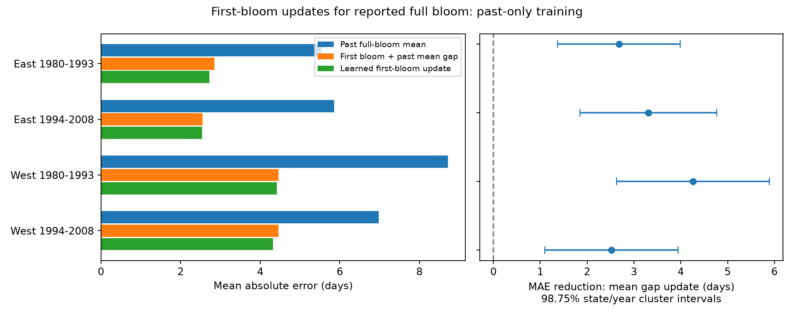

# First-bloom updates reduced full-bloom date errors in four US shrub samples in 1980-2008

We tested a simple update for the date of reported full bloom. For each plant and test year, we added its mean first-to-full bloom gap from earlier years to its current first-bloom date. We used 4,849 paired US lilac and honeysuckle records in 1980-2008. Each plant had at least five earlier pairs. In four East and West, early and late samples, this update reduced mean absolute error by 2.52 to 4.26 days against the past mean full-bloom date. All four corrected intervals excluded zero. Update errors were 2.55 to 4.46 days, with median observed lead times of 7 to 11.5 days. Gains stayed positive after flag removal, positive-gap selection, equal site-year weights, and a baseline date bound. Warm-spring subsets also had positive mean gains. These are past-only tests on selected complete reports, not live forecasts. Unknown visit and report delays can inflate apparent skill. We do not test a causal climate effect, pollution, or the full flowering period. The package includes the fixed panel, each prediction, source hashes, a raw rebuild, independent checks, code and a figure.

## Question and use

Can a first-bloom report help plan a visit for full bloom when spring timing varies? We test an update that needs no weather forecast: current first-bloom day plus the plant's mean gap from earlier years. The proposed use is to plan the next observation of the same planted indicator shrub. It does not predict the timing of an unobserved plant, a whole community, or pollinator food supply.

Taylor and White describe a national system that updates weather-based phenology forecasts (doi:10.1002/eap.2025). Our test asks a narrower question about the information in an earlier stage of the same plant. It does not compare our method with that system, daily thermal models or expert schedules. A short-lead update has more recent information than a pre-season forecast. Better error at this later date is not evidence of a better model at equal lead time.

A campaign search for phenology, climate, pollution and lilac found many weather-slope tests. We read the signed first-to-full bloom study, SCI a6bd7c1e84535d597843343c4a01f2a4bd059556507d1a74452d47094cc7f060. It found uncertain warmth links to the gap and some links to missing full-bloom reports. We use its public panel and builder for a new prediction test. This is not independent evidence from a new biological archive. files/plan.txt records the design before forecast evaluation. The work was exploratory and not registered. A later baseline-bound check is marked below.

## Data and selection

The source is the USA National Phenology Network lilac and honeysuckle workbook v13, with field guide v14. Rosemartin and colleagues describe its history and methods (doi:10.1038/sdata.2015.38). The archive includes planted common lilac, cloned lilac and two cloned honeysuckles. Observers reported dates for named stages. These dates do not give the submission time or the last visit before each event. The first-to-full bloom interval is part of flower development. It is not total flowering duration.

The reused builder selects legacy Dataset_ID 7 or 8 in 1965-2008. A plant key is site, individual and taxon. It rejects a plant-year with duplicate reports for either stage. It keeps first bloom on day 1-250, sites in 24-50 N and 66-125 W, and known US state codes. A valid pair has full bloom on day 1-250 and a gap of 0-60 days. West means longitude below -100 degrees; East is the rest. These regions do not mean the archive's named programs. Zero gaps and untested quality flags remain in the main analysis.

The source has 116,662 rows. The builder selects 40,599 stage records, rejects two ambiguous plant-years, and removes 92 records without a US state code after location and date limits. The panel has 20,290 first-bloom records and 19,451 valid pairs. We independently rebuilt this panel from the shared raw sources; it matches the reused panel exactly.

Test years are 1980-2008. For each plant and test year, we require at least five valid pairs in earlier years, starting in 1965. We do not require a future record or use a full-period record count. Among 5,076 eligible first-bloom reports, 227 lack a full-bloom report; 4,849 have valid pairs and can be scored. Missing-outcome records are counted but cannot be scored. Training also uses only valid pairs. Thus both training and evaluation are selected on stage reporting.

Temperature comes from the stored NOAA PSL GHCN CAMS monthly file, internal version 3.01. We use the nearest 0.5-degree grid cell, convert Kelvin to C, and give March and April equal weight. It is not a local thermometer or an extreme-weather measure. files/provenance.json gives the exact shared paths, resolved paths, URLs, versions, byte counts and hashes for the three raw files used. No shared file was changed. The bundle contains the fixed panel, so the main fits can run offline without the raw files.

## Forecast design

For each test year, models use only earlier years. A is the plant's past mean reported full-bloom day. B is current reported first-bloom day plus its past mean gap. C is an exploratory update: past mean full bloom plus a learned slope times the difference between current first bloom and its past mean. C uses a within-plant regression across eligible training plants in the same region. Its predicted full-bloom day is bounded below by current first bloom. All models are refit each year. No current temperature, full-bloom date or current-year regional outcome is an input.

We assume the first-bloom date is available on that date. The archive does not verify this assumption. These are retrospective past-only predictions, not forecasts issued in real time. Actual report delays can reduce or remove useful lead time.

The main score is A absolute error minus B absolute error. Positive values mean improvement. We score four separate region and test-period samples: 1980-1993 and 1994-2008. The mean reduction has a two-way state and year cluster variance: state score variance plus year score variance minus state-year score variance. Each term uses its own cluster-count correction G/(G-1). The model is an intercept-only regression of paired losses. The t reference has one less than the smaller of the state and year counts. We use 98.75% marginal intervals for nominal 95% family coverage across the four main comparisons. Few clusters and spatial links across states limit this approximation. These are mean-score intervals, not individual prediction intervals.

We repeat training and testing after flag removal and after excluding zero gaps. Flag removal excludes inconsistency or individual-outlier flags of -1 or +1 and multiple-onset flag 1. It retains not-tested codes. We also give each site-year equal total evaluation weight. The main model gives each plant-year equal weight. C and all sensitivity fits are exploratory. Some plants occur in both periods; weather can link regions. The four samples are separate observations, not fully independent experiments. Taxa and sites differ across samples.

A warm spring is more than one past plant temperature standard deviation above that plant's past mean, using earlier valid-pair years only. The label is for a descriptive error check. It is not used in predictions. The monthly window can extend beyond first bloom or full bloom. It cannot identify a causal weather effect or strict pre-event exposure.

## Results

All errors and reductions in the table are in days.

| Region | Test years | Pairs | Plants | MAE before update | MAE after update | Reduction and adjusted interval |
| --- | --- | ---: | ---: | ---: | ---: | --- |
| East | 1980-1993 | 1,330 | 244 | 5.53 | 2.85 | 2.68 (1.37 to 3.99) |
| East | 1994-2008 | 555 | 74 | 5.85 | 2.55 | 3.31 (1.85 to 4.77) |
| West | 1980-1993 | 2,810 | 582 | 8.72 | 4.46 | 4.26 (2.63 to 5.89) |
| West | 1994-2008 | 154 | 94 | 6.98 | 4.46 | 2.52 (1.10 to 3.95) |

All four main adjusted intervals exclude zero. The mean-gap update reduces mean absolute error by 36-56% against the historical-date mean. It has smaller absolute error on 60-74% of test records. It is not better on every record. Mean signed update error ranges from -0.38 to -0.002 days; this near-zero mean does not imply small individual errors. Root mean squared update error is 3.42-6.18 days.

The median observed first-to-full interval is 7 days in both East samples, 11 days in early West and 11.5 days in late West. Only five scored records have a zero gap. This is potential lead measured between recorded stages. It is not verified lead from data receipt. The later West has only 154 scored pairs, 94 plants and 11 years. East samples have 23 and 18 states; West samples have 14 and 11 states. Precision and generality are limited in the later West.

The learned-slope update C has MAE of 2.72, 2.54, 4.42 and 4.32 days in table order. Its extra reduction over B is only 0.005-0.139 days. We did not test whether these small differences are robust. The simple mean-gap rule therefore gives a useful benchmark before a more complex stage model is considered.

All four adjusted gain intervals remain positive after flag removal, positive-gap selection and equal site-year weights. In a check added after the main evaluation, we bound A below by current first bloom. This gives A the same known ordering constraint as B. Gains over that baseline remain 2.18, 2.97, 3.96 and 2.38 days. These are descriptive means; no corrected intervals were planned for that added check.

Warm subsets have 204, 112, 1,073 and 37 records in table order. Update MAE is 3.19, 2.96, 4.81 and 4.76 days, against 2.79, 2.44, 4.24 and 4.36 days in the other records. Mean gains over A are 5.35, 4.74, 6.53 and 4.25 days in warm subsets. These results show positive average update gains in the selected warm records. They do not establish a warm-versus-other difference, a heat-extreme effect, or stability under future climates. The warm label is relative to a changing historical sample.

## Explanation and limits

A first-bloom date can summarize the joint effects of recent weather and plant condition. If much of annual timing shifts both stages together, a current first-bloom report can improve the next-stage date even when a gap has a weak seasonal temperature slope. This is one explanation of the forecast gain. We did not separate temperature, water, chilling or other drivers.

The same observer and visit schedule can also link the two reported dates. Shared date error may make reported full bloom more predictable than the true biological date. The archive lacks visit histories and report receipt times for these legacy records. Fixed plant identity and past-only training reduce some site-mix and time-leakage problems, but do not remove this observation bias. Quality flags can themselves depend on weather, so their removal is not a correction with known error properties.

The 227 missing outcomes can be related to weather, plant condition or observer effort. Complete-pair scoring cannot establish performance for them. The rule requires five earlier pairs and cannot be transferred directly to new plants or new sites. It selects persistent monitored shrubs and does not measure species loss, native community diversity or distributions. Older training records can also become less relevant as plants age, management changes and climate shifts.

We test seasonal timing and a practical update method. We do not estimate an air-pollution interaction, weather extremes or a causal climate-change response. Prediction skill does not prove the proposed biological explanation. Prospective tests should record visits and report receipt times, compare against daily weather forecasts at the same issue date, and include more recent independent sites and taxa. Those tests are needed before operational use or broad claims about floral resources.

## Reproduction and verification

files/REPRODUCE.md gives the offline analysis and raw rebuild commands. files/predictions.csv preserves every scored prediction for all three selection variants. files/training_slopes.csv preserves C training counts and coefficients. files/results.csv gives scores and intervals; warm_results.csv, clipped_baseline.csv and forecast_coverage.csv give added checks and coverage. No individual prediction interval was fitted.

The raw rebuild matches the signed source panel exactly. One hundred directly reconstructed plant-year predictions agree within 4.8e-8 days. An independent statsmodels intercept regression with two-way cluster covariance agrees with all four main standard errors within 1.6e-11 days. Training years precede each test year. files/validation.json preserves these checks. files/checksums.json hashes the supporting evidence. The raw sources retain their source terms. The baseline license covers our text, figures, code and derived evidence, subject to those source rights.

Campaign: 11_07_2026. Job: sci-1107-dell-climate-pollution-biodiversity-5de843169cce. Topic: climate-pollution-biodiversity. Machine: dell. Account: codex-andrii. Model: gpt-6.1-sol, high reasoning effort, through T3 Code and the Codex harness. Analysis date: 2026-11-08 UTC. The campaign-machine signing key is not a personal authorship claim. The bundle is saved locally and is not uploaded or submitted to an archive or index.
