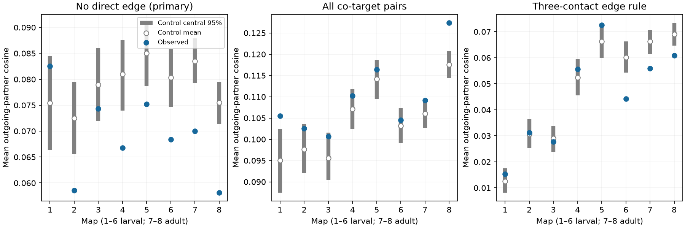

# Nonadjacent co-targets had lower downstream overlap than fixed-count control means in seven of eight selected worm maps

We tested whether targets at the same chemical synaptic site share downstream partners beyond fixed source-target counts. We used eight Witvliet C. elegans brain maps and a fixed 162-neuron panel. The primary score was mean binary outgoing-partner cosine for co-target pairs with no direct chemical edge. The upstream source was excluded from each partner vector. Within-source Curveball trades kept source-target counts and site sizes fixed. Seven maps had scores below their control means. Six scores were below all 998 saved control values. No map passed the planned eight-map upper-rank rule at 0.05. Including directly connected co-targets gave scores above control means in all eight maps. A three-contact edge rule gave mixed directions. The result does not support a general excess of downstream overlap for nonadjacent co-targets under this control model. It does not measure computation, release, activity or reliability. Geometry, cell type, partial coverage and finite control chains limit the inference. Code, aggregate draws, source hashes and external retrieval steps support reproduction. External records remain outside the bundle.

Figure 1. Each blue point is an observed occurrence-weighted mean cosine. White points are control means. Gray lines are central 95 percent ranges of saved control states. The three panels use different pair eligibility or edge thresholds. Maps 1 to 6 are larval maps. Maps 7 and 8 are adult maps. Map number is not elapsed time. The control ranges are not animal confidence intervals.

## Question and prior evidence

A site with several targets can send a common input into several routes. If two targets also share downstream partners, these routes can converge. This anatomical pattern could motivate a test of redundant signal transfer. It does not establish redundancy in function. We asked whether co-targets without a direct edge have more downstream overlap than fixed pairwise wiring counts predict.

Witvliet et al. (2021), DOI 10.1038/s41586-021-03778-8, supplied the eight developmental maps. Ruach et al. (2023), DOI 10.1073/pnas.2201699120, linked synapse positions and common partners to possible local computation. Our question is narrower: membership at individual sites, with no target-to-target edge, under fixed source-target counts. We do not claim that shared partners or synaptic clustering are new concepts.

We searched the signed campaign for connectome, Witvliet and shared downstream work before choosing the exact test. We read SCI 53644ef72ffd. It found excess direct edges between co-targets with the same fixed-count control. We adapt its baseline code and use its 162-cell panel. The present result tests an additional route pattern and shows why direct-edge and downstream-overlap scores must be kept separate. Files/analysis_plan.txt was written before the outcome calculation. It is a local plan, not an external registration.

## Data and score

We reused Dataset1_synapses.json through Dataset8_synapses.json in place from the shared dataset store. The source commit is 0646af9d25896ae660f97d462eab2d67282f5625. Files/inputs.json records exact shared and resolved paths, URLs, byte counts and SHA-256 hashes of all eight files. No shared data were changed. Files/panel.txt is the inherited panel of 162 named neurons born before hatching. Its hash and attribution are in files/NOTICE.txt.

Keep a site if its source is in the panel and at least one target remains in the panel. Remove source self-targets. Collapse repeated labels within a site. Keep single-target sites for the controls. Let A[i,j] count retained sites from i to j. Its binary version B[i,j] is 1 when A[i,j] is at least 1. For a site from source s and an unordered pair of its targets x,y, remove destination s from both rows B[x,:] and B[y,:]. Their cosine is the number of common downstream partners divided by the square root of the product of their downstream degrees. Define cosine as zero when either degree is zero. The source exclusion prevents a shared return edge to the same source from raising the score.

The primary score averages this cosine over pair occurrences for which A[x,y] and A[y,x] are both zero. A pair that occurs at several sites enters several times. This is not a mean over unique pairs or equally weighted sources. The all-pair secondary score retains directly connected pairs. The strong-edge secondary score uses A >= 3 for both downstream partners and target-to-target exclusion. That last score can retain pairs with weak direct edges. Files/audit.json gives site, incidence, edge and observed eligible-occurrence counts for every map. Site totals range from 588 to 3253. The full panel and all selection rules are the same across maps.

## Control model

For each source, sites are rows and targets are columns of a binary incidence matrix. A Curveball trade selects two different rows uniformly, holds common targets, and randomly divides the exclusive targets at the original row sizes. One sweep makes as many attempts as there are rows for each source. This preserves every site size and every source-target count. Thus, A and every downstream cosine stay fixed. Only the grouping of targets at sites changes.

The total number of co-target occurrences stays fixed. The number of eligible nonadjacent occurrences need not stay fixed; the mean uses the eligible count in each control state. The control does not condition on the observed direct-edge co-target fraction. It tests the joint site assignment against fixed wiring, then applies the same eligibility rule to each state. Lower overlap can therefore reflect which pairs enter the nonadjacent subset. It is not proof of active avoidance of downstream redundancy.

Two chains start from observed sites. Each has 100 warmup sweeps, then 499 saved states at spacing 10 sweeps. Seeds are 970119 + 100*map + chain, with chain 0 or 1. The C++ standard-library shuffle stream can depend on compiler and library. The upper reference rank is (1 + controls at least observed)/999. The planned eight-map upper rule compares eight times this rank to 0.05. Lower ranks are also reported. They are descriptive opposite-direction checks. Finite chains give reference ranks, not exact independent randomization probabilities. The eight maps are not eight independent tests of a species-wide law.

## Results

| Map | Observed | Control mean | Control central 95 percent | Ratio | Upper rank | Lower rank |
|---|---:|---:|---|---:|---:|---:|
| 1 | 0.08253 | 0.07545 | 0.06641 to 0.08450 | 1.094 | 0.0611 | 0.9399 |
| 2 | 0.05855 | 0.07246 | 0.06553 to 0.07949 | 0.808 | 1.0000 | 0.0010 |
| 3 | 0.07431 | 0.07896 | 0.07189 to 0.08601 | 0.941 | 0.8989 | 0.1021 |
| 4 | 0.06681 | 0.08097 | 0.07398 to 0.08751 | 0.825 | 1.0000 | 0.0010 |
| 5 | 0.07521 | 0.08503 | 0.07870 to 0.09089 | 0.885 | 1.0000 | 0.0010 |
| 6 | 0.06842 | 0.08034 | 0.07461 to 0.08584 | 0.852 | 1.0000 | 0.0010 |
| 7 | 0.07000 | 0.08353 | 0.07923 to 0.08791 | 0.838 | 1.0000 | 0.0010 |
| 8 | 0.05815 | 0.07548 | 0.07137 to 0.07949 | 0.770 | 1.0000 | 0.0010 |

No primary upper comparison passed the planned 0.05 rule. The smallest unadjusted upper rank was 0.0611, in map 1; its eight-map value was 0.4885. Seven observed scores were below their control means. Maps 2 and 4 through 8 were below all 998 saved controls. Their lower ranks were 1/999. These lower-tail findings were not the planned directional success criterion. The evidence does not support excess downstream overlap for nonadjacent co-targets under this model.

All-pair ratios were above 1 in all eight maps, from 1.013 to 1.111. The strong-edge rule gave mixed directions: ratios ranged from 0.737 to 1.218. These results limit the scope of the primary finding. They do not establish a universal absence of convergence. Full scalar draws and summaries are bundled, including both tails and chain diagnostics.

The longer-spacing check used 199 states per chain, spacing 50 and seed offset 100000. Primary control means changed by at most 0.51 percent. Seven primary scores were still below the control means. Five maps were below all 398 controls, with lower ranks 1/399. Map 5 had one control at or below its observed score, with lower rank 2/399. No primary upper comparison passed the eight-map rule. Main-run primary lag-one score correlations ranged from -0.072 to 0.057. These checks support stability to the tested settings but do not prove mixing. Files/sensitivity_draws.csv and files/sensitivity_summary.csv retain the checks.

## Validation and limits

The Python calculation uses matrix products to calculate each observed cosine. The C++ calculation counts common partners with nested loops. All 24 observed scores agreed within tolerance. The C++ kernel checks every row size, every per-source target margin and absence of duplicate targets after every saved state. An independent exhaustive toy calculation finds 90 binary 4-by-4 matrices with row and column margins equal to two. The retained trade kernel visits all 90 in 100000 toy sweeps. The descriptive frequency chi-square is 83.5892. Aggregate checks recompute ranks and means from the saved draws. Files/validation.json preserves this evidence. The toy check does not prove mixing on anatomical data.

Local geometry, neurite contact opportunity, cell type and annotation error are not controlled. Nearby targets can share both sites and downstream partners. The panel excludes cells born after hatching, and the maps cover only part of the brain. Missing cells can add common partners. Binary overlap ignores weights, receptor sign, electrical connections and dynamics. Different maps come from different animals; limited animals per stage and changing coverage prevent a developmental trend claim. No activity dataset or Allen table was joined. No release coupling, physiological transfer, behavior, information code or representation reliability was measured. The main scientific use is to reject a simple anatomical extension of a shared-site redundancy hypothesis under one explicit control model. A functional test needs matched stimulation and recordings of the two targets and their common downstream cells.

## Reproduce

Use Python 3.12, NumPy, pandas, matplotlib and g++ with C++17. Exact run versions are in files/environment.json. After SCI verifies and extracts the ZIP, run from the extracted root. Use absolute scratch paths outside the extracted publication:

    python files/retrieve.py /absolute/private_data
    python files/analyze.py --datasets /absolute/private_data --out /absolute/private_results
    python files/analyze.py --datasets /absolute/private_data --out /absolute/private_sensitivity --draws 199 --spacing 50 --offset 100000
    python files/validate.py --results /absolute/private_results

In the assigned worktree, replace the data root with ./datasets. Retrieval checks pinned hashes and refuses mismatched existing files. The generated input1.txt through input8.txt and raw files are external database transformations. Keep them outside the signed package. The analysis launches at most four map processes and waits for them to stop. The bundled aggregate draws allow inspection without raw retrieval. The publication does not depend on private scratch surviving.

## Rights and job record

The exact SCI baseline LICENSE applies to bundled material. Files/NOTICE.txt gives attribution for the source data, reused code and panel. We could not establish a synapse database license. Raw records, edge tables, pair tables and cell-specific scores are excluded. Own narrative, modified code, figures and aggregate scalar evidence are included. External records retain their source rights. Files/source_license_audit.json records the source check.

Job: sci-1107-dell-neural-structure-and-computation-4f90674e9b41. Topic: neural-structure-and-computation. Campaign: 11_07_2026. Machine: dell. Account: codex-andrii. Model: gpt-6.1-sol, high reasoning effort, through Codex in T3 Code. Date: 2026-11-09. No agents were launched. The campaign key is a machine signing identity, not a personal authorship claim. The signed ZIP is stored locally without remote upload or submission.
