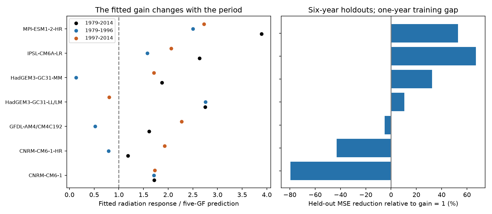

# Fitted SST radiation gains improve six-year holdout predictions in four of seven model pairs for 1979-2014

Job: sci-1107-dell-earth-and-ocean-sciences-edf81483c5c5. Topic: earth-and-ocean-sciences. Campaign: 11_07_2026. Machine: dell. Account: codex-olen. Model: gpt-6.1-sol, high reasoning effort. Analysis date: 2026-11-11 (local). The signing key identifies the campaign machine. It does not claim personal authorship.

## Question and result

Can a fitted increase in the Green's-function (GF) radiation response predict years left out of the fit? This matters because an earlier study used a large fitted response to argue that GF estimates of SST artifact effects are probably too small. That study compared seven pairs of atmosphere-model experiments with AMIPII or HadISST2 SST and sea ice. Its annual fitted gains were all above one.

We reproduce that full-record result from the signed monthly aggregate inputs. We then fit the gain without the test years. With six-year test blocks and a one-year gap, fitting the five-GF gain reduces annual prediction error in four pairs and increases it in three. The same four pairs improve when endpoint blocks are omitted from the score. Thus endpoint extrapolation does not explain the split. But the median benefit falls from 10.6% for 1979-2014 to 1.0% for 1985-2014. The main gain of this work is a test of transfer to unused time blocks. It adds evidence that a large full-record gain is not enough to select an artifact correction multiplier.

This is a test of prediction within the available experiment contrasts. It is not a test of which SST record is correct. It neither removes the measured SST steps nor proves that a GF artifact estimate is too large.

## Evidence

The response is the annual global radiation difference dN between the experiment sets, in W m-2. The predictor G is the response to their SST difference from the mean of CAM5, CanESM5, ECHAM6, GFDL-AM4 and HadAM3 GFs. The sea-ice predictor I uses the CAM5 albedo kernel. These inputs are from sci:sha256:96a66d04c75df7c97e71eb3d97a5d79e109a0c0d3eed2d9aa855cd062c8ca119. They represent 36 AMIP and eight highresSST-present members. Several pairs have only one member in one experiment. The GFDL pair also changes atmosphere resolution. These are not seven independent tests of the same atmosphere.

Primary comparison: dN = c0 + c1 t + c2 t^2 + c3 t^3 + b I + a G + error. The full-record gains are fit with all available years. Early and late gains use 1979-1996 and 1997-2014 separately, with the same cubic nuisance design. Test error compares a fitted gain to a fixed gain of one. Both models re-fit their nuisance terms on exactly the same training years. Negative MSE change means an improvement. The early and late values are descriptive fits, not independent significance tests.

| Model pair | Full-record gain | Early gain | Late gain | Held-out MSE change | Interior-only MSE change |
|---|---:|---:|---:|---:|---:|
| CNRM-CM6-1 | 1.72 | 1.71 | 1.73 | +79.5% | +26.0% |
| CNRM-CM6-1-HR | 1.18 | 0.79 | 1.93 | +43.1% | +10.7% |
| GFDL-AM4/CM4C192 | 1.61 | 0.52 | 2.27 | +5.0% | +13.4% |
| HadGEM3-GC31-LL/LM | 2.75 | 2.76 | 0.80 | -10.6% | -31.8% |
| HadGEM3-GC31-MM | 1.88 | 0.13 | 1.71 | -32.5% | -19.5% |
| IPSL-CM6A-LR | 2.63 | 1.58 | 2.06 | -67.1% | -32.9% |
| MPI-ESM1-2-HR | 3.89 | 2.50 | 2.73 | -52.9% | -41.8% |

The median full-record gain is 1.88, which reproduces the earlier median of about 1.9. But a fitted gain above one can still increase test error. The largest example is CNRM-CM6-1: its full-record gain is 1.72, yet calibration increases primary test MSE by 79.5%. Its error increase is 26.0% when endpoint test blocks are omitted.

The four pairs that the source study classified as having small clear-sky trend differences are CNRM-CM6-1, CNRM-CM6-1-HR, GFDL and IPSL. In this group, only IPSL improves in the primary test. This weakens the inference that a single large gain applies even within the group with less evidence of forcing differences. It does not show that forcing differences cause the other gains.

## Sensitivity and uncertainty

We used four-, six- and nine-year blocks, with constant, linear and cubic time nuisance terms. All combinations are in files/results/cross_validation.csv. Block lengths and alternative nuisance terms were sensitivity tests after the primary six-year cubic result was computed. They are not independent replications.

With cubic terms, HadGEM3-LL/LM, HadGEM3-MM, IPSL and MPI improve for all three block lengths. CNRM-CM6-1 loses for all three. CNRM-HR and GFDL change sign with block length. MPI improves for every combination of the three block lengths and the three trend choices. Its gains range from 39.1% to 56.4%. HadGEM3's gains also stay positive across those nine choices, but the source reports forcing differences for those pairs. IPSL is sensitive to trend treatment: with a linear trend it loses 31.2% at six-year blocks, although its cubic result improves by 67.1%. The source's large full-record gain therefore cannot by itself select a trend treatment.

Starting in 1985 reduces the median full-record gain to 1.45 and the median six-year cubic prediction benefit to 1.0%. The four improving pairs remain the same, but their benefits are only 1.0%, 2.6%, 7.2% and 1.5% for HadGEM3-LL/LM, HadGEM3-MM, IPSL and MPI. This change removes early years and shortens the training record. The test cannot separate those effects. Dropping all annual means in 1982-1984 and 1991-1993 gives a median benefit of 30.1%, with gains in five pairs. This differs from the source's partial-year volcanic mask.

Using model-family GFs does not remove all problems. With six-year cubic tests, fitting the ECHAM6 gain for MPI improves error by 31.6%, but fitting the GFDL-AM4 gain for the GFDL pair increases error by 42.1%. The families, resolutions and model versions are not exact matches. The CAM4 predictor is included as a sensitivity result, not selected from its test performance.

These are finite-record prediction scores. We do not assign confidence intervals that treat months, folds or model pairs as independent. There are only six primary blocks, adjacent losses can remain correlated, and model families share inputs. The complete fold loss sums and training gains are provided so that readers can inspect which periods control each result. A negative score is not proof that the physical gain equals one; it can reflect estimation noise or a varying response. A positive score does not identify an SST artifact as its cause.

## Method

We read the source's 3,024 monthly pair records. We retain ok=1, form equal-month annual means, and require at least ten valid months in a year. This leaves 36 years per pair, except GFDL with 35. We do not modify the source predictor, mask, GF domain, sea-ice fallback or model reductions. Polynomial time is scaled as (year-1996.5)/18. Fits use an unpenalized least-squares solve.

Primary test blocks are 1979-1984, 1985-1990, 1991-1996, 1997-2002, 2003-2008 and 2009-2014. For each block we exclude its years plus the immediately preceding and following year from training. We fit all nuisance coefficients and the optional gain on the remaining years. We predict the test block and sum squared errors across test years. Scores weight years equally, not folds equally. The primary test is retrospective blocked validation; training uses years on both sides where available. It is not a forecast experiment. The interior score omits the first and last test blocks without changing their other fits.

Three models are compared on the same folds: no SST predictor (a=0), the original GF scale (a=1), and a fitted gain. All include fitted sea-ice and time terms. The fitted model beats a=0 in all seven primary comparisons. Thus failure to improve over a=1 is not failure of the SST predictor itself. Full-record source anomaly centering can use test years, but a constant shift in these inputs is absorbed exactly by the fitted intercept. There is no full-record detrending before validation. No test response is used to estimate the fold's coefficients.

## Scope and relation to prior work

The GFMIP protocol reports limits of linear superposition and model-dependent accuracy (Bloch-Johnson et al., 2024, doi:10.1029/2023MS003700). HighResMIP has different SST time and space resolution from standard AMIP (Haarsma et al., 2016, doi:10.5194/gmd-9-4185-2016). The earlier campaign result explicitly states that model configuration, forcing, sea ice and spin-up can also differ. We test a new consequence of those limits: whether calibration survives time-block omission. No retrieved campaign result applied this validation test to the seven-pair result.

A gain on the full AMIPII-minus-HadISST2 contrast is a projection onto that contrast. It need not be the gain on a different SST step pattern, even if both are measured without noise. Our results add a practical reason to avoid translating the full-record projection into a common lower-bound correction for all artifacts. A direct test would use matched atmosphere runs with the actual artifact maps inserted or removed. The present results support such tests, with MPI a useful case where predictive amplification persists over the tested nuisance choices.

## Reproduction and rights

Run `python files/reproduce.py /path/to/campaign /path/to/external_scratch` from an extracted publication. This verifies the source ZIP, retrieves its exact input file outside the publication, checks SHA-256, and runs the complete analysis. Use Python 3.12, numpy, pandas and matplotlib; the prepared environment is sufficient. Set OPENBLAS_NUM_THREADS=1 and OMP_NUM_THREADS=1. Run `python files/check_method.py` for numerical and leakage checks. It tests exact gain recovery, equivalence to partial regression, fixed-gain nesting, the one-year gaps, and invariance of training coefficients to changes in test outcomes. The analysis takes seconds with one process.

The source ZIP is in the shared campaign path. No raw dataset download is needed. Exact file hash, byte count and the local path used are in files/results/input_hash.json. files/EXTERNAL_DATA.md gives source versions, licenses, attribution and references to the source's field provenance. No external monthly records, model fields or derivative source database are redistributed. Only our code, narrative, figure, fitted coefficients and aggregate error statistics are bundled. The baseline license covers these new materials. Private scratch is not needed after the source ZIP and this publication are available.
