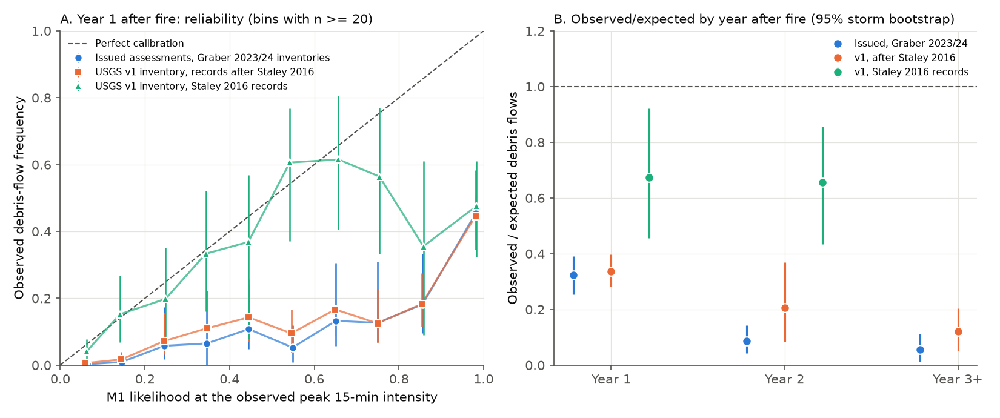
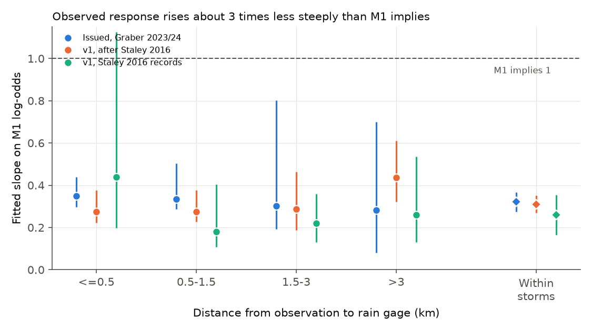
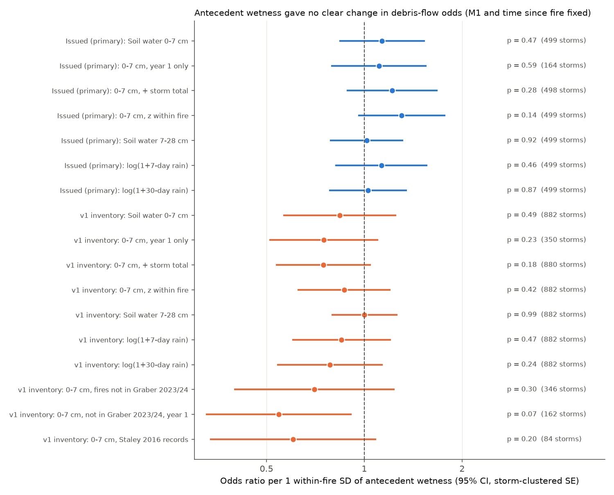

# Issued USGS M1 postfire debris-flow likelihoods were about 3 times too high outside their southern California training records; ERA5-Land antecedent wetness did not explain it (western US)

## Summary

After a wildfire in the western United States, the U.S. Geological Survey (USGS) issues a postfire debris-flow hazard assessment. For each stream segment, the assessment gives a likelihood from the "M1" logistic model (Staley et al. 2017). M1 uses three basin terms (burned steep area T, burn severity F, soil erodibility S) and the peak 15-minute rainfall accumulation R. The USGS fitted M1 to records from southern California fires of 2003-2009.

We asked two questions:

1. **Primary, pre-registered:** Does antecedent soil water change the odds of a debris flow when the issued M1 likelihood and the time since fire are fixed? Two physical hypotheses give opposite signs. Soil water repellency is strongest in dry soil (dry soil gives more debris flows). Saturation and lower infiltration capacity need wet soil (wet soil gives more debris flows).
2. **Descriptive:** How reliable are the issued M1 likelihoods when we apply them to the rainfall that was measured later?

Data: the two USGS inventories of runoff-generated debris flows by Graber (2023, 2024), which link each observation to a segment of the issued assessment; the 27 issued assessment packages; the new USGS inventory v1 (Graber et al. 2026; 7,639 usable records, 77 fires, 2000-2025); and ERA5-Land soil water and ERA5 precipitation at the rain gage.

Main results:

1. **Antecedent soil water had no clear effect (primary test).** For the issued assessments (3,586 observations, 499 storms, 16 fires with both outcomes), the odds ratio per one within-fire standard deviation of 0-7 cm soil water was 1.13 (95% CI 0.84-1.53; storm permutation p = 0.47). Soil water at 7-28 cm and 7-day and 30-day antecedent precipitation also gave no clear effect (p = 0.46-0.92). In the larger v1 inventory (7,123 observations, 882 storms, 52 fires), the odds ratio was 0.84 (0.57-1.25; p = 0.49), with the opposite sign. None of the 17 wetness tests had p below 0.05. The smallest p (0.07) came from year-1 records in fires that are not in the Graber inventories (odds ratio 0.55, 0.33-0.91; 162 storms). This points to more debris flows on drier soil, but it is one of 17 tests and we do not claim it.
2. **Issued likelihoods were too high in year 1.** In the first year after the fire, the issued M1 likelihoods summed to 945 expected debris flows at 1,964 observed segment-storms (173 storms, 18 fires). The inventories record 305 debris flows (observed/expected 0.32, 95% storm-bootstrap CI 0.25-0.39). Segments with a stated likelihood of 0.9-1.0 had debris flows in 46% of cases (CI 35-58%). In year 2 the ratio was 0.09 (0.04-0.14), and in year 3 or later it was 0.055 (0.01-0.11).
3. **The misfit is outside the training records.** In the v1 inventory, the M1 form refitted to the 817 Staley-2016 southern California records recovers the published coefficients (-3.64, 0.41, 0.66, 0.71), and observed/expected is 1.00. In the 2000-2012 Staley-2016 records from other regions, observed/expected is 0.45 (0.33-0.58). In the later records (fires of 2010-2024) from other regions, the year-1 ratio is 0.33 (0.26-0.40, 37 fires). In later southern California fires the ratio is 0.34 (0.31-0.62), but two fires give most of this result: Thomas 2017 (171 observed, 531 expected, one storm) and the Fish/San Gabriel Complex 2016 (7 observed, 46 expected, mostly in years 2-3).
4. **The observed response is about 3 times less steep than M1 implies.** A logistic recalibration on the M1 log-odds gives a slope of 0.33 (0.30-0.47) for the issued year-1 data. The slope is 0.32 (SE 0.02) inside single storms, where the rainfall is almost the same and only the basin terms change. The slope does not increase near the rain gage: 0.35 at 0.5 km or less and 0.28 above 3 km. Thus gage distance (rainfall measurement error) does not cause the flat slope. In the southern California training records, the slope is 1.00 by construction, and the within-storm slope is 0.78 (SE 0.12).
5. **Discrimination is good.** The issued likelihoods rank the segments well (year-1 area under the ROC curve 0.87). The problem is the level and the steepness of the probabilities, not the order.

**Conclusion.** Antecedent wetness, as ERA5-Land gives it, is not a missing control in the M1 forecasts. The issued likelihoods rank segments well but are too high by a factor of about 3 in year 1 outside the training records, and more after year 1. A likelihood of 0.5 from an issued assessment corresponds to an observed frequency of about 0.1-0.2. Users who read the issued numbers as probabilities will over-estimate the hazard. The 2026 USGS regional models (Graber et al. 2026, ESPL) already address part of this problem, and our results give an independent, probability-scale check of the products that were issued for 2016-2022 fires.

## What is new relative to earlier work

* No earlier campaign publication that we found covers postfire debris flows. The campaign search "landslide debris flow" returned no result; two later searches ("postfire debris flow wildfire", "wildfire burned area erosion runoff") did not finish because the shared catalog was slow. Related campaign work on fire effects on runoff: sci:sha256:fd13e2495e0e786296adf3eef558bff0ea77fefb81fde182f96218813082cf04.
* Graber et al. (2026, Earth Surface Processes and Landforms, doi:10.1002/esp.70393) report that M1 over-predicts outside southern California and give regional refits that reduce false positives. They evaluate rainfall thresholds; we evaluate the issued probabilities (reliability, observed/expected, slope), the within-storm basin terms, and gage distance. We also show that the M1 form refitted to the training records reproduces the published coefficients, so the misfit is an out-of-sample effect.
* Graber et al. (2026, Geosphere, doi:10.1130/GES02936.1) show that static year-1 thresholds give false positives in years 2-3. Our year-2 and year-3 ratios agree.
* The antecedent-wetness test is new. Chong et al. (2026, NHESS) proposed seasonal hydraulic conductivity changes after the 2020 Lake Fire. Our data do not show a storm-to-storm wetness effect at the scale of ERA5-Land.

## Data

All inputs are public. File hashes are in `files/data/raw_sha256.txt`.

| Data | Source and license | Use |
| --- | --- | --- |
| Debris-flow inventories, 17 and 18 fires | Graber 2023, doi:10.5066/P98Q4CDH; Graber 2024, doi:10.5066/P13ZFKJS (USGS ScienceBase, CC0 1.0) | Response, storm date, rain gage, PeakI15, segment ID |
| Issued USGS postfire debris-flow hazard assessments, 27 fires | USGS Landslide Hazards Program; links from the pwfdf MapServer layer 0 (https://earthquake.usgs.gov/arcgis/rest/services/ls/pwfdf/MapServer/0); ScienceBase collections doi:10.5066/P142R8E2 and doi:10.5066/P14EWYME (USGS public domain) | Issued M1 terms T, F, S per segment and segment geometry |
| USGS runoff-generated postfire debris-flow inventory v1 | Graber et al. 2026, doi:10.5066/P1R9VXC4 (CC0 1.0) | Extension test and calibration in 77 fires |
| ERA5-Land hourly soil water (0-7, 7-28 cm) and ERA5 hourly precipitation | Copernicus Climate Change Service (doi:10.24381/cds.e2161bac, doi:10.24381/cds.adbb2d47), read through the Open-Meteo historical API (https://open-meteo.com, CC BY 4.0) | Antecedent wetness |

The ERA5 point series and the storm-level antecedent values derived from them are not in this bundle. `files/code/fetch_era5land.py` and `antecedent.py` regenerate them. This publication contains modified Copernicus Climate Change Service information (aggregate statistics only); neither the European Commission nor ECMWF is responsible for any use of it.

The bundle includes the joined observation tables without ERA5 values (`files/data/obs_issued_joined.csv`, `files/data/v1_obs_m1.csv`). They contain only USGS public-domain and CC0 fields plus our M1 calculations.

## Methods

**M1 likelihood.** X = -3.63 + (0.41 T + 0.67 F + 0.70 S) R, with R = PeakI15/4 (mm in 15 minutes); P = 1/(1 + exp(-X)). For the Graber inventories, T, F and S come from the issued assessment segment (`L_X1`, `L_X2`, `L_X3`; `M1_X1-3` in the 2016 package). For the v1 inventory they come from its `HM23`, `dNBR/1000` and `KF` fields. Four 2014-2015 assessments used an older model and are excluded.

**Join to issued segments.** We used the inventory segment ID when that segment lies within 100 m of the observation point; otherwise the nearest assessed segment of the same fire within 100 m (rule fixed before outcomes were examined). Of 4,134 unique observations, 3,616 have a segment and a PeakI15 (3,356 by ID, 260 by distance; 194 of the latter are one monitoring site in the 2016 Fish/San Gabriel Complex fire). Check: for 3,328 observations that are also in the v1 inventory, the issued terms agree with the v1 terms (correlation 0.998 for T, 0.967 for F, 1.000 for S; median ratio 1.00).

**Antecedent wetness.** For each storm and rain-gage 0.1-degree cell, the mean ERA5-Land 0-7 cm volumetric soil water of the UTC day before the storm start (primary), the same for 7-28 cm, and ERA5 precipitation in the 7 and 30 days before the storm. A storm takes the mean over its gage cells.

**Primary test (pre-registered in `files/PREREGISTRATION.md` before the soil-water data were fetched).** Logistic regression of Response on fire fixed effects, the M1 log-odds X, log days since fire, and antecedent wetness A. Statistic: the coefficient of A. Two-sided p from 10,000 permutations of storm-level A among the storms of the same fire (each storm keeps all its observations). Fires with only one outcome value cannot contribute to a fixed-effect logit and drop out. We report storm-clustered standard errors for intervals. Secondary tests: year 1 only; with log storm rainfall total; A standardised within fire; 7-28 cm soil water; log(1 + 7-day) and log(1 + 30-day) precipitation.

**Extension (planned after the primary result, before any v1 analysis).** The same test on the v1 inventory, and on its part that is not in the Graber 2023/2024 inventories.

**Calibration (descriptive).** Observed/expected (sum of responses over sum of M1 likelihoods), reliability bins, area under the ROC curve, and a logistic recalibration (Response on X). Intervals come from 1,000 storm-cluster bootstrap draws (2,000 for `training_split.json`). The within-storm slope comes from a conditional logit with storm strata.

## Results

*Figure 1. A: year-1 reliability of M1 likelihoods. B: observed/expected debris flows by year after fire. Bars are 95% storm-bootstrap intervals.*

*Figure 2. Logistic slope on the M1 log-odds by rain-gage distance and inside single storms. M1 implies a slope of 1.*

*Figure 3. Antecedent-wetness tests. Odds ratio per within-fire standard deviation (95% CI, storm-clustered). p values are from storm permutations within fires.*

Key tables: `files/data/antecedent_tests_table.csv`, `files/data/calibration_issued.json`, `files/data/calibration_v1.json`, `files/data/training_split.json`, `files/data/v1_fire_table.csv`.

Calibration split of the v1 inventory (`files/data/training_split.json`):

| Records | Fires (fire years) | Storms | Observed | Expected (M1) | Observed/expected (95% CI) | Recalibration slope | Within-storm slope (SE) |
| --- | --- | --- | --- | --- | --- | --- | --- |
| Staley 2016, southern California (M1 training records) | 18 (2003-2009) | 63 | 201 | 201 | 1.00 (0.57-1.35) | 1.00 | 0.78 (0.12) |
| Staley 2016, other regions | 15 (2000-2012) | 53 | 133 | 296 | 0.45 (0.33-0.58) | 0.18 | 0.12 (0.05) |
| Later records, southern California | 7 (2014-2020) | 146 | 205 | 604 | 0.34 (0.31-0.62) | 0.30 | 0.32 (0.03) |
| Later records, other regions | 38 (2010-2024) | 790 | 416 | 1,691 | 0.25 (0.18-0.31); year 1: 0.33 (0.26-0.40) | 0.31 | 0.29 (0.04) |

Issued-assessment data (`files/data/calibration_issued.json`), by year after fire:

| Year after fire | Observations | Storms | Observed | Expected | Observed/expected (95% CI) | AUC | Recalibration slope |
| --- | --- | --- | --- | --- | --- | --- | --- |
| 1 | 1,964 | 173 | 305 | 945 | 0.32 (0.25-0.39) | 0.87 | 0.33 |
| 2 | 923 | 169 | 29 | 333 | 0.09 (0.04-0.14) | 0.80 | 0.30 |
| 3 or later | 729 | 168 | 12 | 217 | 0.055 (0.01-0.11) | 0.89 | 0.26 |

## Deviations from the plan

* ERA5-Land precipitation is not available through the API, so the 7-day and 30-day precipitation come from ERA5 (0.25 degree) at the same point.
* The plan's secondary item (d), storm-level log(observed/expected) against wetness, was not run as a separate test. The fixed-effect model already compares storms within fires.
* De-duplication used more fields than planned (segment, storm, response, gage, PeakI15 and location), and the segment join added a 100 m distance check. Both rules were fixed before any outcome was examined.
* We added one extension test that was not in the extension plan: the Staley 2016 records alone (p = 0.20).
* The planned regional break-down is in `calibration_issued.json` and `calibration_v1.json` (`year1_by_region`); the training-record split was added after we saw the calibration results.

## Limitations

* **Inventory sampling.** A "0" means that no true debris flow was observed. The inventories are field-verified, but they do not sample every segment and every storm. Missed debris flows would lower the observed counts. Large monitoring sites contribute many storms (for example 127 storms at one Fish Fire site), and the 2018 Thomas Fire contributes 857 segments of one storm.
* **Segment versus basin.** M1 was fitted to basin outlets. The inventory observations are at segment locations of different sizes. We used the issued segment value, which is what users read.
* **Rainfall.** PeakI15 comes from one rain gage per observation, up to 18 km away. The flat slope did not change with gage distance, but gage rainfall still has errors.
* **Antecedent wetness.** ERA5-Land soil water is a 9 km model value and not a measurement of the burned soil. The test can find only effects that change with storm-to-storm wetness at that scale. Within-fire standard deviation of 0-7 cm soil water was about 0.08 m3/m3. Effects smaller than about an odds ratio of 1.5 per standard deviation are not excluded.
* **Few fires.** The fixed-effect tests use 16 (issued) and 52 (v1) fires with both outcomes. Southern California after 2013 has 7 fires, and two of them give most of the result.
* **Post hoc parts.** The training-record split, the within-storm slope and the gage-distance check were added after we saw the calibration result. They are descriptive.

## Open questions for later work

* Does a measured soil-moisture or soil-repellency series at burned sites (not reanalysis) explain storm-to-storm variation?
* Do the 2026 USGS regional models give calibrated probabilities (not only better thresholds) on fires that were not in their fit?
* Why are the basin terms 3 times too steep outside the training records? Candidate causes: different burn-severity mapping (dNBR from rapid BARC maps), segment size, and different runoff processes in snow-dominated or monsoon regions.

## Reproduction

1. `bash files/code/retrieve.sh /path/to/scratch` downloads the inventories and the 27 assessment zips (about 1.3 GB) into `scratch/raw` (never into this folder). Check the hashes with `files/data/raw_sha256.txt`.
2. `PY=python3 bash files/code/run_all.sh /path/to/scratch` runs the whole pipeline. The ERA5 requests are paced for the Open-Meteo rate limit (about 1.5 h). The permutation and bootstrap steps use fixed random seeds.
3. Environment: Python 3.12 with numpy, pandas 3, geopandas, pyogrio, statsmodels, scikit-learn and matplotlib.

## Provenance

* Campaign 11_07_2026, job `sci-1107-dell-earth-and-ocean-sciences-86a29cf2e45f`, topic earth-and-ocean-sciences, machine dell, account claude-olen.
* Analysis and text by the AI model Claude Opus 5.5 (`claude-opus-5-5`) in Claude Code, 2026-11-12. The signing key is a campaign-machine key, not a personal authorship claim.
* Data retrieved 2026-11-12 from USGS ScienceBase, the USGS pwfdf map service and the Open-Meteo archive API.
