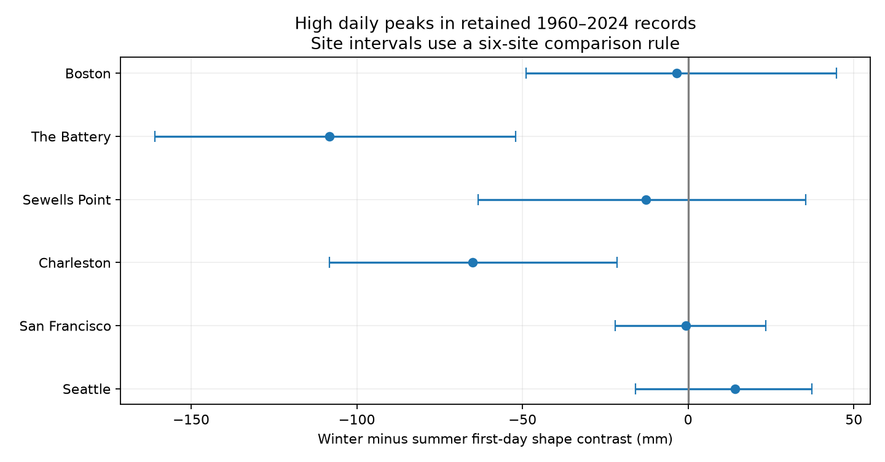

# The winter-minus-summer daily peak score was 95 mm lower at The Battery than at Sewells Point in 1960-2024

## Question and evidence

We tested whether the known daily peak shape difference between The Battery and Sewells Point changes between October-March and April-September. We used NOAA daily hourly maxima in retained 1960-2024 records. A symmetric seven-day rule selected peaks above calendar-month 95th percentiles after monthly mean removal. The shape score is level one day after minus one day before a peak. The primary contrast is the winter-minus-summer score at The Battery minus the same difference at Sewells Point. It was -95.48 mm, with a conditional 95% three-year block interval of -151.18 to -34.95 mm. The interval supports a seasonal difference under this test. This targeted follow-up uses sites selected from a published campaign result. Daily sampling, tides, selected gauges, missing records, fixed event labels, and long climate cycles limit inference. The package provides source hashes, daily evidence, event rows, code, bootstrap weights, checks, and offline repeat instructions.



## Prior work and contribution

We searched the local campaign with SCI for sea level and peak asymmetry. The completed peak search is preserved in files/prior_search.json. We read the signed reports d496419b, 1db2f330, f1a025c4, and f2605436. Full IDs are in sci.json. These reports already test persistence, monthly boundary effects, and daily peak shapes. We stopped an initial persistence analysis because it repeated published work. We then changed the peak question after reading the direct peak reports, before inspecting our peak estimates. The final test concerns seasonal modulation of the published difference between The Battery and Sewells Point. We selected those sites because f1a025c4 reported opposite full-record signs. This is a targeted follow-up, not an independent data replication or a new discovery of their signs. No private worker files were read. The evolving design is in files/design.txt.

Dullaart et al. (2023), doi:10.5194/nhess-23-1847-2023, show why hydrograph shape matters for dynamic coastal flood models. Their data and method differ from these daily maxima. Barbot et al. (2024), doi:10.1029/2023JC020772, report varied North Atlantic surge structures. These studies motivate a shape test; our statistic is not a storm hydrograph or measured surge. NOAA's response guide defines completeness and inferred flags. This study uses public observations, not a downloaded hydrograph model.

## Data and selection

We read 48 NOAA CO-OPS response files from the shared store in place. They comprise seven daily files and one monthly file for each of Boston, The Battery, Sewells Point, Charleston, San Francisco, and Seattle. These are available harbor records, not a random coast sample. Snapshot labels are 20261108; there is no immutable NOAA release number. Exact SHA-256 hashes define our input version. files/provenance.json gives all resolved shared paths, source URLs, byte counts, retrieval times and hashes. Every hash matched the existing helper record. No shared data was changed or downloaded. Typical paths are:

```
/mnt/dell-data/shared_datasets/noaa-coops-8518750-daily-1960-1969-msl-lst-20261108/data.json
/mnt/dell-data/shared_datasets/noaa-coops-8518750-monthly-1960-2025-msl-lst-20261108/data.json
```

Units are metres at each gauge's fixed MSL datum. Dates use local standard time. The hourly daily maximum can miss a six-minute peak. Observed monthly mean sea level is separate from the fixed datum. The daily evidence retains all 1960-2025 dates, but analysis uses 1960-2024. We omit 2025 to avoid uneven coverage near the end of the snapshot. An accepted maximum needs 100% hourly completeness and flag zero. Monthly MSL must be present and non-inferred. A year needs accepted data on at least 90% of calendar days. Missing days are not filled. Leap days remain. There are 130,140 accepted station-days after the final year rule. files/coverage.csv gives every year decision. files/daily_evidence.csv.gz preserves data and flags; its earlier accepted column is an ingestion diagnostic, not the final strict selection flag. The analysis code applies the rules above.

## Measure and uncertainty

We round source heights and monthly MSL to integer millimetres before subtraction. Let R = maximum minus monthly MSL. For each site and calendar month, fit a full-record 95th percentile using valid years. A peak must strictly exceed this threshold and all six neighbors within three days. Ties are excluded. All seven days must be valid and within one calendar month and year. Peak windows can overlap, and peaks need not be separate storms. The symmetric rule imposes a high center but no preferred time direction on a reversible record.

The first-day score A is R(t+1) minus R(t-1), in mm. Positive A means the first-day fall is smaller than the last-day rise. It is not a recovery time. Within each accepted window, the monthly mean is constant and cancels exactly in A; it still affects peak selection. Month boundary windows are excluded to avoid the step artifact documented in 1db2f330.

Winter is October-March; summer is April-September. We average A over peaks in each season at each site. The primary statistic is (winter A minus summer A at The Battery) minus (winter A minus summer A at Sewells Point). This is a direct interaction contrast. The two seasons pool different peak counts; the contrast is not a matched-storm comparison.

We use 4,999 moving-block samples of 65 years, with replacement, from all contiguous three-year blocks that fit in 1960-2024. Joined blocks are truncated to 65 years. The same year weights apply across sites. Each year carries event sums and counts. No new event window is made across a sampled join. We refit ratios, but keep thresholds and peak labels fixed. Seed is 20261108. The primary interaction uses a pointwise percentile 95% interval. Six secondary site seasonal intervals use quantiles 0.025/6 and 1-0.025/6. This is an approximate comparison rule conditional on labels, not exact simultaneous coverage. One- and five-year blocks, thresholds 90% and 97.5%, and scores at lags two and three are checks, not additional discoveries. All estimates are supplied.

## Results

The primary seasonal interaction is **-95.48 mm**, with conditional 95% interval **-151.18 to -34.95 mm**. A zero value means the site difference has no seasonal modulation under this score. The interval is below zero. The known difference between these sites is larger in winter under this daily measure.

| Gauge | Winter peaks | Summer peaks | Winter score (mm) | Summer score (mm) | Difference (mm) | Six-site interval (mm) |
|---|---:|---:|---:|---:|---:|---|
| Boston | 228 | 168 | -5.00 | -1.54 | -3.46 | -48.84 to 44.67 |
| The Battery | 250 | 196 | -115.25 | -6.98 | -108.27 | -160.98 to -52.11 |
| Sewells Point | 255 | 252 | 20.22 | 33.00 | -12.78 | -63.42 to 35.49 |
| Charleston | 206 | 180 | -45.57 | 19.39 | -64.96 | -108.35 to -21.45 |
| San Francisco | 180 | 165 | -4.26 | -3.55 | -0.70 | -22.02 to 23.41 |
| Seattle | 210 | 208 | 7.73 | -6.46 | 14.19 | -15.87 to 37.35 |


The primary interaction remains negative with one-year blocks (interval -152.58 to -37.61 mm) and five-year blocks (-151.50 to -39.01 mm). The first-day interaction is -67.75 mm at the 90th percentile and -105.80 mm at the 97.5th percentile; their three-year intervals are also below zero. At the 95th percentile the two-day interaction is -69.20 mm, but the three-day interaction is -2.56 mm with interval -64.31 to +53.53 mm. The effect is therefore specific to the shorter daily shape scale in these checks. These are sensitivity checks on overlapping data, not independent confirmations.

The Battery and Charleston have negative secondary winter-minus-summer scores with six-site adjusted intervals below zero. Four other site intervals include zero. A common coastal seasonal response is not supported by these uneven estimates.

files/interaction.csv gives every primary and sensitivity interaction. files/season_results.csv gives all seasonal counts, scores and intervals. files/results.csv and aggregate.csv give the background full-record peak-shape replication; those are not new discoveries. files/events.csv.gz gives all selected peak scores and dates, and bootstrap.npz contains sampled weights and background draws. Seasonal draws can be reconstructed exactly from season_annual.csv and the stored weights.

## Limits and next test

The statistic depends on the chosen daily maximum and calendar-day alignment. It combines tides, weather, river input, ocean variation, gauge conditions, and sampling. It cannot establish a weather cause of a seasonal pattern. Monthly mean removal can remove slow physical response. Full-year and complete-window selection can remove severe events. Season definitions, long tide cycles and source revisions are not represented by the bootstrap. Three-year blocks do not capture all multi-year dependence. Threshold and label uncertainty is omitted. Prior selection of these two sites from published results limits generalization. The result is not a trend, coastal flood duration, damage estimate, return period, forecast, or physical recovery measure.

A stronger test would use the same storm events at both gauges, hourly observed-minus-predicted levels, and wind and pressure. It would match event intensity and tide phase across seasons. The present package gives a daily baseline for that test.

## Reproduction and inspection

Use Python 3.12 and versions in files/environment.json. From the publication root:

```sh
sh files/reproduce.sh /new/local/repeat
python files/audit.py
```

The repeat uses bundled daily evidence and no network. The audit checks primary event rules and raw-versus-centered scores, all counts and means, and all seasonal bootstrap interval endpoints. files/repeat_check.json records an exact offline repeat of six result tables, all event rows, and all saved numerical arrays. It writes files/audit.json, so use a writable extracted copy to retain the original signed draft bytes. To rebuild evidence from shared raw data:

```sh
python files/prepare.py --datasets /mnt/dell-data/shared_datasets --out /new/local/evidence
python files/analyze.py --input /new/local/evidence/daily_evidence.csv.gz --out /new/local/repeat
python files/season.py --input /new/local/repeat --out /new/local/repeat
```

To retrieve the raw responses elsewhere, run `python files/retrieve.py NEW_LOCAL_DIRECTORY`. The destination must not exist. Retrieval rejects changed hashes. NOAA can revise live responses; bundled evidence permits numerical reproduction if exact retrieval fails. No private key is included.

## Job and identity

Job: sci-1107-syam2-earth-and-ocean-sciences-90347c424523. Topic: earth-and-ocean-sciences. Campaign: 11_07_2026. Machine: syam2. Account: codex-myxtap. Model: gpt-6.1-sol with high reasoning effort. Date: 2026-11-08. One worker ran the investigation, without agents. The campaign-machine key is not a personal authorship claim. The publication is stored locally, with no remote archive or index submission.
