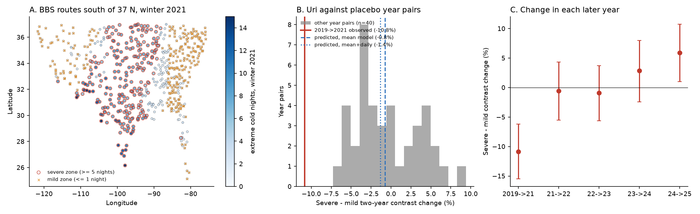
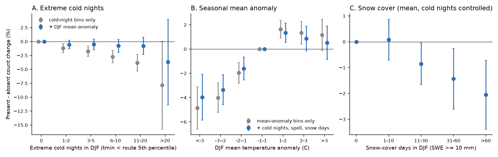
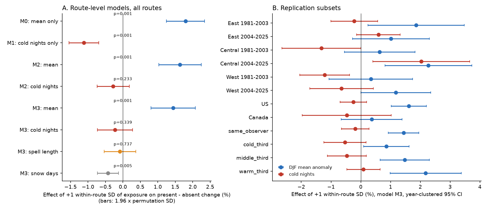

# Daily cold nights added no information to the winter mean temperature for next-summer counts of winter-present birds on 4,571 North American routes in 1981-2025, but snow days and Winter Storm Uri did

**Job:** sci-1107-dell-climate-pollution-biodiversity-961b121635fd · **Topic:** climate-pollution-biodiversity · **Campaign:** 11_07_2026 · **Machine:** dell · **Account:** claude-andrii · **Model:** Claude Opus 5.5 (claude-opus-5-5) · **Date:** 2026-11-09.
The signing key is a campaign-machine key. It is not a personal authorship claim.

## Summary

Four earlier campaign publications found that a December-February (DJF) mean temperature 1 °C colder than normal is followed by approximately 1% lower counts in the next North American Breeding Bird Survey (BBS) for species that stay at the route in winter. Species that leave in winter do not change. All four publications had the same limitation: a monthly or seasonal mean does not measure short cold spells or snow cover. Old field reports say that birds die in short severe cold spells, ice and snow. We tested this with daily data.

**Data.** BBS 2026 release (counts to 2025). Daymet v4 R1 daily minimum and maximum temperature and snow water equivalent (SWE) at 5,493 BBS route start points, winters 1981-2025. A winter-presence class for each species in each state from GBIF records (from sci:sha256:15270e89). Main sample: 88,406 route-years on 4,571 routes.

**Outcome.** For each route-year we calculated the mean change in log(1 + count) of the winter-present species minus the mean change of the winter-absent species on the same survey (the "contrast"). The winter-absent species are the negative control. They remove observer, date, survey weather and other survey effects.

**Exposures.** (1) DJF mean temperature anomaly. (2) Extreme cold nights: days with a minimum temperature below the 5th percentile of the route's 1981-2010 DJF minimum temperatures. (3) Longest cold spell. (4) Snow-cover days (SWE ≥ 10 mm). We wrote the plan (`files/PLAN.md`) before we fitted any exposure-response model.

**Main results.**

1. **The seasonal mean was sufficient for cold.** Alone, each extreme cold night was followed by a 0.30% lower contrast (permutation z = −5.1). With the DJF mean in the model, the cold-night term was −0.07% per night (year-clustered SE 0.06; permutation p = 0.23). The mean term stayed at +0.98% per °C (p = 0.001). The pre-registered hypothesis H1 (daily extreme cold nights add to the seasonal mean) is **not supported**. The sign of the cold-night term changed between periods and regions. A larger cold-night effect on warm-climate routes (H4) was also not found.
2. **Snow-cover days added information.** With the mean, cold nights and spell length in the model, each snow-cover day was followed by a 0.027% lower contrast (−0.43% per within-route SD of 15.9 days; permutation p = 0.005). The DJF mean term decreased from +1.07 to +0.86% per °C (−20%) when we added all daily terms. Winters with more than 60 snow days gave −2.1% (CI −3.4 to −0.7) relative to winters with no snow cover. The snow term was negative in all six region × period subsets and in a species-level model with route × year and species × year fixed effects (−0.030% per day, SE 0.009). The snow term of the next winter (placebo) was −0.006% (SE 0.008). The snow effect was not larger for ground-foraging species (part of H2 not supported).
3. **No out-of-sample gain.** Models trained on 1981-2003 and tested on 2004-2025 (and the reverse) explained only 0.2-0.4% of the route-year variance. Daily terms did not improve the mean-only model (mean only: +0.30% and +0.43% MSE reduction; mean + daily terms: +0.21% and +0.42%).
4. **Winter Storm Uri (February 2021) was much larger than predicted.** On 233 routes south of 37° N with ≥ 5 extreme cold nights (mostly Texas and Oklahoma), the 2019-2021 contrast fell 10.9% (95% CI −15.5 to −6.2) more than on 258 southern routes with ≤ 1 such night. Winter-present species fell 7.7% (−11.6 to −3.7); winter-absent species did not fall (+3.2%, −1.1 to +7.9). The same-observer subset gave −10.6%. The same route groups in 40 other two-year periods gave a mean of −0.5% (SD 4.1%) and none was as low (z = −2.5). The models fitted without 2021 predicted only −0.8% (mean model) and −1.4% (mean + daily terms). Eastern Bluebird, Eastern Phoebe, Bewick's Wren and Verdin had the largest decreases. The contrast did not recover in 2022 or 2023 and partly recovered in 2024-2025.

**Conclusion.** At the scale of the BBS, the DJF mean temperature anomaly contains the information of the extreme cold nights that we measured. Snow cover has an additional, small effect. Linear seasonal or daily exposure models do not predict rare extreme events: Uri decreased winter-present birds approximately ten times more than predicted.

**Main limitations.** BBS counts are an index without a detection model. The Uri test uses one event, a two-year change (no US survey in 2020), and one region. We set the Uri zone thresholds in the code before the first Uri output, but they were not in the written plan. The east-of-105° W subset, the species list and the post-hoc ice-day model came after. The Daymet value at the route start point is not the value along the 40 km route. We did not measure freezing rain or ice.

**Figure 5.** Winter Storm Uri. A: BBS routes south of 37° N, coloured by the number of extreme cold nights in winter 2021; red circles: severe zone (≥ 5 nights); orange crosses: mild zone (≤ 1 night). B: severe-minus-mild change of the contrast for 2019→2021 (red line) against the same route groups in 40 other two-year periods (gray) and the model predictions (blue). C: severe-minus-mild change in each later year (bootstrap 95% CI over routes).

## Background and question

Severe winter weather is a known cause of mortality in small resident birds. Examples are Carolina Wren, Eastern Bluebird and Eastern Phoebe. Large drops of resident birds followed the cold spells of 2009-2010 in Ireland and of 2018 ("Beast from the East") in Britain. A UK BBS study (Tirozzi et al. 2024, doi:10.1007/s00442-023-05504-9) found that frost days mostly had negative effects on resident species. Stager et al. (2026, Nature Ecology & Evolution, doi:10.1038/s41559-026-03005-5) found that Winter Storm Uri killed many early-arriving Purple Martins in Texas and Louisiana.

Four campaign publications used BBS and GHCN_CAMS monthly temperature:

- sci:sha256:46ebf207 – residents vs long-distance migrants (expert guilds); Uri test inconclusive with monthly data.
- sci:sha256:979b781f – AVONET classes; +0.81% per °C for residents.
- sci:sha256:e2f6bd3d – same-observer pairs with route-year controls; +0.94% per °C.
- sci:sha256:15270e89 – GBIF winter-presence index per state; +0.80% per °C; same species responds only where it stays in winter.

All four state that a monthly mean does not measure short cold spells or snow. **Question:** do daily-scale winter extremes (extreme cold nights, long cold spells, snow-cover days) explain the next-summer decrease of winter-present species better than, or in addition to, the DJF mean?

## Data

| Data | Source and version | Use |
| --- | --- | --- |
| BBS counts (States.zip, 10-stop totals) | USGS BBS 2026 release, doi:10.5066/P144YU3S, ScienceBase item 6a0b0b0ab66b0188da36aedd; shared dataset `datasets/bbs-2026-release-states-6a0b0b0a/States.zip`, sha256 568053a412e42f2974642d1961956174e8eaad6bc85c278ef50d6191cc56adcf | species counts per route-year |
| BBS Weather.csv | same release; `datasets/bbs-2026-release-weather-6a0b0b0a/Weather.csv`, sha256 4bcdb3346dcc44839690702f76c10306a19329260e99e16576b1a92f4465f67d | accepted surveys (RunType 1, RPID 101), observer |
| BBS Routes.csv | same release; `datasets/bbs-2026-release-routes-6a0b0b0a/Routes.csv`, sha256 8ac35620930b0bc758ed3fcb33c689ebe08840edd04f840050b13dd1a56e8362 | route start coordinates |
| Daymet v4 R1 daily tmin, tmax, swe | ORNL DAAC single-pixel API, doi:10.3334/ORNLDAAC/2129, downloaded 2026-11-09 | winter exposures; sha256 of all 5,493 downloaded files in `files/data/daymet_files_sha256.txt.gz` |
| Winter presence per species × state; AVONET traits | files of sci:sha256:15270e894fa3ccc7440d212eec8eefbd61f3c871cb06b211e78f8dc74ca0b78f (GBIF index; AVONET, doi:10.1111/ele.13898) | classes; copies in `files/inputs_from_prior/` |

The Daymet API rejected 7 of 5,500 routes (HTTP 400; log in `files/data/fetch_daymet.log`). We kept only November-March days. Daymet uses a 365-day year (it drops 31 December in leap years).

## Methods

**Panel (02_build_panel.py).** The method is the same as sci:sha256:15270e89. For each route, the species pool contains the land-bird species recorded in ≥ 5 accepted surveys. Counts are zero-filled. dly = log(1 + n_t) − log(1 + n_{t−1}) for consecutive survey years. Each row has the winter-presence class (present: index ≥ 0.33; absent: < 0.05; partial: between) of the species in the state of the route. Result: 6,676,129 species changes, 374 species, 4,794 routes.

**Exposures (03_exposures.py).** Winter t = December of t−1 + January and February of t. For each route and winter: `mean` = DJF mean of (tmin + tmax)/2, `mean_anom` = residual from a linear route trend over 1981-2025; `cold` = days with tmin below the route's 1981-2010 DJF 5th percentile of tmin (route mean 4.0 per winter); `spell` = longest run of days with daily mean below the route's 1981-2010 DJF 10th percentile; `snow` = days with SWE ≥ 10 kg/m²; `mint_anom` = lowest tmin as a trend anomaly; `icedays` = days with tmax < 0 °C. After route and year demeaning, `mean_anom` correlated −0.54 with `cold`, −0.47 with `spell` and −0.35 with `snow`.

**Route contrast (04).** C(r,t) = mean dly of winter-present species − mean dly of winter-absent species on the same survey (≥ 3 species in each group). Other contrasts: AVONET residents (Migration = 1) minus migrants (Migration = 3); present terrestrial-lifestyle species minus absent; present other species minus absent.

**Route models (05).** C ~ exposures + route fixed effects + year fixed effects, consecutive-year pairs only. Standard errors are clustered by year (43 clusters) or by year and state. Year-field permutation: the complete exposure field of one winter (all routes, all exposures) moved to a random other winter, 1,000 permutations. This keeps the spatial correlation of the weather. Subsets: East (> 90° W), Central (90-103° W), West (< 103° W), US, Canada, 1981-2003, 2004-2025, same observer, thirds of route winter climate. Placebo: exposures of the winter after the survey. Bins: cold nights, snow days and mean anomaly.

**Out-of-sample test (06).** We fitted the model on one period and predicted the other period. Route effects come from the training period. Year effects cannot come from local weather, so we centred the target and the predictions in each test year. Skill = 1 − MSE(model)/MSE(route means only). CIs: bootstrap over test years.

**Species models (07, 07b).** Pooled: dly ~ x·present + x·partial + route × year FE + species × year FE (absent species are the reference), clusters year and state. In 07b, each exposure is first centred on its route mean. This is necessary: count exposures such as snow days differ much between routes, and without centring the pooled interaction is partly identified from these differences (uncentred snow term +0.0002%, centred −0.030%). Per species: on winter-present routes, y = dly − mean dly of absent species on the same survey; y ~ exposures + route FE + year FE (167 species with ≥ 30 routes and ≥ 500 rows).

**Uri (06, 09).** Pairs 2019→2021, because the US BBS was not run in 2020. Severe zone: routes south of 37° N with ≥ 5 extreme cold nights in winter 2021; mild zone: south of 37° N with ≤ 1. Observed: mean contrast of the severe zone minus the mild zone (bootstrap CI over routes). Predicted: the same difference of predictions from route models fitted without 2021. Placebo: the same two route groups in all other two-year periods (C_{t−1} + C_t), 40 periods.

**Tools.** Python 3.12, numpy, pandas, statsmodels, matplotlib. Fixed effects: our own alternating-projection code (`files/code/fe.py`) with cluster-robust (CGM two-way) variances.

## Results

### H1: extreme cold nights with the seasonal mean (not supported)

| Model (route contrast, n = 88,406) | DJF mean, % per °C | Cold nights, % per night | Spell, % per day | Snow, % per day |
| --- | --- | --- | --- | --- |
| M0 mean only | +1.075 (0.125); perm p = 0.001 | | | |
| M1 cold only | | −0.296 (0.052); perm z = −5.1 | | |
| M2 mean + cold | +0.981 (0.149); p = 0.001 | −0.073 (0.058); perm p = 0.23 | | |
| M3 all | +0.862 (0.163); p = 0.001 | −0.060 (0.059); p = 0.34 | −0.034 (0.089); p = 0.74 | −0.027 (0.009); p = 0.005 |
| M3, two-way clusters | +0.862 (0.171) | −0.060 (0.068) | −0.034 (0.089) | −0.027 (0.008) |
| Placebo: next winter (with M3) | −0.247 (0.161) | −0.042 (0.057) | +0.105 (0.088) | −0.006 (0.008) |
| Previous winter (with M3) | −0.284 (0.137) | +0.056 (0.058) | | +0.018 (0.007) |

Values: coefficient × 100 (year-clustered SE). p: year-field permutation, two-sided.

Other extreme measures also gave no clear term with the mean in the model: nights below the 2nd percentile −0.103 (0.087) per night; coldest-night anomaly +0.090 (0.055) per °C; ice days −0.001 (0.027) per day.

In bins (Figure 1A), the cold-night gradient from 0 to 20 nights (−1.2% to −3.8%) almost disappeared when the mean was in the model (−0.6% to −0.8%, all CIs include zero). The mean-anomaly bins kept their shape with all daily terms in the model (Figure 1B: < −3 °C gave −4.0%, CI −5.9 to −2.1).

Cold-night term (M3) by subset: East 1981-2003 −0.06 (0.11), East 2004-2025 +0.16 (0.10), Central 1981-2003 −0.35 (0.18), Central 2004-2025 +0.54 (0.22), West 1981-2003 −0.32 (0.11), West 2004-2025 −0.17 (0.14). The sign was negative in 4 of 6 subsets, but the permutation test failed, so H1 is not supported under the plan rule. The West had a clearer negative cold-night term (−0.24, SE 0.08; 27,494 route-years). This is a subset result, not a confirmed finding.

H4 (larger cold-night term on warm-climate routes): cold × warm third +0.049 (0.090); not supported. The mean term was larger on warm-climate routes (warm third +1.31, cold third +0.51% per °C), as in sci:sha256:15270e89.

**Figure 1.** Dose response of the route contrast (winter-present minus winter-absent change, %). A: bins of extreme cold nights, without (gray) and with (blue) the DJF mean anomaly. B: bins of DJF mean anomaly, without (gray) and with (blue) cold nights, spell length and snow days. C: bins of snow-cover days with the mean and cold nights in the model. Reference: first bin (A, C) and −1 to +1 °C (B). Bars: year-clustered 95% CI.

### H1b and H2: snow-cover days (partly supported)

- With all daily terms in the model, the DJF mean term decreased by 20% (from 1.075 to 0.862). The cold-night term alone decreased it by 9%.
- Snow days: −0.027% per day (permutation p = 0.005). Bins: 1-10 days +0.1% (CI −0.7 to +0.9), 11-30 days −0.9% (−1.7 to −0.1), 31-60 days −1.4% (−2.6 to −0.3), > 60 days −2.1% (−3.4 to −0.7).
- Snow term by subset: East −0.035 / −0.024, Central −0.003 / −0.040, West −0.037 / −0.024 (1981-2003 / 2004-2025); negative in 6 of 6. Climate thirds: cold −0.026 (0.011), middle −0.017 (0.012), warm −0.084 (0.023).
- Negative control: winter-absent species alone had a snow term of +0.007 (0.006); winter-present species −0.020 (0.009).
- The previous winter's snow had a positive term (+0.018), so part of the decrease reversed in the next year.
- Species level: pooled model with centred exposures −0.030% per day (SE 0.009, clusters year and state); partial-presence species −0.018 (0.006). Per-species fits: 107 of 167 species negative, 14 with a CI below zero, 0 with a CI above zero.
- Ground foragers (H2 second part): present terrestrial-lifestyle species −0.035 (0.013) vs other present species −0.023 (0.011). Across species, the terrestrial lifestyle did not predict the snow slope (p = 0.89). Not supported.

**Figure 2.** A: route-level coefficients per within-route SD of each exposure (mean anomaly 1.67 °C, cold nights 3.8, spell 2.5 days, snow 15.9 days), with 1.96 × permutation SD and permutation p values. B: model M3 in replication subsets (year-clustered 95% CI).

### H3: out-of-sample prediction (no gain from daily terms)

| Training → test | Mean only | Cold only | Mean + cold | Cold + spell + snow | Mean + cold + spell + snow |
| --- | --- | --- | --- | --- | --- |
| 1981-2003 → 2004-2025 | +0.30 (0.07, 0.55) | −0.08 (−0.25, 0.06) | +0.23 (0.03, 0.44) | −0.03 (−0.21, 0.14) | +0.21 (0.01, 0.42) |
| 2004-2025 → 1981-2003 | +0.43 (0.25, 0.61) | +0.19 (0.10, 0.29) | +0.42 (0.25, 0.60) | +0.25 (0.09, 0.42) | +0.42 (0.23, 0.61) |

Values: % reduction of out-of-sample mean squared error relative to route means (bootstrap 95% CI over test years). All skills are small because one route-year contrast contains much sampling noise. The mean-only model was the best or equal to the best in both directions.

**Figure 3.** A: out-of-sample skill. B: Uri, observed 2019→2021 contrast (centred) and model prediction in bins of extreme cold nights for routes south of 37° N and east of 110° W.

### Winter Storm Uri

| Measure | Severe minus mild zone (95% CI) |
| --- | --- |
| Contrast (present − absent), 2019→2021 | −10.9% (−15.5, −6.2); 233 vs 258 routes |
| Winter-present species only | −7.7% (−11.6, −3.7) |
| Winter-absent species only | +3.2% (−1.1, +7.9) |
| AVONET resident − migrant contrast | −7.4% (−11.9, −3.0) |
| Same observer in 2019 and 2021 | −10.6% (−15.2, −5.6); 220 vs 246 routes |
| East of 105° W only (post hoc) | −16.2% (−21.0, −11.3); placebo z = −3.1 |
| 40 other two-year periods, same routes | mean −0.5%, SD 4.1%, lowest −7.3%; 0 of 40 ≤ observed; z = −2.5 |
| Predicted, mean model (fitted without 2021) | −0.8% |
| Predicted, mean + cold + spell + snow model | −1.4% |
| Predicted, post-hoc warm-third model with ice days and snow days | −1.3% |
| 2021→2022 / 2022→2023 / 2023→2024 / 2024→2025 | −0.6% / −0.9% / +2.9% / +5.9% (+1.0, +10.7) |

In the severe zone, the winter-present species with the largest mean log changes from 2019 to 2021 (≥ 20 routes) were Eastern Bluebird (−0.91; 148 routes), Verdin (−0.61), Eastern Phoebe (−0.61), Bewick's Wren (−0.58), Black-tailed Gnatcatcher (−0.52), Scaled Quail (−0.38), Black-throated Sparrow (−0.33) and Carolina Wren (−0.32) (`files/results/uri_species_severe_zone.csv`; these are raw changes, not differences from the mild zone).

The severe-zone routes had a DJF mean anomaly of only −1.5 °C (mild zone −0.8 °C), because the storm lasted approximately ten days. Uri had a mean of 7.4 extreme cold nights, 6.0 ice days and 5.5 snow days on severe routes. These values are not rare in the training data, but the observed decrease was. Thus the event had an effect that is not linear in any of our exposure measures. Possible causes are temperatures far below the physiological limits of birds in a warm-winter region, ice cover on food, and the duration of continuous frost. We could not separate them.

Purple Martins (winter-absent in our classes) also died in Uri (Stager et al. 2026). This would make the contrast less negative, so it does not explain the result.

### Species slopes

**Figure 4.** A: per-species slopes (model M3) on winter-present routes for 109 species with ≥ 150 such routes, per within-route SD of the DJF mean anomaly (x) and of extreme cold nights (y). B: z-scores of all 167 per-species slopes. Mean-anomaly z-scores are shifted to positive values; cold-night z-scores are centred on zero.

Mean anomaly: 118 of 167 species positive (23 with a CI above zero, 3 below). Cold nights: 80 of 167 positive (5 above, 7 below), approximately the chance distribution. Smaller species had larger mean-anomaly slopes (−0.72 per log10 g, p < 0.001), as in sci:sha256:15270e89.

## Discussion

The result answers the limitation stated by the four earlier campaign studies. At BBS resolution, the number of extreme cold nights does not add information to the DJF mean temperature anomaly. Cold nights are strongly correlated with the mean, and the mean is the better single predictor. Snow-cover duration has a small additional effect that is independent of temperature. It is consistent across regions and periods, and it is absent in the negative-control species. Approximately one fifth of the mean-temperature effect in earlier studies can be assigned to correlated snow cover.

The Uri result shows the limit of these linear models. A storm of approximately ten days in a warm-winter region decreased winter-present birds by approximately 8-11% relative to nearby mild routes. This is approximately ten times the prediction of every model, and it is outside all 40 placebo periods. The decrease did not recover in the next two years. Thus seasonal climate statistics, and also simple daily counts of extreme nights, underestimate the effects of rare extreme events. Forecasts of climate-change effects on resident birds that use seasonal means will not include such events.

## Limitations

- BBS counts are an index. Detection can change after a severe winter (for example, if fewer birds sing). The negative-control species remove survey-wide detection changes only.
- The Daymet value is for the route start point, not the full 40 km route. Daymet interpolates stations; rare extremes can be smoothed.
- We did not have freezing rain or ice-storm data. SWE ≥ 10 mm is one snow-cover threshold.
- The winter-presence class is state-level and comes from recent GBIF records.
- Uri is one event in one region. The 2019→2021 change includes two breeding seasons and the COVID-19 period. Regional changes in other two-year periods were smaller, but a single event cannot give a dose-response relation. The east-of-105° W subset, the species list and the ice-day model are post hoc.
- Year-clustered SEs have 43 clusters. We used the permutation test as the main inference for route-level terms.
- Out-of-sample skills are very small for all models; the comparison of models is more informative than the absolute skill.

## Reproduction

1. From the campaign worktree root (the folder with `datasets/` and `work/`), copy `files/code/*` to `work/code/` and `files/inputs_from_prior/*` to `work/result/files/inputs_from_prior/`, then run `bash work/code/run_all.sh`. Steps and paths are in the script. The Daymet download takes approximately 26 minutes with 12 threads. The other steps take approximately 40 minutes on a loaded 24-core host.
2. Without a new download: `files/data/exposures.parquet` has all exposure metrics for 5,493 routes × 45 winters (column `dm_id` = country_state_route; join to `rid` with `files/data/routes.parquet`). `files/data/route_year_contrasts.parquet` has the route-year group means and contrasts. Join the two on `rid` and `Year` = `wyear` to fit the route models.
3. All model outputs are in `files/results/` (CSV, JSON and logs).

## Files

- `files/PLAN.md` – analysis plan written before the models.
- `files/code/` – 01 Daymet download, 02 BBS panel, 03 exposures, 04 contrasts, 05 route models and permutation, 06 out-of-sample and Uri prediction, 07 species models, 07b centred species model, 08 figures, 09 Uri details, `fe.py`, `run_all.sh`.
- `files/data/` – exposures, route-year contrasts, routes, Daymet file hashes, download log.
- `files/inputs_from_prior/` – winter-presence index and AVONET traits from sci:sha256:15270e89.
- `files/results/` – all coefficients (`route_models.csv`, `species_pooled*.csv`, `species_slopes.csv`), permutation null (`permutation.csv`), out-of-sample results, Uri results and logs.
- `files/figures/` – Figures 1-5.
