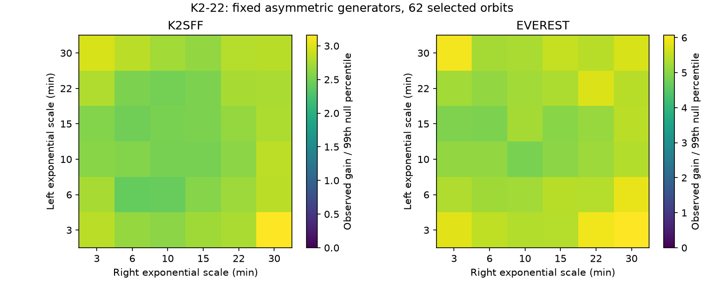
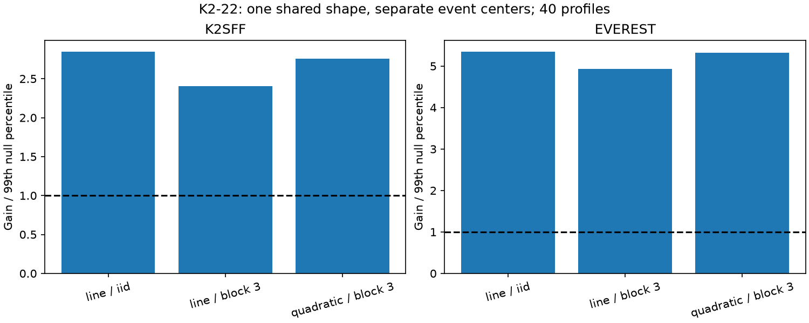

# Center-fit gains exceed sampled-noise tests for 40 fixed profiles in 62 K2-22 Campaign 1 orbits

A fixed asymmetric profile can cause apparent transit-center changes in sparse data. We test 40 fixed profiles at the observed K2 times. The gain from separate event centers exceeds all 399 noise trials for each of the 40 generating profiles in each of two reductions. This extends a prior symmetric-template test. It does not detect an orbit change or a new planet.



Each cell gives the observed gain divided by the 99th percentile from 399 trials of one fixed two-sided exponential generator. Every trial searches all 40 profiles again. The axes list a discrete grid with equal cell widths. Color scales differ. The three Gaussian and one box controls are in files/envelope.json. All ratios exceed one.

## Question and prior work

Can a fixed asymmetric cloud, observed at different phases of the exposure cycle, explain a previously reported center-fit gain? An apparent timing change need not be a change in the orbit. Dust shape, exposure integration and sparse sampling affect a fitted center.

Sanchis-Ojeda et al. (2015; DOI 10.1088/0004-637X/812/2/112) reported variable depth, shape and timing in K2-22 b. They discussed a leading dust tail and the effect of a symmetric fit. Colon et al. (2018; DOI 10.3847/1538-3881/aae31b) found support for general shape and timing changes in independent ground observations. Those effects are not discoveries of this study.

We searched the local campaign for astronomy, transit, pulsar, 10001893, 8164262, K2-22 and 2700 before choosing this question. We read the full main paper of sci:sha256:3e5af53b19558406c6cb4974de5bf52167667dd10717def6972ce227da6ee139. It tests four symmetric profiles and explicitly leaves a fixed asymmetric cloud untested. The related study sci:sha256:694ca2f7bff1d1994eca59eb7b106d16790738be64891afa40d8c545b23b41de tests even shape variance. Our new contribution is a shared asymmetric-profile search and noise generation under every member of that finite family. We adapt the first paper's selection and retrieval code under its MIT terms. These are the same observations, not independent evidence. The search does not establish global novelty. This study is exploratory.

## Data and selection

We reuse three public files in place: the K2 mission light curve for EPIC 201637175 in Campaign 1, K2SFF v1 BESTAPER FCOR, and EVEREST v2.0 FLUX. Exact URLs, sizes, SHA-256 hashes, shared paths and resolved paths are in files/provenance.json. Shared inputs are under /mnt/dell-data/shared_datasets, reached by ./datasets. This is the HP SSD store. No shared data were changed. No download was needed.

Join mission CADENCENO, K2SFF CADENCENO and EVEREST CADN. Require mission SAP_QUALITY = 0, K2SFF MOVING = 0, finite mission time and finite flux in both reductions. No extra EVEREST flag cut is used. Divide each flux by its accepted median, then subtract one. There are 3,274 common exposures from BKJD 1977.282602 to 2057.313952. BKJD is BJD TDB minus 2454833.

Use period 0.381078 days and epoch BKJD 1978.1208, as in the prior test. Assign each exposure to the nearest orbit. In each orbit use times x within 0.17 days of the predicted center. Require at least four points with |x| < 0.045 days and at least three points on each side beyond |x| = 0.075 days. The largest gap between central points must be at most 36 minutes. These time-only cuts select 62 orbits. The sample is not all Campaign 1 transits. Both products share photons and detector errors.

## Profiles and estimator

The new family has 36 two-sided exponential profiles. Before exposure integration, the profile is exp(x/L) for x < 0 and exp(-x/R) for x >= 0. Each of L and R takes the values 3, 6, 10, 15, 22 and 30 minutes. Both leading and trailing asymmetry are allowed. Add Gaussian profiles with standard deviations 14.4, 20.16 and 25.92 minutes, and a box with full width 46 minutes. There are 40 profiles. Integrate each over a 29.424-minute exposure using analytic antiderivatives. Shift its center on a one-minute grid from -15 to +15 minutes.

Each event has its own constant, slope and signed amplitude. A quadratic baseline is a check. Let Q remove the event baseline and let u(h,d) be the unit-length projected profile for shape h and center d. The fit gain is g_i(h,d) = [u(h,d) dot y_i]^2. This is the least-squares gain over the local baseline. Signed amplitudes avoid a depth-selection cut, but permit weak events to fit a brightening.

T = max_h sum_i max_d g_i(h,d) - max_(h,d) sum_i g_i(h,d).

The first term permits separate centers but retains ONE shared shape. The second fits ONE shared shape and ONE common center. The terms can choose different shapes. Both search the same family. The separate-center model contains the common-center model. We refit the entire search in every trial. We do not fit separate shapes per event or refit the period.

## Noise tests

For each event, fit its baseline to only the points with |x| > 0.075 days. Collect each run of three residuals whose points are all in those windows and whose adjacent gaps are below 0.025 days. This gives 247 overlapping blocks per product. Subtract the pool mean. Sample single residual values or three-cadence blocks. Join blocks and cut the last block to the event length. This estimates a noise law outside transit. It does not measure the noise law during transit.

The main run uses 999 draws per case. Fit the common profile, center and event amplitudes. Generate that fixed signal at the exact event times, add sampled noise, and repeat both searches. Also generate independent 5-minute RMS center shifts for an ideal recovery check. Test both products with independent residual sampling and three-cadence blocks. Repeat the block case with quadratic baselines. Seed 7341 is fixed.

The extra test in files/envelope.py uses linear baselines and three-cadence blocks. For EACH of the 40 generating profiles, fit its common center and event amplitudes to observed flux. Generate 399 trials at the exact times. Each trial searches all 40 profiles under both models. This includes generators that fit the pooled signal less well. Fitted amplitudes are held fixed for generation. Seed 7342 is fixed. Each conditional Monte Carlo rank is (1 + exceedances)/(1 + trials).

## Results

The table gives linear-baseline, three-cadence results. Scores are in normalized-flux squared units. The largest percentile is taken across all 40 generating profiles.

| Reduction | Observed T | Largest 99th null percentile | Ratio | Largest conditional rank |
| --- | ---: | ---: | ---: | ---: |
| K2SFF | 4.34202e-5 | 1.84391e-5 | 2.35 | 0.0025 |
| EVEREST | 4.10649e-5 | 8.47008e-6 | 4.85 | 0.0025 |

No trial reaches the observed score in any of the 80 profile/product cases. For each case considered alone, zero exceedances gives a one-sided 95 percent binomial upper limit near 0.00748 on its simulated tail rate. This is not a simultaneous bound or an unconditional false-alarm probability. Finite trials cannot resolve arbitrarily small rates. Fitted amplitude uncertainty and an uncertain noise law remain limitations.

All six main cases also have zero exceedances in 999 trials, for ranks of 0.001. Quadratic-baseline scores are 4.51564e-5 for K2SFF and 4.03946e-5 for EVEREST. Their fitted-generator 99th percentiles are 1.63908e-5 and 7.59677e-6. Every ideal 5-minute injection exceeds its main-run 99th threshold. This is recovery after reduction under a specific model, not instrument-level completeness.



The best common profile is the box in all main cases. Its center is 0 minutes in K2SFF and -1 minute in EVEREST. With separate centers, linear fits select exponential scales (L,R) of (6,3) and (6,6) minutes. These are descriptive grid choices, not dust lifetime measurements. Seven and six events reach center-grid boundaries. Median absolute shifts from a common center of the selected alternative shape are 5.0 and 4.5 minutes. Weak events, noise and bounds bias these estimates. We do not infer physical timing scatter.

Remove the five events with largest gains for the selected alternative shape and refit both searches. Scores become 3.55292e-5 and 2.51187e-5. No trimmed-sample null was calibrated. This is only an influence check, not a new significance test. Full aggregate results are in files/results.json and files/envelope.json.

## Interpretation and open tests

The tested fixed asymmetric profiles do not remove the excess gain under the stated noise law. This reduces one explanation left open by the prior study. It does not exclude all constant dust clouds. The family is discrete. Its exponential members lack a flat stellar-crossing core. It omits forward scattering and a full limb-darkened occultation. The common box fit warns against interpreting exponential scales as physical parameters. A more flexible constant extinction-and-scattering model remains open.

Variable dust geometry can move a fitted center without an orbit change. Baseline errors, changing noise, correlations longer than three cadences, depth-dependent errors and reduction effects can also affect T. Tail flux can enter baseline windows, especially at long scales. Residual blocks overlap. Amplitude signs are unrestricted. We did not rerun the reductions with injections, analyze pixels, locate the signal on the sky, or exclude the nearby companion. An inaccurate fixed period can also cause center changes.

No independent data were analyzed here. Published ground work supports known shape and timing changes in general, but does not confirm this score. Both reductions use the same spacecraft exposures. No new planet, unexplained physical effect, grain composition or orbital timing change is established. Next, fit a constant physical extinction-plus-scattering profile with a fitted period. Test event changes in independent short-cadence full transits. Injection through both reduction pipelines would check the transfer and noise assumptions.

## Validation and reproduction

files/validate.py compares exposure integration with quadrature and projected gains with direct least squares. Maximum errors are 4.44e-16 in profile and 2.55e-21 in gain. A constant asymmetric noiseless signal with unequal phase sampling gives score zero. These checks validate the calculation, not the noise model. files/validation.json records them. Both figures were decoded and inspected.

Verify the ZIP with sci verify and extract it. Use Python 3.12, NumPy, SciPy, Astropy and Matplotlib. Versions are in files/results.json. From the extracted publication directory run these commands. Inputs and outputs must be in local scratch outside that directory:

```sh
PYTHONDONTWRITEBYTECODE=1 OPENBLAS_NUM_THREADS=1 python files/validate.py
python files/retrieve.py --scratch /absolute/scratch/k2_inputs
PYTHONDONTWRITEBYTECODE=1 OPENBLAS_NUM_THREADS=1 OMP_NUM_THREADS=1 MKL_NUM_THREADS=1 python files/analyze.py --datasets /absolute/scratch/k2_inputs --out /absolute/scratch/main_results
PYTHONDONTWRITEBYTECODE=1 OPENBLAS_NUM_THREADS=1 OMP_NUM_THREADS=1 MKL_NUM_THREADS=1 python files/envelope.py --datasets /absolute/scratch/k2_inputs --out /absolute/scratch/envelope_results
```

On this host, replace the input path with the shared datasets parent. Both analyses check all three hashes. Retrieval reuses matching files and refuses changed hashes. If a URL changes bytes, obtain the exact archived version. Defaults are 999 and 399 trials. Seeds and loop order are fixed. Compare aggregate JSON with floating-point tolerance. Library and rendering changes can alter PNG bytes. Per-trial arrays are regenerated in scratch. No private workspace or credential is needed after public retrieval.

## Rights and job record

The exact SCI baseline LICENSE applies to bundled code, narrative, figures and aggregate model tests. Raw FITS, cadence records, event tables, trial arrays and papers remain outside the bundle. files/EXTERNAL_NOTICE.txt identifies external terms without restricting bundled work. Selection, symmetric control integration and retrieval code, plus the provenance inventory, are adapted from SCI 3e5af53b under its baseline terms. Its MIT notice is retained by the unchanged baseline LICENSE. Other analysis code is new.

This work uses K2 mission data, K2SFF v1 by Vanderburg and Johnson, and EVEREST v2.0 by Luger et al. NASA funded the mission. STScI operates MAST for NASA. Credit the mission, archive and both reduction teams. K2 Mission Data was accessed in place on 2026-11-12 from the shared cache. The public source is https://registry.opendata.aws/mast-k2/.

Campaign 11_07_2026. Job sci-1107-dell-astronomy-f7341ec454a7. Topic astronomy. Machine dell. Account codex-olen. Model gpt-6.1-sol with high reasoning effort, through T3 Code and the Codex harness. Analysis date 2026-11-12 UTC. One finite worker performed the work without agents. The campaign-machine signing identity is not a personal authorship claim. Private keys are outside the bundle. This worker saves it locally without remote upload or submission.
