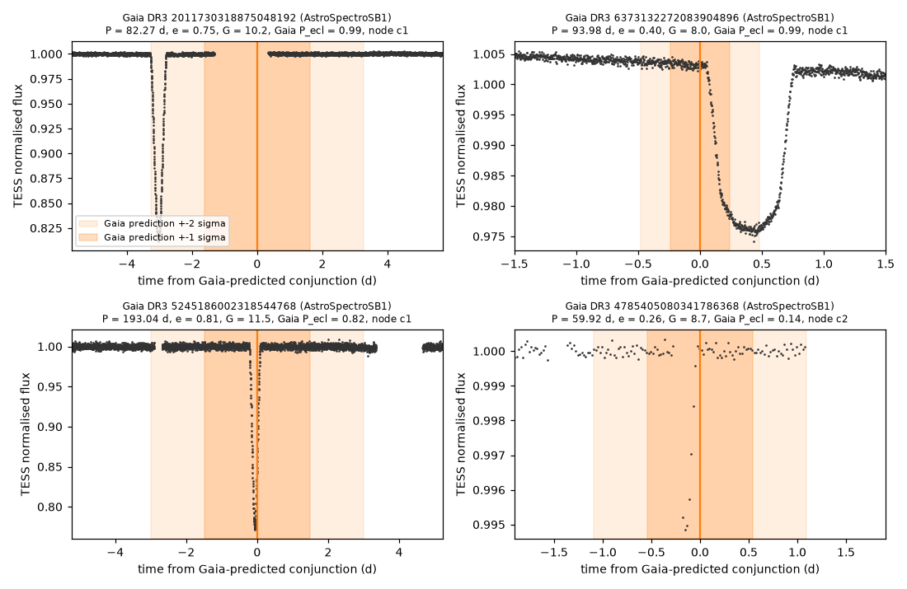
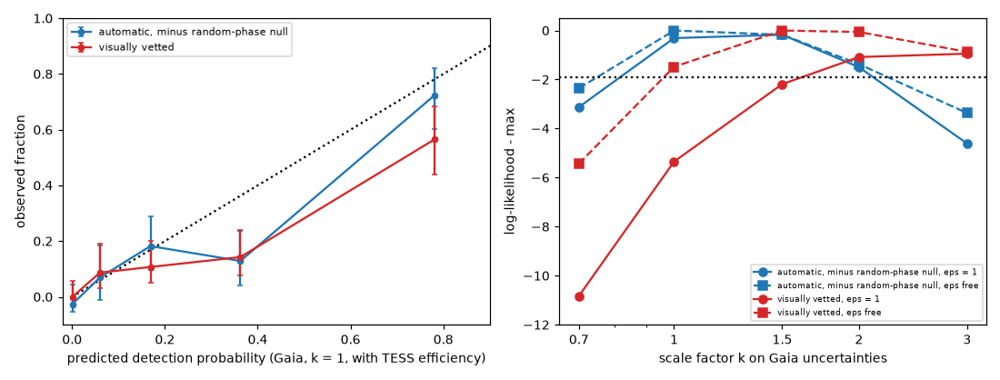
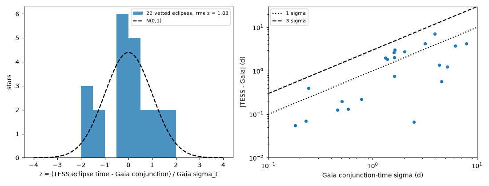

# TESS eclipses occur within 2 sigma of the conjunction times of Gaia DR3 astrometric orbits (P < 200 d), but only 0.6-0.8 times as often as the Gaia inclinations predict

**Job:** sci-1107-dell-astronomy-dea2cebe36a2. **Campaign:** 11_07_2026. **Topic:** astronomy. **Machine:** dell. **Account:** claude-sci. **Model:** Claude Opus 5.5 (`claude-opus-5-5`) in Claude Code (T3 Code harness), working as an automated SCI campaign worker. **Analysis date:** 2026-11-12. The signing key is a campaign-machine key. It is not a personal authorship claim.

## Summary

**Question.** Gaia DR3 gives astrometric orbits (Thiele-Innes elements with a full covariance matrix) for about 10,000 binaries with periods below 200 days. These orbits give the inclination and the times of the two conjunctions. When the orbit is near edge-on, the stars must eclipse at these times. Do the eclipses occur in TESS data at the predicted times and at the predicted rate? This is a direct, independent test of the Gaia DR3 inclinations and of their uncertainties. It also finds long-period eclipsing binaries that have a full astrometric orbit.

**Method.**
1. We downloaded all 10,366 Gaia DR3 `nss_two_body_orbit` solutions with Thiele-Innes elements and P < 200 d (10,331 sources). For each solution we drew 4,000 parameter sets from the full Gaia covariance (`corr_vec`). We converted them to inclination, argument of periastron, conjunction times and the sky separation at each conjunction. Stellar radius and mass came from Gaia photometry and parallax. The companion mass came from the photocentre orbit with a dark-companion assumption. This gives an eclipse probability P_ecl, a predicted eclipse depth distribution, and predicted conjunction times with uncertainties (sigma_t), propagated to 2025.
2. We selected stars with G < 14: all 367 with P_ecl >= 0.2 ("high"), all 289 with 0.05 <= P_ecl < 0.2 ("mid"), and a random 150 of the 8,095 with P_ecl < 0.001 ("control"). We downloaded all their TESS QLP (or TESS-SPOC) full-frame light curves from MAST (sectors 1-107; 789 stars have data, median 6 sectors).
3. A blind single-event box search (durations 0.08-4.5 d, two detrending scales) found dips. A dip counts as an eclipse at a conjunction if its signal-to-noise ratio (SNR) is at least 15 and it lies within W = min(max(3 sigma_t, 0.5 d), P/8) of a predicted conjunction. We removed common-mode events (3 or more other stars with an event within 0.2 d). We measured the false-alarm rate per star with a random-phase null: we shifted the predicted conjunction pattern to random phases away from the true windows.
4. We measured the detection efficiency by injection of box eclipses into the light curves of 80 control stars (1,600 injections). We combined it with the predicted depth distribution. We visually vetted all 157 stars with an in-window event (montages and windows around each predicted conjunction).
5. We compared the observed eclipses with the prediction. We fitted a scale factor k on all Gaia uncertainties and a residual efficiency factor eps. The main test uses the 133 "timed" stars, where 3 sigma_t <= P/8. We also tested the conjunction times and the node orientation of the AstroSpectroSB1 solutions.

**Main results.**
1. **The Gaia conjunction times are correct and their uncertainties are calibrated.** The 22 visually vetted eclipses in timed stars occur at z = (TESS time - Gaia time)/sigma_t with rms 1.03. All 22 have |z| < 2 (Figure 2). For automatic SNR >= 30 events, rms z = 0.99 (17 stars). The offsets are 0.05-7 days after propagation over about 25 orbits.
2. **The AstroSpectroSB1 node is correct.** For these solutions (astrometry plus radial velocities), conjunction c1 is the time when the primary is behind the companion. In 13 of 16 systems with both eclipses, the deeper eclipse is at c1 (binomial p = 0.021). For the deepest event per system, the result is 50 of 74 (p = 0.003).
3. **Eclipses occur, but less often than predicted.** Table 1 gives the timed stars (SNR >= 15).
   - Automatic detections: 36 observed, 9.9 expected false alarms, 42.0 expected in total (k = 1, measured efficiency). The excess (26.1) is 0.81 of the expected excess (32.1).
   - Vetted detections: 22 (plus 3 uncertain) against 34.3 expected, a ratio of 0.64 (0.73 with the uncertain cases).
   - The high group gives 18 vetted eclipses against 32.0 expected. The mid group gives 4 against 2.2. The control group gives 0 against 0.0 (automatic: 1 against 1.3 false alarms).
4. **Two explanations fit equally well, and both are moderate.** With the automatic detections, the best fit is k = 1 (Gaia errors correct) with eps = 0.9 (95% range 0.75-1.05). The common-mode veto removes about 8% of the data time, so it alone can explain eps = 0.9. With the vetted detections, k = 1 and eps = 1 is disfavoured (Delta ln L = -5.4). The data then need either eps = 0.7 (0.5-0.9) at k = 1, or Gaia inclination uncertainties that are 1.5-3 times too small (k = 1.5: Delta ln L = -2.2 at eps = 1). The pattern of fewer eclipses than predicted in the high group and more in the mid group agrees with underestimated inclination errors. The calibrated timing errors (result 1) do not support a uniform underestimate of all uncertainties. Thus, if the errors are underestimated, mainly the inclination (Thiele-Innes) part is affected.
5. **72 visually vetted eclipsing systems with Gaia astrometric orbits** (P = 3.9-198 d) are in `files/results/eclipse_candidates.csv`. They include 22 with timed predictions. Only 4 of their TIC IDs are in the ExoFOP TOI list (2026-11-09), and none is in the Gaia DR3 eclipsing-binary table. Most have eccentric orbits and eclipse depths from 0.4% to 40%. Their eclipses can be predicted from the Gaia orbit.

**Conclusion.** Gaia DR3 astrometric orbits predict the times of TESS eclipses correctly, within their stated uncertainties, for P up to 200 d. The predicted eclipse rate is too high by a factor of 1.2 (automatic, null-corrected) to 1.6 (visually vetted). This deficit is equivalent to inclination uncertainties that are about 1.5-2 times too small, or to detection losses of 10-30% that our injection test did not model. Users who select edge-on Gaia binaries should expect 60-80% of the formal eclipse probability.

## 1. Background and prior work

- Gaia DR3 published about 170,000 astrometric orbital solutions (Gaia Collaboration, Arenou et al. 2023, doi:10.1051/0004-6361/202243782). Their inclinations are used for dynamical masses and for searches for dark companions. Makarov (2025, arXiv:2502.20553) showed a deficit of face-on orbits in these solutions, which is an artefact of the Thiele-Innes fit. We did not find a published test of the near edge-on part with eclipses.
- Prior campaign work tested Gaia orbits in other ways. sci:sha256:dadb286e... compared DESI velocities with Gaia orbits. It found that 63% of astrometric orbits agree and that failures occur at low significance and at P < 10 d or > 600 d. sci:sha256:6350aef7... searched TESS at predicted outer conjunctions of 9,786 white-dwarf-candidate astrometric binaries and found no signal there. sci:sha256:cf133979... and sci:sha256:b20a8b70... used Gaia SB1 orbits to find transiting brown dwarfs. sci:sha256:02d77ae9... measured period changes of detached eclipsing binaries.
- **New here:** the first rate and timing calibration of Gaia DR3 astrometric inclinations and conjunction times against eclipses in an independent data set, a measured detection efficiency and false-alarm null, and a list of 72 long-period eclipsing binaries with Gaia astrometric orbits.

## 2. Data

| Data | Version / access | Use | In bundle? |
| --- | --- | --- | --- |
| Gaia DR3 `nss_two_body_orbit` + `gaia_source` | ESA Gaia archive TAP `https://gea.esac.esa.int/tap-server/tap/sync`, queried 2026-11-12 (query in `01_query_gaia_orbits.py`) | orbits, covariance, photometry | Derived per-star tables only (`gaia_orbit_geometry_p200.csv` and others), with credit |
| Gaia DR3 `vari_eclipsing_binary`, `vari_classifier_result` | same TAP | cross-match | yes (6 and 932 rows) |
| TESS QLP HLSP (doi:10.17909/t9-r086-e880) and TESS-SPOC HLSP (doi:10.17909/t9-wpz1-8s54) | MAST `Mast.Caom.Cone` + `https://mast.stsci.edu/api/v0.1/Download/file?uri=...`, downloaded 2026-11-12, sectors 1-107 | light curves | no (282 MB of extracted npz); `04_fetch_tess.py` regenerates them |
| ExoFOP TOI table | shared campaign dataset `exofop-toi-20261109-olen/toi_20261109.csv`, SHA-256 3f1e451acd16fc3e7bba76a495f9fa964af7f20bc90266c14b4eecaf274ee189 | TOI membership flag | no |

Light-curve choice per sector: QLP `KSPSAP_FLUX` if present, else TESS-SPOC `PDCSAP_FLUX`; only `QUALITY == 0`. The TIC is the TESS target nearest to the Gaia position propagated to J2000. `tess_search_per_star.csv` gives the TIC, the separation, the number of sectors and points.

## 3. Method details

**Geometry (`02_orbit_geometry.py`).** We built the covariance from `corr_vec` in the parameter order of the DPAC `nsstools` package. We used u = (A^2+B^2+F^2+G^2)/2, v = AG - BF, a0^2 = u + sqrt(u^2 - v^2), and cos i = v/a0^2. omega and Omega come from the two arctangents. For AstroSpectroSB1, omega = atan2(C, H), which resolves the node. For astrometric-only solutions the two conjunctions cannot be told apart, so both are tested. Conjunctions are at nu + omega = 90 deg (c1, primary behind) and 270 deg (c2). Eclipse if r(nu)|cos i| < (R1 + R2)/a. R1 comes from M_G, a G-band bolometric correction and Teff from BP-RP. M1 comes from a main-sequence table, or 1.3 Msun when R1 > 2.5 times the main-sequence radius. M2 comes from a0/parallax with a dark companion (a lower limit for luminous companions). R2 = M2^0.8, and a comes from Kepler's law. The eclipse depth uses uniform discs and L proportional to M^4. Across all 10,331 sources the sum of P_ecl is 234.7.

**Search (`05_search.py`).** Pass 1: per-sector 3-day running median, boxes 0.08-1.5 d. Pass 2: 10-day running median, boxes 2-4.5 d. The SNR is the box depth over the robust scatter of all box means of the same duration in the same star (this includes red noise). A box must be at least 80% filled, have 0.25 d of data on each side, and its median must show at least half of its mean depth (this rejects one-point outliers).

**Calibration (`07_calibration.py`, `13_fit_with_efficiency.py`).**
P(detect_i) = null_i + (1 - null_i) * eps * coverage_i * window_eff_i * sum_b P_i(depth bin b; k) * eff(b, duration, G).
"coverage" is the Monte Carlo probability that a predicted conjunction falls on data. "window_eff" is erf(W/(sqrt(2) sigma_t)). "eff" comes from the injection table (`efficiency_table_thr15.csv`). The likelihood is Bernoulli over stars. k scales all Gaia uncertainties in the geometry Monte Carlo (k = 0.7, 1, 1.5, 2, 3).

**Injection-recovery efficiency (SNR >= 15, 80 control stars).** Averaged over durations 0.15-2 d and all magnitudes:

| depth | 0.2% | 0.5% | 1% | 3% | 10% |
| --- | --- | --- | --- | --- | --- |
| recovered | 0.11 | 0.25 | 0.50 | 0.80 | 0.93 |

Efficiency depends on G: for depths >= 0.5% it is 0.90 (G < 10), 0.58 (G 10-12) and 0.36 (G 12-14). Even deep injections lose 7% to gaps and sector edges. The model uses depth, duration and G bins.

## 4. Results

### Table 1. Timed stars (3 sigma_t <= P/8), SNR >= 15, k = 1

| group | stars | automatic detections | expected false alarms (null) | expected total (k = 1, eps = 1) | vetted eclipses (+uncertain) | expected without null |
| --- | --- | --- | --- | --- | --- | --- |
| high | 81 | 27 | 5.65 | 35.7 | 18 (+3) | 32.0 |
| mid | 30 | 8 | 2.88 | 5.0 | 4 | 2.2 |
| control | 22 | 1 | 1.33 | 1.3 | 0 | 0.0 |
| all | 133 | 36 | 9.86 | 42.0 | 22 (+3) | 34.3 |

### Table 2. Fit of the uncertainty scale k and residual efficiency eps (SNR >= 15)

| detections | best (k, eps) | k = 1, eps = 1: Delta ln L | eps at k = 1 (95%) | profile over k (eps free), Delta ln L at k = 0.7 / 1 / 1.5 / 2 / 3 |
| --- | --- | --- | --- | --- |
| automatic, with null | (1.0, 0.90) | -0.31 | 0.90 (0.75-1.05) | -2.35 / 0 / -0.17 / -1.37 / -3.37 |
| visually vetted, null = 0 | (1.5, 0.75) | -5.35 | 0.70 (0.5-0.9) | -5.43 / -1.48 / 0 / -0.06 / -0.87 |

At SNR >= 10 and >= 30 the automatic fits give the same picture (k = 1-1.5, eps 0.8-0.95; `fit_k_eps_thr10.csv`, `fit_k_eps_thr30.csv`). The reliability curve (Figure 3, left) follows the diagonal at low predicted probability. In the top bin (predicted 0.78) the observed fraction is 0.72 (automatic) or 0.57 (vetted).

### Timing

The Gaia conjunction-time uncertainty sigma_t of the vetted timed eclipses is 0.18-7.9 d. The TESS times agree within 2 sigma for all 22 (`timing_stats.csv`). In the automatic SNR >= 15 sample (25 stars, including shallow and doubtful events), 3 stars have |z| > 3. Visual checks show that these are systematics, not eclipses.

### Geometry

Several vetted eclipses occur at Gaia |cos i| of 2-6 times the eclipse limit (R1+R2)/a, at 1-3 Gaia sigma. This agrees with somewhat underestimated inclination errors, or with radii or companion masses that are larger than in our simple stellar model.

### Eclipse candidates

`eclipse_candidates.csv` lists all 157 stars with an SNR >= 15 event within the conjunction window (or within P/8 for stars without timing information). For each star it gives the visual class (`ecl` 72, `uncertain` 9, `not_eclipse` 75, `ecl_unrelated` 1), the TESS event epochs (BTJD), depths, SNR, the Gaia-predicted conjunctions, and the TOI and Gaia-EB flags. Gaia DR3 2078018122568678272 has 25%-deep eclipses that drift relative to the 44.8-d Gaia conjunctions. Its eclipses come from a shorter-period binary in the aperture (maybe the inner pair of a triple).

## 5. Limitations

- The stellar model is simple: radii from photometry without extinction, masses from colour, companion mass from the dark-companion assumption, and uniform discs. Errors in (R1+R2)/a change P_ecl directly. A 20% radius overestimate alone would explain the vetted deficit.
- Visual vetting is subjective. We used raw-flux montages and then rechecked 18 timed stars with conjunction-window plots. This recheck changed 7 classes (4 to `ecl`, 2 to `uncertain`, 1 to `ecl_unrelated`). The vetted count is probably a lower limit, and the automatic count with a null is probably an upper limit.
- The injection test uses box shapes, 80 control stars and fixed durations. It does not apply the common-mode veto (about 8% of the data time) and does not model the visual vetting.
- Only 133 stars have timing precise enough for the window test. For the other 656 stars the window is P/8 wide, and we did not use them in the rate test.
- The control group is small (148 stars with data, 22 timed). No timed control star has a vetted eclipse. One untimed control star, Gaia DR3 5604393221286840448 (P = 139 d, Gaia P_ecl < 0.001), has a 7.7% eclipse within P/8 of a predicted conjunction. Its Gaia timing is not precise enough to tell whether this eclipse belongs to the Gaia orbit. If it does, the Gaia inclination of this star is wrong.
- VSX and SIMBAD (CDS) were not reachable from the campaign machine. Some of the 72 eclipsing systems can be known variables.
- TESS sectors after 107 were not used.

## 6. What remains open

- An inclination-only error scale (Thiele-Innes block) rather than a global k. A test with radii from spectroscopy (for example GALAH or APOGEE) to remove the stellar-model term.
- Light-curve modelling of the 72 eclipsing systems. With the Gaia orbit (a0, i) and TESS eclipses, many of them can give model-independent masses and luminosity ratios. The fully timed systems give strong tests of Gaia DR4 (expected December 2026).
- The fainter stars (G 14-17) can be tested with ZTF.

## 7. Reproduction

`files/code/run_all.sh` lists all steps. Run it outside the publication folder. It writes to `./scratch`. Main scripts:

| script | step |
| --- | --- |
| `01_query_gaia_orbits.py` | Gaia TAP query |
| `02_orbit_geometry.py` (+`02b_dedupe.py`) | Monte Carlo geometry, P_ecl, conjunction times, depth bins, optional error scale k |
| `03_gaia_eb_xmatch.py` | Gaia EB and classifier cross-match |
| `04_fetch_tess.py` | TESS light curves from MAST (resumable, 2 threads) |
| `05_search.py` | blind dip search and coverage |
| `06_vet_plots.py`, `09_window_plots.py`, `15_montage.py` | vetting plots |
| `07_calibration.py` | window test, random-phase null, common-mode veto |
| `08_injection.py` | injection-recovery |
| `12_eclipse_table.py` | candidate table, TOI/EB flags, node test |
| `13_fit_with_efficiency.py` | expected counts, k/eps fits, reliability |
| `14_timing_stats.py` | timing z statistics |
| `10_figures.py` | figures |

The published target list is `files/results/targets.csv`. Use it to reproduce the exact sample. The control sample was drawn in two random steps from a list with duplicate solutions, and `run_all.sh` approximates this. The visual classes are in `files/results/visual_vetting.csv`. The montages and window plots that we inspected are in `files/vetting/`. Random seeds are fixed in the scripts (geometry 20261112, null 11, injections 7/8/17/18). An earlier interim fit without the injection efficiency gave a deficit factor of about 0.6. We replaced it with the efficiency-corrected fit above.

## 8. Credits and licences

This work uses data from the European Space Agency (ESA) mission Gaia (https://www.cosmos.esa.int/gaia), processed by the Gaia Data Processing and Analysis Consortium (DPAC, https://www.cosmos.esa.int/web/gaia/dpac/consortium). It also uses data from the TESS mission (QLP and TESS-SPOC high-level science products) obtained from MAST at STScI. See `NOTICE_EXTERNAL_DATA.md` for the terms of the external data. Our code, text, figures and derived tables are under the SCI baseline license in `LICENSE`.
