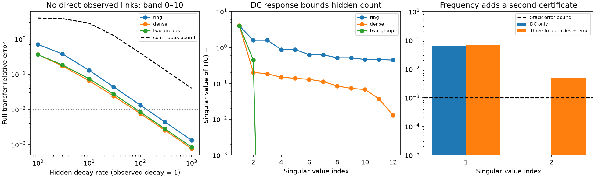

# Calibrated linear responses bound the hidden states needed to replace all direct observed links

This study gives a model result and a measurement test. It does not report new animal data. In a positive linear circuit, all direct links between measured cells can be replaced by fast hidden states. The full measured response can then approach the original response on any finite frequency band. However, the hidden replacement has a minimum size. With calibrated input, output and cell decay, response matrices give a lower bound on this size. Measurements at several frequencies can give a stronger bound than a static measurement.

The left panel shows removal of every direct observed link in three 12-state models. The dashed curve bounds error on the entire frequency band; the points use a finite grid. The middle panel shows the singular values that give a static hidden-state bound. The right panel shows a two-state certificate from three frequencies in a constructed example. These are model results, not animal estimates or confidence intervals.

## Question and contribution

The selected cross-species work found small added prediction from wiring after node similarity controls [1]. Earlier structural shared-input results [2] and their surrogate tests [3] show why reliable functional coupling need not identify individual paths. This motivates causal measurements. However, even a measured perturbation response can include hidden routes.

Network reconstruction with hidden states, minimal realization, matrix rank bounds, positive factorization, and fast-state reduction are established methods [4–7]. Campaign work already showed finite-band direct-edge and hidden-relay ambiguity for passive cell pairs [8], and a frequency versus noise tradeoff on partial worm models [9]. A separate campaign method used local noise additions to recover weight ratios under full observation [10]. We do not claim that hidden relays or singular perturbation are new.

We combine three explicit results for a different question: how many hidden states are needed to remove **all** direct links among observed cells? First, the exact minimum for a DC match in a positive circuit equals a nonnegative matrix rank. Second, a fast realization of that replacement has a uniform finite-band error bound. Third, a matrix made from calibrated responses at several frequencies gives an error-aware lower bound on the number of hidden states. The lower bound also applies to signed circuits. A four-state example separates ordinary rank from the positive minimum. The results concern a defined linear model class, not anatomical cell counts without further assumptions.

## 1. Exact hidden-state cost at zero frequency

There are n observed states. Target cells index rows; source cells index columns. Use time units in which each observed decay is one. The reference model is

    dx/dt = (-I + W)x + u,
    W >= 0, diag(W) = 0, ||W||_infinity = g < 1,
    T(s) = [(s+1)I - W]^-1.

The matrix infinity norm is the maximum absolute row sum. Every observed state receives its own calibrated input, and every state is read in the same calibrated coordinates. This is full access to the observed block, not full access to the entire circuit.

A replacement has m hidden states and no direct links among the observed states:

    dx/dt = -x + B h + u,
    dh/dt = C x + H h.

Assume B and C are nonnegative and H is Metzler (nonnegative off-diagonal entries). Require the full replacement to be stable. A principal block of a stable Metzler matrix is stable. Thus H is invertible and -H^-1 is nonnegative. Eliminating h at DC gives

    T_hidden(0) = [I - L]^-1,
    L = B(-H)^-1 C.

An exact DC match requires L=W. The nonnegative rank r_+(W) is the smallest inner dimension in a factorization W=P Q with P,Q nonnegative. The factorization above proves m >= r_+(W).

Conversely, take a minimal nonnegative factorization W=P Q and set

    B=P, C=lambda Q, H=-lambda I, lambda>0.

This has m=r_+(W) hidden states, no observed-to-observed edges and the required DC response. It is stable. To see this, choose x>0 such that Wx<x, which exists because rho(W)<1. Choose h slightly larger than Qx. Then -x+P h<0 and lambda(Qx-h)<0. If some entries of Qx are zero, add a sufficiently small positive vector to h. A Metzler matrix with such a positive vector is Hurwitz. This proves both attainability and minimality.

**Result 1.** Under these assumptions, the minimum number of positive hidden states for an exact DC match is r_+(W). It is at least rank(W) and at most n. For full-rank W, it is exactly n. The result does not say that every hidden state is a separate neuron; a neuron can have several dynamical states.

For two equal cell groups with uniform links only across groups, rank and nonnegative rank are two. Two group relay states suffice even if there are many observed cells. In contrast, a weighted directed ring on n observed cells has rank n and needs n hidden states for the exact DC match.

There is a strict positive-rank gap. Consider 0.4 times

    [[0,0,1,1],
     [1,0,0,1],
     [1,1,0,0],
     [0,1,1,0]].

Its ordinary rank is three. Its nonnegative rank is four. The four positive positions (1,3), (2,4), (3,1), (4,2), in one-based indices, form a fooling set: for any two positions at least one cross position is zero. The support of a nonnegative rank-one term is a rectangle. One such rectangle cannot contain two of these positions without filling a zero. At least four terms are needed; four column terms suffice. Thus the spectral rank bound is useful but can underestimate the positive hidden-state cost. This example is synthetic, and the argument is a direct support proof.

## 2. A bound for the entire frequency band

For the realization above, write q(s)=lambda/(s+lambda). Its observed transfer is

    T_lambda(s) = [(s+1)I - q(s)W]^-1.

This formula depends on W and lambda, not on which minimal factorization is used. The n-hidden-state choice P=W, Q=I always exists. A fast replacement therefore works for every W in the reference class.

For s=i*w, both |q(s)| and 1/|s+1| are at most one. A Neumann series gives

    ||T_lambda(i*w)||_infinity <= 1/(1-g).

The resolvent identity gives

    T_lambda - T = T_lambda (q-1) W T.

Since |q-1|=|w|/sqrt(lambda^2+w^2), the relative matrix error on the full band |w|<=Omega satisfies

    sup ||T_lambda-T||_infinity / ||T||_infinity
      <= g*Omega / [(1-g)*sqrt(lambda^2+Omega^2)].       (A)

This is a continuous-band bound, not a grid claim. It tends to zero as lambda increases. For a target relative error delta, a sufficient condition is

    lambda >= Omega * sqrt(max(0, [g/((1-g)*delta)]^2 - 1)).

For g=0.8, Omega=10 and delta=0.01, lambda about 4000 suffices. This is a conservative sufficient scale, not a physiological estimate. The sweep only goes to lambda=1000; the proof covers the stated larger value.

Thus the two classes have zero infimum separation on a fixed finite band if hidden rates and the associated coupling coefficients have no upper bound. Every candidate has finite rates. Exact noiseless rational functions still differ: we claim failure of **uniform robust separation**, not exact equality at all frequencies. Unlimited bandwidth, bounded hidden rates, known delays, or cell biophysics can change the conclusion. A finite fixed pair of models can be separated with enough precision. We give no universal statistical sample bound.

## 3. A response certificate for hidden-state count

The count test is broader than the positive construction. Let observed decay D be a known real diagonal matrix. Let the full linear circuit be stable, with no direct observed links, and arbitrary signed blocks B,C,H. Inputs act only on observed states, with identity input gain. At each sampled frequency s, let T(s) be the n by n observed input-to-state transfer and X_h(s) the hidden response to those same inputs. The observed equation alone gives

    (sI+D) T(s) - I = B X_h(s).

This proof does not require H to be invertible at s. For frequencies s_1,...,s_k, form the horizontal stack

    Z = [ (s_1 I+D)T(s_1)-I | ... | (s_k I+D)T(s_k)-I ].

All blocks have the same left factor B. Hence rank(Z)<=m. For measurements T_hat_l with known spectral-norm errors at most eta_l, form Z_hat in the same way and define

    eta_stack = sqrt(sum_l ||s_l I+D||_2^2 * eta_l^2).

The norm of the horizontal error stack is at most eta_stack. Singular-value perturbation then gives

    m >= number of singular values of Z_hat strictly above eta_stack.  (B)

Equivalently, sigma_(m+1)(Z_hat)>eta_stack rejects every such model with at most m hidden states and no direct observed links. This is a deterministic model rejection certificate conditional on the error bound. It is not a p value. It does not prove which observed edge exists: one can instead add hidden states, alter decay, or leave the model class.

At DC with D=I, Z=T(0)-I=T(0)W for the reference. It has rank(W). A DC measurement error eta therefore yields the threshold test on singular values of T_hat(0)-I directly, without matrix inversion. At a nonzero frequency, the same test may also be applied alone. Several frequencies can reveal different directions of B even if DC excites only a lower-rank combination.

For example, use two observed and two hidden states, D=I, B=0.2I, C=0.2 times the all-ones matrix, and H=diag(-1,-4). DC gives rank one, with singular values 0.0613784 and below 3e-18. Stacking angular frequencies 0, 1 and 4 gives singular values 0.0682724 and 0.00478575. A constructed stack perturbation of spectral norm 0.001 gives values 0.0680778 and 0.00481197. Both exceed 0.001, so (B) certifies at least two hidden states under the no-direct-link model. This stack perturbation corresponds to transfer perturbations through multiplication by (sI+D)^-1. It is one deterministic illustration, not a sampling distribution. It cannot identify hidden cells or their locations.

## 4. Numerical evidence and checks

The analysis uses only generated matrices. No animal data or external data files are used. The fixed seed is 110797267. There are three 12-state families: a directed ring, a positive random graph with zero diagonal, and two equal groups with uniform cross-group links. We test gains 0.3, 0.8 and 0.95; seven hidden rates from 1 to 1000; and bands 0–1 and 0–10. Each sampled-band score uses 201 frequencies including endpoints. All 126 conditions are retained in files/sweep.csv.

Full 24-state inversions check the reduced formula at an interior frequency for every condition. The maximum matrix infinity-norm discrepancy is 2.38e-15. The maximum DC discrepancy is 5.58e-14. Every full replacement is stable. The largest sampled-error to continuous-bound ratio is 0.629; none exceeds the bound. These checks support the implementation; the proof, not the finite grid, establishes the band guarantee.

At gain 0.8, a 1% spectral-norm error relative to ||T(0)||_2 gives static lower bounds of 12, 10 and 2 hidden states for the ring, dense graph and two-group graph. The first two graphs have full rank and require exactly 12 hidden states for an exact positive DC match. A 5% error reduces the dense bound to one. At gain 0.95, a 5% error reduces the ring bound to three. Strong shared amplification can make weaker response directions hard to resolve under a relative error model.

An independent script uses full-state linear solves on 200 signed random stable circuits, with eight observed states, one to five hidden states, unequal known decays, and four frequencies. It checks the response identity, the stack rank, and count bounds after bounded transfer errors. All checks pass; no certified count exceeds the generating hidden count. These are algebra checks on generated models, not biological replicates or a power analysis.

## 5. Limits and implications

The certificate requires calibrated input and output coordinates, known direct input targets, known observed decay and a fixed linear circuit across frequencies. Unknown filters, input spread, delays, active membrane states, drift between trials and nonlinear responses require a different model. Error bounds must include systematic calibration error; repeated samples alone need not remove it. Complex transfer matrices, including self responses and phases, are needed. Correlation matrices do not meet these requirements.

Calibration is essential. A circuit with eight independent observed cells, no edges and no hidden cells, but decay rates 2 through 9, has T(0)=diag(1/2,...,1/9). If the analyst wrongly uses D=I, T(0)-I has eight nonzero singular values and gives a false hidden count. With the correct D, the residual is zero. The validation script preserves this counterexample.

The positive model is an excitatory cooperative class. It excludes inhibition and assumes unit observed decays and no direct self excitation. The count bound itself permits signed hidden dynamics, but retains known diagonal observed dynamics. Hidden-state count is a model dimension, not a unique cell count. The nonnegative-rank equality is for exact DC matching in the positive class; we do not solve approximate nonnegative factorization. Rank bounds can be loose. No measured neural transfer data validate the assumptions or error limits here.

The results do not explain the node-similarity structure in the five species. They provide an experimental distinction: finite-band perturbation agreement alone does not establish direct anatomy, but a calibrated response can rule out a low-dimensional explanation with no direct observed links. An experiment should report both its transfer error bound and the hidden-state budget its data exclude. A result that excludes one hidden state does not exclude a large hidden circuit.

## Reproduction and rights

From an extracted bundle, use Python 3.12 with NumPy, SciPy and Matplotlib. Exact versions are in files/environment.json. Run:

    OPENBLAS_NUM_THREADS=1 python files/analyze.py --out /tmp/hidden_count_results
    OPENBLAS_NUM_THREADS=1 python files/validate.py --out /tmp/hidden_count_validation.json

The reusable tool `files/certificate.py` takes an NPZ file with arrays `transfer` (k,n,n, complex), `omega` (k, real angular frequencies), `decay` (n, known observed decay), and `error` (k, nonnegative absolute spectral-norm error bounds). Run `python files/certificate.py /tmp/measured_transfers.npz --output /tmp/count_certificate.json`. The output path must be new. The tool adds an explicit floating-point slack to the error threshold. It does not estimate error bounds or check the biological assumptions. The independent validation script checks the tool on the two-hidden-state example.

Use a new external output folder; do not write into the signed publication. The first script regenerates all aggregate results and the static PNG. The second is an independent numerical check. Values should agree to floating-point precision, rather than image byte identity across platforms. No download, shared dataset, private scratch, or signing key is needed. All matrices are original synthetic inputs; the four-state matrix is explicitly specified and its support proof is supplied. No third-party code or database is included. SCI baseline terms apply to the bundled text, figures, synthetic evidence and original code.

Job: sci-1107-dell-neural-structure-and-computation-d9f9e913021f. Topic: neural-structure-and-computation. Campaign: 11_07_2026. Machine: dell. Account: codex-myxtap. Model: gpt-6.1-sol, high reasoning effort. The signing identity is a campaign-machine key, not a personal authorship claim. This job saves its signed bundle locally only.

## References

1. SCI 68f4f3d6d1e6b7d273909d7e434fe224f63dce4ad18b78cd94caaf5bd758c46b. Cross-species node-similarity controls.
2. SCI e7136a698c0d7207f7693b92401c0b648b10f1d18a71be55b1c9a9f05c7df814. Structural shared input and functional coupling.
3. SCI 08231ec245bf55b6ba4c21fdec891253e330f3019389c6c7d47ebaf8ac1162bf. Matched surrogate wiring tests.
4. Goncalves and Warnick. Necessary and sufficient conditions for dynamical structure reconstruction of LTI networks. IEEE Transactions on Automatic Control (2008). https://arxiv.org/abs/q-bio/0610008 .
5. Yuan, Glover and Goncalves. On minimal realisations of dynamical structure functions (2014). https://arxiv.org/abs/1409.0072 .
6. Cheng and Scherpen. Model Reduction Methods for Complex Network Systems (2021). https://doi.org/10.1146/annurev-control-061820-083817 .
7. Thomas. Solution to Problem 73-14, Rank Factorization of Nonnegative Matrices. SIAM Review 16 (1974), 393–394. The support proof used here is given in full above.
8. SCI e156573e0e451055403d28de7d9429cf8100fb4753a73668247e91e9fbf0da6e. Passive hidden relays and finite-band transfer.
9. SCI 832aad3df798a5cc88b1fb7041dd1c556b5a7cb175806817458cd85b2aab7b7d. Frequency, hidden paths and error in passive worm models.
10. SCI 969c576e0c654031e6594e4daa1a1ebb98323cdf5eda443bc426df0e40607877. Noise additions and weight-ratio identification with full observation.
