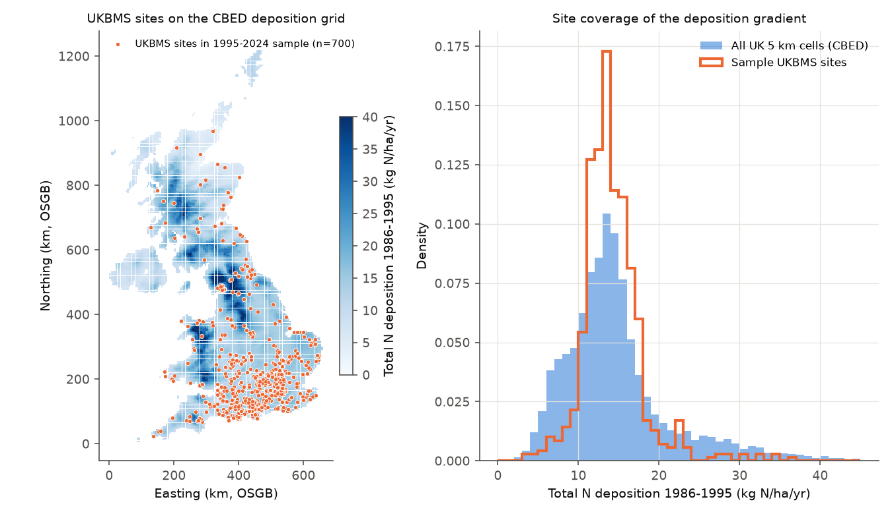
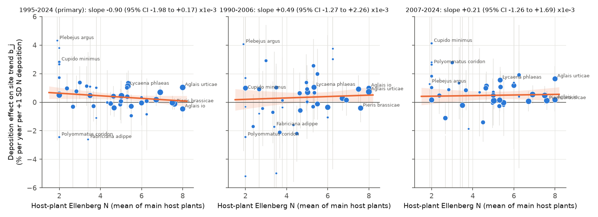
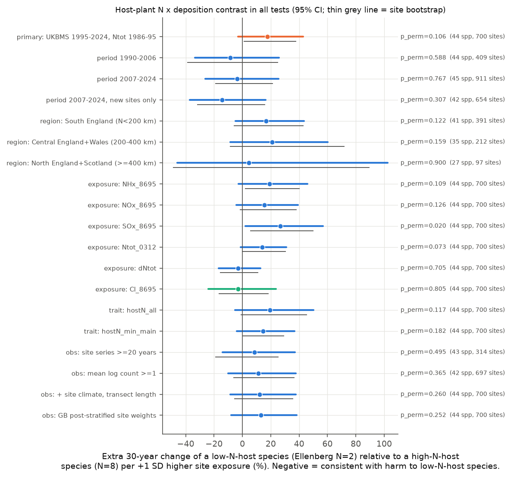

# Butterflies with low-nitrogen host plants did not have more negative trends at UK transects with high nitrogen deposition in 1990-2024

## Summary

Atmospheric nitrogen (N) deposition makes plant communities change. Plants of nutrient-poor soils (low Ellenberg N value) decrease. Thus, a common hypothesis is that butterflies whose larvae feed on low-N plants decrease more where N deposition is high.

We tested this hypothesis with a within-site comparison between species. We used 12,912 site-by-species abundance trends from 700 UK Butterfly Monitoring Scheme (UKBMS) transects in Great Britain (1995-2024). We used 44 resident species. Each species received a host-plant N score: the mean British Ellenberg N value of its main larval host plants. Each site received the mean total N deposition for 1986-1995 from the CBED 5 km grid.

The hypothesis predicts a positive Stage-B slope (definition below). We did not find one.

- Primary sample, 1995-2024: slope -0.90e-3 (95% CI -1.98e-3 to +0.17e-3; species-permutation p = 0.11). This sign is opposite to the hypothesis. In the primary sample, the 95% interval excludes a hypothesis-consistent contrast larger than about 3% over 30 years per +1 SD of deposition (SD = 3.75 kg N/ha/yr).
- Two time periods: 1990-2006 gave +0.49e-3 (CI -1.27e-3 to +2.26e-3). 2007-2024 gave +0.21e-3 (CI -1.26e-3 to +1.69e-3). 2007-2024 on sites not in the first period gave +0.87e-3 (CI -0.85e-3 to +2.58e-3). The sign did not repeat between the periods. The period intervals do not exclude hypothesis-consistent contrasts of up to -26% to -37% over 30 years.
- Three regions (south England, central England and Wales, north England and Scotland): all slopes were negative, and all 95% intervals included zero.
- Oxidised N, reduced N, the 2003-2012 deposition and the deposition change 1986-1995 to 2003-2012 gave no hypothesis-consistent result. Sea-salt chloride deposition (negative control) gave a slope near zero.
- Observation-bias checks did not change the conclusion. These checks were: long site series only, high-count series only, site climate and transect-length controls, and site weights that match the UK deposition distribution.

Conclusion: in these data, host-plant N preference did not predict which butterfly species declined more at high-deposition transects. This is a null result for the trend interaction. It does not show that N deposition has no effect on UK butterflies. Most N-driven plant change possibly occurred before the monitoring windows. The UKBMS sites are not a random sample of the UK.

## Question

Did UK butterfly species whose larvae feed on low-N plants have more negative population trends at transects with high atmospheric N deposition? Did the result repeat in independent time periods and regions, and after checks for observation bias?

## Prior work

- A JNCC and UKCEH study (JNCC Report 775) linked UKBMS and moth data to N deposition. It found lower butterfly species numbers where 1990s N deposition was high, and no effect on total butterfly numbers (https://jncc.gov.uk/news/impact-of-nitrogen-pollution-on-butterflies-and-moths-revealed/).
- A Lancaster MRes thesis (Risser 2023) tested UKBMS species one at a time. Nine species had a negative relation with historic N deposition (https://eprints.lancs.ac.uk/id/eprint/213091).
- In the Netherlands, WallisDeVries and van Swaay (2017) linked butterfly declines to host-plant N preference and N deposition.
- Campaign publications tested US bird counts against ozone (sci:sha256:2603c41c...) and acid deposition (sci:sha256:9e80c094...), and UKBMS indices against summer heat (sci:sha256:124367e5...). None tested host-plant N preference against N deposition.

This study adds a within-site, between-species test. Site fixed effects (in the pooled model) and site controls (in the two-stage model) remove causes that change all species at a site in the same way. Examples are general habitat loss, observer change and site management.

## Data

| Source | Shared path or URL | Version | SHA-256 of the file used |
| --- | --- | --- | --- |
| UKBMS site indices 2024 (Botham et al. 2025, doi:10.5285/53a1c705-4437-48bb-9bcd-b68977f8edd9) | `datasets/ukbms-site-indices-2024-eidc-53a1c705/ukbms_site_indices_2024.zip` | 2024 release | 15d11682bee8e0758e3c6c2318237b955b371a3732adf91a8d88a8d53551f090 |
| UKBMS site locations 2024 (doi:10.5285/d7256b49-f2e3-4ae7-907d-af729610c768) | `datasets/ukbms-site-locations-2024-eidc-d7256b49/ukbms_site_locations_2024.zip` | 2024 release | 701dd651cba36906e97b4308415d51cd75468cdab88f05b04fcf27a3b7313b78 |
| Lepidoptera traits and host-plant lists (Cook et al. 2025, doi:10.5285/dbc7cc17-cbbd-49dd-bab4-8e8855768d66) | `datasets/cook2024-uk-lepidoptera-traits-eidc-dbc7cc17/lepidoptera_traits_2024.zip` | 2024 | d7671799735840f88f05c5ebf44c138ca2640692315c76b45fb8f454f9b92d37 |
| CBED N, S and base-cation deposition, 5 km grid-average, 1986-2012 (Levy et al. 2020, doi:10.5285/8e7644fe-9f17-4fc3-8e4e-8b10a42d5d50) | `datasets/cbed-ndep-gridavg-1986-2012-eidc-8e7644fe/rCBED_Fdep_gm2y_1986-2012_gridavg.csv` | 2020 | c9c8fe8e6d9bf3a32f4800bdb380ccccecb1ea3881e44d2c88031009b1052da6 |
| Berkeley Earth Complete TAVG, 1 degree, monthly | `datasets/berkeley-earth-complete-tavg-latlong1-20261109/Complete_TAVG_LatLong1.nc` | retrieved 2026-11-09 | 4b78118b5552cc4987a7c575b042a0ea92de55d7c01f47783edb81d082c40664 |
| PLANTATT (Hill, Preston and Roy 2004), British Ellenberg values | https://www.brc.ac.uk/sites/default/files/biblio/PLANTATT_19_Nov_08.zip (workspace download; the campaign dataset helper received HTTP 403) | 19 Nov 2008 file | 0e6250bd4ca15f4125cd902a13e0d2f4302f9a1ca9bfe3086b3248a648417d47 |

The UKBMS and trait data use the Open Government Licence. The package contains only derived values from these sources (site trends, site covariates and species scores). It does not contain the raw site indices or the PLANTATT spreadsheet. Derived values from the UKBMS, CBED and trait data contain public sector information licensed under the Open Government Licence v3.0; attribute these sources as in the data table.

Important data limits:

- The public site-index file contains UKBMS transects only. The Wider Countryside Butterfly Survey (WCBS) random 1 km squares are in the locations file, but they have no site indices. Thus, we could not do the planned replication on randomly selected squares.
- The CBED file name gives units of g m-2 yr-1. We report kg N/ha/yr (x10).

## Method

1. **Site trends.** For each site, species and window, we fitted an ordinary least-squares slope of log(1 + site index) on year. Index value -2 (no index) was removed. Windows and rules: 1995-2024 (primary; at least 10 index years over at least 15 years), 1990-2006 and 2007-2024 (at least 8 index years over at least 10 years). Each series needed at least 3 years with a count above zero. Units: change in log abundance per year.
2. **Species.** We used 44 resident species with at least 10 site trends. We removed regular immigrants (Red Admiral, Painted Lady, Clouded Yellow). We kept the Essex/Small Skipper aggregate and removed the two separately recorded Thymelicus species.
3. **Host-plant N score.** From the Cook et al. host-plant list, we took the main host plants (category 1). We matched each plant to PLANTATT, with a synonym table for name changes since 2004 (`files/derived/hostplant_matches.csv`). For "Genus spp." entries we used the genus mean. The score is the mean Ellenberg N of the main host plants (`hostN_main`). The scores agree exactly with the trait-file Ellenberg N for all 13 single-host species. Variants: mean of all host plants (`hostN_all`) and the lowest main-host value (`hostN_min_main`).
4. **Site covariates.** CBED cell for each site (nearest 5 km cell centre; nearest valid neighbour on coasts). Exposures: total N, NHx, NOx and SOx means for 1986-1995 and 2003-2012, and the change between them. Negative control: chloride (sea salt) deposition, 1986-1995. Controls: easting, northing and the linear warming rate of the window at the nearest valid Berkeley Earth land cell.
5. **Stage A (each species).** Site trend = a + b x z(deposition) + controls. z means standardised over the sites of the sample. Heteroscedasticity-robust (HC1) standard errors, with a floor of 0.002 per year.
6. **Stage B (across species).** Random-effects meta-regression (DerSimonian-Laird) of b on the host-plant N score. The hypothesis predicts a positive slope: species with low-N host plants have more negative b. We report: model 95% CI; a two-sided species-permutation p value (host-plant scores shuffled across species, 5,000 permutations, tau-squared held fixed); and a site bootstrap (1,000 or 200 multinomial site resamples). The species permutation is the main test, because the trait varies only between species.
7. **Pooled check.** Two-way fixed-effects model: site trend = site effect + species effect + host-N x z(deposition) + host-N x (easting, northing, warming) + species thermal index x warming. Standard errors clustered by site; species-permutation p (500 permutations).
8. **Replication and bias checks.** Independent periods (and period 2 without period-1 sites), three latitude bands, exposure variants, trait variants, Stage-B trait controls (species thermal index, wingspan, habitat count, voltinism), long series only (at least 20 years), high-count series only (mean log count at least 1), site mean temperature and transect length as extra controls, and post-stratified site weights. The weights make the sample match the share of UK 5 km cells in 5 deposition quintiles x 3 latitude bands (Figure 1 shows the site bias).

The **30-year contrast** in the table and Figure 3 is: 100 x (exp(-slope x 6 x 30) - 1). It is the extra 30-year change of a species with host-plant N = 2 compared with a species with host-plant N = 8, per +1 SD higher site exposure. Negative values agree with the hypothesis.

## Results



Figure 1. UKBMS sites in the primary sample on the CBED 1986-1995 total N deposition grid. Sites are mostly in southern England. They cover the middle of the UK deposition range more densely than the low and high ends.



Figure 2. Stage A deposition effect for each species (b, % per year per +1 SD deposition) against host-plant N, with the Stage B line and 95% band. Point size shows the meta-regression weight.



Figure 3. 30-year contrast for all tests (95% model CI; grey line: site bootstrap 95% interval).

### Stage B results

| Test | Species | Sites | Slope (x1e-3) | 95% CI (x1e-3) | p (perm.) | 30-yr contrast % (95% CI) |
| --- | --- | --- | --- | --- | --- | --- |
| Primary 1995-2024, total N 1986-95 | 44 | 700 | -0.90 | -1.98 to 0.17 | 0.106 | +17.6 (-3.1 to +42.7) |
| Period 1990-2006 | 44 | 409 | +0.49 | -1.27 to 2.26 | 0.588 | -8.5 (-33.4 to +25.8) |
| Period 2007-2024 | 45 | 911 | +0.21 | -1.26 to 1.69 | 0.767 | -3.8 (-26.2 to +25.6) |
| Period 2007-2024, new sites only | 42 | 654 | +0.87 | -0.85 to 2.58 | 0.307 | -14.4 (-37.1 to +16.4) |
| South England | 41 | 391 | -0.86 | -2.01 to 0.28 | 0.122 | +16.8 (-4.9 to +43.5) |
| Central England and Wales | 35 | 212 | -1.06 | -2.61 to 0.50 | 0.159 | +21.0 (-8.5 to +60.1) |
| North England and Scotland | 27 | 97 | -0.25 | -3.92 to 3.41 | 0.900 | +4.6 (-45.9 to +102) |
| NHx 1986-95 | 44 | 700 | -0.97 | -2.09 to 0.16 | 0.109 | +19.0 |
| NOx 1986-95 | 44 | 700 | -0.80 | -1.83 to 0.24 | 0.126 | +15.4 |
| SOx 1986-95 | 44 | 700 | -1.31 | -2.50 to -0.12 | 0.020 | +26.6 (+2.2 to +56.9) |
| Total N 2003-12 | 44 | 700 | -0.72 | -1.50 to 0.06 | 0.073 | +13.8 |
| Change in total N | 44 | 700 | +0.18 | -0.67 to 1.02 | 0.706 | -3.1 |
| Chloride (negative control) | 44 | 700 | +0.17 | -1.18 to 1.53 | 0.805 | -3.1 |
| All host plants score | 44 | 700 | -0.98 | -2.26 to 0.29 | 0.117 | +19.4 |
| Lowest main host score | 44 | 700 | -0.76 | -1.74 to 0.22 | 0.182 | +14.6 |
| Series of 20 years or more | 43 | 314 | -0.46 | -1.76 to 0.84 | 0.495 | +8.6 |
| Mean log count 1 or more | 42 | 697 | -0.59 | -1.78 to 0.59 | 0.365 | +11.3 |
| Plus site temperature and transect length | 44 | 700 | -0.64 | -1.77 to 0.49 | 0.260 | +12.3 |
| Post-stratified site weights | 44 | 700 | -0.67 | -1.80 to 0.46 | 0.252 | +12.9 |

All values: `files/results/summary_table.csv`.

Other results (`files/results/controls_fe.json`):

- Stage B with the species thermal index as a control: -0.90e-3 (CI -1.98e-3 to +0.18e-3). With thermal index, wingspan, habitat count and voltinism: -0.18e-3 (CI -1.69e-3 to +1.34e-3).
- Pooled two-way fixed effects: 1995-2024 -1.99e-3 (site-cluster SE 0.74e-3; species-permutation p = 0.086); 1990-2006 -0.43e-3 (SE 1.45e-3; p = 0.87); 2007-2024 +0.21e-3 (SE 0.85e-3; p = 0.89).
- The site bootstrap interval for the primary slope (-1.78e-3 to -0.06e-3) excludes zero. The bootstrap keeps the species set fixed. Thus, it does not include the between-species uncertainty that the permutation test includes. We use the permutation p value for the conclusion.

## Interpretation

1. **No support for the hypothesis.** No test gave a significant positive slope. The primary estimate and all three regional estimates have the opposite sign. In those estimates, low-N-host species did slightly better at high-deposition sites, relative to high-N-host species.
2. **The opposite-sign estimate is not stable.** It did not repeat in the two independent time periods. It became small when we added more species traits. It became smaller in the long-series and high-count subsets. It changes with the window, so we do not claim a reversed effect.
3. **SOx gave the only nominal result (p = 0.020), also with the opposite sign.** We tested six exposures; a Bonferroni correction gives p = 0.12. SOx deposition decreased by about 70% from 1986 to 2012. A recovery of species of calcareous or acid-sensitive habitats at sites with high historic acid deposition is one possible explanation. We did not test it directly, and the deposition-change exposure did not support a recovery effect for N.
4. **Possible reasons for the null result.** (a) Much of the N-driven plant change in Britain possibly occurred before 1990, and later trends can show other causes. (b) UKBMS transects are mostly on protected or managed land, where management can counter eutrophication. (c) The 5 km deposition grid does not show local sources, such as livestock units. (d) The host-plant mean is a coarse species trait. Host-plant abundance at each site, not its Ellenberg value, controls butterfly numbers.

## Limitations

- Observational design. Deposition correlates with other site properties (rainfall, land use, altitude). The site controls are coarse (location, a 1 degree warming rate).
- Berkeley Earth 1 degree cells are coarse. The cell at the tip of Cornwall has a 1951-1980 mean of 14.3 C, which is too high. This affects only the site-temperature control and the species thermal index.
- Site selection bias: UKBMS sites are not random (Figure 1). The weighted check only corrects deposition and latitude shares. The planned WCBS replication was not possible.
- Conditioning on presence: a series needs at least 3 positive years. A species that disappeared from a site early in the window is not in the trend set. This can hide strong local losses.
- Abundance indices are not corrected for detection. The trend is within site, so constant detection differences cancel. A change in detection over time that differs by species and by deposition is not controlled.
- The species number is small (27 to 45 per test). The power to find moderate trait effects is low in the period and regional samples.
- Units: CBED values were used as g m-2 yr-1, as the file name states.

## Reproduction

Requirements: the campaign `datasets/` folder (paths in the data table), Python 3.12 with numpy, pandas, netCDF4 and pyproj, and `uv` for a small private environment with xlrd (to read the PLANTATT .xls).

```
# from a workspace with datasets/ and work/code/ = files/code/
bash work/code/run_all.sh
```

The script downloads and checks PLANTATT, builds the site and trend panels (`build_panel.py`), computes host-plant N (`hostplant_ellenberg.py`), runs all tests (`analyze.py 5000 1000`; random seed 20261109), and writes the table and figures. Run time on the loaded campaign machine: about 6 minutes.

Files:

- `files/code/`: all scripts.
- `files/derived/`: site covariates (`sites.csv`), CBED cell means (`gb_cells.csv`), site-by-species trends (`trends_full.csv`, `trends_p1.csv`, `trends_p2.csv`), host-plant matches and scores, species traits, and input hashes.
- `files/results/`: Stage A estimates for each sample, Stage B results, summary table, controls and fixed-effects results, post-stratification shares, run log.
- `files/figures/`: the three figures.

## Provenance

- Campaign 11_07_2026, job sci-1107-hp-climate-pollution-biodiversity-946fc04ac21e, topic climate-pollution-biodiversity, machine hp, account claude-myxtap.
- Analysis and text: Claude Opus 5.5 (model ID claude-opus-5-5), an AI model, working in the SCI campaign workspace. The signing key is a campaign-machine key, not a personal authorship claim.
- Date: 2026-11-09.
