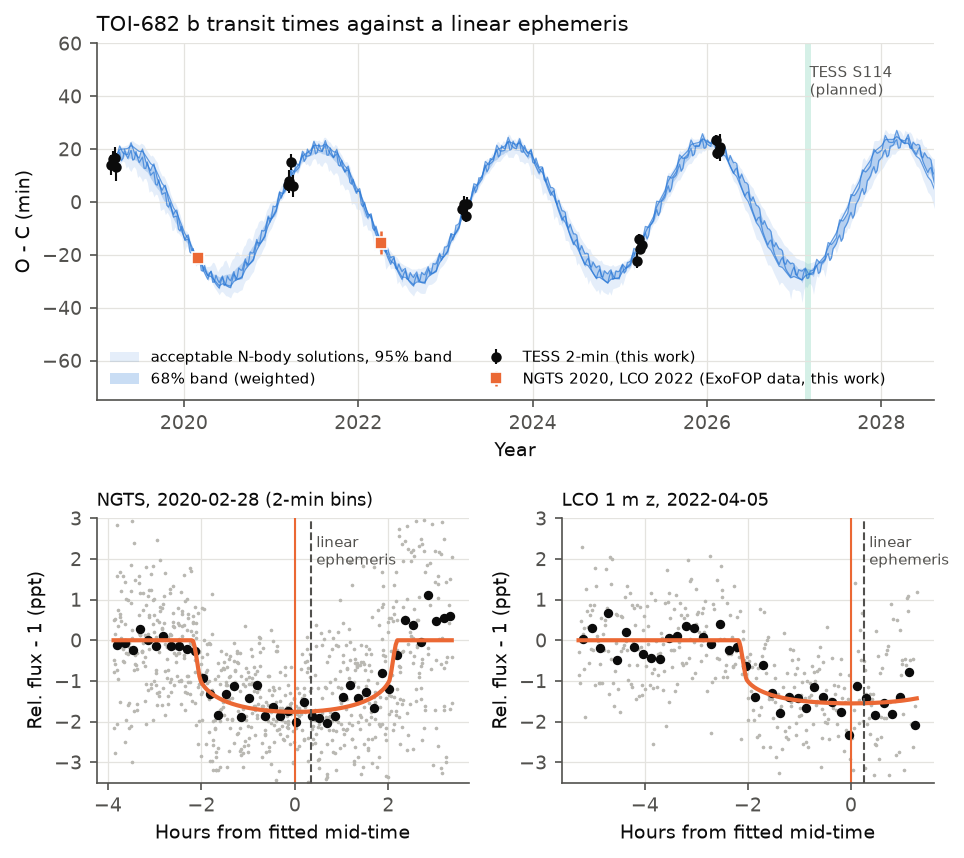
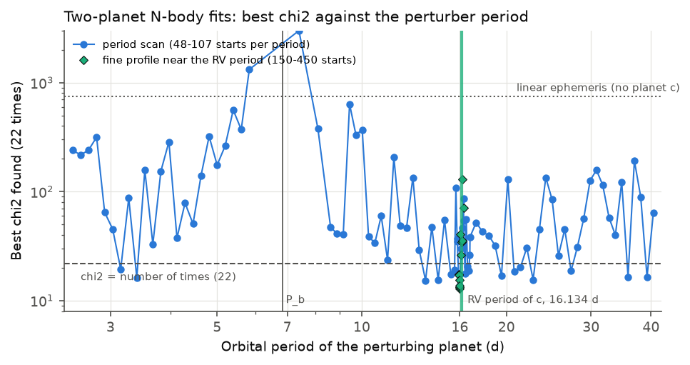
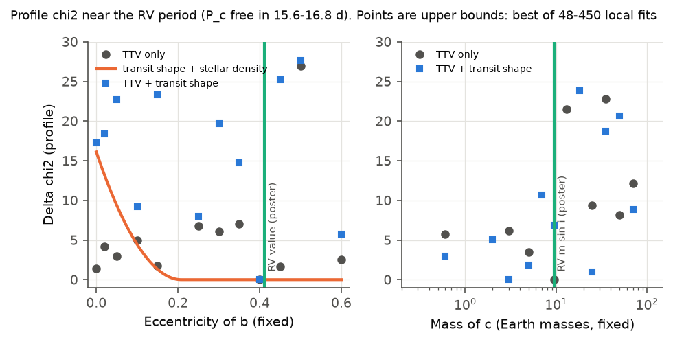

# TOI-682 b: two ground transits confirm the 20-min TESS timing variation; N-body fits prefer an outer planet near 15.96 d to the reported 16.13 d and predict 2027 transits 27 min early

Job: sci-1107-dell-astronomy-d03148942b22. Topic: astronomy. Machine: dell. Model: Claude Opus 5.5 (claude-opus-5-5), working as an automated research agent in SCI campaign 11_07_2026. The signing key is a campaign-machine key. It is not a personal authorship claim.

## Summary

A blind TESS search in this campaign (sha256:302c8280…) found a large transit timing variation (TTV) of the mini-Neptune TOI-682 b (HD 97260 field, P = 6.84 d). It also showed that a reported non-transiting radial-velocity (RV) planet c (P = 16.134 d, m sin i = 9.6 Earth masses) can give TTVs of this size only if b is eccentric. That reported RV solution comes from an unrefereed 2021 poster (Quinn et al.), with e_b = 0.411. We tested this result with independent data and a wider model search.

Main results:

1. **The TTV is real.** We timed all 20 TESS 2-min transits again (sectors 9, 36, 63, 90, 100; 2019-2026) and two independent ground-based transits from public ExoFOP-TESS uploads (NGTS, 2020-02-28; LCO 1 m, 2022-04-05). A linear ephemeris gives chi2 = 748 for 22 times. Both ground transits arrive early by 21.0 +- 2.2 and 15.4 +- 4.3 min. Season means change between -18 and +21 min.
2. **The transit shape shows that b is eccentric.** A circular orbit with the fitted a/R* needs a stellar density of 0.536 (0.507-0.555) solar. A spectroscopic K0 V host gives about 1.0 solar. Thus e_b > 0.14 (97.5 % level; median 0.32), with the transit near apoastron (median e sin w = -0.24). This agrees with the RV value e_b = 0.41. The TTVs alone do not need an eccentric b.
3. **A planet near 16 d explains the TTV, but the period is not 16.134 d in our fits.** The best two-planet fit (coplanar, 22 times) has chi2 = 11.2 at P_c = 15.963 d, e_b = 0.40, m_c = 10.7 Earth masses and e_c = 0.20. These values are close to the RV values except for the period. Within 15.6-16.8 d, all good fits have P_c = 15.90-16.00 d, near the 7:3 commensurability (15.958 d). At the reported 16.134 d, the best fit after 450 starts has chi2 = 34.2 (delta chi2 about 23). The two ground transits cause most of this difference: TESS times alone give delta chi2 = 6.6.
4. **The TTV alone does not measure the mass of c or identify the perturber.** Masses from 0.4 to 105 Earth masses fit within delta chi2 < 9. Other perturber periods from 3.1 to 39 d (18 scanned periods) also give chi2 < 22.
5. **Forecast.** The fits near the RV period predict that the TESS sector 114 transits (2027 February-March) arrive 27 min early relative to the linear ephemeris (68 %: 25-29 min; 95 %: 22-33 min). The best fits at 16.134 d predict 10-11 min early. Thus S114 will test the period of c. Almost all good fits at other periods also predict 18-36 min early, so S114 is also a direct test of the TTV model.

The likelihood surface has many separate minima. All chi2 values from the searches are upper limits on the true minimum. We do not give a posterior distribution of the parameters.

**Figure 1.** Top: observed minus calculated (O-C) transit times of TOI-682 b against the best linear ephemeris. Black: TESS 2-min data. Orange squares: the two ground-based transits. Blue: 34 acceptable two-planet N-body solutions with P_c = 15.90-16.41 d (weighted 68 % and 95 % bands, and the three best solutions). Green band: TESS sector 114 (2027). Bottom: the two ground light curves after baseline removal (grey: raw cadence; black: 10-min bins; orange: model at the fitted mid-time). The dashed line is the time that the linear ephemeris predicts.

## Question

Is the large TTV of TOI-682 b real? Can the reported non-transiting RV planet c (16.134 d) cause it? What do the TTVs and the transit shape tell about the eccentricity of b, and about the mass and period of c?

## Data

- TESS SPOC 2-min PDCSAP and SAP light curves of TIC 429304876, sectors 9 (2019), 36 (2021), 63 (2023), 90 (2025) and 100 (2026), from MAST. TESS observes the star again in sector 114 (2027; tess-point 0.9.5).
- Ground-based light curves of TOI-682.01 from the ExoFOP-TESS file service: NGTS (2019-05-17 egress, 2020-02-28 full), LCO-CTIO 1 m (2020-03-01 y; 2021-03-18, 2022-04-05 and 2023-03-13 zs), PEST 0.3 m (2020-05-14 Rc). We used the reductions of the observers.
- Reported RV parameters (Quinn et al. 2021 poster, Zenodo 5131353): P_b = 6.83968 d, m_b = 12.29 Earth masses, e_b = 0.411; P_c = 16.134 d, m_c sin i = 9.6 Earth masses, e_c = 0.072; M* = 0.969 Msun, R* = 0.966 Rsun, Teff = 5309 K, [Fe/H] = +0.44. The poster gives no period uncertainty, and the RV data are not public.
- TIC 8.2 luminosity 0.708 Lsun at the Gaia distance of 83.15 pc. The ExoFOP CHIRON values are Teff = 5265 and 5409 K.

`files/data/inputs_sha256.json` gives the URL, SHA-256 hash and size of each input file. See `files/EXTERNAL_DATA_NOTICE.md` for the terms. A Spitzer 4.5-micron transit (2019-10-08) exists, but we could not get its frames from the IRSA services during this work. Gaia archive queries failed (server overload).

## Method

1. **TESS times** (`tess_fit.py`). We made one joint fit of all 20 transits: shared shape (Rp/R*, a/R*, b, quadratic limb darkening with Kipping q1, q2), a free mid-time for each transit, and a quadratic baseline for each 0.9-d window (removed by linear least squares). We scaled the flux errors of each window to reduced chi2 = 1, then multiplied them by the time-averaging red-noise factor beta. The posterior comes from emcee (100 walkers, 2500 steps; autocorrelation time 102-127 steps). Checks (`tess_checks.py`): fixed-shape grid times for PDCSAP and SAP flux, and a shape fit for each sector.
2. **Ground times** (`ground_fit.py`). We fixed a/R* and b at the TESS values and set Rp/R* free (scale 0.5-1.5 of TESS) on a grid. Limb darkening was fixed for each band. The baseline was a multiplicative offset plus a linear trend in time plus an airmass term for each camera. We mapped chi2 over a grid of mid-times, scaled it by reduced chi2 and beta squared, and marginalised over Rp/R*. We tested three other baselines and added their scatter to the error in quadrature. **Rule set before the merge:** we use a ground light curve only if delta chi2 (transit against no transit) >= 25 and the data cover at least 40 % of the transit. Only NGTS 2020-02-28 (delta chi2 = 79) and LCO 2022-04-05 (40) pass. The LCO 2021 and 2023 light curves overlap TESS transits but are too weak (5-11).
3. **Photo-eccentricity** (`merge_times.py`). g = (rho_circ / rho_star)^(1/3) = (1 + e sin w) / sqrt(1 - e^2). We used rho_star = 1.00 solar with a 15 % log-normal error, which covers L = 0.708 Lsun, Teff = 5265-5409 K and M* = 0.95-0.97 Msun. We took e and w uniform.
4. **N-body model** (`dyn.py`, TTVFast 0.3.0). Two planets: m_b = 12.3 Earth masses, i_b = 89.4 deg, i_c = 88.0 deg, equal nodes (nearly coplanar), M* = 0.969 Msun, Jacobi elements, time step 0.2 d (results change by less than 0.1 s when we use 0.05 d). The free parameters are e_b and w_b, m_c, P_c, the mean longitude of c, e_c and w_c. We removed the linear ephemeris of b analytically.
5. **Searches** (`dyn_fit.py`, `run_scans_rest.py`, `profile_fit.py`, `circ_check.py`, `pc_profile.py`). Each point is the best of many bounded least-squares fits from random starts:
   - perturber period scan: 2.5-40.4 d, 90 periods, 13-107 starts each (48 or more up to 39.2 d), 7,892 fits;
   - profiles near the RV period (P_c free in 15.6-16.8 d) at fixed e_b (48 starts; 400-448 starts for e_b = 0 and 0.02) and at fixed m_c (48 starts, with and without the photo-eccentric term);
   - fine profile at fixed P_c = 15.90-16.30 d (150 starts; 450 at 16.134 d);
   - TESS-only test at 15.958 and 16.134 d.

   An MCMC did not mix (acceptance 1 %) because the surface has many minima, so we stopped it.
6. **Ensemble, forecast and stability** (`analyze_dyn.py`, `resonance.py`). We kept the solutions with P_c = 15.6-16.8 d within delta chi2 < 9 (TTV plus photo-eccentric term) of the best one. There were 34 distinct solutions, weighted by exp(-delta chi2 / 2). We propagated them to 2029. We tested their stability with REBOUND 4.4.10 WHFast and MEGNO over 1e5 orbits of b (about 1,900 yr), and we tracked the 7:3 resonant angles over 2,000 yr.

## Results

### Transit times

| Epoch | Source | BJD_TDB | Error (min) | O-C (min) |
|---|---|---|---|---|
| -218 | TESS S9 | 2458546.30419 | 3.8 | +14.0 |
| -217 | TESS S9 | 2458553.14506 | 3.1 | +16.3 |
| -216 | TESS S9 | 2458559.98460 | 4.1 | +16.6 |
| -215 | TESS S9 | 2458566.82150 | 5.3 | +13.2 |
| -165 | NGTS 2020-02-28 | 2458908.76236 | 2.2 | -21.0 |
| -110 | TESS S36 | 2459284.94257 | 2.2 | +6.5 |
| -109 | TESS S36 | 2459291.78283 | 4.3 | +7.9 |
| -108 | TESS S36 | 2459298.62710 | 3.1 | +15.1 |
| -107 | TESS S36 | 2459305.46013 | 4.1 | +6.0 |
| -53 | LCO 2022-04-05 | 2459674.76700 | 4.3 | -15.4 |
| -3 | TESS S63 | 2460016.74045 | 2.1 | -2.7 |
| -2 | TESS S63 | 2460023.58108 | 2.9 | -0.8 |
| -1 | TESS S63 | 2460030.41727 | 2.1 | -5.3 |
| 0 | TESS S63 | 2460037.25965 | 2.8 | -0.8 |
| 104 | TESS S90 | 2460748.53125 | 3.0 | -22.1 |
| 105 | TESS S90 | 2460755.37611 | 2.1 | -14.1 |
| 106 | TESS S90 | 2460762.21294 | 1.6 | -17.7 |
| 107 | TESS S90 | 2460769.05319 | 2.8 | -16.3 |
| 152 | TESS S100 | 2461076.84889 | 2.0 | +23.4 |
| 153 | TESS S100 | 2461083.68486 | 2.4 | +18.6 |
| 154 | TESS S100 | 2461090.52473 | 2.2 | +19.4 |
| 155 | TESS S100 | 2461097.36495 | 5.1 | +20.7 |

Linear ephemeris (weighted, 22 times): T(E = -218) = BJD_TDB 2458546.29448 +- 0.00084, P = 6.839292 +- 0.000003 d, chi2 = 747.9 (20 degrees of freedom).

- Our TESS times agree with the times of the parent study (mean difference 0.03 min, scatter 1.2 min, 20 transits; same photometry, different code). Fixed-shape grid times differ from the joint-fit times by less than 1.1 min. SAP times agree with PDCSAP times (|z| <= 1.1).
- The ground times do not depend on the baseline choice (spread below 0.5 min for both). The observers' notes of 2020 had already reported early events (30-43 min against the sector-9 ephemeris).
- TESS shape: Rp/R* = 0.0330 +- 0.0003 (depth 1,091 ppm), a/R* = 12.32 (+0.14/-0.23), b = 0.12 (< 0.31 at 97.5 %), T14 = 4.35 +- 0.03 h. The durations of the five sectors (269.5, 266.1, 261.5, 261.7, 261.1 min, errors 3-5 min) agree with a constant value (chi2 = 3.4, 4 dof). The trend is -1.1 +- 0.7 min/yr. Apsidal precession of b caused by c (about 0.16 deg/yr) gives only about 0.3 min/yr. The best ground Rp/R* values are 1.10-1.15 times the TESS value (depth 20-30 % larger; band and reduction differences; we did not interpret them).

### Eccentricity of b

| Quantity | Value |
|---|---|
| rho_circ (TESS shape, circular orbit) | 0.536 (0.507-0.555) solar |
| g = (rho_circ / rho_star)^(1/3) | 0.81 (0.77-0.85) |
| e_b (uniform e, w priors) | median 0.32; 68 %: 0.21-0.60; 2.5 % quantile 0.14 |
| P(e_b > 0.1) | 0.995 |

The TTVs do not constrain e_b. With 400 starts, a circular b fits with chi2 = 12.6 (P_c = 15.96 d, m_c = 25 Earth masses, e_c = 0.26). Only the transit shape with the stellar density requires e_b > 0. This evidence for an eccentric b does not depend on the RV data. It depends on the stellar density. If rho_star were as low as the TIC 8.2 value (0.67 solar; from Teff = 5085 K), the result would be weaker.

### Period and mass of c

**Figure 2.** Best chi2 found for two-planet N-body fits of the 22 times against the period of the perturbing planet (blue: scan, 48-107 starts for each period; green diamonds: fine profile near the RV period, 150-450 starts). The dashed line is chi2 = 22. The dotted line is the linear ephemeris. The vertical green line is the reported RV period. The curve is jagged because each point is the best of a finite number of local fits.

- Scan: 18 of 90 periods give chi2 < 22 (3.15, 3.40, 13.57, 14.42, 15.32, 15.6, 15.9, 16.0, 16.4, 16.6, 16.7, 19.53, 20.75, 21.39, 22.73, 27.27, 35.83 and 39.24 d). Thus the TTVs alone do not identify the perturber. With the RV detection of a 16-d planet, the most direct explanation is planet c.
- Fine profile (best chi2 of 22 times): P_c = 15.90: 17.3; 15.93: 17.1; 15.95: 15.4; 15.958: 12.8; 15.97: 13.4; 16.00: 13.7; 16.05: 40.5; 16.10: 26.1; 16.134: 34.2 (450 starts); 16.17: 130.6; 16.20: 35.2; 16.30: 71.2. TESS only: 15.958 d gives 11.5 and 16.134 d gives 18.1.
- In the 12 best solutions, the 7:3 resonant angles circulate. The pair is near the 7:3 commensurability but not in resonance.
- The 34 acceptable solutions near the RV period have m_c = 0.4-105 Earth masses (median 4.9), e_b = 0.10-0.60 and e_c = 0.04-0.33. The best solution has m_c = 10.7 Earth masses and e_b = 0.40, which agrees with the RV values. But m_c = 9.6 is not preferred over most other masses.
- 29 of the 34 solutions have MEGNO < 2.5 (quasi-periodic) over 1e5 orbits of b. Five are chaotic.

**Figure 3.** Profile chi2 near the RV period (P_c free in 15.6-16.8 d). Left: fixed e_b. Black: TTV only. Orange: transit shape with stellar density only (exact curve). Blue: sum of TTV chi2 and photo-eccentric chi2 of the same fits (not optimised together). Right: fixed m_c. Black: TTV only. Blue: TTV and photo-eccentric term optimised together. Points are upper limits on the profile, because each is the best of 48-450 local fits. The green lines show the RV values.

### Forecast for TESS sector 114 (2027)

| Epoch | Linear ephemeris BJD_TDB | Predicted O-C (min), median | 68 % | 95 % |
|---|---|---|---|---|
| 206 | 2461446.1545 | -27.0 | -28.7 to -25.4 | -33.4 to -22.3 |
| 207 | 2461452.9937 | -25.1 | -27.9 to -25.0 | -31.8 to -22.7 |
| 208 | 2461459.8330 | -27.2 | -29.2 to -25.1 | -32.4 to -23.2 |
| 209 | 2461466.6723 | -27.4 | -28.8 to -25.2 | -31.0 to -23.2 |
| 210 | 2461473.5116 | -27.4 | -27.4 to -25.4 | -30.9 to -22.9 |
| 211 | 2461480.3509 | -27.3 | -27.7 to -24.9 | -31.9 to -22.9 |

Which of these transits fall in the S114 data depends on the final sector dates. The two best solutions at P_c = 16.134 d predict a mean O-C of -10 to -11 min in the same window (`results/forecast_rv_period.csv`). The best solutions at the other acceptable periods predict -18 to -36 min, except 14.42 d (-6 min) and 27.27 d (+72 min) (`results/forecast_by_period.csv`). One S114 sector with four transits (2-3 min each) can thus separate P_c = 15.96 d from 16.134 d at about 4 sigma or more, if the model is correct.

## Interpretation

The TTV of TOI-682 b is real and has an amplitude of about 20 min. Two ground transits that are independent of TESS confirm it. The transit shape independently shows an eccentric orbit, which agrees with the reported RV eccentricity. A planet near 16 d can produce the TTV with the reported RV mass and eccentricities. But the TTV fits prefer P_c = 15.90-16.00 d, at the 7:3 commensurability, to the reported 16.134 d. This difference is 1.1 %. A short RV baseline can give a period error of this size. The poster gives no period uncertainty, so we cannot say whether the two periods disagree. A joint fit of the RV and TTV data would test this. The TTV data alone cannot measure the mass of c, because many orbital configurations fit.

## Limitations

- The likelihood surface has many separate minima. Our values are the best of finite numbers of local fits. They are upper limits on the true minima, and the delta chi2 values are not calibrated significances. We give no posterior distribution. The MCMC did not mix.
- The model is coplanar (i_c = 88 deg), with m_b fixed at 12.3 Earth masses and M* = 0.969 Msun from the poster. Mutual inclination can change the TTVs.
- The RV period, masses and eccentricities come from an unrefereed poster without uncertainties. The RV data are not public. We could not do a joint RV fit.
- The preference for P_c near 15.96 d comes mainly from two ground times. These times use the observers' reductions, a simple baseline and approximate limb-darkening values.
- The stellar density prior (1.00 solar +- 15 %) is our estimate from catalog values. A lower density would weaken the eccentricity result.
- The period scan stopped at 39.2 d (2-h job limit; periods 40-60 d not done). Periods above 18.9 d have 48 starts. We did not run the planned scan with circular b for all periods; the intensive test near 16 d replaced it.
- We did not use the 2019 Spitzer transit, the 2019 NGTS egress, the PEST data or the weak LCO 2020, 2021 and 2023 light curves (see the selection rule).
- During this work, the shared machine had a load of up to 220 on 23 CPUs. This limited the number of starts.

## Reproduction

1. Python 3.12 with the packages in `files/code/requirements.txt` (numpy 2.5.4, scipy 1.18.1, pandas 3.1.1, astropy 8.0.2, matplotlib 3.11.2, batman-package 2.5.3 with setuptools, emcee 3.1.6, ttvfast 0.3.0, rebound 4.4.10, h5py, tess-point 0.9.5).
2. `cd files/code && bash run_all.sh /path/to/scratch`. This downloads the inputs into the scratch folder (never into the bundle), checks the hashes, and runs all steps in order. Outputs go to `scratch/out`. The random seeds are fixed. The scans and profiles take several hours on 8 cores.
3. To make the figures from the bundled results only: `mkdir out && cp ../results/* out/ && gunzip out/scan_free.csv.gz`. Then run `TOI682_OUT=$PWD/out TOI682_RAW=/path/to/scratch/raw python make_figures.py out/figures`. The ground light-curve panels of Figure 1 need the raw ground files.

Files in `files/results/`: `tess_times.csv`, `tess_shape.json`, `tess_chain.npy` (thinned shape chain), `tess_grid_times.csv`, `tess_sector_shape.csv`, `tdv.json`, `ground_times_all_baselines.csv`, `all_times.csv` (the 22 times used have use = 1), `photoecc.json`, `scan_free.csv.gz` (every scan fit), `scan_best.csv`, `scan_summary.json`, `profile_*.csv` (every profile fit), `solutions_near_rv.csv`, `forecast_ens.csv`, `forecast_by_period*.csv`, `forecast_rv_period.csv`, `stability_ens.csv`, `resonance.csv`, `prior_comparison.txt`.
