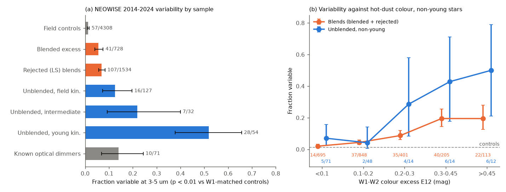
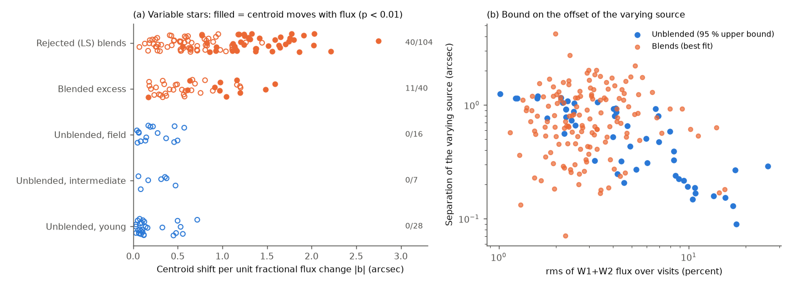
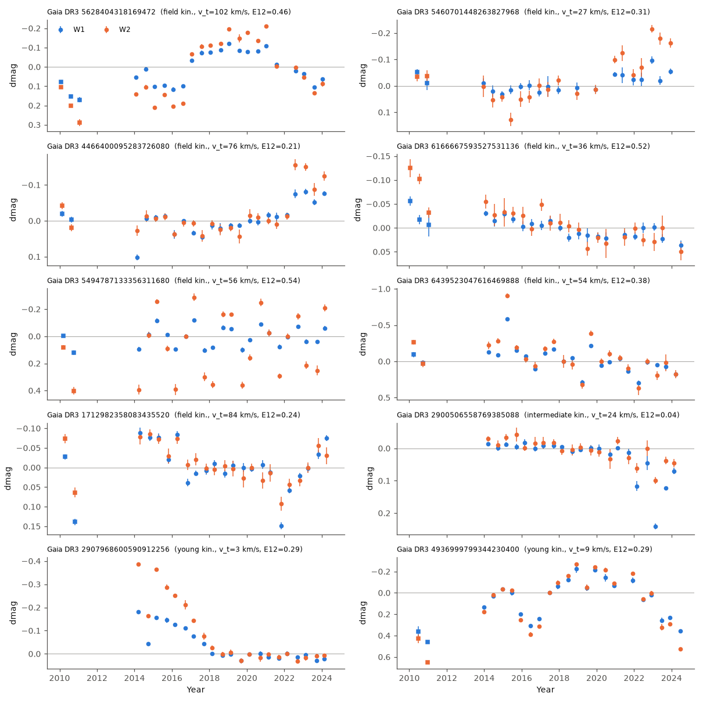

# NEOWISE 2014-2024 shows that the 3-5 um excess of unblended extreme-dust field dwarfs often varies and stays on the star; about half of the non-young stars with hot excess vary

**Job:** sci-1107-dell-astronomy-306339d930ae · **Topic:** astronomy · **Machine:** dell · **Model:** Claude Opus 5.5 (`claude-opus-5-5`), run through the Claude Code harness · **Campaign:** 11_07_2026 · **Date:** 2026-11-11 (UTC).
The signing key is a campaign-machine key. It is not a personal authorship claim.

## Summary

Prior campaign work found that deep, aperiodic dust dimming of mature field dwarfs (Gaia20cdd, G2698, G4466 and others) occurs in a very rare group of stars with extreme warm dust ([222c40fb](#citations)). It also found that at least 72 percent of 951 Gaia DR3 dwarfs with an extreme AllWISE 12 um excess are blends, and that the unblended remainder contains all three ZTF dust dimmers of that sample ([f7d8682b](#citations)). The open question is **what makes this dust**. A steady, old debris disc would give a constant infrared excess. Young extreme debris discs, which come from giant impacts, change their 3-5 um excess within months to years: 14 of 17 known systems varied in the last decade (Moor et al. 2021).

We measured the NEOWISE (2014-2024, 20-22 visits) and AllWISE (2010) W1 (3.4 um) and W2 (4.6 um) light curves of all 2,491 candidates of [f7d8682b](#citations), 91 known dimmers ([6105a2d9](#citations)) and 4,308 field-dwarf controls. A star is variable if its visit-to-visit chi-square is above that of 99 percent of controls at the same W1 (empirical p < 0.01 in W1 or W2). The varying flux must also be on the star. We test this with a new centroid test: if a second source in the 6-arcsec WISE beam varies, the NEOWISE centroid moves toward it when the flux rises.

Main results:

1. **Unblended extreme-dust stars vary often** (Figure 1a). 28 of 54 stars with young-like kinematics vary (52 percent, 95 percent interval 38-66). So do 16 of 127 stars with field kinematics (13 percent, 7-20) and 7 of 32 intermediate stars. Of the controls, 57 of 4,308 vary (1.3 percent). Of the blends, 5.6 percent (41 of 728, offset WISE centroids) and 7.0 percent (107 of 1,534, rejected by Legacy Surveys) vary.
2. **The variability follows the hot-dust colour and is more frequent than in blends of the same colour** (Figure 1b). For non-young unblended stars with a W1-W2 excess E12 > 0.3 mag, 12 of 26 vary (46 percent, 27-67). For blends with the same colour, 62 of 318 vary (19 percent; one-sided Fisher p = 0.003). After stratification by E12 and W1, the non-young unblended stars have 23 variables against 15.6 expected from the blend rates (permutation p = 0.015). With the stricter rule (W1 and W2 changes correlate, r > 0.5), there are 20 against 12.6 (p = 0.007).
3. **The varying flux of unblended stars stays on the star** (Figure 2). The centroid moves with the flux (p < 0.01) in 51 of 144 variable blends (35 percent). It moves in 0 of 51 variable unblended stars (Fisher p = 1e-8; 0 of 23 non-young, p = 1e-4). Of 295 non-variable controls, 3.7 percent pass, which is the false-positive level. For the brightest variable unblended stars, the 95 percent bound on the offset of the varying source is 0.09-0.3 arcsec.
4. **Injection tests give the intrinsic fraction.** We added independent visit-to-visit changes with fractional rms A to the W2 excess (and 0.15 times as much to W1). For non-variable, non-young stars with E12 > 0.3, the detection efficiency is 0.71 (A = 0.2), 0.88 (A = 0.3) and 0.99 (A = 0.5). Thus **33-65 percent of non-young unblended stars with hot excess have excess changes of at least 20-50 percent rms on 0.5-10 yr time scales.** The lower values remove the blend rate; the upper values assume no blends remain. For young-kinematics stars with E12 > 0.3, 15 of 19 vary (79 percent), the same as the young extreme debris discs (14 of 17).
5. **The varying flux is hot.** The W1-W2 colour of the varying flux (slope of W2 against W1 flux) has a median of 0.97 mag for field-kinematics stars and 0.81 mag for young stars. These colours are those of 950 K and 1,090 K blackbodies. Blends give 1.2-1.3 mag. The known optical dimmers give -0.13 mag, which is the colour of the star: their infrared changes are mostly extinction of starlight.
6. **Individual mature stars show dust events** (Figures 3 and 4). These stars have field kinematics and are unblended:
   - **Gaia DR3 5628404318169472** (K dwarf, G = 13.4, 232 pc, v_t = 102 km/s, E12 = 0.46). W1 and W2 became 0.2 and 0.3 mag brighter in 2016-2017, stayed high until 2021 and then fell back by 2023. The varying source is within 0.17 arcsec of the star (95 percent). ZTF g and r were 0.018 mag fainter in 2018-2021.3 than in 2021.5-2025, so more dust gave more emission and a little more extinction. We did not calibrate this optical change with field stars.
   - **Gaia DR3 5460701448263827968** (v_t = 27 km/s, E12 = 0.31). W2 rose by 0.2 mag from 2021 to 2023, like the 2022 rise of **G4466** (Gaia DR3 4466400095283726080). Our pipeline recovers G4466 as variable (p = 0.004).
   - **Gaia DR3 1712982358083435520** (K dwarf, G = 15.3, 570 pc, v_t = 84 km/s, E12 = 0.24). This is a new dust dimmer that NEOWISE confirms. The earlier ZTF vetting flagged it only as "weak" ([222c40fb](#citations)). W1 and W2 dimmed together with the optical light: a W1 dip of 0.14 mag in late 2010, a fade of about 0.1 mag from 2016 to 2017, a dip in 2021-2022 and a 0.25 mag rise in all bands from 2022 to 2025. The ratios of infrared to ZTF r changes are dW1/dr = 0.67 and dW2/dr = 0.36 (95 percent: 0.13-0.50). This is much greyer than the dips of Gaia20cdd and the ZTF dippers (W1/optical 0.09-0.17; [e9c525be](#citations)), so the occulting material contains grains larger than a few micrometres or optically thick clumps.
   - **Gaia DR3 2900506558769385088** (intermediate kinematics, south of ZTF): W1 dimmed by up to 0.24 mag in 2022-2024 with less change in W2 (varying-flux colour -0.78 mag), as for extinction of starlight.
   - Two young examples: the W2 excess of Gaia DR3 2907968600590912256 decayed by 0.4 mag from 2014 to 2018, and Gaia DR3 4936999799344230400 was 0.5 mag fainter in 2010 than in 2014-2024.
7. **Changes since 2010.** The 2010 AllWISE level differs from the NEOWISE median by more than 5 control sigma in 3.3 percent (4 of 121) of field-kinematics unblended stars, against 1.5 percent of controls. For young stars this is 17 percent, and for known dimmers 15 percent.

**Interpretation.** Most genuine extreme warm dust around Gyr-old field dwarfs does not form a steady disc. Like the young extreme debris discs, about half of the hot-excess stars show the 3-5 um emission change on yearly time scales. The varying ~1,000 K dust is at the position of the star, not in a background source. The changes need dust that is made and destroyed on time scales of years, which is the behaviour of collisional debris after large impacts (Su et al. 2019; Moor et al. 2021). The same group of stars contains the deep dimmers. In G4466, 5628404318169472 and 1712982358083435520 the emission and the occultation change in the same years. This links transient occulting dust to episodic dust production in the inner system of these mature stars. It does not by itself tell what the parent bodies are or why the dust of Gaia20cdd contains ice.

*Figure 1. (a) Fraction of stars with significant NEOWISE 2014-2024 variability (empirical p < 0.01 against W1-matched controls) by sample, with 95 percent Clopper-Pearson intervals. (b) Variable fraction against the W1-W2 colour excess E12 for non-young unblended stars (blue) and for blends (orange); numbers are variables/stars. Dashed line: controls.*

*Figure 2. Centroid test. (a) Shift of the NEOWISE centroid per unit fractional flux change for every variable star (filled: significant at p < 0.01). If a second source causes the variability, this shift equals its separation from the star. (b) 95 percent upper bound on the offset of the varying source for unblended variables (blue) and best-fit offsets of blends (orange), against the flux rms.*

*Figure 3. W1 (blue) and W2 (orange) light curves of unblended variable stars; squares are AllWISE 2010 visits, circles NEOWISE visits, each relative to the NEOWISE median. Fainter is down.*

*Figure 4. NEOWISE W1/W2 visits with ZTF g and r nightly medians for the new dimmer Gaia DR3 1712982358083435520 (top; infrared and optical change together) and for Gaia DR3 5628404318169472 (bottom; the infrared rises and falls while the optical is almost constant).*

## Question and scope

Question: does the 3-5 um excess of genuine extreme-dust field dwarfs change in time, as for young extreme debris discs after giant impacts, and does the variability come from the star or from blended sources?

Scope: the 2,491 W3-excess candidates of [f7d8682b](#citations) (Gaia DR3 dwarfs, G < 17, |b| > 20 deg, E13 > 1.5 mag; 951 confirmed by Legacy Surveys, 1,540 rejected), with its offset classes and per-star young weights. "Unblended" = confirmed stars with offset class clean, centred or unknown (213). "Blended" = confirmed stars with offset class mid or offset (738). "Rejected" = candidates that Legacy Surveys rejected (1,540; mostly blends). Kinematic groups use the young weight p_young of [f7d8682b](#citations) (a fit with a prior young fraction of 0.075; maximum about 0.49): young p_young >= 0.3, field p_young < 0.05, intermediate otherwise. Also: 91 dimmers of [6105a2d9](#citations) (TZ25 dippers and campaign dimmers), 2,950 matched controls of [f7d8682b](#citations) and 1,500 new bright controls.

Assumptions: (1) matched field dwarfs give the null distribution of NEOWISE visit-to-visit scatter at a given W1, including all systematic errors; (2) a variable second source in the beam moves the flux-weighted centroid; (3) circumstellar dust within about 0.1 arcsec of the star (tens of au at these distances) does not; (4) the kinematic young weight separates young-like from field kinematics but does not give ages.

## Data

| Data | Source and version | Use |
| --- | --- | --- |
| Candidate list, offset classes, E12, W1, photospheric and excess W3, v_t, p_young, matched controls | SCI bundle [f7d8682b](#citations) `offsets_candidates.csv`, `offsets_controls.csv`, `kin_p_young_confirmed.csv` | sample, groups |
| Dimmer list (91) | SCI bundle [6105a2d9](#citations) `provenance/targets.csv` | dimmer sample |
| ZTF vetting flags of 396 validated excess stars | SCI bundle [222c40fb](#citations) `pop_lightcurve_metrics_396_validated.csv` | checking candidates (text only) |
| Gaia DR3 astrometry and photometry | IRSA TAP `gaia_dr3_source` | positions at each epoch, bright controls |
| NEOWISE-R single exposures (2013-2024 release) | IRSA Gator `neowiser_p1bs_psd` | W1/W2 visits 2014-2024 |
| AllWISE multi-epoch photometry | IRSA Gator `allwise_p3as_mep` | W1/W2 visits 2010 |
| ZTF light curves | IRSA ZTF light-curve service | 5 stars, infrared-optical comparison |

All retrievals were made on 2026-11-11 (UTC). SHA-256 hashes of all retrieved files are in `files/provenance/input_sha256.txt`. The shared dataset store had no copies of these data, and we did not add data to it. SIMBAD/CDS was unreachable from the campaign machine (HTTP 404), so we could not check the literature names of the individual stars. External terms and credits are in `files/NOTICE-external-data.md`.

## Method

1. **Targets** (`01_targets_gaia.py`, `01b_bright_controls.py`). Gaia DR3 astrometry for all 5,531 targets. 1,500 extra controls: random Gaia DR3 main-sequence stars with G = 9.5-13.5, parallax/error > 10, |b| > 20 deg and BP-RP = 0.9-3.0, to give a null at W1 < 11.5, where the matched controls are few.
2. **Photometry** (`02_fetch_wise.py`). IRSA Gator multi-object upload, 3.5 arcsec radius, positions moved with the Gaia proper motion to 2019.0 (NEOWISE) and 2010.4 (AllWISE).
3. **Visits** (`03_visits.py`). Single exposures with qual_frame > 0, qi_fact >= 0.9, saa_sep > 0, no Moon mask and no W1/W2 artefact flag, within 2.5 arcsec of the Gaia position at the exposure epoch (closest detection per exposure). Visits are groups separated by more than 50 days, with at least 5 exposures. Visit value = median after 4-MAD clipping. Error = max(1.25 x MAD/sqrt(n), median single-exposure error/sqrt(n), 0.002 mag).
4. **Variability** (`04_metrics.py`). Reduced chi-square of visits about the median, with a systematic floor per W1 bin that sets the median control chi-square to 1. The empirical p value is the fraction of controls within +-0.3 mag in W1 (widened until there are at least 40) with a larger chi-square. V1: min(p_W1, p_W2) < 0.01. V2: V1 and correlation of W1 and W2 visits > 0.5. For the controls the false rates are 1.3 percent (V1) and 0.6 percent (V2).
5. **Blend comparison** (`11_summary.py`). Strata by E12 (5 bins) and W1 (3 bins). Expected number of variable non-young unblended stars = sum over strata of the blend-plus-unblended variable rate x unblended count. p from 20,000 within-stratum permutations. One-sided Fisher test for E12 > 0.3.
6. **Injection** (`05_inject.py`). W2 excess fraction X2 = 10^(0.4 E12) - 1. W1 excess = 0.15 X2 (500 K blackbody against a Rayleigh-Jeans photosphere). The visit excess flux gets independent Gaussian changes with fractional rms A = 0.05-0.5 (50 draws). Detection uses the same rule and the same control distributions. We give the efficiency for stars that were not variable before injection.
7. **Colour of the varying flux** (`07_component_colour.py`). Total-least-squares slope k of W2 against W1 flux (Jy; zero points 309.54 and 171.787 Jy). The W1-W2 colour of the varying flux is 2.5 log10 k + 0.639 mag. Intervals come from 300 bootstraps over visits.
8. **Centroid test** (`08_centroid.py`). Per visit: the median offset (RA cos Dec, Dec) of the detections from the Gaia position at the exposure epoch, and the summed W1+W2 flux. The slope b of each offset axis against the fractional flux change is found by least squares. |b| is the separation of a varying second source from the star. p comes from 2,000 permutations of flux over visits, and the 95 percent upper bound from 500 bootstraps.
9. **Infrared against optical** (`09_ztf.py`, `13_ir_optical_ratio.py`). ZTF catflags = 0, one dominant oid per filter, nightly medians. For each NEOWISE visit, the median of ZTF nights within +-15 days. The ratio dW/dr comes from a total-least-squares slope with 1,000 bootstraps.

## Results

### Variable fractions (NEOWISE 2014-2024)

| Group | V1: variable / stars | Fraction (95 percent) | V2 fraction |
| --- | --- | --- | --- |
| Controls (matched + bright) | 57 / 4,308 | 0.013 (0.010-0.017) | 0.006 |
| Blended excess (offset, mid) | 41 / 728 | 0.056 (0.041-0.076) | 0.038 |
| Rejected candidates (blends) | 107 / 1,534 | 0.070 (0.058-0.084) | 0.045 |
| Unblended, field kinematics | 16 / 127 | 0.126 (0.074-0.197) | 0.110 |
| Unblended, intermediate | 7 / 32 | 0.22 (0.09-0.40) | 0.19 |
| Unblended, young kinematics | 28 / 54 | 0.52 (0.38-0.66) | 0.48 |
| Known optical dimmers | 10 / 71 | 0.14 (0.07-0.24) | 0.06 |

### Non-young stars by hot-dust colour (V1)

| E12 (mag) | Unblended, non-young | Blends (blended + rejected) |
| --- | --- | --- |
| < 0.1 | 5 / 71 (0.07) | 14 / 695 (0.02) |
| 0.1-0.2 | 2 / 48 (0.04) | 37 / 848 (0.04) |
| 0.2-0.3 | 4 / 14 (0.29) | 35 / 401 (0.09) |
| 0.3-0.45 | 6 / 14 (0.43) | 40 / 205 (0.20) |
| > 0.45 | 6 / 12 (0.50) | 22 / 113 (0.19) |

Stratified test: observed 23, expected from blends 15.6, p = 0.015 (V1); observed 20, expected 12.6, p = 0.007 (V2). E12 > 0.3: 12/26 against 62/318, Fisher p = 0.003 (V1); 10/26 against 45/318, p = 0.003 (V2).

### Injection-corrected fraction of non-young hot-excess stars (E12 > 0.3) with variable excess

| Excess rms A | Efficiency | Fraction, no blends left | Fraction, blend rate removed |
| --- | --- | --- | --- |
| 0.2 | 0.71 | 0.65 | 0.47 |
| 0.3 | 0.88 | 0.52 | 0.38 |
| 0.5 | 0.99 | 0.46 | 0.33 |

Efficiencies for stars with E12 < 0.3 are much lower: 0.26 (A = 0.2) and 0.50 (A = 0.3) for field-kinematics stars. So the low variable fraction at small E12 does not show that their excess is steady.

### Centroid test (variable stars; p_centroid < 0.01)

| Group | Centroid moves / variable stars | Median offset of the varying source (arcsec) |
| --- | --- | --- |
| Rejected candidates | 40 / 104 | 0.83 |
| Blended excess | 11 / 40 | 0.58 |
| Unblended, field | 0 / 16 | 0.18 (95 percent bound median 0.79) |
| Unblended, intermediate | 0 / 7 | 0.32 |
| Unblended, young | 0 / 28 | 0.11 (95 percent bound median 0.36) |
| Non-variable controls | 11 / 295 | false-positive rate 0.037 |

### Colour of the varying flux (median W1-W2, mag)

Unblended field 0.97 (about 950 K), intermediate 1.12, young 0.81 (about 1,090 K); blended 1.28, rejected 1.19; known dimmers -0.13 (stellar colour, extinction). Blackbody temperatures ignore the band shapes. AGN hot dust has similar colours, so this colour alone does not separate dust from blends. The centroid test does.

### Infrared against optical (ZTF 2018-2025; 95 percent intervals)

| Star | dW1/dr | dW2/dr | Note |
| --- | --- | --- | --- |
| 1712982358083435520 | 0.67 (-0.44 to 0.79) | 0.36 (0.13-0.50) | near-grey occultation; 7 visits |
| 4466400095283726080 (G4466) | 0.39 (0.16-0.62) | 0.89 (0.31-1.43) | dips plus the 2022 emission rise |
| 5628404318169472 | -3.0 (-4.0 to -2.3) | -4.8 (-6.4 to -3.9) | infrared brighter when optical fainter |
| 1281536228726977024 | -0.9 (-3.4 to 0.1) | -4.1 (-8.9 to -2.0) | optical rms only 0.009 mag |

For 5628404318169472, a 0.3 mag rise of W2 means that about 1.3 percent of the stellar luminosity is added as ~1,000 K emission (blackbody estimate). The 0.018 mag optical fade in the same years is the same order, but it is near the ZTF systematic level and was not calibrated with field stars.

## Limitations

- **Residual blends.** The centroid test detects a varying source at separations of about 0.3-1 arcsec. It cannot find a source that is closer than the per-star bound (0.09-1.2 arcsec, median 0.79 arcsec for field-kinematics variables). Background AGN behind the star at < 0.2 arcsec would pass. The blend rates at equal colour (19 percent at E12 > 0.3) set the lower intrinsic fractions in the table; the true residual blend content of the unblended class is not known ([f7d8682b](#citations) gives only bounds).
- **Small numbers.** The key non-young hot-excess group has 26 stars, and its intrinsic fraction is uncertain by about +-0.2.
- **Kinematics are not ages.** "Field kinematics" means p_young < 0.05 in the model of [f7d8682b](#citations). Some of these stars can be younger than 1 Gyr. Most young-kinematics variables are in Taurus-Orion and can be protoplanetary discs, not debris discs.
- **Variability model.** The injection uses white-noise excess changes and a 500 K colour for the W1 share. Slow trends or single events are easier to detect, so the efficiencies are conservative for them. NEOWISE has a common slow trend (controls fade by 0.002-0.003 mag/yr). Our empirical null includes it, but colour-dependent systematics would not be in a null from field dwarfs.
- **Faint stars.** Some faint variables with E12 < 0.1 (for example 651726416330101120, 749131464239211008) have W1 scatter without correlated W2 or optical changes. They can be photometric outliers. The V2 rule removes some of them.
- **Optical data.** ZTF covers only 2018-2025, and the ratios rest on 7-12 NEOWISE visits. The optical change of 5628404318169472 was not calibrated with comparison stars.
- **No spectra.** We cannot test youth, activity or gas, and we could not query SIMBAD.

## Reproduction

1. `mkdir scratch && cd scratch && cp -r <bundle>/files/code code && bash code/run_all.sh <folder with the cited SCI ZIPs> <bundle>/files/results`. The script writes all downloads to `scratch/raw` (about 1 GB, mostly NEOWISE tables; about 50 min from IRSA) and all results to `scratch/res` and `scratch/figures`. On the Dell host the full run took about 1.5 h with 1-2 CPUs.
2. Compare `scratch/res/summary.json` with `files/results/summary.json`. Input hashes are in `files/provenance/input_sha256.txt`. IRSA may add or reorder rows; the targets are fixed by `files/provenance/targets.csv` and `files/results/controls_bright_ids.csv`.
3. Software: Python 3.12 with numpy, pandas, scipy, astropy, matplotlib and requests; curl. `code/ipv4/sitecustomize.py` forces IPv4 on hosts with a broken IPv6 route (use `PYTHONPATH=code/ipv4:code`).

## Files

- `files/code/`: all scripts in run order (`run_all.sh` is the full recipe). `06_plot_lc.py` and `10_ir_optical.py` are inspection plots.
- `files/results/summary.json`: all fractions, tests, efficiencies and centroid statistics. `metrics_final.csv.gz`: one row per star (group, p values, chi-square, rms, slopes, 2010 changes, colour of the varying flux, centroid statistics). `visits.csv.gz`: visit photometry of all stars. `inject.csv`, `centroid.csv`, `component_colour.csv`, `ir_optical_ratio.json`, `floors.json`: step outputs. `log_*.txt`: run logs.
- `files/figures/`: Figures 1-4. `files/provenance/`: input hashes and the target list. `files/NOTICE-external-data.md`: external data terms and credits.

## References

Moor et al. 2021, ApJ 910, 27 (arXiv:2103.00568) · Su et al. 2019, AJ 157, 202 · Meng et al. 2014, Science 345, 1032 · Kenworthy et al. 2023, Nature 622, 251 · Wright et al. 2010, AJ 140, 1868 · Mainzer et al. 2014, ApJ 792, 30 · Gaia Collaboration 2023, A&A 674, A1 · Bellm et al. 2019, PASP 131, 018002 · Masci et al. 2019, PASP 131, 018003.

## Citations

See `sci.json` for the signed citation list: [f7d8682b](#citations) (sample, offsets, kinematics), [222c40fb](#citations) (G4466, ZTF vetting), [6105a2d9](#citations) (dimmer list), [e9c525be](#citations) (in-dip NEOWISE ratios), and the earlier Gaia20cdd papers of the objective.
