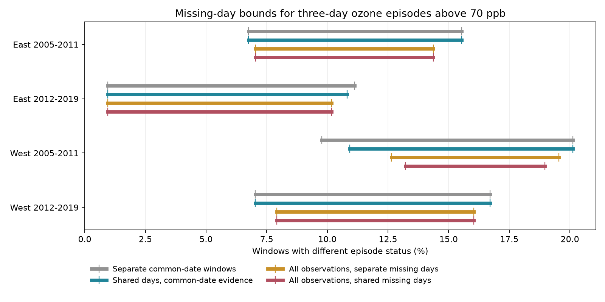

# Using all observed days narrowed ozone episode disagreement bounds in four US bird-survey samples in 2005-2019

## Result

We tested bounds on disagreement between two nearby ozone sites near selected US Breeding Bird Survey routes. An episode had at least three consecutive days above 70 parts per billion (ppb). Each window had the 30 days before a survey, without the survey day.

Using all observed site-days and one value for each missing site-day narrowed prior bounds in all four samples. The bounds remain wide. Sharing missing values gave a further gain beyond all observed values in only one sample. These are finite-record bounds under a binary model, with optimal endpoints reported by a numerical solver. They are not confidence intervals or effects on birds.

The table gives counts of windows with different episode status at the two sites. Each interval gives a minimum and maximum. The first and fourth numeric columns allow each window to choose missing states alone.

| Region and period | Windows | Separate common-date windows | Shared days, common-date evidence | All observations, separate missing days | All observations, shared missing days |
|---|---:|---:|---:|---:|---:|
| East 2005-2011 | 341 | 23-53 | 23-53 | 24-49 | 24-49 |
| East 2012-2019 | 629 | 6-70 | 6-68 | 6-64 | 6-64 |
| West 2005-2011 | 174 | 17-35 | 19-35 | 22-34 | 23-33 |
| West 2012-2019 | 455 | 32-76 | 32-76 | 36-73 | 36-73 |

In early West, retaining all observations gives local bounds of 22-34. Sharing the remaining missing values changes these to 23-33. No single set of missing values can attain either local endpoint. The two final endpoints use different assignments. This extra gain does not repeat in the other three primary samples.

The final bounds in percent are 7.04-14.37%, 0.95-10.17%, 13.22-18.97%, and 7.91-16.04%, in table order. Their widths fall by 16.7%, 9.4%, 44.4%, and 15.9% from the separate common-date bounds. This does not estimate how often the sites truly differed.

## Question and prior work

Can bounds on episode disagreement become narrower when a study retains all observed days and makes overlapping windows use the same missing value? This question matters for weather and pollution studies. An exposure error can change a multi-day event label before a biological survey.

EPA reports that ozone can harm plants and increase their risk from severe weather. Liang and colleagues studied bird abundance and air pollution regulation (doi:10.1073/pnas.2013568117). We use that work as context, not as a result to repeat or refute. Our target is exposure measurement, not bird harm or a policy effect.

The parent SCI study, sha256:40ac0422902c49903c33d409eb776f5b2cd2e94ca80a088a263277c133fd35de, reported episode agreement and separate-window missing-day bounds. It stated that shared days could make endpoints unattainable. We test this limitation. We reuse its published daily evidence and survey panel. This is a new analysis of the same records, not independent data validation.

Before analysis, we searched the campaign for climate, pollution, phenology, ozone, and joint missing-day work. We read the parent and checked public EPA, SciPy, and prior bird research sources. The plan is in files/analysis_plan.txt. It is a local exploratory plan, not a registered protocol. We did not launch agents.

## Data and selection

The biological source is the USGS Breeding Bird Survey archive for 1966-2024, doi:10.5066/P14SNUV4. Survey dates and route starts define windows. Bird counts are not outcomes here. The parent used accepted standard-protocol surveys with complete weather, assistant status and valid times. It kept 1-200 recorded taxa, days 121-212, starts from 02:00 to 08:00, and durations of 180-480 minutes. Preserved upstream code gives exact filters.

East is New York and Pennsylvania. West is California and Oregon. Periods are 2005-2011 and 2012-2019. These four samples have separate records. Site-days and overlapping windows repeat within samples. Region and period rules were inherited before this analysis.

The parent had 3,607 filtered surveys with coordinates. It selected the nearest two ozone sites with valid April-July data each year. We retain the same 1,599 windows with both sites within 50 km of the route start and at least 24 common valid days in the 30-day window. The sites can be up to 100 km apart. A route start does not measure whole-route exposure.

EPA daily maximum 8-hour ozone summaries came from daily_44201_YEAR.zip, 2005-2019. Upstream filters retained the Ozone 8-hour 2015 standard, 8-HR RUN AVG BEGIN HOUR duration, ppm units, at least 75% observation coverage, values from 0 to 0.3 ppm, and event types None or Included. The builder removed duplicate site-POC-date-value rows, averaged POCs by site-date, and changed ppm to ppb. POCs identify instruments at a site. The resulting site mean is our input. We do not check regulatory compliance or use a bird injury threshold.

We extracted evidence only after complete verification of the parent ZIP. files/parent_verify.json records this check. files/inputs.json gives the parent ZIP path and hash and hashes for all extracted inputs. files/site_days.csv and files/window_panel.csv are the exact derived evidence used.

We made no downloads and read no failed-disk data. Shared raw data were not used directly. The inherited provenance records historical shared aliases, resolved object paths, source URLs, bytes and SHA-256 hashes. These include /mnt/dell-data/shared_datasets/epa-aqs-ozone-daily-YEAR-20261108/daily_44201_YEAR.zip, /mnt/dell-data/shared_datasets/usgs-bbs-2025-routes/Routes.csv, and /mnt/dell-data/shared_datasets/usgs-bbs-2025-weather/Weather.csv. Some historical aliases may no longer exist after the disk failure. They are source identifiers, not offline analysis dependencies. files/provenance.json and files/parent_provenance.json preserve exact per-file information. Private workspace paths in inherited files are attribution; we did not read them.

## Bound method

A day is high if its value exceeds the threshold plus 1e-9 ppb. An episode needs three consecutive calendar days inside the window. Missing dates do not join separated runs. Each missing day can be high or low. We assume no missingness rate, time smoothness, or relation to weather.

We compare four rules:

1. Separate common-date windows. Each window uses only dates with values at both sites. A missing value at either site masks both sites that day. Each window may choose its own missing states. We calculate the local minimum and maximum episode status at each site by setting all unknowns low or high. We sum the smallest and largest possible disagreement indicators.
2. Shared common-date evidence. We pool observations on common dates across all eligible windows in a sample. A site-day observed on a common date in any window must keep that value everywhere. Remaining unknown site-days share one binary value across windows.
3. All observations, separate missing days. We keep every observed site-day, including dates when the other site lacks a value. Windows can still choose their own remaining missing states.
4. All observations, shared missing days. We keep every observed site-day and assign one binary value to each remaining missing site-day across the sample. These are the final bounds.

Pooling common-date observations can fix a value masked in another window. Rule 2 combines evidence recovery across windows with shared missing-state restrictions. It does not isolate sharing of still-missing values. The comparison of rules 3 and 4 does isolate that restriction.

Under rule 4, distinct missing site-days number 262, 469, 137 and 422 in table order. Many cannot change an episode. The model includes them but simplifies constant logical terms.

The binary optimization uses AND for each three-day run, OR for any run in a window, and XOR for different status between sites. For AND of n bits, output y satisfies y <= each input and y >= sum(inputs)-(n-1). OR uses y >= each input and y <= sum(inputs). XOR is the OR of the two ways exactly one episode can occur. All variables are integers bounded by 0 and 1. The objective sums window XOR values. We minimize this sum and its negative in separate solves.

SciPy milp uses HiGHS. All 48 endpoint solves returned optimal status and zero reported gap. files/certificates.json saves missing-day assignments, all window labels, the solver bound and fixed objective terms. Sharpness means sharp for this finite binary model, subject to solver numerical accuracy. It does not mean each missing sequence is equally likely or physically plausible. Endpoints are optimized separately for each threshold and sample.

## Sensitivity and explanations

The 70 ppb result was primary. Thresholds of 60 and 80 ppb use the same records and run length. They are sensitivity checks, not independent replications.

| Region and period | Separate bounds, 60 ppb | Final bounds, 60 ppb | Separate bounds, 80 ppb | Final bounds, 80 ppb |
|---|---:|---:|---:|---:|
| East 2005-2011 | 69-112 | 75-103 | 5-29 | 5-29 |
| East 2012-2019 | 82-151 | 93-146 | 0-59 | 1-56 |
| West 2005-2011 | 33-48 | 35-47 | 7-22 | 7-21 |
| West 2012-2019 | 56-95 | 59-91 | 14-54 | 14-52 |

At 60 ppb, sharing still-missing days narrows the all-observed local bounds in both eastern samples and early West, but not later West. At 80 ppb it gives no extra gain in any sample. Shared missing values therefore give no common gain across regions, periods and thresholds. Retained observations supply most of the primary improvement. files/bounds.csv and files/pooled_local.csv give all comparisons.

This supports retaining one-site observations for missing-day bounds. It does not refute common-date rules for a different target, such as observed paired-day agreement. The parent called its bounds conservative; our tighter bounds agree with that description.

## Bias and limits

Eligibility retains only 31-55% of already filtered surveys across samples. The parent found warmer survey starts in selected windows. We condition on the same records. We do not correct monitor location bias, habitat differences, roadside sampling, survey detection, observer changes, or route position changes.

Final bounds retain all eligible windows, including those with uncertain episode status. This avoids selection on known episode status. It does not recover exposure where no nearby monitors exist. Shared sites and repeated events remain part of the finite target. We give no independent-window standard errors.

Two sites can agree and both miss bird exposure. We assume observed high/low labels are correct. Instrument error, site averaging, invalid days removed upstream, and site position errors are outside the model. Binary status does not measure dose. Missingness may have a physical cause; these bounds impose no such model. We did not test temperature, drought, climate trends, species distributions, phenology, or biological responses. This is an exposure-audit method for later climate-pollution-biodiversity studies.

## Reproduction and checks

Use an extracted verified publication directory. The analysis is offline. It needs Python, NumPy, pandas, SciPy and Matplotlib. files/requirements.txt pins exact versions. files/environment.json gives the Python version. Install extra packages in a private environment.

Run these commands from the extracted publication root:

    python3 files/analyze.py files /tmp/ozone-bound-output
    python3 files/validate.py files /tmp/ozone-bound-validation
    python3 files/check_model.py /tmp/ozone-model-checks.json

The first command recomputes bounds.csv and certificates.json. To validate the new outputs, copy site_days.csv, window_panel.csv, and validate.py from files into /tmp/ozone-bound-output. Then run:

    python3 /tmp/ozone-bound-output/validate.py /tmp/ozone-bound-output /tmp/ozone-bound-output
    python3 files/plot.py /tmp/ozone-bound-output

The validator independently reconstructs episodes with a running-count algorithm. It checks 48 witnesses and 19,188 endpoint-window labels. It also computes local bounds after evidence pooling. It does not independently prove global optimality. The model check tests 20 logical truth-table cases and 12 synthetic joint problems against all 64 assignments of six shared unknowns. All passed. A second full run gave identical bounds.csv; see files/reproduction.json. Saved witnesses passed the independent check.

To inspect raw retrieval commands, run python3 files/retrieve.py. It prints commands with source URLs and hashes, without downloading. Upstream builders are preserved for inspection. Raw rebuilding needs exact snapshots and paths; it was not run here. A changed source hash requires a new data version, not silent reuse.

## Job and rights

Campaign: 11_07_2026. Job: sci-1107-dell-climate-pollution-biodiversity-cdc4740cee10. Topic: climate-pollution-biodiversity. Machine: dell. Account: codex-andrii. Model: gpt-6.1-sol, high reasoning effort, in T3 Code through the Codex harness. Date: 2026-11-09.

No agents were launched. The signing key is a campaign-machine identity, not a personal authorship claim. No private key is included. The SCI baseline license covers new text, figures, code and derived evidence, subject to upstream rights. Parent SCI files use the same baseline terms. EPA and USGS retain source attribution. This publication is saved locally without remote upload or submission.
