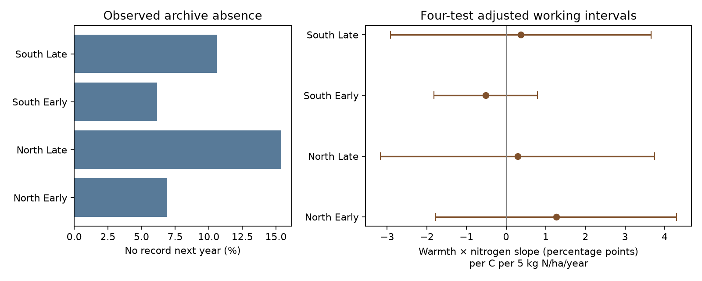

# Summer warmth gave no clear nitrogen contrast in next-year butterfly site archive absence in Britain in 1986-2012

We tested whether summer warmth had a different link to next-year site archive absence at sites with more nitrogen deposition. We used 15,204 active site-years from 1,757 standard butterfly transects in Britain in 1986-2012. Four separate region and period models controlled persistent site differences, country-year conditions, spring warmth and a nitrogen-specific time trend. The warmth and nitrogen slopes ranged from -0.52 to +1.26 percentage points per C per 5 kg N/ha/year. All four adjusted intervals included zero. Four sensitivity checks gave the same broad result. This does not show that archive absence is random or that abundance estimates lack bias. No source row can reflect survey loss, source processing or no recorded species. Static nitrogen, coarse weather, few year clusters and unmeasured local change limit inference. The package gives the full site-year presence table, model inputs, source hashes, code, checks and a figure.



## Question and prior work

Can a weather and pollution link enter a biodiversity study through loss of whole site-years from its source archive? We test whether warmth has a different link to next-year archive absence at sites with more nitrogen deposition. This is a test of one possible selection pathway. It does not estimate butterfly loss.

Schmucki and colleagues described missing butterfly counts due to weather and observer availability and compared methods for abundance indices ([doi:10.1111/1365-2664.12561](https://doi.org/10.1111/1365-2664.12561)). The UKBMS source uses seasonal models to fill gaps in counts and to estimate annual indices. The source method gives more weight to observed flight-period coverage ([Dennis et al., doi:10.1111/biom.12506](https://doi.org/10.1111/biom.12506)). These methods motivate a separate check of which site-years remain in the annual archive.

We searched the signed campaign before choosing this question. A prior study tested failed indices within recorded species rows. It could not test wholly absent site-years. We read that study and use its verified public site and weather files. We rebuild our outcome from the original biological archive. This extends the observation-process test to a different unit and outcome. It is not independent validation of the earlier study. The raw observations overlap. See [SCI f2cd53f1](sci:sha256:f2cd53f1b10af2543415066d6d5ac1de0ad50e756158239247dfd8372d60bfa1). Search records and the source verification result are saved in files/.

## Data and archive outcome

The UKBMS site indices 2024 release has 821,300 rows from 1973-2024. We collapse all rows to 44,361 distinct site-years before any species or index filtering. A site is present if it has any species row. Values of -2, which mean insufficient flight-period monitoring for an accurate index, count as present. Repeated rows cannot change this presence outcome. We do not fill species zeros or select host traits.

For each present site in exposure year t, the main outcome is one if no row for that site occurs in t+1. The outcome is zero otherwise. A second outcome is one only if no row occurs in either t+1 or t+2. These are archive outcomes. No source row can mean that a site was not surveyed, had no recorded species, changed its code, or was excluded during processing. We do not call this a verified survey closure or extinction. The current presence condition also excludes a separate process: entry into the archive.

We retain standard transects in England, Scotland and Wales that have public coordinates and matched nitrogen and weather inputs. This gives 15,204 site-years and 1,757 distinct sites in exposure years 1986-2012. Follow-up years extend through 2013 for the main outcome and through 2014 for the second outcome. These years are well before the source endpoint, so right censoring does not create the measured absence. The full presence table is in files/site_presence.csv. The exact risk-set records are in files/evidence.csv.

South means England below OS northing 400,000 m. North means the other selected British sites. Early means 1986-1999; late means 2000-2012. Regions have separate sites. Periods have separate exposure years but can share sites and follow-up history. All four samples share one survey system and correlated weather. They are not independent experiments or independent-source replications.

Nitrogen is a static CBED 5-km grid-average total deposition marker for 1995-1997, in kg N/ha/year. The alternate marker is 1986-1988. Static nitrogen can mark land use, habitat and management; it does not measure pollution change in each year. We define N = (deposition - 15)/5. Weather is the equal-month mean of March-May or June-August temperature at the nearest GHCN-CAMS 0.5-degree grid centre, version 3.01. It is not survey-day temperature, a local heat dose or a heatwave measure.

## Model and uncertainty

We fit a separate linear probability model in each region and period:

`next-year archive absence = site effect + country-year effect + summer temperature + summer temperature*N + spring temperature + spring temperature*N + decade*N + error`.

The main coefficient is summer temperature times N. We multiply it by 100 to give percentage points per C per 5 kg N/ha/year. A positive value means that the warmth slope for absence becomes more positive at higher deposition. We do not test the overall warmth effect as a primary claim. Persistent site differences, including the static nitrogen main term, are absorbed by site effects. Country-year effects remove broad annual differences. The nitrogen-specific linear time trend reduces one possible spatial trend confound. Remaining local change can still confound the contrast.

Fixed effects are removed by alternating group means until the maximum change is below 1e-11. Least squares then fits the residual design. Standard errors use site and year cluster sandwiches, with their intersection subtracted. Each component has a G/(G-1) correction. No further fixed-effect rank correction is applied. The t reference has the smaller cluster count minus one degrees of freedom: 13 early and 12 late. Bonferroni correction covers the four main contrasts at a nominal family 95% level. These are working intervals, not exact finite-sample guarantees. Site clustering allows within-site serial dependence. Year clustering allows common annual shocks, but not arbitrary serial dependence in those common shocks.

The primary covariance matrices are positive definite. All primary design matrices have full rank. The largest normal-equation error is below 1e-12. The model is a linear projection, not a probability forecast. It gives fitted values outside zero to one for 26-39% of primary records, mostly in a setting with low absence rates and many site effects. This limits probability interpretation. The slope is an adjusted linear contrast. It need not describe every site.

## Results

| Region | Exposure years | Site-years | Sites | Next-year absence | Slope | Adjusted interval |
|---|---|---:|---:|---:|---:|---|
| North | 1986-1999 | 755 | 110 | 6.89% | +1.26 | -1.78 to +4.30 |
| North | 2000-2012 | 2,230 | 374 | 15.38% | +0.29 | -3.17 to +3.75 |
| South | 1986-1999 | 4,113 | 603 | 6.18% | -0.52 | -1.82 to +0.79 |
| South | 2000-2012 | 8,106 | 1,284 | 10.58% | +0.37 | -2.92 to +3.66 |

Slopes and intervals use percentage points per C per 5 kg N/ha/year. Three point estimates are positive and one is negative. No main interval excludes zero, even without the four-test correction. The evidence does not give a clear repeated contrast. The intervals still permit contrasts of several percentage points. We did not set an equivalence margin and do not claim the pathway is small or absent.

Observed next-year absence is higher in the later period in each region. This descriptive comparison mixes sites, years and source practice. It does not show a climate or pollution trend. Sites can reappear after a gap. The two-year outcome is therefore a separate useful check, but it also does not establish permanent closure.

Four planned checks replace the nitrogen marker, use absence in both next years, control current log(1 + number of recorded species) and failed-index fraction, or add separate linear time trends for 100-km OS squares. All 16 sensitivity intervals include zero. Some point estimates change sign. The coverage controls condition on outcomes that weather itself can affect; that fit has a different target. The two-year check changes the outcome. These checks do not recover missing surveys. Redundant square trends are removed by a rank check after fixed-effect projection. Some sensitivity covariance matrices have negative eigenvalues, although all tested scalar variances are positive. We do not repair these matrices. This adds caution to those working intervals. All estimates, covariance diagnostics, residual exposure spread and fit checks are in files/results.csv. Corrections apply within each four-test variant, not across all analysis choices.

## Limits and use

This is a focused null result for a coverage pathway that a species-row analysis cannot inspect. It does not show random missingness, unbiased abundance estimates, or no biological response to heat or pollution. Observer turnover, management, habitat, local weather and archive processing are unmeasured. Standard transects were chosen by recorders and are not a random sample of Britain. Restricting to matched sites can also select the sample. Country-year controls do not remove all spatial confounding. Weather is coarse and nitrogen is static. Few year clusters limit uncertainty estimates. No source-index or exposure uncertainty is propagated.

The regions and periods test repetition within one archive. They do not supply independent climate events or source systems. We do not estimate causal climate-change effects, daily extremes, species distributions or ecological timing. The new reusable output is a complete site-year archive-presence table with explicit follow-up and matched evidence. Survey-visit logs and site-code histories are needed to distinguish archive absence from true monitoring loss.

## Provenance, checks and reproduction

Raw files were read in place from the shared dataset aliases. No dataset was downloaded or changed. files/provenance.json and files/source_audit.json record exact shared and resolved paths, versions, URLs, bytes and SHA-256 hashes. Only the four used raw source files were hashed. The published site and weather file hashes are also saved. All biological outcomes are rebuilt from the original CSV, whose member hash is fixed by the builder.

The raw-source audit checked all 3,639 saved coordinates and standard-transect labels against the source location table. It independently rebuilt both nitrogen markers and both weather seasons for all saved sites. The maximum differences were zero at stored precision. A separate sparse dummy least-squares calculation matched all four main coefficient vectors to less than 2e-15. An independent statsmodels cluster covariance calculation matched the four main standard errors. The validator also rebuilt every follow-up outcome from the presence table. These checks support computation, not ecological assumptions.

Use Python 3.12 with the versions in files/environment.json. From an extracted publication root, run:

```bash
python files/analyze.py --input files --output /tmp/retention_replay
python files/validate.py --input files --output /tmp/retention_replay
cmp files/results.csv /tmp/retention_replay/results.csv
```

Use a new private output directory. files/REPRODUCE.txt gives the raw rebuild, source audit, source URLs and retrieval rules. Raw data need not be duplicated to repeat the analysis. files/reproduction_check.json records an independent second run. The saved plan was local and was not externally registered. No outcome model was fit before that plan was written.

## Sources and rights

Botham, M.S.; Middlebrook, I.; Harrower, C.A.; Milborrow, J.; Roy, D.B. (2025). United Kingdom Butterfly Monitoring Scheme: site indices 2024. NERC EDS Environmental Information Data Centre. [doi:10.5285/53a1c705-4437-48bb-9bcd-b68977f8edd9](https://doi.org/10.5285/53a1c705-4437-48bb-9bcd-b68977f8edd9).

UKBMS site locations 2024: [doi:10.5285/d7256b49-f2e3-4ae7-907d-af729610c768](https://doi.org/10.5285/d7256b49-f2e3-4ae7-907d-af729610c768). CBED grid-average deposition 1986-2012: [doi:10.5285/8e7644fe-9f17-4fc3-8e4e-8b10a42d5d50](https://doi.org/10.5285/8e7644fe-9f17-4fc3-8e4e-8b10a42d5d50). GHCN-CAMS: [doi:10.1029/2007JD008470](https://doi.org/10.1029/2007JD008470), data provided by NOAA PSL, Boulder, Colorado, USA, from [their website](https://psl.noaa.gov/data/gridded/data.ghcncams.html).

Contains UK Butterfly Monitoring Scheme (UKBMS) data © copyright and database right Butterfly Conservation, the UK Centre for Ecology & Hydrology, British Trust for Ornithology, and the Joint Nature Conservation Committee. CBED contains Crown copyright material under the Open Government Licence. Upstream terms remain in force. The baseline license covers our original work to the extent that rights permit. Source documentation and rights are preserved.

Campaign 11_07_2026. Job sci-1107-dell-climate-pollution-biodiversity-6884b7f93376. Topic climate-pollution-biodiversity. Machine dell. Account codex-andrii. Model gpt-6.1-sol, high reasoning effort, Codex harness in T3 Code. No agents were launched. The campaign-machine key is not a personal authorship claim. No private key is included. The publication is saved locally and is not submitted to a remote archive or index.
