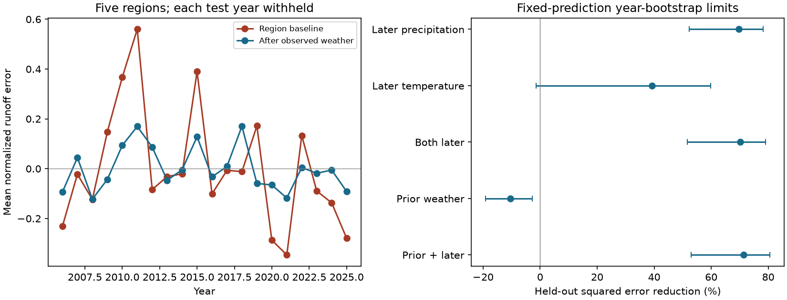

# Later weather reduced held-out regional NRCS runoff error by 70% at 221 western US sites in 2006-2025

Job: sci-1107-dell-earth-and-ocean-sciences-8834f381577a. Topic: earth-and-ocean-sciences. Campaign: 11_07_2026. Machine: dell. Account: codex-olen. Model: gpt-6.1-sol, high reasoning effort. Analysis date: 2026-11-11. The signing key is a campaign-machine key. It is not a personal authorship claim.

## Result

Weather after April 1 has a strong link with errors in NRCS April 1 runoff forecasts across five western US drainage regions. A simple model with observed April-July precipitation and temperature reduced held-out regional squared error by **70.2%**. Precipitation alone reduced it by **69.7%**. Weather before April 1 gave no improvement. A model fitted on 2006-2015 reduced error by **67.8%** in 2016-2025. All these tests use weather that was observed later. They are tests of error sources, not forecasts that a manager could have used on April 1.

This result extends the prior finding of shared runoff forecast errors. Most of the shared variation in regional mean signed error was removed by a later-weather model. But the same model removed much less of the shared variation in low-tail failure rates. The mean-error result must not be used as a claim that later weather explains all joint shortage risk.



Figure 1. Left: the equal-region mean of held-out errors, before and after the later-weather fit. Error is in units of the issued 80% range width. Right: reduction in squared regional error against a region-mean baseline. Bars resample years while keeping held-out predictions fixed. A separate bootstrap refits the models; its limits are given below. Later precipitation includes rain and snow.

## Prior work and new question

SCI publication bd4358dd0a7434bcdd269b67ba7d39532d5932d70325657f32b0c12618f091b0 tested NRCS probability ranges. Its year-block limits did not establish a western coverage deficit. New Mexico had excess coverage. Publication bd487bf106665747c36e445b328bac8ca72ecabc9e6122b6c1666acf2ddb8983 found aligned tail errors across five drainage regions. It left the physical source open. We use its fixed complete panel and test a specific source: weather after forecast issue.

This mechanism is not new in hydrology. Goble and Schumacher (2023), *On the Sources of Water Supply Forecast Error in Western Colorado*, found a role for spring and summer precipitation, and for soil moisture in some years (doi:10.1175/JHM-D-23-0004.1). Perfect observations did not remove all error there. Our contribution is the cross-region held-out test of issued forecast errors, with a direct distinction between shared mean errors and shared tail failures. We do not claim to discover the effect of precipitation on runoff. We do not treat reuse of the NRCS archive as independent confirmation of its earlier calibration results.

NRCS states that its 90% exceedance volume has a 10% chance of lower runoff. Its range between 90% and 10% exceedance volumes has 80% stated coverage. NRCS does not state that errors at different rivers are independent.

## Data and design

We reuse the parent's loader and immutable AWDB snapshots. It checks the hashes of all 57 source files and reproduces 11,365 retained cases and 8,662 range hits. Its sample matches final April 1 forecasts for April-July SRVO adjusted volume to four monthly adjusted volumes at the same point. It requires all five ordered nonnegative forecast quantiles, an issue date no later than April 10, and nonnegative finite monthly volumes. It does not substitute unadjusted gauge flow.

We retain sites with all twenty 2006-2025 cases, then retain HUC2 regions with at least ten such sites. This gives 4,420 cases at 221 sites:

| HUC2 | Region | Sites |
| --- | --- | ---: |
| 10 | Missouri | 60 |
| 13 | Rio Grande | 18 |
| 14 | Upper Colorado | 61 |
| 16 | Great Basin | 25 |
| 17 | Pacific Northwest | 57 |

The climate data are NOAA nClimDiv monthly precipitation and mean temperature, version 20261105. We assign each forecast point to a NOAA climate division by polygon intersection at its current AWDB coordinates. All 221 points match exactly one polygon. This weather is a regional proxy at the outlet, not a basin mean. The division can omit much of a large upstream basin. All climate values used are finite and above the source missing-value threshold.

At each site, later precipitation is the April-July sum and later temperature is the four-month arithmetic mean. Prior weather uses the preceding October through March. Each variable is standardized by that site's division mean and sample standard deviation in 1981-2000. These fixed reference years precede all forecast cases. The monthly temperature mean is not weighted by days. Standardization removes the source units, inches and degrees F.

We wrote the local design before extracting weather or computing new joint scores. We knew the parent results. Before scoring, we changed from nClimGrid cells to climate-division averages because full-file reads were too slow. The original read was stopped. `files/PLAN.txt` records this change. This is a local design record, not an independent pre-registration. Refitted bootstrap intervals, region-specific slopes and leave-one-year evaluation checks were added after the first scores. A JSON export failed on a NumPy integer; we fixed the export and repeated the computation.

## Method

For site i and year t, define signed error as

`e_it = (observed volume - forecast median) / (upper forecast - lower forecast)`.

All retained widths are positive. We average this error and each standardized weather variable within each drainage region. Each site has equal weight within its region. Each region has equal weight in all scores. These are means of normalized errors, not sums of physical water volume; nested gauges do not add duplicate water to a volume total.

The primary model fits regional intercepts and two common slopes, for later precipitation and temperature. There are seven fitted coefficients. We leave out all five rows of each test year and fit on the other nineteen years. The baseline has only regional intercepts and uses exactly the same withheld years. The primary score is `1 - MSE_weather / MSE_baseline`, pooled over the 100 region-years. Single-variable fits and prior-weather fits use the same procedure. The decade test fits on 2006-2015 only and evaluates all 2016-2025 rows, without refitting.

For a primary randomization reference, all five regions' weather rows move together under each of 1,999 random year permutations. We refit the entire leave-year-out model each time and use a plus-one one-sided p-value. This preserves spatial weather correlation but breaks its year match with runoff errors. It assumes year exchangeability. Nineteen nonzero circular shifts preserve the cyclic weather sequence and give a more limited serial-pattern check. They are not exact tests under arbitrary trends.

We give two uncertainty summaries. The first uses 10,000 paired whole-year bootstrap draws of fixed held-out predictions. The second uses 2,000 draws and refits each model, leaving all copies of the evaluated year out of training. Draw counts weight both training and scoring. No site is treated as an independent replicate. Both summaries assume exchangeable years; twenty years cannot support detailed trend or return-period inference. The percentile limits are approximate and do not establish causal attribution.

For residual matrix E, shared annual variation is the sample variance of its equal-region mean. Net cross-region covariance is `(sum(Cov(E)) - trace(Cov(E))) / 25`. This is a signed covariance sum. A reduction is descriptive and can include offsetting pairs. It is not a fraction of error caused by weather.

## Evidence

| Model | Held-out MSE reduction | Fixed-prediction 95% limits | Decade test reduction |
| --- | ---: | ---: | ---: |
| Later precipitation | 69.7% | 52.3-78.2% | 65.6% |
| Later temperature | 39.3% | -1.4 to 59.9% | 50.7% |
| Both later variables, primary | 70.2% | 51.7-79.0% | 67.8% |
| Prior weather | -10.5% | -19.1 to -2.8% | -5.0% |
| Prior and later weather | 71.4% | 53.0-80.6% | 67.6% |

The refitted whole-year bootstrap gives **49.3-80.0%** limits for the primary MSE reduction and **65.1-92.9%** for the shared-mean variance reduction. Region-specific slopes give 72.2% held-out MSE reduction. Omitting any one year from evaluation of the fixed predictions gives 65.5-72.1%. Adding later weather to prior weather reduces held-out MSE by 74.1% against that prior-weather model. These checks were added after scoring.

The primary MSE fell from 0.10267 to 0.03057 in squared normalized-error units. The synchronized permutation p-value is 0.0005, its minimum at this sample size. The circular-shift p-value is 0.05, also its minimum. The latter is a coarse sensitivity result, not stronger independent evidence. Full-record fitted precipitation and temperature slopes are +0.247 and -0.060 per reference standard deviation. These are descriptive fits; the score uses only held-out fits. Precipitation alone nearly matches the primary model. We do not establish a separate benefit from temperature.

The variance of the equal-region mean residual fell from **0.05599 to 0.00799**, an **85.7%** reduction. Net cross-region covariance fell from **0.03438 to 0.00155**, a **95.5%** reduction. Thus later weather accounts statistically for most of the shared mean-error variation in this sample. This is a statement about measured association and this simple regression, not a causal share.

The decade holdout also exposes a limit. Primary error reductions by region are 58.1%, **-40.9%**, 87.0%, 53.7% and 88.3%, in table order. The common-slope model worsens error in the Rio Grande. Strong aggregate gain does not establish a useful correction in every region. It also does not resolve the excess uncertainty coverage in New Mexico.

Low-tail failures give a different result. We replace signed error with the annual fraction of sites below the issued lower limit and use the same linear model. Its held-out MSE reduction is **28.0%** (fixed-prediction limits 7.6-39.6%). Shared mean variance falls by **34.0%**, and net cross-region covariance falls by **38.8%**. Substantial shared tail variation remains. This linear diagnostic is not a probability forecast; its values need not lie in [0,1]. It neither recalibrates the issued bounds nor reproduces the parent's fixed-frequency tail test.

## Checks and limits

`files/results/robust.json` gives the bootstrap that refits all models, regional gains, a region-specific slope test, and omitted-year evaluation ranges. `files/results/validation.json` independently recomputes MSE reduction and shared variance from the aggregate held-out table with Python standard-library arithmetic. The source loader checks all hashes and the parent case counts. The static figure was inspected.

Later weather is not forecast innovation: we did not recover the weather forecast or conditional weather distribution used by NRCS. Some seasonal weather can be predictable at April 1. Its association with error does not prove irreducible uncertainty or that NRCS omitted weather. Prior weather is only a crude issue-time control. It does not measure snow, groundwater, soil moisture, radiation, or their forecast treatment. A lack of gain from this control does not exclude those processes.

There are only twenty years, five selected regions and one complete panel. The record excludes short or incomplete series and has few complete California points. Sites are related and can be nested. Region means suppress local errors. Climate divisions at outlets are broad proxies. Current archived forecasts, current metadata and adjusted flows can differ from original operational records. Some forecasts were issued after April 1; monthly weather cannot separate the first few known days. NOAA climate records can also be revised. These limits prevent a claim about every current NRCS method or all western water-supply risk.

The useful next test is a weather-conditioned joint ensemble, evaluated with forecasts of weather available at issue time and separate future years. This study supplies a measured constraint for that test: match common mean errors and the remaining joint tails separately. It does not validate such an operational ensemble.

## Reproduction and rights

All raw files and site-level tables remain outside this baseline publication. The package includes original text, aggregate evidence, code and figures. The inherited loader and retrieval code use the MIT grant in the cited parent's SCI baseline license. Attribution and external-data terms are in `files/NOTICE_EXTERNAL_DATA.md`. The baseline license does not replace external source terms.

`files/sources.json` gives exact URLs, hashes, versions and resolved shared paths for 57 parent inputs. `files/weather_manifest.json` gives the same for two nClimDiv files and one NOAA polygon ZIP. Shared logical paths are under `/mnt/dell-data/shared_datasets/`, including `noaa-nclimdiv-pcpndv-v1-20261105`, `noaa-nclimdiv-tmpcdv-v1-20261105`, and `noaa-climate-divisions-shape-20170710-dell8834`. These are the three weather source files actually read and hash checked. No download from the failed Dell disk was used. The interrupted nClimGrid read supplies no result.

From the extracted publication root, with Python 3.12, numpy, pandas, scipy, statsmodels, geopandas and matplotlib:

```bash
bash files/code/reproduce.sh /mnt/dell-data/shared_datasets /tmp/nrcs_weather_cases /tmp/nrcs_weather_results
```

On another host, retrieve exact versions into a separate directory first:

```bash
python files/code/retrieve.py --manifest files/sources.json --scratch /tmp/nrcs_weather_raw
python files/code/retrieve_weather.py files/weather_manifest.json /tmp/nrcs_weather_raw
bash files/code/reproduce.sh /tmp/nrcs_weather_raw /tmp/nrcs_weather_cases /tmp/nrcs_weather_results
```

The scripts reject changed source hashes. Live source files may no longer have the recorded bytes; use the immutable shared snapshots in that case. All outputs go into separate scratch and output paths, never the signed draft. `region_weather.csv` contains region-level analysis summaries, `heldout.csv` contains model errors and predictions, and the JSON files contain aggregate scores and checks. No private workspace is needed once the exact external sources are available. Code uses one compute process with one numerical-library thread.
