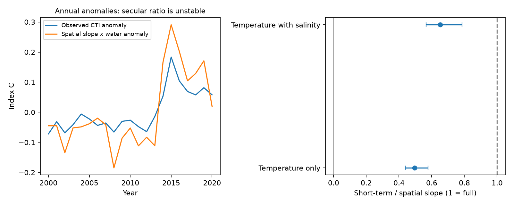

# California fish larvae had a short-term thermal slope near half their spatial slope in 2000-2020

Job: sci-1107-dell-climate-pollution-biodiversity-ca5833183fbe. Topic: climate-pollution-biodiversity. Campaign: 11_07_2026. Machine: dell. Account: codex-olen. Model: gpt-6.1-sol, high reasoning effort. Date: 2026-11-11. The signing key is a campaign-machine key. It is not a personal authorship claim.

## Result

In 2,583 selected CalCOFI fish-larva tows at 45 stations, the short-term thermal-index slope was 0.1317 index C per water C. The spatial slope in the same test sample was 0.2661. Their ratio was 0.495. Its conditional 95% three-year block interval was 0.439 to 0.578. A joint station and year-block resample gave 0.410 to 0.607. Full spatial transfer (ratio 1) was outside both intervals.

With salinity in both slope models, the spatial slope fell to 0.1871 and the short-term slope fell to 0.1221. The ratio rose to 0.653 (0.565 to 0.785). Thus, salinity adjustment changed the benchmark as well as the measured response. The increase is a point-estimate comparison; the two variant bootstrap draws are not paired for an interval on this increase.

The secular result is less certain. The community index rose by 0.0887 index C per decade (0.0106 to 0.1536). Water temperature rose by 0.5287 C per decade, but its three-year block interval was -0.1055 to 1.0742. The ratio of these trends, after spatial normalization, had a point value of 0.630. Its temperature denominator can cross zero. It cannot establish a bounded decadal transfer fraction. The direct difference between community change and full spatial expectation was -0.0520 index C per decade (-0.1264 to 0.0316). This test did not resolve a secular deficit.



The figure shows annual observation-adjusted anomalies and short-term slope ratios. The bars are conditional 95% three-year block percentile intervals. They are not simultaneous intervals. The annual lines are descriptive; their fitted secular ratio is unstable.

## What this adds

Earlier campaign work found weak spatial-to-temporal thermal transfer in birds, butterflies and many monitoring networks (SCI 0037934e). Northeast US Shelf plankton supplied a stronger marine contrast (SCI dd5e171c). A CalCOFI study found a positive held-out thermal-index slope after salinity adjustment (SCI ece7e8d), but did not estimate a spatial denominator. A later score partition showed that station information supplied most of that slope (SCI e2141c25).

We add a matched spatial benchmark, a direct short-term-versus-secular comparison, and joint station/year uncertainty for this second marine system. We searched local campaign results for thermal and CalCOFI work and read those studies before this test. We reuse their raw observations and preparation method. This is a new analysis of an existing survey, not a new independent data collection. The plan was written before the new slope results, but after reading the prior short-term slope. Station resampling and one- and five-year block checks were added after the first results. They are sensitivity tests, not independent replications.

The short-term response is much greater than the small fast fractions reported in the broad network synthesis, yet remains below this survey's spatial benchmark. The comparison uses different sampling, indices and habitat-temperature measures. It does not establish a realm effect. More importantly, a strong short-term marine association does not establish a precise decadal transfer fraction. The latter needs a warming denominator that is resolved under serial dependence.

Published work already connects California larval fish to water masses (doi:10.1029/2018JC014011), shared salinity and temperature dynamics (doi:10.3389/fmars.2020.557940), and changing spawning seasons (doi:10.1073/pnas.1421946112). Those processes are not new claims here. Our evidence does not separate adult movement, larval transport, spawning time, survival or capture. It provides a better-scaled response constraint for tests of those processes.

## Data and fixed index

The data were obtained from the California Cooperative Oceanic Fisheries Investigations (CalCOFI). CalCOFI data are available at https://calcofi.org/. We used the 16 October 2023 bottle/cast release and NOAA SWFSC ERDDAP tow and larva-count snapshots from 9 November 2026. The exact shared paths, URLs, byte counts and SHA-256 hashes are in `files/source_provenance.json`. Raw data and record-level derived tables are external. `files/NOTICE.md` gives attribution and source terms.

We kept starboard bongo tows (CB, S) in 1978-2020 on lines 76.7, 80, 83.3, 86.7, 90 and 93.3, at station numbers 26-90. We kept the first tow per cruise and line-station. This gave 8,488 tows. Positive counts were summed by tow and scientific-name label; some labels cover groups above species level.

Each cast variable needed four distinct nonmissing depths between 0 and 150 m, a shallowest depth at most 10 m and a deepest depth at least 100 m. We averaged duplicate depths, interpolated at 5 m steps and integrated from 0 to 100 m. The shallowest value was carried to the surface where needed. We matched the nearest cast within three days at the same nominal cruise and line-station. There were 6,431 matches, including 3,185 training tows in 1978-1999. We used published nonmissing values without a separate quality-flag exclusion. This is not a new source-quality assessment.

A taxon score is the mean training station-quarter temperature climatology across its positive training tows. A label needed at least 30 positive tows, five years and ten stations. There were 78 labels. Scores were fixed before the 2000-2020 test period. They measure local survey associations, not physiological tolerance or a global thermal niche.

The primary community temperature index (CTI) is the equal-label mean score in a tow. Test tows needed three scored labels, at least 80% of larvae in scored labels and positive sorted volume. Each station-quarter needed five eligible test years. These rules gave the common test sample of 2,583 tows, 45 stations and 21 years. Selection can omit novel arrivals and low-count or unusual catches. In the secondary index, each label has weight log(1 + larvae per 10 square metres).

## Models and estimates

The spatial model uses one mean per test station-quarter, with equal cell weight:

```
mean CTI = quarter intercept + b_space * mean temperature [+ salinity] + error
```

The short-term model uses individual tows, with equal tow weight:

```
CTI = station-quarter intercept + linear year trend + day within quarter
    + sine and cosine of local solar hour + log sorted volume
    + b_fast * temperature [+ salinity] + error
```

Year is in decades from 2010. Local solar hour is UTC hour plus longitude/15. Day within quarter uses nominal 91.25-day quarters. Sorted volume is volume sampled times fraction sorted. We call the detrended within-cell slope short-term; it is not a pure frequency filter or a causal temperature effect.

Separate CTI, temperature and salinity trend models use the same cell and observation controls, without the hydrographic predictors. Let their CTI and temperature trends be a and u. The descriptive secular ratio is a/(b_space*u). The direct full-expectation contrast is a - b_space*u. The extra CTI trend beyond the short-term association is a - b_fast*u. The last contrast was 0.0190 index C per decade (-0.0028 to 0.0374). The data therefore did not resolve a difference between the secular change and the short-term association multiplied by warming.

| Variant | Short-term / spatial slope | Conditional 95% interval |
| --- | ---: | --- |
| Primary | 0.495 | 0.439 to 0.578 |
| Salinity in both slope models | 0.653 | 0.565 to 0.785 |
| Log-density index | 0.509 | 0.451 to 0.589 |
| Exclude 2014-2016 | 0.497 | 0.452 to 0.571 |
| North: lines at most 83.3 | 0.387 | 0.340 to 0.468 |
| South: lines at least 86.7 | 0.507 | 0.424 to 0.615 |
| Cast match within one day | 0.497 | 0.442 to 0.576 |

These are separate sensitivity estimates, not seven replications. All direct short-term-minus-spatial slope intervals were below zero. The north/south contrast was not tested as a planned interaction.

The stored salinity variant also gives a total CTI trend divided by its partial temperature spatial slope times warming. That stored ratio is only a denominator diagnostic. It does not subtract a spatial salinity contribution from the CTI trend and must not be called a salinity-adjusted secular transfer fraction. We do not use it to make a secular claim.

## Uncertainty and checks

The primary analysis uses 999 paired case resamples of whole years in circular blocks of three consecutive retained years. The same year multiplicities refit spatial, short-term and trend models. Scores and the sampled station set remain fixed. Within-year observations can be dependent. This method gives only a short approximation to serial dependence in 21 years. In the no-heatwave variant, consecutive retained years can span the omitted years.

A post hoc sensitivity also resamples 45 stations with replacement, independently of year blocks. It uses station multiplicities in the spatial cell fit and tow fit. The primary ratio interval widened to 0.410-0.607. This allows station heterogeneity, but it does not model a continuous spatial correlation field. One-year and five-year blocks gave primary ratio intervals of 0.439-0.573 and 0.446-0.573. The short-term finding held under these choices.

The water trend interval was positive with independent-year resampling (0.209-0.813 C per decade), but crossed zero with three- or five-year blocks and with joint station/year resampling. Thus serial dependence materially changes the secular interpretation. In 32 of 999 primary draws the water trend was nonpositive. The finite percentile interval stored for the secular ratio (0.202-1.112) must not be treated as a well-behaved bounded ratio confidence set. The direct contrast is safer. Neither it nor the extra-trend contrast resolved a secular departure.

The weighted bootstrap engine reproduces explicit repeated-row resamples within 1.5e-15 in five checks. An independent spatial regression differed by less than 8e-16. Dense residual regression reproduced the fast slope within 6e-17, and a synthetic response recovered a known slope within 2e-15. The original fast slope was recovered to its published precision. These checks test the calculations, not ecological causation. `files/evidence/validation.json` and `checks.json` give the errors.

## Limits and next test

Local fitted scores can encode geography, spawning season, productivity and capture. Holding them fixed in later years prevents direct fitting to test anomalies but does not remove those associations. Their uncertainty is absent from all intervals. A positive spatial gradient is partly expected from the score design. The ratio is conditional on that index and regional benchmark. External niche scores and independent geographic training remain needed.

The spatial fit covers the selected core grid, not all local pairwise gradients. Spatial and temporal models use different weights and different controls because station effects cannot identify a spatial gradient. Neither ratio is a physiological adjustment rate. Salinity is one water-mass tracer and cannot remove transport without a salinity signal. Quarter, date and hour terms cannot fully remove spawning and capture changes. A linear trend through 2000-2020 is sensitive to heatwaves and does not represent an equilibrium response.

This investigation does not identify the process that sets the terrestrial gap. It finds a partial short-term response in a second marine survey and shows why the same record cannot yet determine decadal transfer. A useful next test would combine externally estimated taxon niches with longer matched profiles, adult spawning distributions and current-derived source-water fractions. Those observations can separate transport and timing from local demographic change. This publication does not supply them.

## Reproduce

Use Python 3.12 with numpy, pandas, scipy, statsmodels and matplotlib. Exact versions and run commands are in `files/run_manifest.json`. Use one BLAS thread. From an unpacked publication root, with a separate scratch directory:

```
bash files/reproduce.sh /absolute/scratch/calcofi /absolute/shared/datasets
```

Omit the second argument to retrieve the exact sources with `fetch.py`. The retrieval script checks recorded hashes and stops if a source changed. Exact reproduction then needs the recorded snapshot. It never downloads into the signed package. Preparation creates profiles, scores and tow tables in scratch. The analysis writes only aggregate evidence into its output directory. The signed package contains code, notices, a plan, aggregate results, resample statistics and the figure; no private scratch is required beyond the documented inputs.

Additional checks and sensitivity runs:

```
python files/validate.py --panel /absolute/scratch/calcofi/prepared/panel-external.csv --output /absolute/scratch/calcofi/validation
python files/analyze.py --panel /absolute/scratch/calcofi/prepared/panel-external.csv --output /absolute/scratch/calcofi/sites --primary-only --sites
python files/analyze.py --panel /absolute/scratch/calcofi/prepared/panel-external.csv --output /absolute/scratch/calcofi/block1 --primary-only --block 1
python files/analyze.py --panel /absolute/scratch/calcofi/prepared/panel-external.csv --output /absolute/scratch/calcofi/block5 --primary-only --block 5
```
