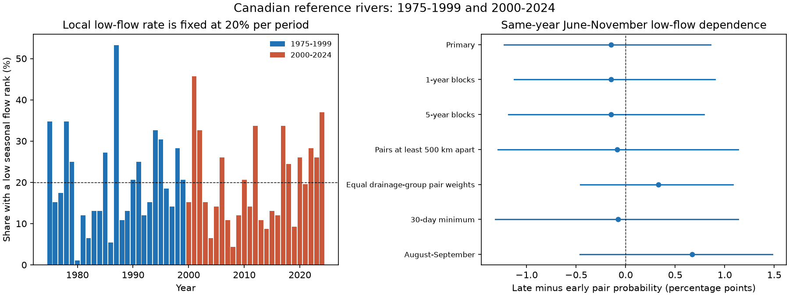

# June-November low-flow dependence showed no clear change at 92 Canadian reference gauges between 1975-1999 and 2000-2024

Job: `sci-1107-hp-earth-and-ocean-sciences-2bdc98cbe623`. Topic: earth-and-ocean-sciences. Campaign: 11_07_2026. Machine: hp. Account: codex-myxtap. Model: gpt-6.1-sol, high reasoning effort. Analysis date: 2026-11-09. The signing identity is a campaign-machine key. It is not a personal authorship claim. No other agents were used.

## Result

We tested whether unusually low June-November river flow occurred in the same year more often across 92 Canadian reference gauges. We compared 1975-1999 with 2000-2024. At each gauge, we ranked the 25 seasonal low-flow values within each period. The lowest 20% received low-flow weight. This rule removes changes in the local low-flow rate from the comparison.

The mean low-flow pair probability was 5.110% in the early period and 4.960% in the late period. The late-minus-early difference was -0.150 percentage points. Its 95% three-year block range was -1.226 to +0.858 points. Thus, the primary test gave no clear change. This range permits changes of practical size in both directions. It does not show equal risk.

The left panel gives the share of gauges with a low seasonal rank in each year. The mean is 20% in each period by design. The right panel gives changes in mean pair probability and their 95% ranges. Each resampled year retains the whole gauge field. The points are not estimates from independent gauge pairs.

## Question and prior work

Water transfers can help with a local shortage. They can be less useful when many rivers have low flow in the same year. Shared weather, snow deficits, and water storage can connect river responses over space. We test one proposed statistical explanation for an increase in shared low-flow risk: stronger same-year low-rank dependence. We cannot identify a physical cause from discharge alone.

Brunner and Chartier-Rescan studied drought propagation in 70 Central European catchments. They found that spatial drought extent increased from precipitation to discharge and then fell toward groundwater. Their study motivates a spatial test, but it does not establish a Canadian time change ([2024 study](https://doi.org/10.1029/2023GL107918)). A western Canadian study found different low-flow trends among snow-fed rivers. This supports the need to define the season and gauge sample ([Whitfield and Pomeroy study](https://doi.org/10.1016/j.ejrh.2024.102144)). Our outcome is a period contrast in same-year dependence, not a local flow trend or drought propagation time.

The campaign [seasonal low-flow study](sci:sha256:8ae995f3a8d858f4a8d59297e379209a3d5380784cc4a683d43071a24fa0b680) used the same HYDAT and reference-network snapshots. We read its source-selection and retrieval code. We reused the selection method and adapted the retrieval code. Its result concerns changes in local period medians. The campaign [timing forecast study](sci:sha256:e1dd27fb705c1fcc6ceda9c33304c65e1fc5b7d8f44151b21d4bc3a760367581) prevented a repeated timing question. The campaign [US precipitation pair study](sci:sha256:a5241ee5e18ad270f83425c1068b82d9cc5607576754f63f88a1c3dd8eef5ed0) informed the distinction between local event rates and shared events. We use river flow, a complete-record sample, and ranks that are recalculated in each resample. The shared river records are not independent confirmation of prior campaign findings.

The contribution is a fixed-data river dependence test with explicit local-rate control, whole-field uncertainty, distance and drainage weighting checks, a null main result, and reproducible code. [SEARCH_NOTES.md](files/SEARCH_NOTES.md) records the search and question choice. [DECISIONS.md](files/DECISIONS.md) records the rules before the first statistic. This is an internal plan, not an external registration.

## Data and scope

We reused ECCC Water Survey of Canada HYDAT release 2026-10-19 and the fixed RHBN metadata workbook with 2020 evaluation rows. The source database reports schema version 1.0 and date 2026-10-19. The [official network description](https://www.canada.ca/en/environment-climate-change/services/water-overview/quantity/monitoring/survey/data-products-services/reference-hydrometric-basin-network.html) explains the screen for long records with limited human effects. It also states that the screen cannot remove all human impacts or identify natural changes.

Select 2020 RHBN-N=1 rows with discharge type Q and Canadian province or territory codes. Exclude any gauge with a HYDAT REGULATED=1 row at any date. This gives 314 archive gauges from 317 national reference flow rows. Require a finite, nonnegative published discharge on every calendar day from 1975 through 2024. Use no gap filling. Ninety-two gauges meet this rule, with 4,600 station-years and 18,263 days per gauge. All date calculations retain leap days.

The fixed sample has 28 BC, 18 NB, 12 NL, 11 AB, nine ON, seven NS, three SK, and one each in PE, QC, YT, and NT. It has 41 three-character HYDAT drainage groups. It is not an equal-area or nationally representative sample. The complete-record rule strongly limits coverage. It also selects records retrospectively. The national reference list was made in 2020, not in 1975.

The main test accepts all finite daily values, including partial-day, ice-condition, and estimated values. HYDAT defines symbols A, B, and E as those three conditions. There are 6,928 A, 44,005 B, and 26,234 E values in the June-November records of the selected sample. The presence of a value is not proof of a full-day, ice-free measurement. This is a material limit.

Exact shared source paths:

- `/mnt/dell-data/shared_datasets/eccc-hydat-sqlite3-20261019/Hydat_sqlite3_20261019.zip`
- `/mnt/dell-data/shared_datasets/eccc-rhbn-metadata-20201020/RHBN_Metadata.xlsx`

These compatibility paths use the HP SSD store. No failed-disk path was used. The ZIP SHA-256 is `644d0b262963a0dd48ac25cd960d3194f02d993eed9aba8cf84f99523c602ed4`. The workbook SHA-256 is `9843a4e2278f33e69d6d4d750c88841010e07995d8a28d8ee294bd3552c41571`. The extracted database SHA-256 is `a2c84de258187fb91645beea56b954c4b7bd363786660c21bf48b78cb7ec315a`. [provenance.json](files/provenance.json) gives URLs, sizes, helper records, versions, and worker details.

Data Source: Environment and Climate Change Canada. Contains information licensed under the Open Government Licence - Canada. External source terms and attribution are in [NOTICE.md](files/NOTICE.md). Source records and record-level derivatives stay outside this publication. The SCI baseline covers our bundled code, text, figures, aggregate statistics, and resample indices. It does not relicense the external data.

## Measure and uncertainty

For each year and gauge, find the smallest mean of seven consecutive daily discharges whose full window lies inside 1 June to 30 November. This is one seasonal minimum, not a count or duration of drought events. Two gauges can have low seasonal minima on different days and still have a shared low-flow year.

Rank the 25 values separately in each period. Give weight one to the lowest five and zero to the other values. If a tie crosses the fifth value, assign the same fractional weight to all values at the boundary. Each station's total weight is exactly five. There are two fractional station-year weights in the primary sample. The 10% and 30% checks use target weights of 2.5 and 7.5. They can have fractional weights even without source ties.

Let w_ti be the low-flow weight at year t and gauge i. Let N be the number of gauges and T=25. Define J as the mean of w_ti*w_tj over years and all distinct gauge pairs. For equal weights, compute it as:

`J = mean_t [((sum_i w_ti)^2 - sum_i w_ti^2) / (N*(N-1))]`.

The squared self-term is needed for fractional weights. J is a probability for a randomly selected distinct pair and year, with an independent random tie resolution at each gauge. It is a finite-sample tail measure, not a daily drought probability. Under product independence of gauge weights, J is 0.2*0.2 = 4%. The tested difference is late J minus early J. There are 4,186 distinct gauge pairs, but only 25 years in each period. Pairs are not independent replicates.

For the primary range, draw circular three-year blocks independently within each period until 25 years are selected. Use the same selected years at every gauge. Recalculate ranks and tie weights in each resampled period. Repeat 5,000 times, with seed 211072029. Take the 2.5th and 97.5th percentiles of the differences. The one- and five-year checks use seed 211072026 plus block length. All draw scores and indices are saved.

These approximate ranges assume that short blocks describe variation within each period. They retain observed spatial dependence and some serial dependence. They do not include source error, unobserved slow climate cycles, selection uncertainty, or a change to another gauge network. Resampling produces repeated values; fractional boundary weights treat those ties in the same way as source ties. The primary mean resampled difference is -0.110 points, compared with the observed -0.150 points. Small samples and only five to eight long blocks per period limit precision.

## Planned checks and explanation tests

All values in the table are percentage points of late-minus-early pair probability. Each row uses a separate 95% percentile range. The rows share records and are not independent evidence. No multiple-test claim is made.

| Check | Gauges | Change | 95% range |
| --- | ---: | ---: | ---: |
| primary | 92 | -0.150 | -1.226 to +0.858 |
| block_1 | 92 | -0.150 | -1.126 to +0.901 |
| block_5 | 92 | -0.150 | -1.182 to +0.789 |
| distance_500km | 92 | -0.085 | -1.291 to +1.136 |
| equal_drainage_group_pairs | 92 | +0.328 | -0.459 to +1.081 |
| tail_10 | 92 | -0.072 | -0.551 to +0.389 |
| tail_30 | 92 | +0.042 | -1.578 to +1.222 |
| window_30 | 92 | -0.075 | -1.318 to +1.136 |
| august_september | 92 | +0.673 | -0.463 to +1.481 |

The distance check uses 3,408 pairs with gauge outlets at least 500 km apart. It reduces nearby-pair influence, but outlet distance does not prove that watersheds are disjoint. A rise from a more spatially coherent driver would need to appear in some appropriate broad-distance measure. This check gave no clear rise. It cannot reject all shared-forcing explanations.

For the drainage check, define groups by the first three characters of the gauge code. Exclude within-group pairs. Give each pair across groups weight 1/(n_g*n_h), where n_g and n_h are their group sizes. This gives equal total weight to each distinct group pair. Its point difference is positive, unlike the primary point. Its range also crosses zero. Thus even the direction depends on spatial weighting at this precision.

A strict planned partial-day check would exclude every gauge with any A value in any June-November season. It leaves one gauge. No distinct pair exists, so this check cannot be estimated. It is recorded in summary.json under unavailable_checks. After seeing this limit, we added a window check: remove any seven-day window with an A value, require at least 90% accepted windows in each season, and keep only gauges with all 50 seasonal values. Only three gauges remain. Their difference is 0.000 points, with a range of -6.667 to +8.000. This added diagnostic cannot establish flag robustness for the main network. It is labelled post_result_exclude_partial_windows in the saved outputs.

Regional point differences are -0.308 points for 40 western gauges and +0.064 for 48 eastern gauges. The three Prairie gauges give zero. One northern gauge cannot form a pair. West is BC, AB, and YT; East is ON, QC, NB, NS, PE, and NL; Prairies are SK and MB; North is NT and NU. These are descriptive values without regional uncertainty tests. They do not establish regional differences.

## Fixed historical thresholds give a different descriptive change

An added rate need not imply stronger dependence. Apply the early-period fifth value and its tie weight as a fixed threshold in both periods. The early mean low-flow fraction is 20.00%; the late fraction is 22.65%. Mean pair probability then rises from 5.110% to 6.059%, a change of +0.949 points. In contrast, separate-period ranks give a change of -0.150 points.

This planned comparison shows sensitivity to the event reference. It is not a causal decomposition or a proof that local rates caused the fixed-threshold rise. No separate significance claim is made for that rise. A fixed threshold measures absolute changes relative to an earlier flow distribution; separate-period ranks ask about relative low states within each period. Both can be relevant to water supply, but they answer different questions. The null rank result does not show that absolute water availability or drought impacts stayed constant.

## Audit and limits

The numerical audit checks 80 station-years directly from source SQL with a separate sum-of-seven routine. Its largest difference is zero at the saved precision. A separate sort and tie-allocation routine and direct pair matrix reproduce both main J values. They also rebuild 100 deterministic primary resamples. The largest draw difference is 4.34e-17 in probability units. Every saved table range is checked against its draw file. A constant-flow synthetic record gives the required 0.04 independent reference with fractional tie weights. See [audit.json](files/aggregates/audit.json). This audit checks arithmetic. It is not independent scientific replication.

The result applies to a fixed final archive snapshot, two short periods, one main seasonal window, and a highly selected gauge network. National pair means can hide regional changes or changes at other distances. Flow regulation screening cannot remove all land use, natural disturbance, groundwater use, glacier loss, or station changes. Estimated, ice-condition, and partial-day observations remain in the main result; the flag checks have too few gauges to resolve their influence. Within-period local trends can affect which years receive low ranks. These ranks do not isolate a climate mechanism or a stationary dependence law.

The test uses discharge alone. It does not observe precipitation, evaporative demand, snow storage, groundwater, water demand, reservoir operations, water quality, or ecological impacts. It cannot attribute changes to warming, snowmelt, or climate modes. It tests no operational forecast. A failure to resolve a dependence change does not remove the need to manage local or regional shortages.

## Reproduction

Read [REPRODUCE.md](files/REPRODUCE.md). The package has the analysis and audit code, an exact-source retrieval script, requirements, source provenance, all 5,000 draws per check, year resample indices, annual network aggregates, numeric summaries, and the static figure. Record-level source data and derivatives are not bundled. The retrieval script can reuse the shared files or retrieve the exact URLs into separate scratch. It refuses changed hashes. Full reproduction therefore needs those external source bytes. No private workspace file is needed.

Install the exact SCI baseline license with `sci license` before signing. This job saved the signed ZIP only in the local campaign. It did not upload or submit it to a remote archive or index.
