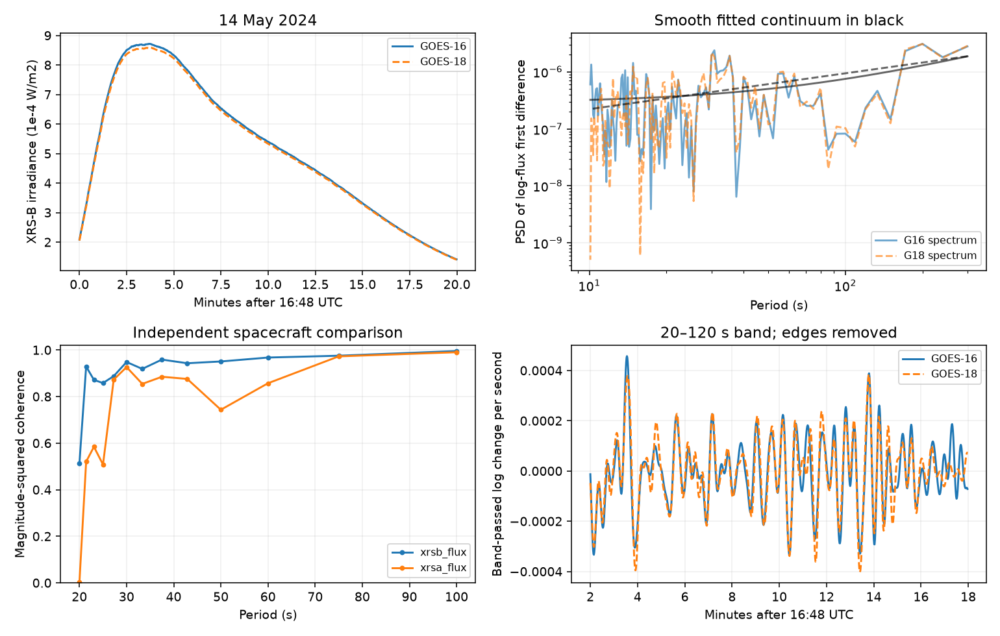

# GOES-16 and GOES-18 share 20 to 120 second changes but no narrow peak passes a fitted-noise test on 14 May 2024

Two independent spacecraft record shared rapid changes during the large 14 May 2024 flare. No tested narrow spectral peak passes a 5 percent screen against a fitted smooth noise spectrum. This is a restricted measurement and method result. It is not a new report of this flare, a new physical mode, or a planet discovery.



## Question and prior work

Can a 20 to 120 second peak in the bright part of this flare pass a colored-noise screen and repeat in an independent instrument? Such a result could help to test periodic heating or a coronal wave. Before this test we searched the campaign for astronomy, ephemeris, GOES and XRS. We read the published GOES scale study cited in sci.json. That work tests long-term calibration and flare rates, not these fast changes. We use new code and no prior campaign numeric results.

We searched public papers for this event and for flare pulsation tests. Inglis, Ireland and Dominique (2015) show why a power-law noise model matters. Inglis et al. (2016) apply spectral tests to a large flare sample. The 2026 event study cited in sci.json gives the flare peak near 16:51 UTC. We do not claim to have made a complete literature search or to be the first to study rapid changes in this event.

We chose the main window, 16:48 to 17:08 UTC, before computing its spectra. It covers the bright peak and decay. We first inspected a wider 16:45 to 17:15 interval for detector changes. The main window avoids those changes. The period band was chosen before analysis. Early and late ten-minute splits are sensitivity checks of the same selected event. All tests are conditional on that choice, not on an unbiased flare survey.

## Data and processing

We use NOAA NCEI science-quality XRS one-second data, version 2-2-2, for GOES-16 and GOES-18 on 14 May 2024. Both files were created on 9 October 2026. Exact source URLs, byte counts and SHA-256 hashes are in files/provenance.json. The shared paths are:

- `/mnt/dell-data/shared_datasets/goes16-xrs-1s-20240514-v222/xrs.nc`
- `/mnt/dell-data/shared_datasets/goes18-xrs-1s-20240514-v222/xrs.nc`

The worktree ./datasets link reaches these HP SSD compatibility paths. We checked existing dataset names before downloading. The campaign dataset helper completed both transfers with provenance. We reused the completed files in place. No existing shared dataset was changed.

The NetCDF inputs supply a time coordinate, irradiance, detector choice and quality flags. XRS-A and XRS-B measure different soft X-ray bands. We retain only positive finite values with quality flag zero. We interpolate to the common UTC second grid 60480 through 61679 after midnight. This gives 1200 flux values and 1199 first differences. We permit only gaps shorter than 3.1 seconds near the window and record bad-sample counts. This removes the flagged spikes; it does not model their cause. The two clocks differ in sampling phase by about 0.3 seconds. Interpolation aligns them. We do not apply a fitted lag or search for the lag with the largest agreement.

For each channel, set z[t] = log(F[t+1]) - log(F[t]). This reduces the large smooth flare trend and makes the scale relative to local flux. We subtract the mean and calculate a one-sided Hann-window periodogram on the Fourier grid. We do not fit a smoothed trend with a chosen oscillation period. Differencing reduces long-period sensitivity and changes the noise spectrum.

We fit S(f) = A (f / 0.02 Hz)^(-alpha) + C to the difference spectrum from periods 10 to 300 seconds. A and C are positive; alpha is bounded from -4 to 6. The objective is the mean of log(S) + I/S. Three fixed start points reduce optimizer dependence. These are Whittle-style estimates; Hann powers are correlated, so the usual independent-bin likelihood is approximate.

The detection score is the largest I/S over periods 20 to 120 seconds. For each of 499 simulations per test, we generate a stationary Gaussian difference process with the fitted spectrum, apply the same Hann periodogram, refit the spectrum and repeat the full band search. Outside the fit range we hold the spectrum at its boundary value. The reported p-value is (1 + number of simulated scores at least as large as observed) / 500. It is a plug-in parametric test. It includes refitting and the frequency search, but not full uncertainty in the noise family, event selection or window selection. Seeds and all settings are in files/analyze.py.

## Spectral results

| Test | Peak period, seconds | Peak / fitted power | Conditional search p |
| --- | ---: | ---: | ---: |
| main g16 xrsb | 30.74 | 5.775 | 0.104 |
| main g16 xrsa | 35.26 | 4.113 | 0.512 |
| main g18 xrsb | 29.98 | 4.921 | 0.268 |
| main g18 xrsa | 30.74 | 5.554 | 0.118 |
| early g16 xrsb | 42.79 | 3.697 | 0.286 |
| early g18 xrsb | 42.79 | 3.600 | 0.320 |
| late g16 xrsb | 28.52 | 4.105 | 0.222 |
| late g18 xrsb | 28.52 | 4.805 | 0.094 |

All eight p-values exceed 0.05. No test passes even the unadjusted threshold, so a correction for the eight tests does not create a detection. The tests are correlated. The peak locations alone do not establish a stable period. In the main XRS-B windows, the largest ratios are near 30 seconds in both spacecraft, but neither passes its own smooth-noise screen.

This null result is limited. It does not show that the signal is pure noise, that no physical oscillation exists, or that all useful flare models have been tested. Six equal-frequency-bin mean I/S ratios are stored in files/diagnostics.json. They show imperfect continuum fit. The flare changes rapidly and is not stationary. These effects can change the calibration of the simulated p-values. A broad oscillatory excess can also enter the fitted continuum. No general upper bound on oscillation amplitude is claimed.

## Independent detector and artifact checks

After a fourth-order Butterworth band pass at 20 to 120 seconds, with forward and reverse application, we remove 120 samples at each edge. The remaining first differences have cross-spacecraft correlations of 0.92255 for XRS-B and 0.82304 for XRS-A. A phase control preserves the second series' Fourier amplitudes and replaces its phases. All 1999 controls give smaller absolute correlations in both bands, for conditional p = 0.0005. This is a test of shared timing, not a narrow-period test. Random phases assume stationary noise. Filtering a changing flare can leave shared broad structure.

The figure also shows magnitude-squared coherence from 300-second Hann segments with 150-second overlap. There are six segments. Coherence is descriptive; no independent significance level is assigned to each bin. Both channels in one spacecraft share an instrument, while GOES-16 and GOES-18 use separate spacecraft and detectors. They still share a design and processing method.

All primary detector values in the main window select detector 2. Direct fixed-detector A2 and B2 measurements give the same main-window values under the recorded quality rules. This check excludes a detector switch inside the main window. It is not a second independent measurement. The wider inspection window contains switches before and after the main window.

The source Readme warns that particle contamination is not fully corrected in the one-second high-flux channels. We did not analyze independent particle counters or a third instrument. Similar particle environments and shared processing can affect both spacecraft. A solar origin for much of the shared structure is plausible, but is not proven by this comparison. No claim of a new unexplained solar phenomenon is made.

## Physical interpretation and sensitivity

A coherent narrow wave or repeated heating could make a peak above a smooth spectrum. Neither is required by these tests. A changing flare with irregular heating and cooling can give a broad spectrum and shared rapid structure. This explanation is consistent with the measurements, but we did not fit a physical plasma model. The spectra do not identify a loop length, density, temperature, or a specific wave mode.

To measure limited sensitivity, we multiply the observed GOES-16 XRS-B flux by exp(a sin(2 pi t/P + phase)). Periods are 30, 45, 70 and 100 seconds. Four phases give 16 trials at each amplitude. We repeat the spectrum and continuum fit. A recovery must exceed the main-window 95 percent simulated score and select a frequency within two Fourier bins of the injected frequency.

| Added log-flux amplitude, percent | Recovered trials |
| --- | ---: |
| 0.03 | 2 / 16 |
| 0.10 | 8 / 16 |
| 0.30 | 16 / 16 |

The amplitude is approximately the fractional flux semiamplitude for these small values. These ideal, persistent injections are conditional on one observed event. They do not define completeness for damped, drifting, short-lived or irregular pulsations. files/diagnostics.py also verifies a known 40-second sinusoid and its first-difference amplitude. The arithmetic checks pass. They do not validate the physical noise model.

## Reproduce and inspect

The signed package includes original code, aggregate spectra, results, provenance, text and a static PNG. External NetCDF data and source documents remain outside the package. files/EXTERNAL_DATA.md gives attribution and source terms. The exact SCI baseline license applies to our material. It does not replace third-party terms.

Use Python 3.12 and files/requirements.txt in a private environment. From the extracted publication root, retrieve data into separate local scratch and run:

```bash
python files/retrieve.py --dest /absolute/local/scratch/raw
python files/analyze.py --raw-root /absolute/local/scratch/raw --out /absolute/local/scratch/analysis --draws 499
python files/diagnostics.py --raw-root /absolute/local/scratch/raw --out /absolute/local/scratch/diagnostics
```

On the campaign machine set --raw-root to the shared datasets directory to avoid downloads. Raw hashes must match. The programs refuse output inside the publication. No network access is needed for analysis. The bootstrap uses one process. Small numeric differences can occur across numerical libraries. The fixed seeds and stored aggregate tables permit comparison. The raw files can be retrieved again without private scratch. Read files/results.json and files/diagnostics.json for all tests, software versions and checks.

## Campaign record

Job: sci-1107-dell-astronomy-5f948e097b67. Topic: astronomy. Campaign: 11_07_2026. Machine: dell. Account: codex-myxtap. Model: gpt-6.1-sol, high reasoning effort, through the Codex harness in T3 Code. Date: 2026-11-09. One finite worker conducted the study. No agent was launched. The campaign-machine key records bundle integrity, not personal authorship or external peer review. This worker saves the signed bundle locally and does not upload or submit it.
