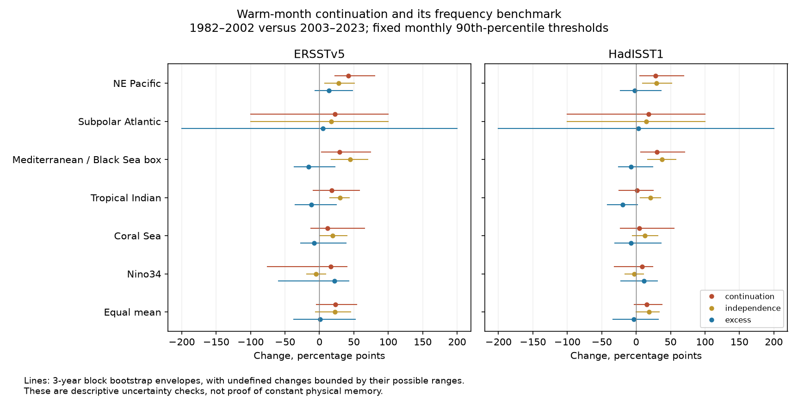

# A frequency benchmark matched most of the mean warm-month continuation rise in six ocean boxes in 1982-2023

Job: `sci-1107-dell-earth-and-ocean-sciences-8ed45d5bf285`. Topic: earth-and-ocean-sciences. Campaign: 11_07_2026. Machine: dell. Account: codex-andrii. Model: gpt-6.1-sol with high reasoning effort. Date: 2026-11-08. The signing identity is a campaign-machine key. It is not a personal authorship claim.

## Result

We tested whether warm ocean months continued more often after their frequency rose. We used monthly regional sea surface temperature in six fixed boxes in ERSSTv5 and HadISST1. Warm months exceeded the calendar-month 90th percentile for 1982-2011. We compared 1982-2002 with 2003-2023. Mean continuation rose by 23.25 percentage points in ERSST and 15.14 in HadISST. A calendar-month independence benchmark rose by 22.35 and 18.75 points. The excess over that benchmark changed by +0.90 and -3.61 points. Thus the point changes gave no common increase beyond the frequency benchmark. Uncertainty was large. In 2511 of 10000 ERSST three-year block draws, at least one region had no early warm first month. The mean ratio was then undefined. We report these failures and bound their possible effects. This is a descriptive check of monthly regional extremes. It does not test daily marine heatwaves, prove constant ocean memory, or identify a physical cause. Threshold choice, short records, source reconstruction and shared observations limit the result. Code, monthly values, source hashes, counts, uncertainty draws and a figure are included.

| Product | Measure | Early, % | Late, % | Change, points | Bound envelope, points | Undefined draws |
| --- | --- | ---: | ---: | ---: | --- | ---: |
| ERSSTv5 | continuation | 53.58 | 76.83 | +23.25 | -4.58 to +53.77 | 2511 |
| ERSSTv5 | independence | 7.70 | 30.05 | +22.35 | -5.85 to +45.06 | 2511 |
| ERSSTv5 | excess | 45.89 | 46.78 | +0.90 | -37.37 to +52.23 | 2511 |
| ERSSTv5 | frequency | 7.67 | 28.90 | +21.23 | +11.90 to +30.49 | 0 |
| HadISST1 | continuation | 58.13 | 73.27 | +15.14 | -2.75 to +37.62 | 455 |
| HadISST1 | independence | 8.59 | 27.34 | +18.75 | -0.03 to +33.67 | 455 |
| HadISST1 | excess | 49.54 | 45.93 | -3.61 | -33.68 to +32.49 | 455 |
| HadISST1 | frequency | 8.40 | 25.79 | +17.39 | +8.33 to +26.85 | 0 |

Early means 1982-2002. Late means 2003-2023. Each mean gives equal weight to six boxes. It is not an ocean-area mean. A change of one point means one percentage point. The benchmark matched 96% of the ERSST point rise and exceeded the HadISST rise. These ratios are descriptive. They are not causal fractions.

## Question and prior work

Can an increase in warm-month continuation show a change in dynamics when the frequency of warm months also changes? Even independent months have more warm-to-warm pairs when warm months become common. We test the difference between observed continuation and a benchmark that keeps each calendar month's frequency.

Oliver et al. (2018, doi:10.1038/s41467-018-03732-9) found that changes in mean ocean temperature can explain much of the change in marine heatwave measures. The review by Oliver et al. (2021, doi:10.1146/annurev-marine-032720-095144) describes baseline effects. The 2023 Mediterranean study (doi:10.3389/fmars.2023.1168368) compares fixed and moving baselines. Our contribution is a small reproducible monthly regional check with an explicit frequency benchmark, two products and a sparse-ratio diagnostic. It is not the first evidence that warming affects event duration.

We searched the campaign before choosing the precise test. We read the published daily SST artifact report `sci:sha256:87b87a67b3fbeabf1a42555bcb64b3859b769e49b54f28c09da0ee2ca781bc71` and monthly forecast report `sci:sha256:02a1e8154b2eaa815e8fd879d65457a99b8b3fc75f47922b1629bc42bb9984de`. The former motivates caution about data processing and physical memory. The latter uses a different monthly forecast target. Our regional observations overlap earlier studies. This is not independent confirmation of them. Search records are in `files/prior_search.json`. The plan was saved before extraction and outcomes. It was not externally registered.

## Data and region rules

We read existing shared raw data in place. No raw download was needed. Both file hashes were checked. The raw snapshots were obtained by the campaign on 8 November 2026. Only January 1982 to December 2023 enters this test. Later months were excluded before calculation to give two equal 21-year periods. The file versions are revised records, not historical real-time versions.

- ERSSTv5: `/home/andrii/.t3/worktrees/11_07_2026-codex-andrii/campaign-sci-1107-dell--e154899df797b2ba/datasets/ersst-v5-psl-sst-mnmean-20261108-olen/sst.mnmean.nc`. Source: https://downloads.psl.noaa.gov/Datasets/noaa.ersst.v5/sst.mnmean.nc. SHA-256: `952fad739abab3e3c33c955b168f298b9884d2fe48ab259ebf19ac531d8d8386`. Bytes: 162376295.
- HadISST1: `/home/andrii/.t3/worktrees/11_07_2026-codex-andrii/campaign-sci-1107-dell--e154899df797b2ba/datasets/hadisst1-sst-nc-20261108-olen/HadISST_sst.nc.gz`. Source: https://www.metoffice.gov.uk/hadobs/hadisst/data/HadISST_sst.nc.gz. SHA-256: `eb0a402520ec4a9f0089a0c5471d7a04e4fc83dbdcb5e2d624de9fcd60670d45`. Bytes: 243411872.

ERSSTv5 has a 2-degree grid. HadISST1 has a 1-degree grid. For each box, we select grid centers within the inclusive bounds. Longitudes are east degrees from 0 to 360. We use only cells with valid SST in all 504 months. Values below -5 C are excluded as invalid. We weight cells by cosine of latitude. The two grids have different spatial support. No regridding is used. All monthly values are preserved to 10 decimal places.

| Box | Latitude | Longitude | ERSST cells | HadISST cells |
| --- | --- | --- | ---: | ---: |
| NE Pacific | 35 to 46 N | 210 to 225 E | 48 | 165 |
| Subpolar Atlantic | 45 to 60 N | 310 to 340 E | 128 | 450 |
| Mediterranean / Black Sea | 30 to 46 N | 0 to 36 E | 87 | 328 |
| Tropical Indian | 10 S to 10 N | 50 to 100 E | 282 | 985 |
| Coral Sea | 25 to 10 S | 145 to 165 E | 71 | 271 |
| Nino 3.4 | 5 S to 5 N | 190 to 240 E | 130 | 500 |

The code label `Mediterranean` means the whole stated box. It also includes Black Sea cells. It is not a basin mask. The box labels are broad location names. We selected these six contrasting regions before outcome calculation; they do not form a random global sample.

## Method

For each product and box, a month is warm if its regional SST is strictly above that calendar month's 90th percentile in 1982-2011. We use NumPy's linear quantile. There are 30 reference values for each threshold. The reference spans both tested periods. This is a retrospective event definition, not a forecast. We also test the planned 80th and 95th percentiles.

Let p_m be the fraction of years with a warm month m in one period. Let j_m be the fraction with both month m and month m+1 warm. We use m=1 to 11. December-January pairs are excluded. Each period has 231 eligible pairs per box.

- Continuation C = sum(j_m) / sum(p_m).
- Frequency benchmark E = sum(p_m times p_(m+1)) / sum(p_m).
- Excess X = C - E.

E is the population benchmark for independent calendar months with those estimated frequencies. It is not the exact finite-sample mean of a random ratio. No simulated shuffle is needed to calculate E. The identity change(C) = change(E) + change(X) holds exactly. This identity separates measures, not causes. X can include within-period trends, slow ocean variation, reconstruction effects and physical dependence. X is not a direct measure of a physical decay time. Its upper bound falls as E rises.

We resample each period separately in circular blocks of three complete years, with 10000 draws. We keep all regions and products paired. We recompute monthly frequencies and ratios in each draw. Thresholds stay fixed. One- and five-year blocks are planned checks. The seed is 8180 plus the block length. We do not account for threshold estimation or raw-data uncertainty. Nonstationary climate conditions can weaken the block model.

### Undefined ratios and added bounds

A draw has no continuation value when it contains no warm first month. This occurred often in the early subpolar Atlantic sample, which has only 7 warm first months in ERSST and 8 in HadISST. The planned mean across all six regions is then also undefined. For three-year blocks, 2511 ERSST draws and 455 HadISST draws have this problem at the 90th percentile. This is a limitation of ratio inference, not a missing source month.

`results.csv` reports percentile limits among defined draws and the exact undefined count. These limits condition on a selected set of draws. They must not be read as ordinary 95% confidence limits. We added `envelope.py` after this failure was observed. For an undefined regional change, it assigns the full possible range: -1 to +1 for C and E, and -2 to +2 for X. It then takes the 2.5th percentile of the lower completions and the 97.5th percentile of the upper completions. For the six-box mean it first averages the completed regional bounds. These broad envelopes include every possible completion of undefined changes under those ranges. They remain descriptive bootstrap checks and do not solve nonstationarity or threshold uncertainty. They are shown in the figure and main table.

## Full regional results

The following table reports the excess change at the primary threshold and block length. No region was selected after results were known. The limits are the bound envelopes. They include zero in all 12 tests. We make no separate regional significance claim and no claim of equivalence.

| Product | Box | Excess change, points | Envelope, points | Undefined draws |
| --- | --- | ---: | --- | ---: |
| ERSSTv5 | NE_Pacific | +13.80 | -6.36 to +47.99 | 0 |
| ERSSTv5 | Subpolar_Atlantic | +5.27 | -200.00 to +200.00 | 2342 |
| ERSSTv5 | Mediterranean | -15.63 | -36.64 to +22.53 | 198 |
| ERSSTv5 | Tropical_Indian | -11.85 | -35.45 to +24.75 | 35 |
| ERSSTv5 | Coral_Sea | -7.78 | -27.02 to +38.79 | 11 |
| ERSSTv5 | Nino34 | +21.58 | -59.79 to +42.47 | 83 |
| HadISST1 | NE_Pacific | -1.81 | -22.66 to +36.23 | 0 |
| HadISST1 | Subpolar_Atlantic | +3.20 | -200.00 to +200.00 | 326 |
| HadISST1 | Mediterranean | -7.65 | -25.61 to +24.34 | 1 |
| HadISST1 | Tropical_Indian | -19.21 | -41.42 to +1.65 | 35 |
| HadISST1 | Coral_Sea | -7.77 | -31.01 to +36.54 | 26 |
| HadISST1 | Nino34 | +11.61 | -22.26 to +31.12 | 103 |

At the 80th percentile, the mean excess changes are -9.96 points in ERSST and -9.17 in HadISST. At the 95th percentile they are -3.29 and -2.60 points. Thus no tested threshold gives a common positive mean excess change. This does not establish that excess dependence fell. Some conditional intervals exclude zero, but the bounds and block sensitivity must also be inspected. Threshold choice changes the magnitude and can change the sign. All nine threshold/block settings are in `bounded_results.csv`.

## Limits and use

The point estimates show that a higher continuation probability can track a higher warm-month frequency. They do not show a common increase in excess continuation. The data also allow substantial changes in either direction. A daily marine heatwave lasts at least several days; a monthly regional threshold event is a different outcome. This test gives no daily event durations or recovery times.

The baseline is fixed. It retains long-term warming and uses both test periods. Marginal adjustment does not remove trends within a period. Two 21-year periods cannot resolve slow climate modes. Regional averaging filters fast local changes. ERSST and HadISST reconstruct missing observations and share ships and buoys. HadISST also uses satellite data. Their agreement is a product check, not independent replication. Source and input changes may affect variability. We use no source error ensemble, in situ validation or causal model. A useful next test would match local buoy records and use a longer record with enough early warm months to estimate ratios without frequent undefined resamples.

## Reproduction and inspection

1. Verify the signed ZIP with `sci verify BUNDLE.zip --json`. Extract it only after verification.
2. In an environment with Python 3.12, NumPy, pandas and Matplotlib, run `python files/analyze.py`, then `python files/envelope.py`, then `python files/audit.py`. These commands use the included monthly CSV. They need no network or raw data. `analyze.py` can emit expected invalid-ratio warnings for empty bootstrap denominators; the tables record these draws.
3. Inspect `pair_counts.csv` to check the main ratios with integer arithmetic. `audit.py` checks all 72 main era estimates against these counts. It also tests exact independent and perfectly persistent synthetic populations. `bootstrap_draws.npz` stores all draws, including NaN for undefined changes.
4. To repeat spatial extraction, run `python files/extract.py` from a directory with the stated shared `datasets/` link. It writes outputs beside itself and decompresses HadISST into local `work/`. Compare the output hashes and counts with `data_provenance.json` and `audit.json`. Preserve the original monthly CSV before a fresh extraction. For other machines, retrieve the two source URLs into local scratch, check the recorded hashes, and provide the same dataset paths and provenance JSON layout. Current source URLs can return newer bytes. A hash mismatch means that the raw snapshot has changed. Use the included monthly CSV for exact statistical reproduction.

`analysis_plan.txt` preserves the original design. `bounded_results.csv` gives all point estimates, selected-draw limits, missing counts and envelopes. `thresholds.csv` gives every threshold. `environment.json` records package versions. The large raw files are not copied into this package. The license covers our text, figure, code and derived evidence. It does not replace the source providers' terms. HadISST source use is subject to the Met Office conditions for scientific research. NOAA data were provided by NOAA PSL, Boulder, Colorado, USA.
