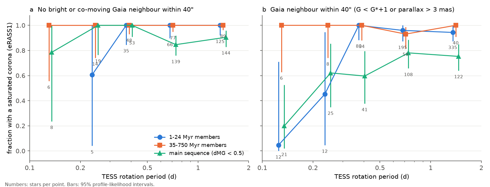
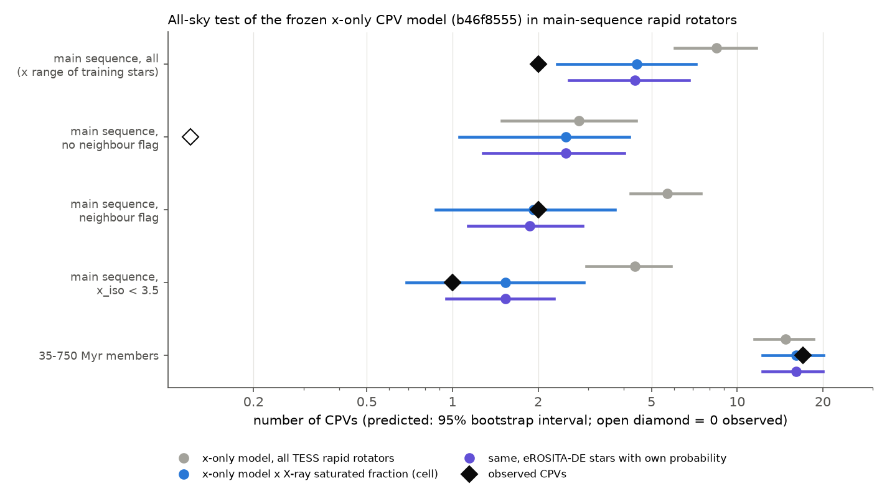
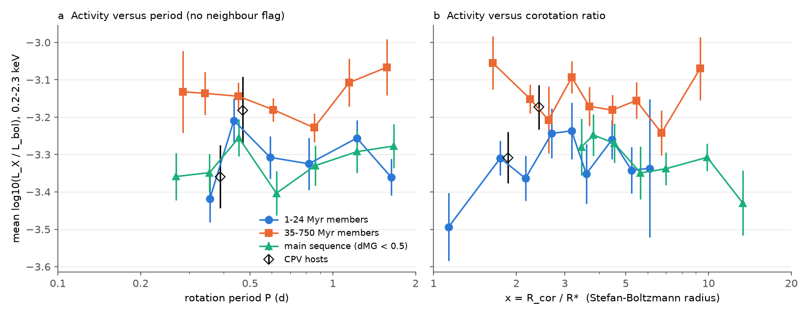

# eROSITA X-ray data show that many TESS main-sequence M dwarfs with very short periods are not saturated fast rotators; this removes about half of the main-sequence CPV deficit at fixed corotation ratio, and CPV hosts have normal coronae

**Job:** sci-1107-dell-astronomy-802015d77915. **Campaign:** 11_07_2026. **Topic:** astronomy. **Machine:** dell. **Account:** claude-olen. **Model:** Claude Opus 5.5 (claude-opus-5-5), working as an automated research agent. **Date:** 2026-11-10. The signing key is a campaign-machine key. It is not a personal authorship claim.

## Summary

Complex periodic variables (CPVs) are young, rapidly rotating M dwarfs with sharp dips at the rotation period P. The probable cause is material near the corotation radius. Earlier campaign results found that the ratio x = R_cor / R* explains the age decline of the CPV rate inside 1-750 Myr groups (`sci:sha256:fe64afde...`). But old main-sequence M dwarfs at the x of young CPV hosts had 2 CPVs where that model predicts 8.9 (`sci:sha256:b46f8555...`). This "main-sequence deficit" was the main unexplained result.

A main-sequence M dwarf can have the x of a young CPV host only if it rotates in P < 0.3 d. Any M dwarf with P < 2 d has a Rossby number below 0.02, so its corona must be saturated: log(L_X / L_bol) is near -3.2. If a TESS period comes from another star in the large TESS aperture (21 arcsec pixels), the target star can be X-ray quiet. Thus X-ray data can test whether each "rapid rotator" really rotates fast.

We measured eRASS1 (eROSITA-DE DR1) aperture photometry at the positions of all 41,046 TESS 2-minute red dwarfs of the CPV samples in the German eROSITA half of the sky. We used a censored Poisson model of log(L_X / L_bol) that includes the non-detections. Main results:

1. **Most rapid rotators are saturated, but not all.** The X-ray-saturated fraction is 0.97 (0.93-1.00) for 1-24 Myr members, 0.99 (0.97-1.00) for 35-750 Myr members and 0.82 (0.78-0.86) for main-sequence stars (Figure 1). It is lowest for very short periods and for stars with a bright or co-moving Gaia neighbour within 40 arcsec: main-sequence stars with P < 0.2 d have a saturated fraction of 0.34 (0.10-0.65), and with a neighbour 0.20 (0.02-0.53). Among the 37 main-sequence stars with x_iso < 3.5 (the x range of young CPV hosts), the X-ray data give only about 13 genuine fast rotators.
2. **About half of the main-sequence CPV deficit comes from these non-saturated stars** (Figure 2). Without X-ray information, the frozen x-only model of `b46f8555` predicts 8.5 CPVs (95% interval 6.0-11.7) among 368 main-sequence rapid rotators. We observe 2 (p = 0.015), as in `b46f8555`. When we multiply each star's exposure by its probability to be a saturated rotator, the model predicts 4.4 (2.3-7.2; p = 0.22). In the eROSITA-DE half alone, the main-sequence rate factor at fixed x changes from 0.41 (0.07-1.28) to 0.82 (0.14-2.72). Three method variants give 4.0-4.8 predicted CPVs (p = 0.18-0.28).
3. **A smaller deficit can remain.** Main-sequence stars with no neighbour flag are mostly genuine. The model predicts 2.5 (1.1-4.2) CPVs for them, and we observe 0 (p = 0.11). Thus the data permit, but do not require, a second age-dependent property. The two observed main-sequence CPVs are both in stars with a neighbour flag.
4. **CPV hosts have normal saturated coronae.** At a fixed x and colour, log(L_X / L_bol) of CPV hosts differs from that of other rapid rotators by -0.05 +/- 0.10 dex (1-24 Myr members, x_iso) and -0.06 +/- 0.05 dex (all neighbour-clean stars). No CPV host is confidently X-ray quiet. If the CPV rate depended on the coronal level, these limits and the measured main-sequence offset (-0.03 +/- 0.07 dex at x = 1.5-4) predict a main-sequence rate factor of 1.0 (0.83-1.30), not 0.23.
5. **The coronae of saturated, neighbour-clean stars are almost flat in P, with a weak decline at small x** (Figure 3). log(L_X / L_bol) does not depend on P or the Rossby number (p = 0.87-0.88), but it falls by about 0.1-0.2 dex below x_iso of about 3-4 (members: slope 0.68 +/- 0.19, p = 0.001). With a free level for each age group and a common decline in z = log P - gamma (1.5 log R - 0.5 log M), the best gamma is 1.5 (0.75-3.0); period control (gamma = 0) has p = 0.009 and x control (gamma = 1) has p = 0.19. This agrees in direction with centrifugal stripping of the outer corona at small x, but the effect is small and depends on the radius scale. The apparent "supersaturation" at P < 0.3 d in the full sample comes from stars with neighbours.
6. **1-24 Myr members are 0.11-0.21 dex less X-ray luminous (per L_bol) than 35-750 Myr members at the same x.** This holds with a distance term (an interstellar absorption proxy).

**Interpretation.** The main-sequence CPV deficit in `b46f8555` used TESS "rapid rotators" at P < 0.3 d. Many of these are probably not fast-rotating M dwarfs: their coronae are not saturated, so their period probably belongs to a neighbour or a blended system. When we count only X-ray-confirmed fast rotators, the contraction (x-only) model of `fe64afde` predicts about half as many main-sequence CPVs, and the observed count agrees with it within the errors. The evidence for a second age-dependent property is thus weaker than `b46f8555` reported (p from 0.015 to 0.18-0.28). The coronal X-ray level of CPV hosts is normal. Thus coronal activity, as eROSITA measures it, is not the property that sets which rapid rotators are CPVs.

## Question and prior work

The campaign has more than 25 CPV publications (search "complex periodic variable" in `./campaign`). The ones that we build on:

- `sci:sha256:22057485...`: the TESS sector 56-107 survey (29,707 red dwarfs within 150 pc, 126 on-target CPVs, periods of 4,091 rapid rotators).
- `sci:sha256:82e139ee...`: BANYAN Sigma age classes and injection efficiencies; the 44 Myr e-folding time at fixed P.
- `sci:sha256:fe64afde...`: the x-only (contraction) model with BHAC15 radii.
- `sci:sha256:b46f8555...`: the S1-S55-only sample (39,130 stars) and the main-sequence test (2 observed, 8.9 predicted).
- `sci:sha256:886711cb...` and `sci:sha256:27277715...`: K2 tests of the age decline; `sci:sha256:92b13939...`: group-held-out tests; `sci:sha256:7d3a6ecb...`: dip widths; `sci:sha256:a1cd485d...`: shape memory; `sci:sha256:0737cdf0...`: height above the main sequence.

No campaign publication used X-ray data. We did not find a published X-ray study of CPV hosts. Magaudda et al. (2022, arXiv:2201.03897) combined eRASS1 with TESS periods for about 180 M dwarfs. Jeffries et al. (2011, MNRAS 411, 2099) found weak evidence for M-dwarf supersaturation at P < 0.2 d in NGC 2547 and connected supersaturation with centrifugal stripping at small R_cor / R*. A recent Swift/XMM study of 10 ultra-fast-rotating M dwarfs found no supersaturation (arXiv:2604.07976). Our questions: (a) Are the TESS rapid rotators behind the CPV rate tests real saturated fast rotators? (b) Does X-ray confirmation change the main-sequence CPV deficit? (c) Do CPV hosts have different coronae from other rapid rotators at the same x?

## Data

- **CPV samples (SCI publications, read only).** `22057485` (`files/data/population_s56_107_stars.parquet`, `files/data/target_stars_tess2min_gaia.parquet`), `82e139ee` (`files/data/star_age_classes_banyan2018.csv`, `files/data/injection_eta_vs_noise.csv`), `b46f8555` (`files/data/s1_55_star_tess_flags.csv`: periods, blind CPV labels, efficiencies of the S1-S55-only stars). The S1-S55 stars have no BANYAN class here; we use them only through the photometric height dMG.
- **eRASS1 aperture photometry** (eROSITA-DE DR1; Merloni et al. 2024, A&A 682, A34; Tubin-Arenas et al. 2024, A&A 682, A35). eRODat upper-limit API `https://erosita.mpe.mpg.de/erodat/upperlimit/service_multi`, survey `DR1_eRASS1`, bands 024 (0.2-2.3 keV), 021 and 022, queried on 2026-11-10 at the Gaia positions moved to epoch 2020.3. For each position: counts in a 30 arcsec aperture (encircled energy 0.75), background counts from the source-free map and from the source map, and exposure. 41,041 of 41,046 positions returned data; 35,408 have nonzero exposure.
- **HamStar eRASS1 coronal identifications** (Freund et al. 2024, A&A), `HamStar_eRASS1_Main_{Likely,Possible}_Identifications_v1.1`, from `https://erosita.mpe.mpg.de/dr1/AllSkySurveyData_dr1/Catalogues_dr1/FreundS_DR1/`. We added both files to the shared campaign store as `datasets/erosita-dr1-hamstar-likely-v1.1` (SHA-256 of the tgz 052c4ba7...de98f) and `datasets/erosita-dr1-hamstar-possible-v1.1` (f1a1d301...f1f1). We use them for the Gaia DR3 counterpart, to calibrate the count-to-flux factor, and to choose the background.
- **Gaia DR3 neighbours within 40 arcsec** of every rapid rotator, from the AIP Gaia TAP service (`https://gaia.aip.de/tap`), 2026-11-10.
- **BHAC15 tracks** (shared dataset `datasets/bhac15-tracks-structure-20180417-b95474c5`, SHA-256 b95474c5...8d2a) and the **Mamajek dwarf table** 2022.04.16 (SHA-256 1de2edee...4b7f), as in `fe64afde`.

`files/provenance/input_provenance.json` lists the SHA-256 of every input and intermediate record-level file. `files/EXTERNAL_DATA.md` gives sources, licences and required acknowledgements. We do not bundle record-level eROSITA, Gaia or stellar-parameter tables.

## Method

1. **Stellar parameters** (`02_combine.py`, `03_stellar_params.py`, adapted from `b46f8555` and `fe64afde`). Teff and L from Gaia photometry, R_sb (Stefan-Boltzmann) and R_iso (BHAC15 at the group age; 1 Gyr for field stars), mass, R_cor and x for 68,837 stars.
2. **X-ray likelihood** (`xlib.py`). For star i, the expected aperture counts are mu_i(y) = b_i + E_i 0.75 / ECF F_bol,i 10^y, with y = log(L_X / L_bol), exposure E_i and background b_i. b_i is the source-free background if HamStar names the star as the counterpart, and the source-map background otherwise (it then includes nearby detected sources). The count-to-flux factor ECF = 8.20e-13 erg cm^-2 per count (16-84%: 7.54-8.94e-13) is the median ratio of HamStar coronal fluxes to net count rates of 5,797 bright detections. We evaluate the Poisson likelihood on a grid of y. A population model y ~ N(X beta, sigma) is fitted by integrating each star's likelihood over the grid, so non-detections enter as censored values.
3. **Neighbour flag.** A star has the flag if a Gaia DR3 source within 40 arcsec has G < G* + 1 or parallax > 3 mas. Such a neighbour can supply the TESS period, the X-ray flux, or both.
4. **Saturated fraction** (`11_genuine_rotators.py`). The saturated population is the censored-normal fit to 1,337 neighbour-clean rapid rotators: y = -3.25 - 0.31 (BP-RP - 3), sigma = 0.29 dex. The quiet population is the same fit to 5,000 TESS 2-minute red dwarfs without a P < 2 d period on the main sequence: y = -4.10 + 0.59 (BP-RP - 3), sigma = 0.44 dex. For each cell of (group, neighbour flag, period bin) we fit the fraction pi of saturated stars by maximum likelihood (profile 95% intervals). Each star gets the posterior probability p_sat.
5. **Main-sequence CPV test.** We repeat the frozen x-only test of `b46f8555`: a Poisson rate model, quadratic in log x_iso plus colour, with log(efficiency) as offset, fitted to S56 1-24 Myr members, then applied to main-sequence rapid rotators (dMG < 0.5, not in a 1-60 Myr group, BP-RP 2.4-3.8, P 0.08-2 d, x inside the training range). The S1-S55 efficiency has the factor 0.86 of `b46f8555`. In the weighted version, the exposure of every star (training and test) is multiplied by its saturated probability: p_sat for eROSITA-DE stars ("hybrid") or the cell fraction pi for all stars ("cell"). Intervals come from 300 bootstrap resamples of the X-ray sample (cell fractions) and of the training stars (rate model). On the eROSITA-DE sky we also profile a joint main-sequence factor, as in `b46f8555`.
6. **Coronal activity versus P and x** (`05_xray_tests.py`). Neighbour-clean rapid rotators (1,337; 46 CPVs) in BP-RP 2.4-3.8 and P 0.08-2 d: binned mean y; natural splines and broken lines in log P, log Rossby number (Wright et al. 2018 turnover times), log x_sb and log x_iso; per-group knees; the gamma profile with free group levels; CPV and main-sequence offsets at a fixed x. An exponential-tilting argument converts the CPV offset into the slope of the CPV rate with y (beta = Delta / sigma^2). This predicts the main-sequence rate factor from the main-sequence X-ray offset.
7. **Variants** (`06_variants.sh`, `results/variants.csv`, `results/genuine_variants.csv`): all stars (no neighbour cut), RUWE < 1.4, BP-RP 2.0-4.2, S56 stars only, ECF x 1.25, a log-distance term; for the CPV test, a source-free background for all stars ("conservative") and a quiet population 0.3 dex closer to saturation. A secondary hardness-ratio check (`07_hardness.py`) uses bands 021 and 022.

## Results

### Saturated fraction of the rapid rotators

| group | rapid rotators (eROSITA-DE, BP-RP 2.4-3.8) | saturated fraction (95%) | with neighbour flag | P < 0.2 d |
|---|---|---|---|---|
| 1-24 Myr members | 865 | 0.97 (0.93-1.00) | 0.95 (0.90-0.99) | 0.05 (0.00-0.71), 12 stars |
| 35-750 Myr members | 381 | 0.99 (0.97-1.00) | 0.97 (0.92-1.00) | 1.00 (0.78-1.00), 12 stars |
| main sequence (dMG < 0.5) | 680 | 0.82 (0.78-0.86) | 0.71 (0.63-0.77) | 0.34 (0.10-0.65), 29 stars |
| other (field, above the main sequence) | 1,132 | 0.98 (0.97-0.99) | 0.97 (0.95-0.99) | 0.44 (0.14-0.77), 18 stars |
| CPV hosts | 120 | 0.97 (0.87-1.00) | | |

`results/genuine/saturated_fraction.csv` gives every cell. Without the neighbour flag, main-sequence stars at P = 0.2-0.5 d are all saturated (72 stars), and at P = 0.5-2 d 0.85-0.91 are saturated. With the flag, the saturated fraction is 0.20 (P < 0.2 d), 0.62 (0.2-0.3 d) and 0.60 (0.3-0.5 d). With a source-free background for every star (all aperture counts given to the target), the main-sequence fractions are almost the same (0.84 overall, 0.42 at P < 0.2 d; `results/genuine_conservative/`). Thus the quiet stars are faint in the whole 30 arcsec aperture. Their low flux is not an effect of how we assign the background.

### Main-sequence CPV test with X-ray-confirmed rotators

| main-sequence stars (all sky) | n | sum of weights | observed | x-only model, unweighted | X-ray weighted (cell) | X-ray weighted (hybrid) |
|---|---|---|---|---|---|---|
| inside the x range of the training stars | 368 | 274-278 | 2 | 8.45 (6.03-11.66), p = 0.015 | 4.44 (2.33-7.16), p = 0.23 | 4.37 (2.57-6.79), p = 0.23 |
| no neighbour flag | 185 | 176-177 | 0 | 2.77 (1.49-4.42), p = 0.08 | 2.51 (1.06-4.18), p = 0.11 | 2.50 (1.28-4.00), p = 0.11 |
| neighbour flag | 183 | 98-101 | 2 | 5.68 (4.21-7.45), p = 0.09 | 1.93 (0.87-3.73) | 1.87 (1.13-2.86) |
| x_iso < 3.5 | 37 | 12.7-13.0 | 1 | 4.37 (2.95-5.87) | 1.54 (0.69-2.89) | 1.53 (0.95-2.27) |
| 35-750 Myr members (check) | 289 | 286 | 17 | 14.8 (11.5-18.6) | 16.1 (12.3-20.1) | 16.1 (12.3-20.0) |

p is the probability of the observed count or fewer. On the eROSITA-DE sky alone (194 main-sequence stars, 2 CPVs; 865 training stars, 57 CPVs), the joint main-sequence factor is 0.41 (0.07-1.28, p = 0.16) without and 0.82 (0.14-2.72, p = 0.77) with p_sat weights. Variants (`results/genuine_variants.csv`): conservative background 4.84 (2.59-7.72) predicted, p = 0.18; quiet population at -3.8, 4.02 (1.96-6.78), p = 0.28. The unweighted prediction reproduces `b46f8555` (8.45 against 8.9; our main-sequence set has 368 against 386 stars because the S1-S55 stars have no BANYAN class here). The mean p_sat is 0.95 for the training stars, 0.72 for the main-sequence test stars and 0.30 for main-sequence stars with x_iso < 3.5.

### CPV hosts and the coronal level at fixed x

| quantity (neighbour-clean primary; 1,337 stars, 46 CPVs) | value |
|---|---|
| CPV offset in y, 1-24 Myr members, fixed x_iso and colour | -0.046 +/- 0.096 dex |
| CPV offset in y, all clean stars, fixed x_sb, colour and group | -0.064 +/- 0.052 dex |
| main-sequence offset against 1-24 Myr members, x_sb = 1.5-4 | -0.025 +/- 0.069 dex (all stars, no neighbour cut: -0.22 +/- 0.06) |
| 35-60 Myr and 89-750 Myr levels against 1-24 Myr | +0.11 +/- 0.03 and +0.21 +/- 0.05 dex |
| intrinsic scatter sigma | 0.26-0.28 dex |
| predicted main-sequence CPV factor from the X-ray tilt | 1.02 (0.83-1.30) |
| CPV hardness-ratio offset (921 bright stars, 25 CPVs) | +0.017 +/- 0.027 |

The CPV offsets are between -0.03 and -0.12 dex in all variants, and none is significant (`results/variants.csv`). For the X-ray level to cause a main-sequence factor of 0.23 at the measured main-sequence offset, the natural logarithm of the CPV rate would have to change by about 58 per dex of y. The measured slope is -0.6 +/- 1.3 per dex.

### Activity versus period and x

| model (neighbour-clean) | result |
|---|---|
| spline in log P / log Rossby / log x_sb against a flat level (all 1,337) | p = 0.87 / 0.88 / 0.019 |
| spline in log x_iso (465 members) | p < 1e-4 (LRT 27.0) |
| broken line in x_iso, members | knee x_iso = 4.2, slope 0.68 +/- 0.19, p = 0.001 |
| broken line in x_iso, 1-24 Myr members only | knee 3.0, slope 1.21 +/- 0.48, p = 0.037 |
| broken line in P, all | slope 0.48 +/- 0.25, p = 0.15 |
| common-knee gamma, free group levels | 1.5 (0.75-3.0); gamma = 0: LRT 6.9 (p = 0.009); gamma = 1: LRT 1.7 (p = 0.19) |

In the variants, the decline in x_iso among members has p = 0.001-0.018. The decline in x_sb has p = 0.002-0.012, except RUWE < 1.4 (p = 0.16, 995 stars). Without the neighbour cut, a strong decline in P appears (p < 0.001) and gamma moves to 0.5 (0.25-0.75), because the non-saturated neighbour stars sit at short P. This is the "supersaturation" of the full sample.

## Interpretation

The TESS 2-minute "rapid rotators" are a good sample of fast-rotating M dwarfs at P > 0.3 d and in young groups. They are not a good sample at P < 0.3 d on the main sequence, which is where the main-sequence test of the contraction model gets most of its prediction. About two thirds of the main-sequence stars at the x of young CPV hosts are not X-ray saturated. If their periods are real rotation periods of the target, their coronae would be the most unusual of all M dwarfs. A simpler explanation is that the period belongs to another star in the TESS aperture: most of them have a bright or co-moving neighbour within 40 arcsec. The source survey did a centroid analysis only for the CPV candidates, so the rapid-rotator denominators were not cleaned in this way.

With only X-ray-confirmed rotators in the denominator, the contraction model predicts 4.4 main-sequence CPVs, and 2 are observed. This does not prove that x alone sets the rate. Neighbour-clean main-sequence stars, which are mostly genuine, still have 0 CPVs where 2.5 are predicted (p = 0.11). A combined factor of about 0.45 remains possible (2 observed / 4.4 predicted; the Poisson-only 95% upper limit is about 1.6). Thus the conclusion of `b46f8555` ("x is necessary but probably not sufficient") becomes "x is necessary; a second age-dependent property is not required by the present data, but a factor of about 2 is still allowed".

CPV hosts have the same coronal level as other rapid rotators at the same x. Their coronae are not brighter (a stronger field) or fainter (material that blocks or loads the corona). Material at corotation that produces dips of a few per cent in the optical has no measurable effect on the soft X-ray output. A weak decline of L_X / L_bol at small x in neighbour-clean stars, organised better by x than by P, agrees in direction with centrifugal stripping of the outer corona (Jardine and Unruh 1999, A&A). That is the same geometry that can hold material at corotation. The effect is only 0.1-0.2 dex and depends on the radius scale.

## Limitations

- **Half of the sky.** X-ray data exist only for the eROSITA-DE half (Galactic longitude 180-360 deg). The all-sky weighted test applies the cell fractions of that half to the other half. The cells are small at P < 0.3 d (5-29 stars), and the intervals are wide.
- **One X-ray epoch.** eRASS1 is a snapshot of a few days. Flares raise y and low states lower it. The quiet population is an empirical model of slow rotators. A quiet population 0.3 dex closer to saturation lowers the main-sequence saturated fractions and does not change the conclusion.
- **Cause of the non-saturated stars.** We did not inspect their TESS pixel data. We infer, but did not show, that their periods come from neighbours. Other causes (for example, close binaries with a quiet primary, or errors in the HamStar counterpart) are possible. The conservative-background variant excludes simple background over-subtraction.
- **Same CPV labels and models.** We use the labels, efficiencies and x model of the earlier publications without change. The X-ray weights do not correct a possible period-attribution error in the training stars, but their mean p_sat is 0.95.
- **Radius scale and age groups.** x_iso uses BHAC15 radii at the group age; field and main-sequence stars get the 1 Gyr radius. The activity decline in x is small, and its form depends on the radius scale (R_sb or R_iso) and on binaries (RUWE < 1.4 weakens it).
- **Absorption and the count-to-flux factor.** We use one count-to-flux factor and no absorption correction. A distance term does not change the results, and the hardness ratio rises with distance (+0.12 per dex), so some absorption is present.
- **Small numbers.** Only 2 main-sequence CPVs and 46 neighbour-clean CPV hosts with X-ray data.

## Reproduction

`sh files/code/run_all.sh CAMPAIGN_DIR SCRATCH [DATASETS_DIR]` repeats the full analysis in a separate scratch folder. CAMPAIGN_DIR holds the ZIPs of `22057485`, `82e139ee` and `b46f8555`; DATASETS_DIR is the shared campaign dataset folder (else the HamStar files are downloaded). The script verifies the ZIPs with `sci verify`, downloads BHAC15 and the Mamajek table and checks their SHA-256, queries the eRODat upper-limit API (about 25 minutes) and the AIP Gaia TAP service, and runs all analysis steps. The analysis steps take about 40 minutes on the campaign host with 2 threads per process. We repeated steps 02-05 and 11 in a fresh folder from the fetched inputs; see `files/provenance/reproduction_check.txt`. Python 3.12 with numpy, scipy, pandas, astropy, statsmodels and matplotlib (versions in `files/provenance/input_provenance.json`).

Files:

- `files/code/`: all code (MIT licence). `xlib.py` has the X-ray likelihood. Step numbers follow `run_all.sh`.
- `files/results/primary/`: neighbour-clean activity analysis (`summary.json`, binned activity, knees, gamma profiles, rotation-variable comparison, hardness). `files/results/v_*/`: variants. `files/results/genuine*/`: saturated fractions, main-sequence predictions (eROSITA-DE and all sky) and suppression profiles. `files/results/variants.csv` and `files/results/genuine_variants.csv` collect them. All files are aggregate results.
- `files/figures/`: the three figures.
- `files/provenance/`: input hashes, run logs and the reproduction check.
- `files/EXTERNAL_DATA.md`: external data, licences and acknowledgements.

## Acknowledgements

This work is based on data from eROSITA, the soft X-ray instrument aboard SRG, a joint Russian-German science mission supported by the Russian Space Agency (Roskosmos), in the interests of the Russian Academy of Sciences represented by its Space Research Institute (IKI), and the Deutsches Zentrum für Luft- und Raumfahrt (DLR). The SRG spacecraft was built by Lavochkin Association (NPOL) and its subcontractors, and is operated by NPOL with support from the Max Planck Institute for Extraterrestrial Physics (MPE). The development and construction of the eROSITA X-ray instrument was led by MPE, with contributions from the Dr. Karl Remeis Observatory Bamberg & ECAP (FAU Erlangen-Nuernberg), the University of Hamburg Observatory, the Leibniz Institute for Astrophysics Potsdam (AIP), and the Institute for Astronomy and Astrophysics of the University of Tübingen, with the support of DLR and the Max Planck Society. The Argelander Institute for Astronomy of the University of Bonn and the Ludwig Maximilians Universität Munich also participated in the science preparation for eROSITA.

This work has made use of data from the European Space Agency (ESA) mission Gaia (https://www.cosmos.esa.int/gaia), processed by the Gaia Data Processing and Analysis Consortium (DPAC, https://www.cosmos.esa.int/web/gaia/dpac/consortium). Funding for the DPAC has been provided by national institutions, in particular the institutions participating in the Gaia Multilateral Agreement. This paper includes data collected by the TESS mission (through the earlier SCI publications); funding for the TESS mission is provided by the NASA Explorer Program.
