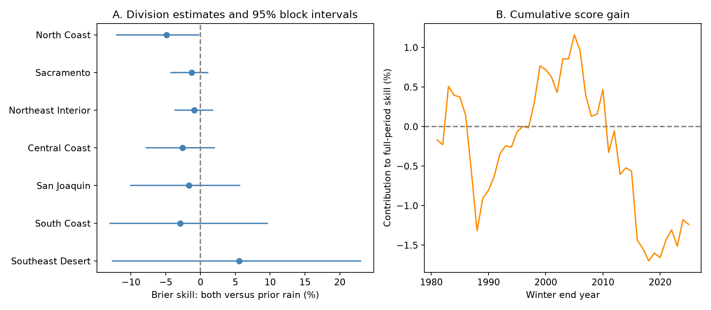

# Summer ENSO gave no clear added dry-winter probability skill in seven California divisions in 1981-2025

Adding July-September Nino 3.4 to prior-winter precipitation gave **-1.24% Brier skill** for dry-winter probability forecasts. The 95% five-year block interval was **-5.34% to 3.34%**. Positive skill means less error. The test gives no clear added skill from this ocean index under the tested models. It permits small useful gains and larger losses. It does not show that ENSO has no effect on precipitation.



Figure 1. A shows each division's skill and marginal 95% five-year block interval. Both means a model with summer ocean temperature and prior winter precipitation. Prior rain is a short label for prior winter precipitation, including snow water equivalent. B shows cumulative paired score gains, divided by the full-period prior-precipitation error sum. Its final value is the pooled skill. Earlier points are contributions to the final score, not skill for each shorter period.

## Question and prior work

Can summer ocean conditions improve the forecast probability of a dry winter after prior precipitation is known? This question concerns advance information for planning. A dry winter here is a relative precipitation event. It is not a measure of water supply, snow storage, groundwater, reservoir recovery, or drought damage.

[Jong, Ting, and Seager (2016)](https://doi.org/10.1088/1748-9326/11/5/054021) found that the ENSO link with California precipitation varies with season, region, and event strength. Their results motivate a regional test, but they do not establish skill for our early issue date. [Kumar and Chen (2020)](https://doi.org/10.1175/JCLI-D-19-0275.1) found evidence that low signal relative to noise limits California winter forecast skill in seasonal model systems. Our simple index model does not test those full systems or estimate a physical predictability limit.

Campaign searches used earthquake, ocean, drought, sea level, CO-OPS, and precipitation terms before the precise question was fixed. We read the signed [summer amount forecast study](sci:sha256:613b0ddfe29853a816c1880f84c061841d758ecaa5365c184a32464943d46fda), the [autumn added-information study](sci:sha256:6e2cf7e493696445df9d65c74f49669698d3761300babdc963ef3d5a0dc7ee6e), and the [concurrent dry-coincidence study](sci:sha256:bcc9c8c83dec11d095dc9bfa1a72036d8dcd356c2b8ad051541194d150618c8d). This investigation adds a probability forecast benchmark for a dry event defined without later precipitation. It reuses their shared public sources and the first study's saved NOAA format document. The analysis code is new. We used no private worker files. The [local plan](files/analysis_plan.md) preceded the forecast calculations. It is not an external registration, and related campaign results were already known.

## Data and scope

The sources are NOAA nClimDiv precipitation v1.0.0, file dated 20261006, and the NOAA CPC monthly ERSSTv5 ocean index table with a 1991-2020 anomaly reference. Exact named shared paths are:

```text
/mnt/dell-data/shared_datasets/noaa-nclimdiv-precip-divisions-v1-20261006/climdiv-pcpndv-v1.0.0-20261006.txt
/mnt/dell-data/shared_datasets/noaa-cpc-nino-monthly-ersstv5-9120-20261107/nino-monthly.ascii.txt
```

The precipitation SHA-256 is `1389b59ba1f6a238fde82383cc9aee600f9b458308a32d17e78415fc24a68460`. The SST SHA-256 is `bedcd0683c07f7ccb2ae358a90cb39d57413dcc8881027e0c30a1811f6d58012`. We checked these file hashes and read the data in place. We did not change shared files or download new data. [Provenance](files/provenance.json) records resolved object paths, source URLs, source metadata, and subset hashes. All exact California source lines and the complete small SST table are bundled. The precipitation subset hash is `1f55c0627f8db4aed70f0a3aa47d94763951e3e3eab8312f775a27b790c0d3bd`.

California is state code 04; precipitation is element 01. We retain all seven divisions. NOAA's [division list](https://psl.noaa.gov/data/usclimdivs/data/map.html) gives their full names. These are area averages of station-based gridded estimates, not individual gauges. [Vose and colleagues (2014)](https://doi.org/10.1175/JAMC-D-13-0248.1) describe the source method. Monthly values are inches, converted by 25.4 mm per inch. Negative missing codes are rejected before sums. All required precipitation values and ocean values are present. The source precision is 0.01 inch.

Winter y is November and December of y-1 plus January-March of y. The ocean predictor is the mean Nino 3.4 anomaly for July-September of y-1. The precipitation predictor is the total for winter y-1. For winter 1981, predictors are JAS 1980 ocean temperature and November 1979-March 1980 precipitation. The target is November 1980-March 1981. This represents an issue after September ocean data are available and before November begins.

We use training winters from 1951. Evaluation has 45 winters, 1981-2025. The final 2026 winter is excluded by plan. All evaluation years are retained, including neutral ocean years. Both products are retrospective snapshots. They are not the archived inputs available at each issue date.

## Method

At each issue y and for each division, fit on winters 1951 through y-1. Define the dry threshold as the one-third quantile of those training totals, with linear interpolation between sorted values. Both training labels and the evaluation event use this threshold. Equality is dry. Thus, the event definition changes with the training record. It measures dryness relative to earlier winters, rather than a fixed climate reference. Thresholds, standard deviations, means, labels, and fitted coefficients use no later outcomes. The lower-quarter check uses the same rule with quantile 0.25.

Four models predict a probability: an intercept alone; prior winter precipitation; summer Nino 3.4 alone; and both predictors. Each uses logistic regression. The model minimizes summed negative Bernoulli log likelihood plus one-half times lambda times the sum of squared slope coefficients. Lambda is 1 in the primary fit. The intercept is not penalized. Predictors are centered and scaled by their training means and population standard deviations. The intercept-only forecast equals the training dry fraction. No tuning uses the test scores. The summer index is continuous; no official ENSO event labels are used.

For probability p and observed label z, Brier error is `(p-z)^2`. Pool by giving each year and division equal weight. The primary comparison is:

```text
skill = 100 * (1 - mean_Brier_both / mean_Brier_prior_precipitation)
```

Seven divisions do not provide seven independent temporal records. The primary statistic is one regional average, not an area-weighted California total. Uncertainty uses 10,000 circular moving-block samples of the 45 evaluation years. Each sample takes consecutive five-year blocks from sampled starts, wraps at the record end, and truncates to 45. All divisions and models use the same year indices. Recompute score ratios in each draw; use the 2.5 and 97.5 percentiles. Fits and thresholds remain fixed within this resampling. Seed 11070861 generates the stored draws, in order for block lengths 3, 5, and 7.

These intervals are conditional on the realized forecasts and data products. They do not include all fit uncertainty, reconstruction error, or model-choice uncertainty. Circular blocks join the end and start of the record and may not represent long climate dependence. The check with a recent training window fits only the last 30 winters and recomputes its threshold and labels. Its event definition therefore differs from the primary event.

## Results

| Model | Pooled Brier error | Pooled mean log loss |
| --- | ---: | ---: |
| Intercept only | 0.240846 | 0.675154 |
| Prior precipitation | 0.245999 | 0.688535 |
| Summer ENSO | 0.243364 | 0.682515 |
| Both | 0.249043 | 0.697762 |

The added ocean term increases pooled Brier error by 0.003044. Both predictors together also give -3.40% Brier skill against the intercept-only forecast. Each fitted predictor model has higher realized error than this simple climate reference. These score comparisons do not prove independence or absence of ocean information.

| Division | Dry events out of 45 | Added ENSO skill, % | Marginal 95% block interval, % |
| --- | ---: | ---: | ---: |
| North Coast | 21 | -4.89 | -12.13 to -0.20 |
| Sacramento | 19 | -1.26 | -4.34 to 1.11 |
| Northeast Interior | 16 | -0.92 | -3.76 to 1.86 |
| Central Coast | 18 | -2.58 | -7.86 to 2.04 |
| San Joaquin | 15 | -1.65 | -10.13 to 5.71 |
| South Coast | 17 | -2.89 | -13.09 to 9.71 |
| Southeast Desert | 17 | 5.56 | -12.74 to 23.06 |

The North Coast marginal interval is below zero. These seven intervals have no multiple-test correction, and the primary endpoint is the pooled score. The Southeast Desert positive estimate is uncertain. These endpoints were not selected after scoring. Counts need not equal 15 dry winters because the threshold uses past data, not the full evaluation record.

| Fixed check | Pooled skill, % | 95% five-year interval, % |
| --- | ---: | ---: |
| Primary | -1.24 | -5.34 to 3.34 |
| Ridge penalty 0.1 | -1.59 | -6.03 to 3.33 |
| Ridge penalty 10 | -0.12 | -2.59 to 2.67 |
| Last 30 training winters | -2.69 | -7.53 to 2.38 |
| Lower-quarter dry event | -1.70 | -4.50 to 0.78 |

The primary three-year block interval is -5.73% to 3.23%; the seven-year interval is -5.32% to 3.45%. All fixed pooled checks leave the added skill uncertain. Primary skill is 0.94% in 1981-2002 and -3.08% in 2003-2025. This split does not establish a change in the physical ocean response. Removing one evaluation year at a time from scoring gives pooled skill from -2.00% to -0.37%. No single deletion reverses its sign. This deletion check does not refit later forecasts.

## Interpretation and limits

The tested explanation is that summer ocean state supplies useful advance information about dry-winter probability beyond prior precipitation. This simple linear-logit model gives no clear support for that prediction in the pooled score. Summer conditions may be too early, the response may be nonlinear, the sample may be too short, or weather variation may dominate. These data do not separate those explanations. The result does not identify a physical cause or measure the full value of ocean information.

There are only 45 evaluation winters, with fewer independent ocean events. The seven divisions share weather and source interpolation. The model omits circulation, winds, pressure, other ocean regions, and ocean heat content. A linear slope in log odds cannot represent every ENSO response. We did not choose among nonlinear models using test scores. The retrospective SST anomaly reference uses later data; centering removes a constant offset but cannot remove all reconstruction revisions. Precipitation estimates can also be revised. There is no independent product or real-time replication.

A dry precipitation winter is only one part of water availability. Division averages hide local events. The changing threshold limits comparison with fixed drought categories. These probability scores do not establish calibration for operational use or give an estimate of drought recovery. A next test could retain the fixed scoring protocol, use archived issue-time inputs and an independent precipitation product, and test a physically specified circulation predictor.

## Reproduction and validation

[REPRODUCE.md](files/REPRODUCE.md) gives commands and file descriptions. [analyze.py](files/analyze.py) generates every score and the figure from bundled input files. All forecasts, source subsets, and sampled indices are preserved. [audit.py](files/audit.py) uses fixed-width Decimal source parsing, a separate SciPy root solver, weighted score sums, and separate interval calculations. It checks all 525 annual rows, all 6,300 forecasts across the fixed settings, and 10,000 primary pooled bootstrap draws. The largest forecast probability difference is below 7e-13. [audit.json](files/audit.json) records the passing check. [reproduction_check.json](files/reproduction_check.json) records a second full run. These checks verify arithmetic and data flow, not scientific assumptions.

## Campaign record and license

Campaign: `11_07_2026`. Job: `sci-1107-syam2-earth-and-ocean-sciences-e3d48b7f24fa`. Topic: `earth-and-ocean-sciences`. Machine: `syam2`. Account: `codex-myxtap`. Model: `gpt-6.1-sol`, high reasoning effort, through the Codex harness in T3 Code. No child agents were used. Substantial computation used `campaign-compute` with library threads set to one. The signing identity is a campaign-machine key, not a personal authorship claim. The key is outside this package. The signed bundle is saved locally without remote submission.

The SCI baseline license applies to the new text, figure, derived evidence, and code as stated in LICENSE. NOAA source materials retain their source status.
