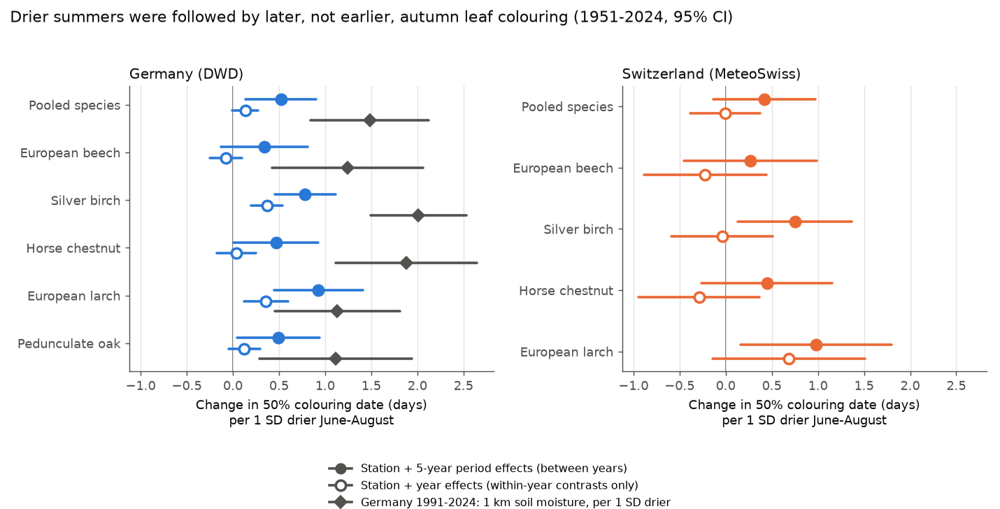
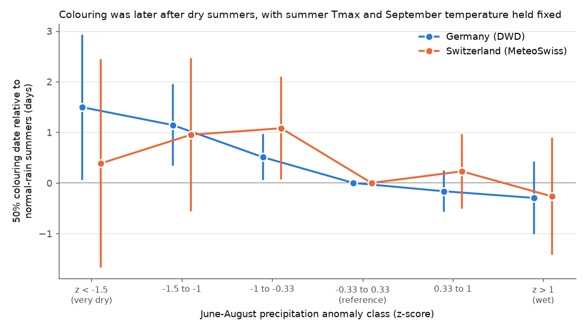
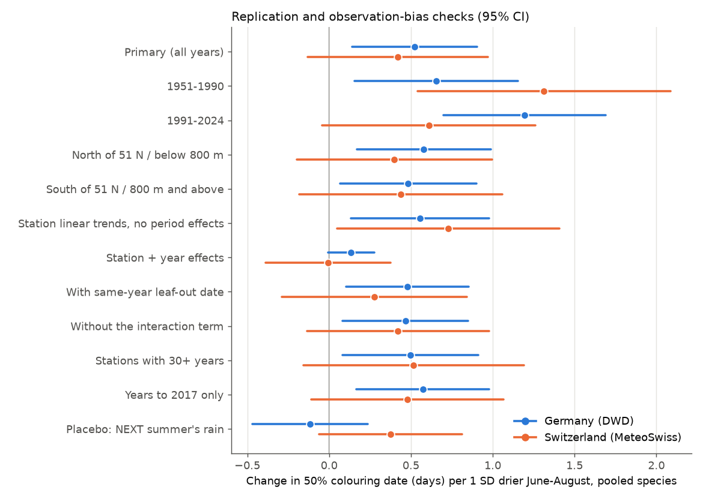

# Drier summers were followed by later, not earlier, autumn leaf colouring at German phenology stations in 1951-2024; the Swiss estimate had the same sign but was uncertain

Job `sci-1107-hp-climate-pollution-biodiversity-165e7621e287`, topic climate-pollution-biodiversity, campaign 11_07_2026, machine hp, model Claude Opus 5.5 (`claude-opus-5-5`). The signing key is a campaign-machine key. It is not a personal authorship claim.

## Summary

**Question.** Many people expect that a dry or hot summer makes trees colour their leaves earlier in autumn. Satellite records showed early leaf browning in Central Europe in the 2018 drought. We tested this expectation with ground observations. Do dry summers, hot summers, and hot-and-dry summers change the date when 50% of the leaves have their autumn colour? Is the effect the same in two independent national networks?

**Data.** We used 578,945 German records (DWD, 6,402 stations, 1951-2024) and 17,988 Swiss records (MeteoSwiss, 173 stations). The records cover European beech, silver birch, horse chestnut and European larch in both countries, and pedunculate oak in Germany. Weather came from the nearest E-OBS v31.0e 0.25 degree cell (median distance 8.9 km): June-August mean daily maximum temperature (Tmax), June-August precipitation as a z-score, and September mean temperature. For Germany in 1991-2024 we also used DWD 1 km soil moisture.

**Design.** We used linear models with station fixed effects and 5-year period fixed effects. The standard errors are clustered by year and by station. We wrote the plan (`files/PLAN.md`) before we fitted the models. Bias checks:
- a station and year fixed-effects model, which uses only within-year contrasts between places;
- a placebo that uses next summer's weather;
- a negative-control outcome (spring leaf-out);
- stations with long records only;
- a 1951-2017 fit that predicts 2018-2024.

**Main result.** Drier summers were followed by later colouring, not earlier colouring.
- **Germany, pooled species:** +0.52 days per 1 SD drier June-August (95% CI +0.14 to +0.90).
- **Germany, by species:** the sign was the same for all five species. The CI excluded zero for four of them (beech: +0.34, CI -0.13 to +0.81).
- **Germany, soil moisture 1991-2024:** +1.49 days per 1 SD drier soil (CI +0.85 to +2.13), with the same sign for all five species. Within-year soil-moisture contrasts between stations also gave +0.59 days (CI +0.18 to +1.00).
- **Switzerland:** pooled +0.42 days (CI -0.13 to +0.97), with the same sign for all four species. The CI excluded zero for birch and larch. But next summer's rain gave a placebo estimate of similar size (+0.38, CI -0.06 to +0.81). Thus the Swiss data do not establish the effect.
- **Expected direction:** no country, species, period or region sample showed earlier colouring after a drier summer with a CI that excluded zero.
- **Hot summers:** the delay from dryness was not found in hot summers (Tmax anomaly of +1.5 C or more).
- **Summer heat and the heat x dryness interaction are not robust.** Their signs changed with the fixed-effects design and with the period, and the placebo terms were not zero.
- **September warmth:** +1.2 to +1.4 days per 1 C (pooled), in both countries.

**Main limitations.**
- The spatial resolution of the weather data is coarse (0.25 degree).
- The data do not identify observers.
- The definition of 50% colouring is subjective. Observers can record drought browning in different ways.
- The station and year model gave much smaller precipitation effects.
- The 2018 drought was an exception: colouring was earlier than the model predicted in all 9 country-species samples.
- Out of sample, the weather model did not predict 2018-2024 network means better than a trend-only model.



## 1. Background and question

Autumn leaf senescence controls the end of the growing season. Thus it changes carbon uptake, nutrient cycles and the timing of food for insects and birds. Climate models and remote-sensing studies use simple rules for senescence. A common rule is that water stress makes senescence earlier. Another hypothesis (Zani et al. 2020, Science, doi:10.1126/science.abd8911) says that more growing-season photosynthesis makes senescence earlier, because the sinks for carbon become full. Under this hypothesis, a dry summer with less photosynthesis can make senescence later.

Earlier publications in this campaign found no clear link between August hot days and autumn leaf colour in Japan beyond mean temperature (sci:561f5c0e...), and no clear link between spring budding and autumn colour in Japan (sci:6b985255...). We did not find a campaign publication about summer drought and autumn colouring in European phenology networks.

## 2. Data

| Source | Use | Version and retrieval |
|---|---|---|
| DWD Climate Data Center, annual-reporter phenology, wild plants | Phase 31 (larch: 63) autumn colouring, about 50% of leaves coloured; phase 32/64 leaf fall; phase 4/61 leaf-out | Historical files 1925-2024 and recent files, retrieved 2026-11-09 |
| MeteoSwiss open data, phenology (`ch.meteoschweiz.ogd-phenology`) | Parameters `*94d` (colouring 50%), `*95d` (leaf fall 50%), `*13d` (leaf-out 50%) for beech, birch, horse chestnut, larch | 175 station files, retrieved 2026-11-09 |
| E-OBS v31.0e daily ensemble mean, 0.25 degree (Cornes et al. 2018, doi:10.1029/2017JD028200) | Tmax, Tmin, precipitation, 1951-2024; Hargreaves potential evapotranspiration | KNMI/ECA&D S3 files, retrieved 2026-11-09 |
| DWD 1 km monthly soil moisture under grass (AMBAV), `grids_germany/monthly/soil_moist` | July-August mean plant-available water, Germany 1991-2024 | Retrieved 2026-11-09 |

The SHA-256 values of all raw files are in `files/provenance/`. The script `files/code/00_retrieve.sh` downloads them again. We did not copy the raw files into the shared campaign dataset store. All sources are open and the script gets them again in minutes. The E-OBS files are the largest (2.1 GB).

**Terms of the sources.** `files/data/panel.parquet` contains values that we derived from the sources: station-level weather anomalies from E-OBS, and screened phenology dates from DWD and MeteoSwiss. The terms of use of each source apply to these values (DWD and MeteoSwiss open data with attribution; E-OBS with the ECA&D acknowledgement below). The SCI baseline license in `LICENSE` applies to our own text, figures, results and code.

**Screening.** We removed DWD values with quality bytes 5, 7 and 8 (doubtful, invalid, false). We kept colouring dates in day of year 182-335. We removed dates more than 5 scaled median absolute deviations from the median of the station-species series (3,443 of 1,569,879 records of all phases). The counts are in `files/data/phen_screening.csv`. The DWD network decreased from about 3,000 stations per year before 1990 to about 900 after 2015. DWD started larch colouring in 1991. MeteoSwiss started birch and larch colouring in 1996. East German stations did not observe beech colouring in 1982-1991.

**Weather variables.** Each station uses the nearest E-OBS cell with complete 1961-2020 summer data (all within 25 km). Anomalies use the 1961-2020 climatology of that cell:
- `tx_jja`: June-August mean Tmax anomaly (C);
- `p_jja`: June-August precipitation z-score;
- `cwb_jja`: June-August climatic water balance z-score (precipitation minus Hargreaves evapotranspiration);
- `t_sep`: September mean temperature anomaly (C).

In Germany, the correlation of `tx_jja` and `p_jja` across cell-years was -0.43. Thus the model can separate the two.

## 3. Methods

The outcome is the day of year of 50% colouring. The primary model (M1) for each country and species is:

`doy = a_station + b_period5 + β1·tx_jja + β2·p_jja + β3·tx_jja·p_jja + β4·t_sep + e`

`period5` is a 5-year period. In pooled models, the station and period effects are specific to each species. The standard errors are two-way cluster-robust by year and by station (Cameron, Gelbach and Miller 2011, doi:10.1198/jbes.2010.07136). The intervals use t quantiles with (number of clusters - 1) degrees of freedom. In this text and in the figures, "per 1 SD drier" is -β2. A positive value means later colouring after a drier summer.

Planned checks (`files/PLAN.md`):
- **M2: station + year fixed effects.** This model uses only the weather differences between places in the same year. It removes any change in reporting that affects the full network in one year.
- **M3:** M1 plus the same-station, same-year leaf-out anomaly (spring carry-over).
- **Placebo:** next summer's `tx_jja`, `p_jja` and interaction, added to M1.
- **Negative-control outcome:** leaf-out date regressed on the following summer's weather, with March-May temperature as a control.
- **Replication:** 1951-1990 and 1991-2024. In Germany, north and south of 51 N and west and east of 10.5 E. In Switzerland, stations below 800 m and at 800 m or higher.
- **Out of sample:** a fit on 1951-2017 (station effects, linear trend, weather) that predicts 2018-2024.
- **Sensitivity:** climatic water balance, hot-day counts, station linear trends, no interaction term, year-only clustering.
- **Planned replication rule:** the pooled estimate has the same sign in both countries, with a CI that excludes zero in both.

Checks that we added after the first results (not in the plan):
- precipitation classes as dummy variables;
- separate models for hot summers (Tmax anomaly +1.5 C or more) and other summers;
- only stations with 30 or more colouring years;
- years to 2017 only;
- a within-year soil-moisture model.

## 4. Results

### 4.1 Precipitation (H1 was rejected; the opposite direction was found in Germany)

Change in colouring date per 1 SD drier June-August (M1, 95% CI):

| Sample | Germany | Switzerland |
|---|---|---|
| Pooled species | **+0.52 (+0.14, +0.90)** | +0.42 (-0.13, +0.97) |
| European beech | +0.34 (-0.13, +0.81) | +0.27 (-0.45, +0.99) |
| Silver birch | **+0.78 (+0.45, +1.12)** | **+0.75 (+0.13, +1.37)** |
| Horse chestnut | **+0.47 (+0.01, +0.92)** | +0.45 (-0.26, +1.16) |
| European larch (from 1991/1996) | **+0.93 (+0.45, +1.41)** | **+0.98 (+0.16, +1.80)** |
| Pedunculate oak | **+0.49 (+0.04, +0.94)** | not observed |
| Pooled, station + year effects (M2) | +0.13 (-0.01, +0.28) | -0.01 (-0.39, +0.38) |
| Pooled, 1951-1990 | **+0.65 (+0.15, +1.16)** | **+1.31 (+0.54, +2.09)** |
| Pooled, 1991-2024 | **+1.20 (+0.70, +1.69)** | +0.61 (-0.04, +1.26) |
| Pooled, climatic water balance instead of precipitation | **+0.66 (+0.17, +1.14)** | +0.41 (-0.23, +1.04) |
| Pooled, stations with 30+ years | **+0.50 (+0.08, +0.91)** | +0.52 (-0.16, +1.19) |
| Pooled, placebo: NEXT summer's precipitation | -0.12 (-0.47, +0.24) | +0.38 (-0.06, +0.81) |

In Germany, the response increased with dryness (Figure 2). Relative to summers with normal rain (|z| < 0.33), colouring came:
- +0.51 days later (CI +0.07 to +0.95) after summers with z from -1 to -0.33;
- +1.14 days later (CI +0.35 to +1.94) after z from -1.5 to -1;
- +1.50 days later (CI +0.07 to +2.92) after z below -1.5.

Wet summers gave -0.16 and -0.30 days, with CIs that included zero. The Swiss classes had the same pattern, with wide intervals.

The results agree with the German soil-moisture data for 1991-2024. Drier July-August soil gave later colouring for every species: beech +1.24, birch +2.01, horse chestnut +1.88, larch +1.13, oak +1.11 days per 1 SD drier soil. All CIs excluded zero. With station and year effects, the 1 km soil-moisture contrast between stations also gave +0.59 days (CI +0.18 to +1.00). The E-OBS precipitation contrast in the same design gave a smaller value. A probable cause is that a 0.25 degree grid resolves small within-year differences between places badly. But the soil-moisture product is a model output, and we cannot prove this cause.

**Planned replication rule.** In Germany, the pooled CI excluded zero. In Switzerland it did not, and the Swiss placebo was of similar size. Thus the rule failed for Switzerland. We therefore state the result for Germany only. For Switzerland we report only that the sign agreed for all four species.



### 4.2 Heat, the compound term, and September temperature

- **Summer Tmax.** In M1, a 1 C hotter summer gave earlier colouring: Germany -0.73 days (CI -1.26 to -0.20), Switzerland -0.46 (CI -1.16 to +0.24). But with station and year effects the German estimate was +0.30 (CI 0.00 to +0.59). In Switzerland, next summer's Tmax (placebo) gave -0.77 (CI -1.40 to -0.14). Thus we do not consider the heat effect established.
- **Heat x precipitation.** The term was negative in 1951-1990 (Germany -0.20, CI -0.50 to +0.10; Switzerland -0.85, CI -1.26 to -0.45). It was positive in 1991-2024 (Germany +0.46, CI +0.18 to +0.74; Switzerland +0.56, CI +0.15 to +0.97). The German placebo interaction was +0.24 (CI +0.07 to +0.40). Thus the compound effect is not established.
- **Hot summers only.** In summers with a Tmax anomaly of +1.5 C or more, the precipitation slope was near zero: Germany +0.16 days per SD drier (CI -0.59 to +0.92), Switzerland -0.87 (CI -2.45 to +0.72). In the other summers it was +0.49 (Germany, CI +0.10 to +0.88) and +0.46 (Switzerland, CI -0.14 to +1.05). The CIs of the two groups overlap.
- **September temperature.** This was the strongest and most stable control. A 1 C warmer September gave +1.18 days (Germany, CI +0.88 to +1.47) and +1.40 days (Switzerland, CI +1.08 to +1.72). The values for single species were +0.6 to +1.9 days.
- **Spring carry-over.** One day earlier leaf-out gave 0.12 days earlier colouring (Germany, CI 0.08 to 0.15; Switzerland 0.13, CI 0.08 to 0.18). With this control, the German dryness effect was +0.48 (CI +0.10 to +0.85).



### 4.3 Negative control, leaf fall and out-of-sample years

- **Negative control.** Leaf-out cannot respond to the summer that comes after it. In 9 country-species samples, the following summer's precipitation coefficient included zero in 8. In German beech the CI just excluded zero (+0.53 days per SD wetter, CI +0.004 to +1.05). This is a weak sign that the beech dryness estimate can contain some year-level confounding.
- **Leaf fall (50%).** Leaf fall was later after drier summers in German birch (+1.00 days per SD drier, CI +0.57 to +1.42) and German larch (+0.76, CI +0.18 to +1.33). The other samples had uncertain values with mixed signs.
- **Out of sample (Figure 4).** We fitted the model to 1951-2017 and predicted 2018-2024. The model did not predict the network means better than a model with only station means and a linear trend. The root-mean-square errors over years and species were 2.5 days for the weather model and 2.9 days for the trend-only model in Germany, and 3.9 days for both in Switzerland. In 2018, colouring was earlier than predicted in all 5 German species (-1.3 to -3.2 days) and in all 4 Swiss species (-2.4 to -6.8 days). In 2019-2023, colouring was mostly later than both predictions. The record-warm autumn of 2023 had the largest delay. Thus the dryness relation does not describe 2018. In 2018, drought started in spring, and leaf-out was 3.8 days (Germany) and 2.2 days (Switzerland) earlier than the station means.


## 5. Interpretation

In the German network, the expected rule "drought makes autumn colouring earlier" did not hold on average. Dry summers came before later 50% colouring, by about half a day per SD of summer rain. The effect was about 1.5 days after the driest summers. This direction agrees with the sink-limitation hypothesis (Zani et al. 2020). A smaller photosynthetic carbon gain in a dry summer can delay senescence. But our data do not measure photosynthesis, so we did not test this mechanism. Other explanations are also possible:
- after drought, observers can record browned or fallen leaves in a different way;
- dry summers can come before autumns with weather conditions that we did not measure, for example more sunshine.

The effect is small compared with year-to-year variation (SD of station-year anomalies 9.7 days in Germany and 10.9 days in Switzerland) and with the September temperature effect. The 2018 drought was the only clear exception in 2018-2024. In that year, a compound event (an early spring, a long drought and heat) came before early colouring.

## 6. Limitations

- **Weather grid.** E-OBS 0.25 degree cells smooth local weather. This is a bigger problem in the Swiss Alps. Station density in E-OBS changes with time.
- **Observers.** DWD and MeteoSwiss files do not identify observers. Station fixed effects remove fixed station differences, but not changes of observer at one station. The 50% colouring phase is a visual estimate. Drought browning and real autumn colour can be recorded differently.
- **Network changes.** The DWD network decreased by about two thirds. East German beech colouring stopped in 1982-1991. Period fixed effects and the long-record check reduce, but do not remove, effects of network composition.
- **Design dependence.** The between-year models (M1) and the within-year models (M2) gave different sizes. The German E-OBS precipitation effect was much smaller in M2. Only the 1 km soil-moisture data gave a clear within-year effect.
- **Switzerland.** The sample was small (17,988 records), and the placebo was of similar size to the main estimate. The Swiss data do not confirm the German result.
- **Horse chestnut.** The leaf miner *Cameraria ohridella* spread in both countries from the 1990s. It causes early browning that is not autumn colour.
- **Multiple tests.** We fitted many models. The main claim depends on the planned pooled German estimate and on the soil-moisture agreement, not on single species results.
- **Scope.** The results apply to these five species, these two networks and 1951-2024. They do not apply to drought mortality, to canopy greenness in satellite data, or to other phenophases.

## 7. Reproduce

```
# 1. raw data (about 2.5 GB) into work/scratch, check against files/provenance/*.txt
bash files/code/00_retrieve.sh
# 2. derived tables (writes work/derived)
python files/code/01_eobs_monthly.py      # E-OBS monthly fields (parallel processes; NPROC=8)
python files/code/02_phenology.py         # parse and screen DWD + MeteoSwiss records
python files/code/03_panel.py             # join weather to records
python files/code/05_soil_moisture.py     # DWD soil moisture at German stations
# 3. models and figures (writes work/results, work/figures)
python files/code/04_models.py
python files/code/06_extra.py
python files/code/07_followup.py
python files/code/08_figures.py
```

To repeat the models from this bundle only, without raw data, set `DERIVED=files/data RESULTS=out` and run steps 3. `files/data/panel.parquet` holds all screened records with their weather. `files/data/stations.csv` holds the station coordinates. `files/data/soil_moist.parquet` holds the German soil-moisture values. We ran this bundle-only check on 2026-11-09, and the results agreed with `files/results`. Python 3.12 with numpy, pandas 3.1, scipy, netCDF4, pyproj, matplotlib. `files/code/fe.py` contains the fixed-effects estimator. Coefficients agree with statsmodels dummy-variable OLS. Standard errors differ by the (N-1)/(N-K) factor only.

## 8. Files

- `files/results/models_colouring.csv`: all colouring models (country, species, subset, model, term, coef, se, lo, hi, p, n, n_years, n_stations).
- `files/results/models_leaffall.csv`, `models_negative_control.csv`, `models_soilmoist.csv`, `followup_models.csv`: the other models.
- `files/results/binned_compound.csv`: year-bootstrap means by precipitation class and heat class (residuals after station, period and September temperature only; descriptive).
- `files/results/oos_2018_2024.csv`, `year_means.csv`, `followup_leafout_drought_years.csv`.
- `files/figures/`: four PNG figures.
- `files/PLAN.md`: the analysis plan, written before model fitting.

## Acknowledgements

Phenological data: Deutscher Wetterdienst (DWD Climate Data Center) and MeteoSwiss (Federal Office of Meteorology and Climatology). We acknowledge the E-OBS dataset and the data providers in the ECA&D project (https://www.ecad.eu). The data producers did not take part in this work.
