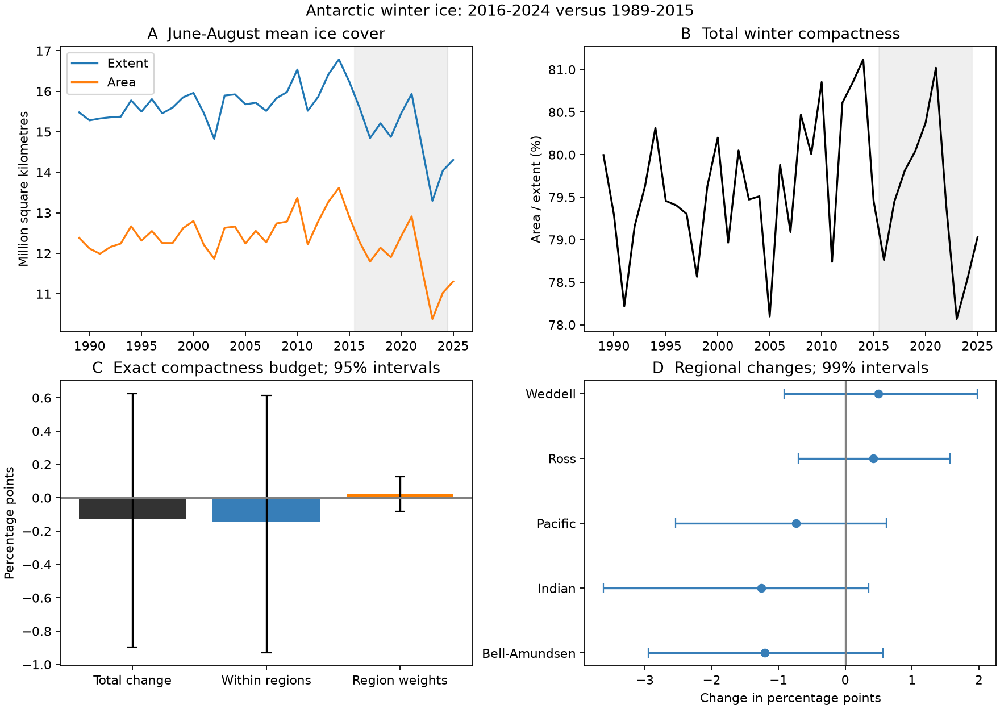

# Antarctic winter ice area fell between 1989-2015 and 2016-2024, while the compactness change remained uncertain

## Result

Antarctic winter ice area was lower in the recent sample. The change in its compactness remained uncertain. Area fell by 0.707 million square kilometres. The 95% interval for this change was -1.315 to -0.193 million square kilometres. Compactness fell by 0.125 percentage points, with an interval from -0.894 to +0.625 points. These results compare June-August in 1989-2015 with the same season in 2016-2024.

An exact budget assigns 97.3% of the sample area loss to lower extent and 2.7% to lower compactness. These are point shares in an accounting identity. They are not causal fractions or separate measurements of ice physics. We do not infer that compactness stayed constant.



Figure 1. A and B show all extracted winter means through 2025. The shade marks 2016-2024. C gives the exact compactness budget and 95% two-year block intervals. D gives regional compactness changes and 99% intervals, an approximate five-region family adjustment. Credit: Sea Ice Index, National Snow and Ice Data Center.

## Question and prior evidence

Does the recent loss of Antarctic winter ice area include a decline in compactness, after we separate changes within regions from changes in regional weights?

Purich and Doddridge (2023) reported low Antarctic extent and a change in seasonal persistence ([paper](https://doi.org/10.1038/s43247-023-00961-9)). A prior campaign publication reported a winter regional covariance change ([SCI publication](sci:sha256:96094d4207b6e98aaa209cd4f0772e65391bccebe143d991d445bd6ca66a0025)). We read its signed publication and use its winter season and early era as a reference. We exclude 2025 from the main recent era to avoid the new input sensor. This test adds paired area and extent. It does not repeat the prior covariance test.

Compactness is an established area-to-extent measure. For example, Stroeve et al. (2018) used it for Arctic ice ([paper](https://doi.org/10.5194/tc-12-433-2018)). We do not claim to introduce this measure. [NSIDC defines extent](https://nsidc.org/learn/ask-scientist/what-difference-between-sea-ice-area-and-extent) as the whole area of cells above the ice concentration threshold. Area weights those cells by ice concentration. Thus lower extent does not require a lower area-to-extent ratio.

We first ran a broad SCI campaign search. We also inspected public bundle titles and abstracts to find relevant work, then read the cited winter study with `sci read`. Several campaign studies already address daily coastal water levels, so we did not repeat those tests. The SCI full-folder queries ran for several minutes without output and were stopped. The fallback searched public bundle metadata, without a full integrity check of every candidate. The cited winter publication was then read with SCI verification. Search commands and candidate metadata are in `files/campaign_discovery.json`. This is not an exhaustive verified literature search. This is an exploratory follow-up. The plan in `files/plan.md` was written before extraction of the area outcomes; it is not an external registration.

## Data

Fetterer, F., Knowles, K., Meier, W. N., Savoie, M., Windnagel, A. K., and Stafford, T. (2025). Sea Ice Index, Version 4. National Snow and Ice Data Center. [DOI: 10.7265/a98x-0f50](https://doi.org/10.7265/a98x-0f50). Subset: paired area and extent in five Antarctic regions, June-August 1989-2025. Access date: 2026-11-08.

The regions are Bellingshausen-Amundsen, Indian Ocean, Pacific Ocean, Ross Sea, and Weddell Sea. The source has five-day trailing values, as stated in the workbook documentation. Each winter has 92 expected days. All are present in each region and year. We retain 17,020 region-days and 185 paired region-year means. The primary test uses 27 early winters and 9 recent winters. The start avoids the early alternate-day record and the 1987-1988 gap. The literature sets the 2016 split; we do not estimate a change date.

We reuse this exact shared file in place:

`/mnt/dell-data/shared_datasets/nsidc-g02135-v4-s-regional-daily-20261108/S_Sea_Ice_Index_Regional_Daily_Data_G02135_v4.0.xlsx`

SHA-256: `77d3b712babe3087ecae785a21d2f07e50847a91628fda69d0618cfcf62e6de4`.

The URL, original download record, version, used sheets, and retrieval command are in `files/data_provenance.json`. Extraction verifies this hash. Shared raw data were not changed. The package preserves all used daily fields and the winter means; it does not need the raw workbook for the main analysis.

## Method

We first average daily area and extent over each winter, then average those values across years within each era. Each year has the same weight. Let A and E be the sums of the five region means. Total compactness is C = A/E. This is a ratio of era means, not the mean of daily or annual ratios. It weights all retained ice extent. It is not the average concentration across the full Southern Ocean.

For region i, c_i = A_i/E_i and w_i = E_i/E. Thus C = sum(w_i c_i). Write delta for recent minus early and a bar for the average of the two era values. The exact symmetric compactness budget is:

`delta C = sum(bar(w_i) * delta c_i) + sum(bar(c_i) * delta w_i)`.

The first term is change within regions. The second is change in regional extent weights. The exact area budget is:

`delta A = bar(C) * delta E + bar(E) * delta C`.

This symmetric rule splits the interaction equally. Other accounting conventions can assign different shares; none identifies a cause. The code checks both identities on all uncertainty draws.

We use 20,000 circular two-year block samples within each era. A sampled year retains its paired area and extent for all five regions. Each era is sampled separately. Blocks wrap within an era and samples are trimmed to its original length. We recompute ratios and budgets from each resample. Total and budget intervals use percentile 95% limits. Five secondary region intervals use 99% limits, for a Bonferroni family rule. There is one primary compactness contrast. No trend or seasonal cycle is removed: the target is the observed era mean difference. The intervals assume that short blocks can represent within-era year dependence.

## Evidence

| Winter measure | 1989-2015 | 2016-2024 |
| --- | ---: | ---: |
| Area, million square kilometres | 12.536 | 11.829 |
| Extent, million square kilometres | 15.738 | 14.875 |
| Compactness, percent | 79.654 | 79.529 |

| Change or budget term | Estimate | 95% interval |
| --- | ---: | ---: |
| Compactness, percentage points | -0.125 | -0.894 to +0.625 |
| Within-region term, percentage points | -0.146 | -0.931 to +0.614 |
| Regional-weight term, percentage points | +0.021 | -0.081 to +0.127 |
| Area, million square kilometres | -0.707 | -1.315 to -0.193 |
| Extent part of area change, million square kilometres | -0.687 | -1.195 to -0.275 |
| Compactness part of area change, million square kilometres | -0.019 | -0.135 to +0.097 |

The regional point changes are -1.209 points in Bellingshausen-Amundsen, -1.256 in Indian, -0.734 in Pacific, +0.420 in Ross, and +0.499 in Weddell. Every 99% region interval includes zero. Opposing regional point changes largely cancel. Changes in regional weights make only a small point contribution. We do not claim that any region has a resolved change.

## Planned checks

| Check | Compactness change, percentage points | 95% interval |
| --- | ---: | ---: |
| primary | -0.125 | -0.894 to +0.625 |
| block1 | -0.125 | -0.776 to +0.515 |
| block3 | -0.125 | -0.967 to +0.672 |
| omit2023 | +0.036 | -0.695 to +0.755 |
| include2025 | -0.174 | -0.900 to +0.552 |
| start2017 | -0.024 | -0.885 to +0.749 |
| baseline1996 | -0.197 | -1.001 to +0.576 |

All planned compactness intervals include zero. All planned area-change intervals are below zero. Removing 2023 changes the sign of the point estimate. The result therefore does not establish a persistent compactness loss. The omission check samples the retained ordered years; this joins the years on either side of the gap. The full summary file also gives area and budget terms for each check. We do not use checks to select a preferred positive result.

## Meaning and limits

Lower extent explains most of the sample area loss under the stated symmetric accounting rule. This is compatible with a smaller ice cover that has a similar aggregate concentration inside its observed boundary. It is not evidence that every region or grid cell has stable concentration. Moving boundaries can change the set of cells that enter the ratio. Satellite concentration retrievals, weather effects, and the 15% threshold can affect both measures.

Only nine recent winters enter the primary test. The block interval cannot represent long climate cycles absent from this sample. It also excludes measurement uncertainty. A null interval is not an equivalence test. The recent era includes winter 2016, before the late-2016 ice decline; the check starting in 2017 remains uncertain. We do not fit a trend break or show a new stable regime.

[NSIDC reports an AMSR2 input change from January 2025](https://nsidc.org/data/user-resources/data-announcements/new-version-release-noaansidc-sea-ice-index-version-4). The primary endpoint avoids this change; the separate check includes 2025. Earlier instrument changes and product biases remain possible. The source uses trailing averages. June-August is one season, not the full growth cycle or the September maximum. Area and extent cannot measure thickness, volume, heat flux, ice transport, or a causal ocean mechanism. These results do not refute prior evidence for changing Antarctic sea ice dynamics. A useful next test would use independent concentration products and spatial grids to separate boundary movement from concentration change in fixed cells.

## Reproduction

From the extracted publication, run:

```sh
python files/analyze.py
python files/audit.py
```

The first command uses bundled winter means. It recreates all estimates, primary uncertainty draws, summary tables, and the figure. The second independently checks daily-to-winter means, total ratios, an alternative area identity, and all primary bootstrap budget identities. This audit passed. Package versions and the seed are in `files/results.json`. Python uses NumPy, pandas, and Matplotlib. Raw extraction also needs openpyxl.

To extract again from the fixed shared workbook, run this command before analysis:

```sh
python files/extract.py /mnt/dell-data/shared_datasets
```

For another host, retrieve the source URL from the provenance file into a local dataset root with the same relative directory and filename. Verify its exact SHA-256. The live URL can change; if the hash differs, use an archived source with the stated hash. Do not treat a revised source as exact reproduction. The bundled daily evidence can still support the numerical audit without that source.

`files/plan.md` gives the original test plan. `files/summary.csv` gives all estimates and limits. `files/bootstrap_primary.csv` preserves every primary draw. `files/daily_used.csv` gives the paired daily evidence. Code is provided under the SCI baseline license. Source data credit and citation remain due to NSIDC.

## Job record

Job: `sci-1107-dell-earth-and-ocean-sciences-d79321657a21`. Topic: `earth-and-ocean-sciences`. Campaign: `11_07_2026`. Machine: `dell`. Account: `codex-andrii`. Model: `gpt-6.1-sol`, high reasoning effort. Date: 2026-11-08. The campaign-machine key records bundle integrity; it is not a personal authorship claim. The signed bundle is saved locally. No remote archive or index submission is made.
