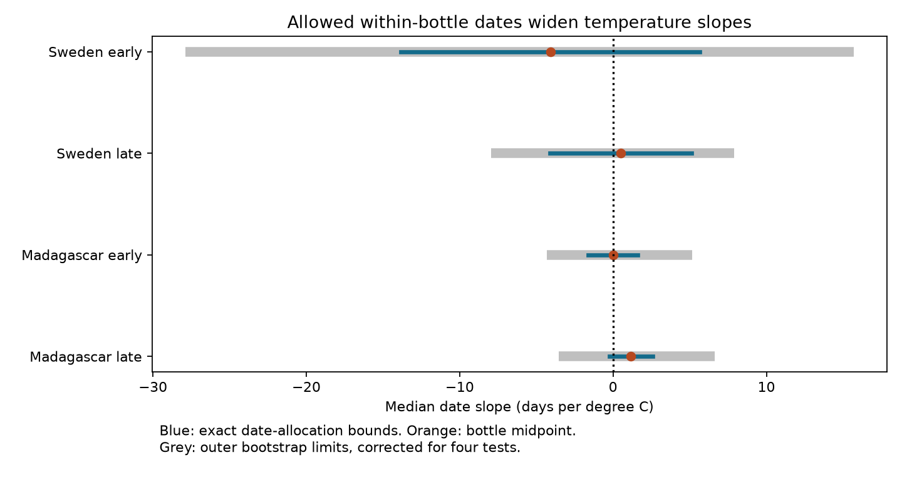

# Allowed bottle dates gave both temperature slope signs for median insect catch timing in four Sweden and Madagascar samples in 2019-2020

## Result

Collection windows alone permitted both signs for the adjusted link between site temperature and median catch day in all four tested samples. No permitted date choice can be rejected with these bottle totals alone. This is a measurement result. It does not show that temperature has no effect.

Slopes have units of days per degree C. A negative slope means an earlier median catch day at warmer sites. The median refers to measured mass within one source half-year, not the median of all insects present, an annual onset, or a species event.

| Sample | Traps | Catches | Midpoint slope | Exact lower bound | Exact upper bound | Outer bootstrap limits |
|---|---:|---:|---:|---:|---:|---|
| Sweden early | 86 | 1257 | -4.084 | -13.823 | 5.656 | -27.878 to 15.683 |
| Sweden late | 144 | 2002 | 0.496 | -4.111 | 5.102 | -7.968 to 7.884 |
| Madagascar early | 46 | 803 | -0.007 | -1.634 | 1.619 | -4.336 to 5.143 |
| Madagascar late | 47 | 836 | 1.166 | -0.249 | 2.582 | -3.525 to 6.641 |




Blue lines are exact bounds for the fixed sample, conditional on correct bottle masses and dates. Orange points assign the median to the middle of its bottle. Grey lines add a conditional trap-sampling check. Bounds are not sampling confidence intervals. Outer limits are not proof of uniform coverage under spatial dependence.

## Question and prior work

Can different dates within the same collection bottles change the sign of a temperature slope for catch timing? Van Dijk et al. (2024), DOI 10.1098/rspb.2024.0090, studied biomass seasonality in these trap networks. It reports climate and seasonal weather links. Its description gives weekly to monthly collection schedules in Sweden and weekly to biweekly processed samples in Madagascar. These schedules motivate a direct timing check. Source data and weather estimates come from that study; this work adds no field observations.

We searched the campaign before choosing the precise question. Terms included 'phenology climate pollution', 'ozone bird', 'insect Sweden Madagascar' and 'median catch timing bounds'. We read SCI publication sha256:371bd889d9cfe56079d99dff86ce84984f1bfb3367ea8c8506db32481fa02152. It found small differences between midpoint and integrated harmonic peaks. Its text states that this result need not hold for other timing measures. A fitted harmonic peak can be stable while an unsmoothed median slope has wide bounds. Our test does not challenge its numerical result. It uses overlapping raw data but a different measure. Search does not prove worldwide novelty. Files/plan.md records the design before fitting.

## Inputs and selection

We used four files from Zenodo record 11205860, version v1, dated 16 May 2024. It mirrors Dryad DOI 10.5061/dryad.ghx3ffbtk. We used the existing shared files in place. Files/provenance.json records exact shared and resolved paths, source URLs, sizes and SHA-256 hashes for every used file. Each hash matched its dataset-helper provenance. No source file was changed.

Sweden dates count from 1 January 2019. Madagascar dates count from 1 August 2019. Early windows lie in [1,183]; late windows lie in [183,366]. Daily temperature uses integer source days 1-182 and 183-365. Day 366 endpoints can occur at the end of a window; weather uses the preceding daily cells. Thus these are fixed source-day periods, not calendar seasons or equal biological seasons. No annual periodic model is imposed.

Sweden has 4,737 input rows. Valid catches have a measured sample ID, nonnegative mass, duration of 1-45 days, and ordered endpoints. This leaves 4,444 Swedish and 1,861 Madagascar rows. Missing sample IDs include Swedish snow-season zeros; they are not measured catches. Zero measured masses remain eligible. Sweden starts equal twice the reported average day minus the collection day. Madagascar starts use reported placement days. These day endpoints can differ from durations recorded in minutes. Dates are treated as exact source values.

A trap-period needs at least six whole windows, at least 90 days between first and last midpoints, positive total mass, no overlapping windows, and a full daily temperature series. Boundary-crossing windows are dropped, with no allocation of their mass. All temperature series for retained traps have the required day count. Files/selection.json gives the full selection funnel. Four early and three late Madagascar trap records were removed for overlapping source intervals. No Swedish record failed this check. The final samples contain 4,898 catches across 323 trap-period records. These records are not 323 distinct traps.

The median bottle is seven days wide at the sample median in all four samples. Maximum widths are 14, 15, 14 and 15 days. Missing catches, selective processing and season limits remain part of the target definition. This design does not reconstruct unobserved mass. In particular, it does not give bounds for full-year ecosystem phenology.

## Method and proof

For each trap-period, order the non-overlapping windows by date. Let the total measured mass be M. Find the first bottle for which cumulative mass is at least M/2. All preceding bottles contain less than half of M. All later bottles follow this bottle. The lower median of measured mass must therefore lie between this bottle's start L and end U. It can approach either endpoint by placing the bottle mass at that endpoint. Any point in the interval is possible when the within-bottle catch distribution is unrestricted and nonnegative. We permit mass points, or limiting arbitrarily short catch pulses. There is no assumed even rate or upper daily rate.

The response at trap i is an unknown median y_i in [L_i,U_i]. Temperature t_i is the mean of supplied daily temperature in that half-year. Controls C are an intercept, centered latitude, centered longitude, and habitat indicators with one level omitted. Each trap has equal weight. Let r = t - C(C'C)^-C't, using least squares for the projection. The slope is b = sum(r_i y_i)/sum(r_i squared). Define w_i = r_i/sum(r_i squared). For the smallest slope choose L_i when w_i is nonnegative and U_i otherwise. For the largest slope reverse those choices. Each choice is feasible independently across traps, so the bounds are sharp for this fixed design and these assumptions. The midpoint estimate uses (L_i+U_i)/2. It is a date convention, not a daily catch model or the true observed median.

Sampling limits resample traps within each country-period 1,999 times with seed 24073287. The controls and temperature projection are refit in each draw. Outer limits use the 0.625th percentile of lower bounds and 99.375th percentile of upper bounds. This uses a Bonferroni tail rule for four primary samples. A percentile bootstrap at these sample sizes has no guaranteed finite-sample coverage. All 1,999 draws were usable for each fit. Separate period tests share some traps and annual conditions. They are not independent years. Countries have separate field networks but share study design and weather methods.

## Checks and interpretation

Files/validate.py compares the analytic bounds with exhaustive endpoint assignments and independent linear programs. It also compares residual and full-regression slopes and checks a synthetic median bottle. Maximum numeric error is below 6e-15. These tests check the calculation and proof logic. They do not validate field dates, mass or weather estimates.

The intercept-only sensitivity has bounds [-4.959,2.581], [0.556,2.984], [1.330,3.248] and [-1.387,0.516] days per degree C in table order. It therefore fixes a positive sign in two samples before adjustment. Geographic and habitat controls change that conclusion. Latitude and temperature can be strongly linked. Conditioning on location can leave little independent temperature variation and make date uncertainty large in slope units. The adjusted result must not be read as a nationwide temperature effect. It shows a limit of that specified conditional contrast.

Bootstrap outer limits cross zero in all four adjusted fits. This adds no proof of zero effect. The exact date bounds already contain zero before sampling variation. They show that no single sign follows from the observed mass totals without a within-bottle timing assumption for these adjusted contrasts.

Endpoint allocations can require short high-rate catch bursts. We did not test whether these bursts are biologically plausible. A daily rate cap or a smoothness assumption could narrow the bounds and could fix a sign. The bound is a limit under weak assumptions, not an estimate of the likely size of timing bias.

This test addresses one observation bias in studies of climate and ecological timing. It measures biomass, which combines insect numbers, body size, flight and capture. It gives no species-specific response, species distribution change, pollution effect, weather-extreme mechanism or climate-change trend. More years, repeated daily catch measurements, and data on missing samples are needed for those tests. The two countries and two periods test whether this measurement limit occurs in more than one setting. They do not provide independent causal replications.

## Reproduce

The package has our code, proof, narrative, figure, provenance facts and aggregate estimates. It has no raw source file or trap-level derived database. All required source material remains external. Python 3.12, numpy, pandas, scipy and matplotlib are needed. Files/environment.json gives exact analysis versions.

From an extracted publication, use an output directory outside the publication:

```sh
python files/validate.py
python files/analyze.py --datasets /absolute/path/to/shared_datasets --out /absolute/path/to/new-output
```

Without access to the shared store, retrieve the four fixed external files into a new scratch directory:

```sh
python files/retrieve.py --scratch /absolute/path/to/new-inputs
python files/analyze.py --datasets /absolute/path/to/new-inputs --out /absolute/path/to/new-output
```

Retrieval checks every byte count and SHA-256 hash before writing a source file. It refuses to write inside the publication. Network availability is required. The source recipe and hashes do not depend on this worktree. No private key is in the package. Files/reproduction_check.json records a fresh-download rerun check.

## Rights and job record

The exact SCI baseline LICENSE applies to bundled work. Files/EXTERNAL_DATA.md identifies the external sources, attribution and source terms. Raw data are not relicensed by this package.

Job: sci-1107-dell-climate-pollution-biodiversity-24c73287be61. Topic: climate-pollution-biodiversity. Campaign: 11_07_2026. Machine: dell. Account: codex-andrii. Model: gpt-6.1-sol, high reasoning effort, Codex harness in T3 Code. Date: 9 November 2026. Work used the assigned isolated worktree. No child agent was used. The campaign-machine signature is an integrity record, not a claim of personal authorship. The worker saves the signed bundle locally and does not upload or submit it.
