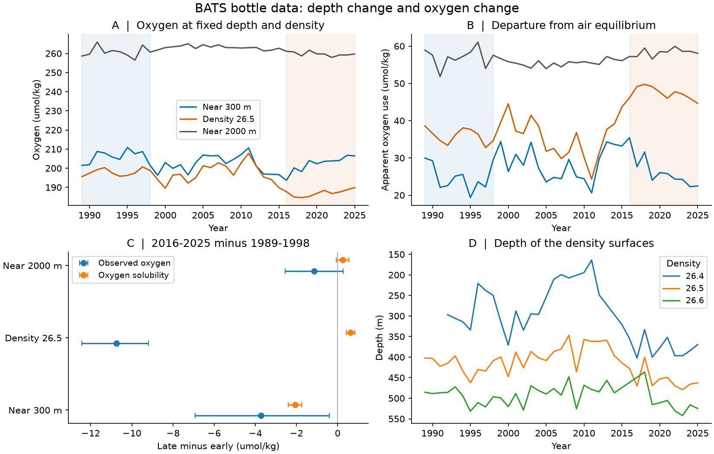
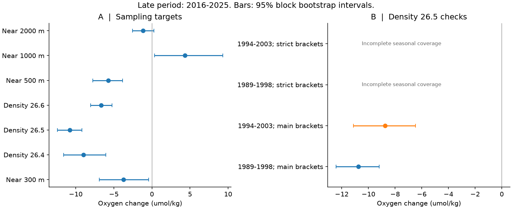

# BATS bottle records show a 10.8 umol/kg oxygen loss on the 26.5 density surface between 1989-1998 and 2016-2025

Job: sci-1107-hp-earth-and-ocean-sciences-1b21a5b32e50. Topic: earth-and-ocean-sciences. Campaign: 11_07_2026. Machine: hp. Account: codex-myxtap. Model: gpt-6.1-sol, high reasoning effort. Date: 10 November 2026 UTC (9 November at the work site).

The signing key is a campaign-machine key. The signature does not make a personal authorship claim.

## Question and result

Can vertical motion of water layers explain long-term oxygen change near Bermuda? We compared oxygen at fixed depths with oxygen on a fixed density surface. We used BATS bottle data, version 10. The two main periods were 1989-1998 and 2016-2025. We gave the 12 calendar months equal weight.

On the 26.5 density surface, mean oxygen fell from 197.88 to 187.12 umol/kg. The change was -10.76 umol/kg, or -5.44%. Its approximate 95% block bootstrap interval was -12.42 to -9.20. Oxygen solubility increased by 0.62 umol/kg. Thus lower solubility cannot explain this oxygen loss. Apparent oxygen utilization increased by 11.38 umol/kg.

This result rejects a model in which only the vertical position of an unchanged oxygen-density profile changes. It does not identify the cause of the change on the density surface. Water sources, transport, mixing, gas exchange and respiration can all affect that change. We did not estimate the fraction of the 300 m change caused by vertical motion.

The 300 m comparison gave a much smaller decrease. It also depended on the early period. At that depth, the change was -3.73 umol/kg against 1989-1998, but -0.55 against 1994-2003. The latter interval included zero. A fixed-depth record alone can therefore give a different view of change from a fixed-density record.



## Prior work and added evidence

Bates and Johnson reported surface oxygen loss at Bermuda through 2023 [1]. Stanley and colleagues used water-age tracers to study oxygen use in 2003-2006. They warned that a comparison with older oxygen data could contain measurement error [2]. Zhang and colleagues showed large effects of eddies on oxygen-layer depth at BATS in 1993-2024 [3]. These studies motivate separate tests for solubility, vertical motion and common measurement drift. Their results do not imply that these mechanisms explain all long-term changes.

A prior campaign publication used this same BATS source for surface carbonate chemistry [4]. Another used density surfaces to study oxygen off California [5]. This study adds a month-balanced Bermuda period comparison, a deep-water comparison and an explicit failure of the strict interpolation check. It is a new analysis of an existing record. It is not an independent data replication. It is not a test of the full eddy model in [3].

## Data and selection

The source is BCO-DMO dataset 3782, version 10, dated 24 July 2026, DOI 10.26008/1912/bco-dmo.3782.10 [6]. We reused the completed shared file in place:

`/mnt/dell-data/shared_datasets/bcodmo-3782-bats-bottle-v10-20260705/3782_v10_bats_bottle.csv`

The source file has 17,679,647 bytes. Its SHA-256 is:

`7c38d3c147b98c146f7dfb39b5b8b54ee10c8032e4a60b79014dd7fdcb509472`

The path is an HP SSD compatibility path. We did not access the failed disk. The source and all bottle, cast, cruise and monthly extracts stay outside this publication. The source license is CC BY 4.0. The separate notice gives attribution, changes and source terms. The original annual aggregates, figures and statistical results use the CC BY 4.0 part of the SCI baseline license.

We selected BATS Core cruises in 1989-2025. We kept bottles within 50 km of 31 degrees 40 minutes N, 64 degrees 10 minutes W. We required quality flag 2 for bottle, depth, temperature, oxygen and potential density anomaly. We used flag-2 bottle salinity, with flag-2 CTD salinity as a fallback. We required nitrate plus nitrite flag 2 for the secondary nutrient result. Oxygen and nutrients are in umol/kg in the source metadata [7].

The source had 78,822 rows. The Core selection in the study years had 72,315 rows. The site rule removed 13,654 of these rows before quality selection. The final joint oxygen and water-property selection had 16,179 bottles from 427 cruises. These are input counts, not independent sample sizes. The primary density comparison used 103 early and 101 late monthly means, with all 10 years and all 12 calendar months represented in each period.

## Method

The density coordinate is the supplied potential density anomaly, sigma theta, in kg/m3: potential density minus 1000 kg/m3. The primary surface is 26.5. This surface was at a mean depth of 422 m in the early period and 455 m in the late period. A density surface is not a material parcel tracked through time.

We interpolated within each cast. For depth targets, we used a bottle within 5 m directly if one was present. Otherwise we used linear interpolation with a maximum bracket width of 200 m. For density targets, both bottles had to bracket the target. Their density difference could not exceed 0.20 kg/m3, and their depth difference could not exceed 250 m. We did not extrapolate. We averaged casts within a cruise and cruises within a calendar month. We omitted a target-year if fewer than six months remained. The coverage file lists the retained target-years; the preparation audit lists omitted target-years.

We calculated sea pressure from depth and latitude, then calculated surface potential temperature from temperature and absolute salinity. GSW 3.6.23 supplied these conversions. Its O2sol_SP_pt function supplied air-equilibrium oxygen at one atmosphere from practical salinity and potential temperature [8]. Apparent oxygen utilization, AOU, is equilibrium oxygen minus measured oxygen. It is a diagnostic concentration difference, not a measured respiration rate.

For each period and variable, we first averaged years separately for each calendar month. We then averaged the 12 month means. The contrast is the late mean minus the early mean. This is a saturated period-by-month calculation with equal-month standardization. The local plan used the phrase month fixed effects; the code uses this explicit month-standardized contrast instead of a common period coefficient. The plan preceded target results but was not externally registered or independently timestamped.

We drew 6,000 circular moving-block samples of years independently within each ten-year period. The same year draws served all variables and targets. The main block length was three years. Checks used two and five years. A period or a bootstrap draw needed all 12 calendar months. A draw with an absent month stayed missing. We used the 2.5% and 97.5% quantiles of valid draws. For the primary oxygen contrast, 5,917 draws were valid. These are approximate sampling intervals, conditional on these periods, the block model and the retained samples. They do not include systematic measurement or interpolation errors.

We also subtracted the 2000 m monthly oxygen mean from each shallower target where both were present. We then repeated the month-balanced contrast. This paired comparison tests a depth-common additive drift explanation. It does not assume that deep oxygen is constant, and it does not rule out depth-specific measurement error.

## Results and checks

All changes below are late minus early. Oxygen, solubility and AOU use umol/kg. Intervals are approximate 95% intervals with three-year blocks.

| Quantity | Change | Interval |
|---|---:|---:|
| Oxygen near 300 m | -3.73 | -6.92 to -0.41 |
| Oxygen on density 26.5 | -10.76 | -12.42 to -9.20 |
| Solubility on density 26.5 | +0.62 | +0.41 to +0.83 |
| AOU on density 26.5 | +11.38 | +9.78 to +13.04 |
| Oxygen near 500 m | -5.71 | -7.75 to -3.84 |
| Oxygen near 1000 m | +4.33 | +0.33 to +9.32 |
| Oxygen near 2000 m | -1.15 | -2.56 to +0.27 |
| Density-26.5 oxygen minus 2000 m oxygen | -9.34 | -11.38 to -7.58 |

The primary density-surface loss stayed clear with two- and five-year blocks. With 1994-2003 as the early period, it was -8.75 (-11.13 to -6.46). With that later early period, the paired deep-reference contrast was -6.45 (-9.97 to -3.24). A depth-common additive drift alone does not explain these paired changes.

The adjacent 26.4 and 26.6 surfaces also had lower oxygen, by 9.00 and 6.67 umol/kg. These are secondary checks with weaker coverage. In particular, the 26.4 early period had only 43 monthly means from six years, and only 3,591 of its 6,000 bootstrap draws retained all months. Its interval has an extra coverage condition. The 26.6 late period had 72 months from eight years. These results are not separate independent discoveries.

The strict check allowed depth brackets of 125 m and density brackets of 0.10 kg/m3 with depth gaps of 150 m. It retained only 18 early and 15 late monthly means on density 26.5, from three early and two late years. Some calendar months were absent. We therefore report no strict month-balanced contrast or interval for this surface. We cannot claim robustness to this strict interpolation rule. Near 300 m, the strict check changed the main estimate only slightly, but the later-start null result remained.

Nitrate plus nitrite on density 26.5 increased by 1.21 umol/kg (+1.05 to +1.36), using 100 early and 91 late monthly means. This co-occurs with higher AOU in the main selection. It is consistent with a change in the balance of oxygen supply and nutrient regeneration. It cannot separate respiration from water age, source-water composition or mixing. We did not estimate a nutrient-to-oxygen ratio or use it to infer a respiration rate. Nutrient coverage was too poor in the strict check to test that result.



## Limits

This is one open-ocean site and two ten-year means. It does not measure a basin-wide change or establish a climate-forcing effect. The full annual series is not monotonic. These period contrasts do not estimate a permanent trend or a date of change.

The interpolation can span 250 m on a density surface. The strict check failed through loss of coverage. Unresolved profile curvature and sampling changes can therefore affect the effect size. Missing observations may depend on ocean conditions. The bootstrap does not correct such selection. It samples only ten years per period and cannot represent all decadal climate variability. Longer blocks need not give wider intervals in such short windows. Secondary intervals have no correction for multiple comparisons.

AOU combines circulation, mixing, source-water oxygen disequilibrium and biological oxygen use. It is not a direct ventilation measure. The deep comparison reduces concern about one common additive drift, but it cannot remove all calibration errors. Nutrient and deep-water changes are not perfect controls. The result is conditional on the source quality flags and the supplied density coordinate.

## Reproduce and inspect

Use Python 3.12 in a private environment. Install `files/code/requirements.txt`. Run from the extracted publication directory:

```sh
python -m venv /tmp/bats-study-env
/tmp/bats-study-env/bin/pip install -r files/code/requirements.txt
/tmp/bats-study-env/bin/python files/code/reproduce.py \
  --scratch /tmp/bats-study-data --output /tmp/bats-study-output
```

The script downloads the cited file into separate scratch and requires its exact SHA-256. If the source is unavailable or its version changes, it stops. To use the campaign copy, add:

```sh
--data /mnt/dell-data/shared_datasets/bcodmo-3782-bats-bottle-v10-20260705/3782_v10_bats_bottle.csv
```

Scratch and output must be outside the signed publication. `prepare.py` creates external record-level intermediates. `analyze.py` writes aggregate results and figures. `audit.py` checks the solubility units against documented numerical values, checks physical ranges and the oxygen budget identity, and independently recalculates month-balanced oxygen contrasts. The main results also passed a full rerun from the shared source file. See `files/results/reproduction_check.json` for file comparisons.

`contrasts.csv` includes all planned targets, periods, block lengths and interpolation settings, including absent results. `annual_aggregates.csv` contains season-adjusted annual means for inspection; those are plot values, not the primary period estimator. `coverage.csv` gives retained month counts. `primary_bootstrap_changes.npy` contains all main simulation draws; its column order is in `metric_array` in `analyze.py`. The settings, preparation audit, numeric audit and source provenance are included. No private scratch file is needed beyond the external source that the script can retrieve.

## References

[1] Bates and Johnson (2023). https://doi.org/10.3389/fmars.2023.1289931

[2] Stanley, Doney, Jenkins and Lott (2012). https://doi.org/10.5194/bg-9-1969-2012

[3] Zhang and colleagues (2026). https://doi.org/10.1029/2026GL123350

[4] Campaign publication on surface carbonate chemistry at HOT and BATS. sci:sha256:bcfea584e66fe62653da5d482d35630a8bae0ea26081226c20c3327e39c00128

[5] Campaign publication on oxygen change at depth and on density surfaces off California. sci:sha256:de98e51999096adfc943c89cd129c3a0b56e700ca2eaf0c1620c1b4adea4540c

[6] BATS and BCO-DMO (2026), bottle dataset version 10. https://doi.org/10.26008/1912/bco-dmo.3782.10 . Full contributor credit and source terms are in `files/NOTICE_external_data.txt`.

[7] BCO-DMO version 10 parameter metadata. https://erddap.bco-dmo.org/erddap/info/bcodmo_dataset_3782_v10/index.html

[8] GSW oxygen-solubility documentation. https://www.teos-10.org/pubs/gsw/html/gsw_O2sol_SP_pt.html . Garcia and Gordon (1992, with 1993 correction) oxygen-solubility coefficients.
