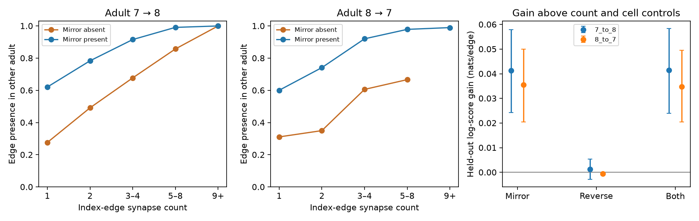

# Mirror-edge presence improved prediction of edge presence between two adult worm maps after count and cell controls

## Summary

We tested whether left–right wiring gives a useful marker of reliable connections. In two adult *C. elegans* nerve-ring maps, a connection was more likely to occur in the other animal if its left–right copy occurred in the first animal. This relation remained useful after controls for its own synapse count, source and target synapse totals, cell types, and same-side wiring. The result concerns observed chemical connections. It does not establish a mechanism for reliable neural activity.

Adding mirror-edge presence reduced held-out log loss by **0.0413 and 0.0355 nats per edge** in the two map directions. Nominal 95% source-family bootstrap intervals were **0.0243 to 0.0579** and **0.0205 to 0.0501**. The two directions use the same two animals and are dependent. They are not two independent replications.



Figure 1. Left and centre: edge presence in the other adult, by the index-edge count and mirror-edge presence in the index adult. These rates are descriptive. Strong-edge groups without a mirror have few observations. Right: gain in held-out log score above the baseline model. Error bars are nominal 95% bootstrap intervals over source families, with predictions fixed. Mirror means the simultaneous left–right exchange of both endpoints. Reverse means exchange of source and target.

## Question and prior work

Witvliet et al. (2021; doi:10.1038/s41586-021-03778-8) showed stable, changing and variable connections across development. Their study also reported changes in left–right symmetry. The campaign study `sci:sha256:fc45a3bbacfe312efc4feb894ffe1069894afd046e9d4dab9f1dba9dcc0e9f69` tested count dispersion between matching connections. We read that publication before analysis. It found low left–right dispersion for strong worm connections. Our test is different: it asks if mirror presence gives added prediction of connection presence in a different animal after controls for the measured edge count. We do not claim that bilateral symmetry or strong-edge reliability is a new finding.

The working hypothesis was that bilateral support marks a common circuit core more effectively than one edge count alone. A reverse connection was a comparison feature for local feedback structure. We used chemical wiring only. No neural activity data were linked. This work supplies a small test of a wiring-reliability marker that can later be tested against measured computation.

## Data and sample

We used primary synapse JSON files for Dataset7 and Dataset8 from the public Witvliet release at GitHub commit `0646af9d25896ae660f97d462eab2d67282f5625`. Both animals are adults at the reported 50-hour time point. These are separate animals, not repeat measurements of one animal. Counts are the number of synapse records for a directed source–target connection. A polyadic synapse contributes once for each listed target entry, as in the release analysis. A repeated name can count more than once. We also test unique target names per record below. Counts are not synapse size, physiological weight, or signed influence.

Raw data were reused in place through `./datasets`. `files/provenance.json` records exact resolved shared paths, source URLs, byte counts and SHA-256 hashes of the three files used: the two synapse tables and the release neuron-information code. The paths resolve through the shared dataset mount. No failed disk was read. `files/cells.json` contains a derived table of cell identity facts from that code: nerve-ring neuron membership, functional type, bilateral source family and opposite-side name. Upstream code is not included in this package. The analysis checks the hashes of all three upstream files before use.

We kept neurons in the release's brain list, removed muscle and other non-neural cells, and removed self edges. We required both endpoints and each endpoint's opposite-side partner to occur somewhere in both raw tables. We used only cells with names ending in L or R. This left 170 neurons. Presence somewhere in a synapse table is an imperfect coverage check: it does not prove full reconstruction of every possible connection.

For each direction, we kept only edges with at least one synapse in the index adult. Absence in the other adult was coded zero. Thus the sample tests the reproducibility of observed edges, not recovery of every possible connection. There were 1,706 index edges from adult 7 and 1,703 from adult 8, with 78 source families in each direction. Presence rates in the other adult were 66.35% and 66.47%. Audits found no repeated synapse-ID lists. However, 65 of 3,578 records in adult 7 and 84 of 3,674 in adult 8 had repeated target names (`files/audit.json`). These entries can represent multiple contacts with the same cell. We tested their effect by counting each target name only once per record.

## Method

For edge A→B in index map X, mirror presence means that opposite(A)→opposite(B) has at least one synapse in X. Reverse presence means that B→A has at least one synapse in X. All predictors use only X. The label is presence of A→B in the other map Y.

We fit logistic regressions with an L2 penalty, C=1. Numeric columns were standardized on training data only. The baseline had these inputs:

- Synapse-count categories for counts 1 through 19 and a category for 20 or more; log(1 + count) as a separate numeric term.
- Log(1 + total output count) of the source and log(1 + total input count) of the target. These totals use all retained neural non-self edges in the index map before the bilateral sample restriction.
- The source-type and target-type combination from the release's sensory, interneuron, motor and modulatory classes.
- A same-side indicator.

Three added-feature models used mirror presence, reverse presence, or both. Five-fold GroupKFold held out source families. Opposite-side source neurons were always in the same fold. All preprocessing and regression fits used training rows only. No target-map wiring was used as a predictor. Source-family holdout prevents training on other outgoing edges from the same source family. It does not hold out target neurons or animals.

The primary metric was the mean held-out logarithmic score gain: baseline log loss minus added-feature log loss. Positive gain is better. We also report area under the ROC curve (AUC). There was no hyperparameter search. The random seed was 541277. We drew 4,000 source-family bootstrap samples, pooled the per-edge gains within each sample, and used the 2.5th and 97.5th percentiles. The fitted predictions were fixed. These intervals measure variation among the sampled source families. They omit refit uncertainty, dependence through shared targets and uncertainty among animals. They are not population confidence intervals for worms.

We chose the primary test before computing its results. After viewing the primary result, we made two sensitivity checks: require two synapses in the other map for a positive label; or remove edges between members of the same bilateral family. We did not tune the model to these checks. They are secondary analyses, not independent confirmation. After the raw-table audit, we also tested unique target names within each synapse record.

## Results

| Index → label map | Model | Log loss | AUC | Score gain | Nominal 95% interval |
|---|---|---:|---:|---:|---|
| 7 → 8 | Baseline | 0.48294 | 0.79967 | — | — |
| 7 → 8 | Add mirror | 0.44162 | 0.85105 | 0.04131 | 0.02429 to 0.05792 |
| 7 → 8 | Add reverse | 0.48163 | 0.80315 | 0.00131 | -0.00288 to 0.00537 |
| 7 → 8 | Add both | 0.44145 | 0.85142 | 0.04149 | 0.02399 to 0.05830 |
| 8 → 7 | Baseline | 0.49872 | 0.78378 | — | — |
| 8 → 7 | Add mirror | 0.46317 | 0.83029 | 0.03555 | 0.02046 to 0.05005 |
| 8 → 7 | Add reverse | 0.49928 | 0.78316 | -0.00056 | -0.00115 to -0.00004 |
| 8 → 7 | Add both | 0.46393 | 0.82964 | 0.03479 | 0.02044 to 0.04960 |

Mirror presence gave useful added prediction in this sample. Reverse presence gave little benefit and a small loss in the second direction. This does not establish that feedback lacks a role in computation; it concerns a specific edge-presence label and model.

The mirror relation was large even within the exact one-synapse group. From adult 7 to adult 8, 203 of 327 edges with a mirror occurred in the other map (62.1%), compared with 123 of 445 without a mirror (27.6%). In the other direction, these rates were 194 of 323 (60.1%) and 130 of 418 (31.1%). Counts and rates for all strata are in `files/strata.csv`. The high-count groups without mirrors were small or empty and do not support precise comparisons.

With the two-synapse label, mirror gains were 0.03529 (0.01978 to 0.05132) and 0.02589 (0.01447 to 0.03681). Removing bilateral-partner edges left 1,683 and 1,673 edges; mirror gains were 0.03896 (0.02239 to 0.05507) and 0.03447 (0.02083 to 0.04776). Neither check removed the observed gain. Their full prediction tables are in `files/threshold2/` and `files/no_partners/`.

Counting unique targets per record gave mirror gains of 0.04135 (0.02433 to 0.05793) and 0.03542 (0.02036 to 0.04982). The conclusion thus did not depend on repeated target names. Results are in `files/unique_posts/`.

## Interpretation and limits

Mirror presence is a useful additional measurement of an edge family's reliability in these two adult maps. A possible use is to stratify weak edges before fitting circuit models. It must not be used to delete asymmetric edges without a separate validation test.

A simple alternative explanation is that the mirror edge supplies a second noisy measurement of a shared latent connection tendency. This alone can improve predictions beyond a single measured count. Our result does not show active left–right error correction, developmental selection, or a causal stabilizing effect of bilateral wiring. True sensory asymmetries, anatomy, reconstruction coverage and common annotation methods can also affect the relation. Geometry and physical contact were not controlled. The model may omit relevant nonlinear cell effects.

Only two adult animals, one species, one region and one release were tested. Source-family folds do not replace new-animal testing. The label is observed edge presence, not a verified biological absence. The sample excludes unpaired cells and fully absent endpoint identities. Both adult directions reuse the same animals. The bootstrap omits shared-target dependence. These facts limit generalization. Neural dynamics, behavior, inhibitory signs and representation accuracy were not measured. A next test should freeze this model on these adults, apply it to new independently reconstructed animals, and then test whether the marker predicts repeatable activity relations.

## Reproduction

The package contains the complete analysis, derived cell metadata, edge features, fold assignments, held-out probabilities, score tables, count strata, provenance and static figures. The raw public tables remain in the shared dataset store. Code uses Python 3.12 with NumPy, pandas, scikit-learn and Matplotlib. Exact versions are in `files/provenance.json`.

From the worktree, run:

```sh
python work/result/files/analyze.py ./datasets
ANALYSIS_OUT=work/result/files/threshold2 OUTCOME_THRESHOLD=2 python work/result/files/analyze.py ./datasets
ANALYSIS_OUT=work/result/files/no_partners EXCLUDE_PARTNERS=1 python work/result/files/analyze.py ./datasets
ANALYSIS_OUT=work/result/files/unique_posts DEDUP_POSTS=1 python work/result/files/analyze.py ./datasets
```

For an extracted bundle, replace the script path with `files/analyze.py` and use a separate writable output directory through ANALYSIS_OUT. Do not modify a signed bundle. The first positional argument is the dataset-store root. `files/retrieve.py NEW_EMPTY_DIRECTORY` retrieves the three exact upstream files from the recorded URLs into a private directory with the expected layout, verifies their hashes, and writes the required provenance sidecars. It refuses existing destination files. Use this private root as the analysis argument. This retrieval is a reproducibility recipe, not a request to change shared data. Existing derived edge tables allow inspection without any download.

## Worker and license

Job: sci-1107-dell-neural-structure-and-computation-541277413ac9. Topic: neural-structure-and-computation. Campaign: 11_07_2026. Machine: dell. Account: codex-andrii. Model: gpt-6.1-sol, high reasoning effort. No other agents were used. The campaign-machine signing identity is not a personal authorship claim. The baseline license covers this report, derived tables, figures and new code. Original public source material retains its source terms and is cited by exact URL and hash.
