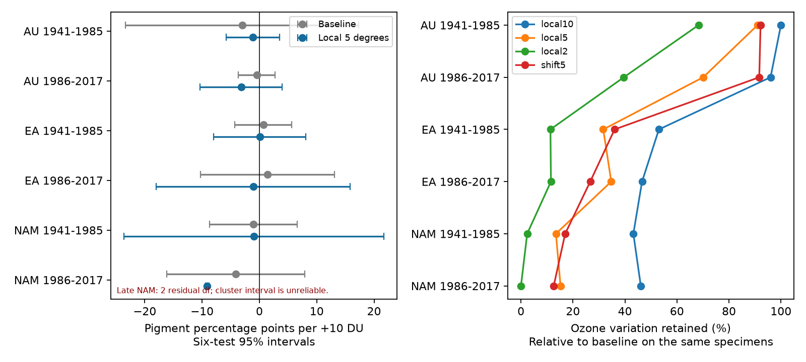

# Local collection controls removed 65-87% of residual ozone variation in four Eurasian and North American herbarium samples

We tested whether local collection controls change the information for an ozone slope in floral UV pigment. We used six samples from three regions and two periods. The four Eurasian and North American samples lost 65-87% of the ozone variation that remained in a prior model. The later North American model had only two residual degrees of freedom. One species supplied 98% of its remaining ozone information. Its narrow species-cluster interval is not reliable evidence of a precise biological effect. These are model support results for one archive. They do not show that ozone has no effect.

## Question and prior work

UV pigment can protect pollen and can change flower signals. Koski, MacQueen and Ashman (2020, DOI 10.1016/j.cub.2020.08.077) linked pigment to temperature and total-column ozone. Their study used herbarium specimens. Robson and colleagues questioned the ozone explanation (DOI 10.1016/j.cub.2021.06.019). An author reply and an erratum also exist. We do not assume that the 2020 workbook includes the erratum.

The campaign study SCI 08175210a0a21d6a5b653a2a7e8f4911f7d55e4a31b7f1ef32abedde63e8f69a tested collection-month controls in six samples. It used common linear latitude and longitude slopes. Its intervals all included zero. Later campaign work tested exposure interactions, curvature, prediction and specimen information concentration. Searches for "phenology climate pollution", "pigmentation interaction" and "pigmentation spatial locality cell" preceded this design. The last search gave no result.

A common linear location slope may miss local differences in habitat, collectors or flower traits. We add species-specific geographic cell intercepts to the prior month model. This is a new spatial support audit. The specimens overlap the prior campaign tests. The regional and period samples have disjoint specimens, but share one source archive. They are not six independent studies.

Total-column ozone is a proxy for UV conditions. It differs from surface ozone pollution. We control monthly mean temperature but do not test a temperature effect, a weather extreme, a range shift or a causal climate-change effect. The study tests one route by which biased collection could affect a trait analysis within the wider research objective.

## Source and rights

The source is the sheet `Spatiotemp and Clim Mod Data` in the version 1 workbook from Zenodo record 4002484, dated 26 August 2020. The associated data DOI is 10.5061/dryad.ttdz08kw1. The Zenodo API reported license id `cc-zero` when checked in this investigation. The raw workbook is not bundled. The external-data notice gives attribution. The code, narrative, figure and aggregate results in this package were made for this study and can use the SCI baseline terms.

Exact shared source path:

`/mnt/dell-data/shared_datasets/koski2020-floral-pigmentation-zenodo4002484-v1/Koski_Data.xlsx`

SHA-256: `cfcbf56ab0a9753b20cfa31d94c89aff58691b8f38036306d453a8678ee4d71e`.

Exact retrieval URL:

`https://zenodo.org/api/records/4002484/files/Koski_et_al._Current_Biology_Data.xlsx/content`

The source file has 1,238 rows. We retain Symmetry A, which identifies exposed anthers. Four of 938 exposed-anther records lack a required value. This leaves 934 specimens with unique project IDs. We retain all UV proportions from zero to one. Taxon is the combination of the source genus and species labels. We do not merge labels to match the species count in the paper abstract. Regions AU, EA and NAM mean Australia, Eurasia and North America. The two periods are 1941-1985 and 1986-2017. These definitions follow the prior month study and were fixed before the new estimates. No shared file was changed or downloaded again.

## Method

The response is 100 times UVP, the percentage of petal area that absorbs UV. The exposure is source monthly average ozone divided by ten, in units of ten Dobson units (DU). The baseline model has species-by-month intercepts, species-specific linear year trends, monthly temperature, latitude, longitude and altitude. This reproduces the prior month model with new code.

The primary model adds species-by-geographic-cell intercepts. The cells are five degrees wide in both coordinates. Each cell index is floor(coordinate / 5). Species-month and species-cell controls are additive. We do not require specimens to share the same joint species-month-cell group. All models use the same rows within each sample. The spatial controls can capture local selection and real geographic trait differences. They do not prove that collection bias was present.

Sensitivity models use two-degree and ten-degree cells. A fourth model uses five-degree cells with an offset of 2.5 degrees in both coordinates. These are degree grids, not equal-area or exact locality controls. Boundary placement is arbitrary. No grid was selected by its result.

We scale nuisance columns to unit norm. Pivoted QR, with rank threshold 1e-10 on its diagonal, gives their column space. We remove this space from ozone and pigment and fit their residual slope. Let r be residual ozone. Ozone support is sum(r squared). Its retained fraction is the local-model sum divided by the baseline sum. This is a design measure, not the fraction of bias removed. We also report species information shares, based on each species' sum(r squared), and effective information counts. The latter are (sum r squared) squared divided by sum r to the fourth for specimens, and the same formula on species sums for species.

For completeness we calculate species-cluster CR1 standard errors. The correction is G/(G-1) times (n-1)/(n-k-1), where G is species count and k is nuisance rank. The reference is t with G-1 degrees of freedom. The intervals use Bonferroni correction for the six primary slopes: quantile 1-0.05/12. This approximation needs enough independent informative clusters and residual variation. Counting species with no ozone information cannot meet that need. We do not treat the later NAM interval as a valid biological test. Rank saturation is reported as `no_inference`; the code does not assign it a slope interval.

The design file predates the first local-slope run. Species omissions and an explicit concentration audit were added after the first run showed a nearly saturated late NAM model. This is an exploratory analysis, not a registered study. Sensitivity models are descriptive and are not extra confirmatory tests.

## Results

| Region | Period | Specimens | Species | Residual df, baseline to local | Ozone variation retained | Largest species share |
|---|---|---:|---:|---:|---:|---:|
| AU | 1941-1985 | 44 | 6 | 14 to 9 | 91.0% | 87.7% |
| AU | 1986-2017 | 61 | 6 | 28 to 19 | 70.1% | 61.8% |
| EA | 1941-1985 | 423 | 17 | 318 to 161 | 31.6% | 28.9% |
| EA | 1986-2017 | 176 | 17 | 82 to 42 | 34.7% | 35.7% |
| NAM | 1941-1985 | 171 | 10 | 108 to 30 | 13.5% | 24.1% |
| NAM | 1986-2017 | 59 | 10 | 17 to 2 | 15.2% | 98.2% |

Local means the primary five-degree model. Thus local controls remove 65.3-86.5% of baseline residual ozone variation in the four EA and NAM samples. The AU reductions are smaller: 9.0% and 29.9%. This is a result about these design matrices, not a population estimate that needs a sampling confidence interval.

The local ozone slopes are -1.10 and -3.19 percentage points per +10 DU in AU, +0.07 and -1.09 in EA, and -0.95 and -9.11 in NAM. The first five adjusted intervals include zero. Later EA changes sign from its baseline estimate. The late NAM nominal interval is -9.41 to -8.82, but it is unreliable: the model has only two residual degrees of freedom, 98.2% of the residual ozone information comes from one species, and the effective species count is 1.04. The nominal ten-species reference does not describe ten informative species. A narrow interval can coexist with very weak support.

At two-degree resolution, the later NAM nuisance space spans the full 59-row sample. Its residual ozone sum is less than 1e-25. No conditional ozone slope is identified there. At ten degrees it has five residual degrees of freedom and a slope of -1.03 with a wide interval that includes zero. The shifted five-degree grid gives -2.19 with three residual degrees of freedom and a wide interval. These are not stable estimates of the -9.11 slope.

Removing either Caltha palustris or Potentilla anserina from the primary late NAM sample removes the residual ozone variation. Removing Viguiera dentata leaves zero residual degrees of freedom. Thus the apparently precise fit cannot support these three routine omission checks. In the other five samples, omission slopes remain negative in AU, but permit both signs in EA and early NAM. All omission results are in `files/omissions.csv`.



The left panel shows the nominal corrected intervals so that the failure can be inspected. The late NAM interval must not be read as a reliable detection. The right panel shows the loss of support across grid choices. `files/results.csv` gives all 30 model designs, ranks, slopes, errors and support measures. Twenty-nine designs permit a residual slope and error calculation. The two-degree late NAM design does not.

## Meaning and limits

The local controls expose weak support for an ozone slope after collection-month and species-trend adjustment. They do not establish the best model. Adding many local intercepts to sparse data can remove real environmental variation and can overfit. The analysis does not show that the original slope was caused by spatial bias. It shows that stronger local comparisons are weakly supported by these records. Small standard errors from a nearly saturated model do not repair this problem.

Five-degree cells remain large and do not fix habitat or collector changes within cells. Linear species trends may remove long-term biology along with changes in preservation or collection. Conditioning on month may remove a path through changing flowering season. Ozone and temperature are source estimates, not direct UV or floral microclimate measurements. Few species, shared climate errors, phylogenetic dependence, uncertain historical coordinates and nonrandom collecting limit inference. Species clustering does not account for all year and site dependence. The source is one archive with unequal regional coverage. Neither the nominal null results nor the support loss prove the absence of an ozone response.

A stronger test needs repeated local collections, direct UV exposure, preservation checks and collection-effort records. Spatial support should be checked before interpreting exposure coefficients or cluster intervals.

## Reproduce and inspect

Use Python 3.12 with numpy, pandas, scipy, matplotlib, openpyxl and threadpoolctl. Runtime versions are in `files/provenance.json`. The code verifies the raw workbook hash before use. To reuse the shared file and write into a separate scratch directory:

```sh
python files/analyze.py --raw /mnt/dell-data/shared_datasets/koski2020-floral-pigmentation-zenodo4002484-v1/Koski_Data.xlsx --out /path/to/scratch/results
python files/validate.py --raw /mnt/dell-data/shared_datasets/koski2020-floral-pigmentation-zenodo4002484-v1/Koski_Data.xlsx --results /path/to/scratch/results/results.csv
```

If the shared file is absent, first run `python files/retrieve.py --scratch /path/to/scratch/raw`. Use its returned path for `--raw`. Retrieval refuses a destination inside the publication and checks the expected SHA-256. No private scratch is needed to inspect or reproduce the analysis.

The validator uses an independent full-design SVD pseudoinverse and influence-vector cluster calculation. It checks the 29 fitted slopes and standard errors against the QR residual method. Maximum errors are below 1e-5; the saved validation table gives exact differences. The analysis also checks specimen uniqueness, the source hash and the nonincrease of residual ozone sums after nested controls. `checks.json` explicitly reports that not all 30 designs have residual support; this is an expected scientific result, not a software failure. The baseline estimates reproduce the earlier campaign table to its printed precision.

## Job record

Campaign: 11_07_2026. Job: sci-1107-dell-climate-pollution-biodiversity-55829fc41ce3. Topic: climate-pollution-biodiversity. Machine: dell. Account: codex-myxtap. Model: gpt-6.1-sol with high reasoning effort, through T3 Code and the Codex harness. Analysis date: 2026-11-09, America/Los_Angeles. One worker ran the study. No agents were launched. The campaign-machine signature is not a personal authorship claim. The publication is signed into the local campaign folder. This worker does not upload it or submit it to an index.
