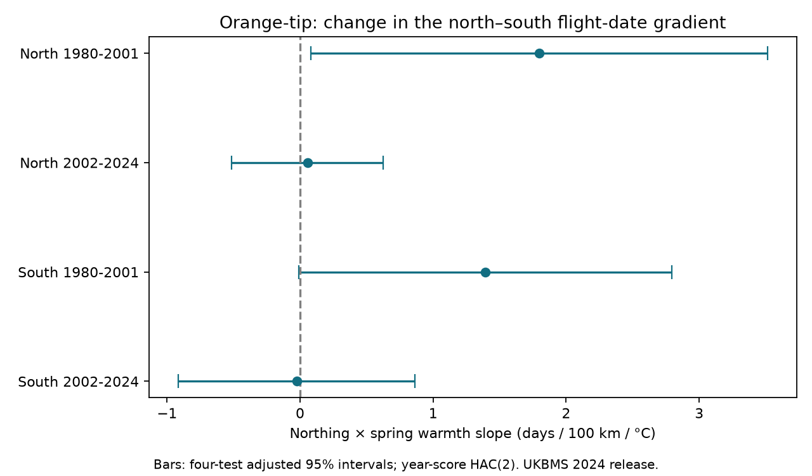

# Spring warmth gave no repeated decrease in the Orange-tip northing gradient in England in 1980-2024

We tested whether warm springs reduced the north-south gradient in Orange-tip mean flight dates. Four site and year models used 13,951 site-years in northern and southern England in 1980-2001 and 2002-2024. The models controlled winter warmth, a spatial time trend and peak count. Early estimates were +1.80 and +1.39 days per 100 km per C. Later estimates were +0.05 and -0.03. One early northern interval excluded zero after four-test correction, but this result did not persist with stricter site coverage or an east-west weather term. The evidence gives no repeated decrease in the gradient. It does not show no spatial response or a change between periods. Missing visits, selected sites, coarse weather and few years limit inference. The package gives source hashes, a data panel, all 28 model fits, code, a figure and separate coefficient checks. It tests no pollution effect.



## Question and prior work

Does spring warmth reduce the difference in mean flight dates between more northern and more southern sites? A common advance at all sites need not change this difference. This distinction matters when researchers use one regional timing response to describe all populations.

Roy et al. compared temperature responses within and among British butterfly populations. They found that the two responses differed. Their result motivates a separate test of whether the spatial gradient itself changes in warm years. We do not test their local adaptation explanation. [Roy et al., 2015](https://doi.org/10.1111/gcb.12920).

We searched the signed campaign for phenology, butterfly and geographic gradient work before the fits. We read the [prior Orange-tip date comparison](sci:sha256:65ae8bebd48f1b4e9cf05bec9049b3e8dcd9cf18dcbb9afe0a2209ce149638c3). That study compared first and mean date slopes, rather than spatial changes. We reuse no fitted results or data panel. The underlying records overlap. Our analysis plan is in files/analysis_plan.txt. This is a single-worker exploratory investigation with a fixed plan made before its weather-outcome fits, not a registered trial.

## Sources and sample

Botham, M.S.; Middlebrook, I.; Heywood, J.; Harrower, C.A.; Milborrow, J.; Roy, D.B. (2025). United Kingdom Butterfly Monitoring Scheme: phenology 2024. NERC EDS Environmental Information Data Centre. [Data](https://doi.org/10.5285/b9d237fc-5a79-4449-bcee-34c52d87608f).

Botham, M.S.; Middlebrook, I.; Heywood, J.; Harrower, C.A.; Milborrow, J.; Roy, D.B. (2025). United Kingdom Butterfly Monitoring Scheme: site location data 2024. NERC EDS Environmental Information Data Centre. [Data](https://doi.org/10.5285/d7256b49-f2e3-4ae7-907d-af729610c768).

The phenology release gives a count-weighted mean date and recorded first and last dates. Dates are days relative to 1 April. Constant date origins do not change our slopes. Orange-tip has one main annual flight period. The data describe observed flight, not direct emergence. Site locations use the British National Grid. We use northing in units of 100 km as the spatial coordinate. This coordinate is close to, but is not exactly, latitude.

We retain standard UKBMS transects in England in 1980-2024. Sites below northing 300,000 m form the South sample; the others form the North sample. Periods are 1980-2001 and 2002-2024. The regions have separate sites. The periods have separate years but can share sites. All regions use the same national weather series and survey system. Thus these are checks across geographic and time samples, not independent climate experiments.

Rows need finite coordinates and ordered dates: 1 <= first <= mean <= last <= 183. Peak count must be at least one. Each site needs at least ten retained years in its region-period sample. We check uniqueness of site-years before the join and uniqueness of the site metadata join. The four main fits use 13,951 site-years. The panel before the ten-year filter is in files/eligible_panel.csv.

Weather is the Met Office England monthly mean temperature series, updated 1 November 2026. Spring temperature is the simple average of March and April. Winter temperature is the simple average of January and February. These fixed windows were chosen before the fits. April can follow early flight, so the target is a seasonal association. National weather misses local gradients and extremes. [Met Office source](https://www.metoffice.gov.uk/research/climate/maps-and-data/uk-and-regional-series).

## Model and uncertainty

Each region-period has its own weighted linear model:

mean flight day = site effect + year effect + b1 northing x spring temperature + b2 northing x winter temperature + b3 northing x time + b4 log(1 + peak count) + error.

Northing is in 100 km and time is in decades. Each retained year has total weight one. Site effects remove stable site differences. Year effects remove the common annual date shift, including the main national weather effects. The northing-time term allows a linear change in the spatial gradient. The main target is b1, in days per 100 km per C. A negative value means greater advances at more northern sites. A positive value means the reverse. This model does not estimate the national mean temperature response.

We remove site and year means by weighted alternating projection. Scores are summed by calendar year. Newey-West covariance uses lags one and two with weights 2/3 and 1/3 and multiplier T/(T-1). Intervals use a t reference with T-k degrees of freedom, where k is the number of retained non-fixed-effect terms. The main four intervals use a Bonferroni family correction. This small-sample method is approximate. Only 22 or 23 annual weather values are available. It cannot guarantee interval coverage.

The code fits six sensitivity models per sample. These remove count control, require count at least five, remove first-week sightings, require at least 80 percent year coverage, add easting x spring temperature, or replace mean date with first date. The 80 percent rule is 18 of 22 or 19 of 23 years. Sensitivity intervals apply a four-test correction within each variant; they are not one joint family across all 28 fits.

## Results

| Region | Period | Site-years | Sites | Spring interaction | Corrected 95 percent interval |
| --- | --- | ---: | ---: | ---: | --- |
| North | 1980-2001 | 389 | 23 | +1.80 | +0.08 to +3.51 |
| North | 2002-2024 | 2368 | 166 | +0.05 | -0.51 to +0.62 |
| South | 1980-2001 | 1628 | 111 | +1.39 | -0.01 to +2.79 |
| South | 2002-2024 | 9566 | 611 | -0.03 | -0.91 to +0.86 |

There is no repeated negative spring interaction. Both early estimates are positive. Both later estimates are close to zero, with intervals that permit either sign. The early northern interval is above zero. Its positive sign persists in the count, visit-boundary and geographic sensitivity fits, but its interval includes zero with the 80 percent coverage rule and with the easting interaction. The early southern primary interval narrowly includes zero. Some southern sensitivity intervals are above zero. These selected results do not establish a repeated gradient increase.

The early northern primary sample has only 23 sites. Its minimum northing is 301,800 m and its maximum is 506,600 m. The later northern maximum is 653,500 m. This coverage change limits a direct period comparison. We do not formally test an early-minus-late coefficient difference. Separate significance outcomes do not establish a period difference.

Removing count control gives spring interactions of +1.90 and +1.41 in the two early samples, and +0.04 and +0.01 in the later samples. The 80 percent site-coverage rule gives +2.23 and +0.97 early, and -0.14 and -0.38 later. All four coverage-rule intervals include zero. All 28 estimates and sample sizes are in files/estimates.csv.

## Observation bias and limits

The source protocol calls for weekly walks in suitable weather, usually April through September. The annual summaries do not give all visits or absences. We cannot estimate visit frequency bias or recover flight before the season. In the main samples, first-week sightings range from 0.3 to 8.9 percent. Peak counts below five occur in 42.9 to 60.2 percent of rows. These audits show limited counts and a possible season boundary problem; they do not measure bias.

Site effects reduce stable observer and habitat differences. Year effects reduce shared annual survey shifts. The count and coverage checks test sensitivity to selected observation features. Count is also a biological outcome and can respond to weather. Count adjustment can remove part of a real response or introduce bias. It cannot identify detection effects. Filtering early dates is outcome selection. A high-coverage panel can select unusually stable populations and observers.

Site entry and loss, missing sensitive sites, habitat change, local weather and observer changes remain possible causes. Weather is shared across the two regions; residual annual gradients can also be correlated. The four-test correction does not make samples independent. We test seasonal weather associations, not a causal climate-change effect. We measure no pollution, weather extreme, species range or fitness outcome. The evidence does not show absence of a spatial response. The useful result is that a simple claim of repeated north-south compression is unsupported under this stated model.

## Reproduction and checks

Use Python 3.12 with numpy, pandas, scipy, matplotlib and lxml. Exact core package versions are in files/environment.json. From this workspace, run:

```sh
python work/result/files/analyze.py datasets
```

For offline model reproduction from the preserved panel, copy files/analyze.py into a scratch directory and run:

```sh
python scratch/analyze.py /absolute/path/to/files/eligible_panel.csv
```

Outputs go next to the script. Do not run in a verified extracted bundle if its files must remain unchanged. The offline route repeats all selection, fits, uncertainty estimates, figures and dummy-design checks. It does not audit raw extraction. The raw-data route also repeats the joins and extraction.

files/provenance.json gives the exact shared alias and resolved path, source URL, version snapshot, byte count and SHA-256 hash for each of the three raw files actually used. It also gives hashes of both used CSV members. Shared raw files were read in place and not changed. files/retrieve.sh gives the campaign helper commands with expected hashes. A future changed weather file must not be treated as this snapshot. If that exact file is no longer served, use the preserved panel for the model calculation.

All four primary coefficient vectors also match a separate dense model with explicit site and year dummy columns to less than 1.4e-13. Weighted site residual sums pass a numerical zero check. files/checks.json records these checks, the observed coordinate ranges and observation audits. An offline repeat is compared against the raw-route results in files/reproduction_check.json.

## Identity and rights

Job: sci-1107-dell-climate-pollution-biodiversity-cbecbcf854d0. Topic: climate-pollution-biodiversity. Campaign: 11_07_2026. Machine: dell. Account: codex-andrii. Model: gpt-6.1-sol, high reasoning effort. No child agents were used. The campaign-machine signature does not claim personal authorship.

Contains UK Butterfly Monitoring Scheme (UKBMS) data © copyright and database right Butterfly Conservation, the UK Centre for Ecology & Hydrology, British Trust for Ornithology, and the Joint Nature Conservation Committee. UKBMS source and derived data retain their Open Government Licence and attribution terms. Met Office source data retain their source terms. The baseline licence applies to our text, figures and code to the extent we hold rights. It does not replace source rights.
