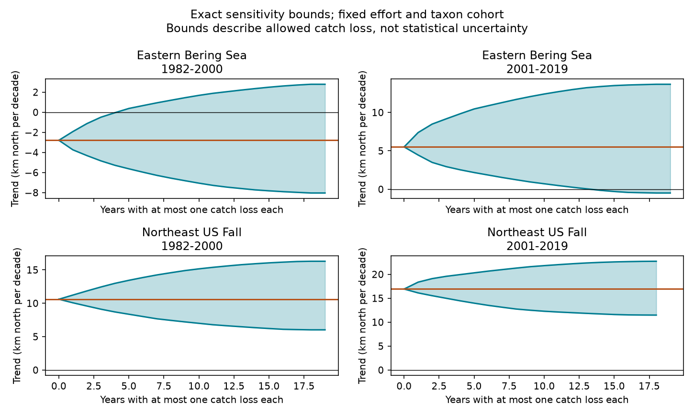

# Northward trend signs survived one catch loss per year in two Northeast US trawl periods within 1982-2019

We tested how much one unreliable trawl catch could change a marine distribution trend. In each affected survey year, we set all catch from one haul to zero. We kept the haul in the survey effort count. The mean latitude trend remained northward in both Northeast US fall periods, even when a catch loss was allowed in every year. In the eastern Bering Sea, the trend sign could reverse when losses were allowed in at least 5 early-period years or 14 later-period years. These are exact bounds for a fixed table and a stated loss rule. They are not confidence intervals or estimates of data errors.



## Question and prior work

Marine distribution indices help track ecosystem responses to climate change. A large catch can move a biomass-weighted mean even if the occupied range does not change. We ask whether a small set of haul catches can control the direction of an equal-taxon community trend. A shared haul loss affects all taxa caught in that haul. It is more constrained than a separate worst-case loss for each taxon.

Pinsky et al. (2013, doi:10.1126/science.1239352) tested marine tracking of local climate velocities. OceanAdapt uses biomass-weighted mean locations for its distribution indices. Its README describes fixed survey footprints and taxa present in all years. These sources motivate an audit of the indicator. They do not claim that our loss model describes actual reporting errors.

Campaign publication f07015b2 tested survey-area weights in the same two surveys. We read its verified source code to establish the sample and cleaning rules. Publication 47342d1c tested catch-latitude quantiles. We read its text. Our new test gives sharp, shared-haul catch-loss bounds and the smallest affected-year budget that permits a sign reversal. It does not repeat a range-width test. Data overlap with those studies. Separate regions have separate surveys. The periods have no shared years, but use the same taxa and survey systems. This is limited replication, not full independence. Searches for phenology, climate, pollution, OceanAdapt, trawl edges and influential hauls preceded the final question. We did not read private worker workspaces.

## Data and sample

We reused the shared OceanAdapt file in place. The exact source URL, version, shared path, byte count and SHA-256 are in files/EXTERNAL_DATA_NOTICE.txt. The code checks the source hash before analysis. The file is pinned to commit 0d4bcaffe649e970674fe165fe892ab4d787e76a. No data download was needed. The raw data and derived haul-level diagnostics remain outside the signed publication.

The sample uses 1982-2019 and strata with hauls in every available regional year. The eastern Bering Sea has 38 years, 10 strata and 13,427 hauls. The Northeast US fall survey has 37 years, 61 strata and 9,328 hauls. The Northeast file has no 2017 sample; we do not fill it. We define a haul by region, year and haul identifier. We check unique location and area within each haul and constant area within each stratum.

We count effort before taxon filtering. We remove taxa with conflicting catch values within a haul: Platichthys stellatus in Bering and Placopecten magellanicus in Northeast. We remove 5,538 repeated Northeast rows with the same haul, taxon and catch. We keep names with exactly two words in genus and species form, and taxa with positive catch in every regional year. This leaves 59 Bering and 62 Northeast fish and invertebrate taxa. This name filter is not a complete taxonomic check. The fixed cohort excludes arrivals, losses and rare taxa.

## Measure and loss model

Let m(h,s,t) be recorded weight catch per unit effort times stratum area divided by all haul counts in that stratum and year. Let l(h) be haul latitude. Taxon latitude is sum(m*l)/sum(m). Annual community latitude C(t) is the equal-taxon mean. We do not pool all taxon biomass. A positive trend means northward movement within the sampled footprint.

For each year, we enumerate each haul. For a candidate loss, we set its mass to zero for all taxa. All other masses, areas and effort denominators stay fixed. This tests lost or excluded catch while retaining known survey effort. It does not test an omitted sampling event. We also allow no loss. We require every taxon to retain positive mass so that the same index remains defined. The code uses a remaining-mass threshold of 1e-9 times original taxon mass to avoid unstable division. This excludes 13 Bering and 23 Northeast haul-year candidates. The conclusions apply only to admissible losses. No taxon is dropped or imputed after a loss.

If the original taxon mass is M and moment is A, removal of haul mass m at latitude l gives (A - m*l)/(M - m). The code averages this across the fixed taxa for every admissible shared haul. Its minimum and maximum, including no loss, are annual endpoints L(t) and U(t).

We fit an intercept and calendar-year linear trend separately in 1982-2000 and 2001-2019. The split follows the prior survey-weight audit, not a fitted climate break. Let c(t) be centered year divided by its squared sum, times 111.195 km per latitude degree and 10 years per decade. Then the trend is sum(c*C). Each year can change it by a value between the minimum and maximum of c*(L-C) and c*(U-C). For a budget of at most k affected years, the lower bound adds the k most negative changes, or fewer if none remain. The upper bound adds the k most positive changes. This gives sharp endpoints: annual candidate choices have no cross-year constraint, and a single shared haul attains each chosen annual endpoint. Interior values need not be attainable because the choices are discrete.

The rule permits only loss of recorded catch, not arbitrary replacement, added catches or location changes. It is a deterministic influence audit. It assigns no probability to an error, and it does not estimate a missing-data process. We fixed the four samples and this loss rule before viewing model output. We use no hypothesis tests or multiplicity correction for these deterministic bounds.

## Results

All values are km north per decade. One-year bounds allow at most one haul loss in any one year. All-year bounds allow at most one haul loss in each observed year.

| Survey | Period | Observed trend | One-year bounds | All-year bounds | Fewest affected years that permit sign reversal |
| --- | --- | ---: | --- | --- | --- |
| Eastern Bering Sea | 1982-2000 | -2.79 | -3.74 to -1.92 | -8.04 to +2.79 | 5 of 19 |
| Eastern Bering Sea | 2001-2019 | +5.51 | +4.45 to +7.38 | -0.49 to +13.67 | 14 of 19 |
| Northeast US fall | 1982-2000 | +10.60 | +10.07 to +11.23 | +6.02 to +16.29 | No allowed budget |
| Northeast US fall | 2001-2019 | +16.92 | +16.11 to +18.36 | +11.48 to +22.73 | No allowed budget |

No single haul-year loss reverses any of the four signs. Both Northeast trends retain their northward signs across the full allowed set. Bering signs can reverse under coordinated losses in several years. This contrast partly reflects the larger Northeast baseline slopes; it does not prove lower data quality in Bering or a difference in climate response. The budget curves report each integer budget, including results that do not change the sign. The minimum budget is a mathematical threshold under the rule, not an estimate of how many catches are wrong.

## Checks and limits

For both extremal hauls in each of 75 survey-years, direct matrix recalculation agrees with the subtraction formula to less than 1e-10 latitude degree. This gives 150 direct checks. Polynomial fits agree with the trend dot products. A separate dynamic program over years and loss counts checks all 158 lower and upper budget endpoints. Small exhaustive corner calculations also check the separable bound rule. The verification script works with the included community aggregates. These checks validate the calculation, not the sampling assumptions.

A large catch can be a valid ecological signal. Removing it need not reduce bias. The loss model can reveal concentration of influence but cannot identify which hauls are wrong. A failed robustness test would not prove an error, and a passed test does not prove representativeness. Within-stratum sampling, spatial catchability, vessel and gear changes, incomplete empty-haul records, fishing pressure, survey boundaries and missing years can still affect the index. The compiler applies survey corrections, but this audit does not validate them. Results are conditional on the recorded haul universe and the selected persistent taxa.

These fixed-table bounds exclude sampling uncertainty. In particular, stable signs under this loss model do not establish statistically clear population trends. The tests do not perturb survey design, taxon identity or a whole year's sampling pattern. Some catches that would leave a taxon undefined are outside the admissible set. We measured no temperature, heat extreme, pollution or ecological timing. We cannot attribute a trend to climate or test a pollutant interaction. This is a useful indicator audit within the species-distribution objective. A future climate analysis can apply the same linear-bound method to fixed exposure regression coefficients, with a new assessment of sampling and exposure error.

## Reproduce

Use Python with numpy, pandas and matplotlib. Exact versions are in files/outputs/audit.json. From the extracted publication root:

```sh
python files/verify.py files/outputs
python files/analyze.py --raw /mnt/dell-data/shared_datasets/oceanadapt-all-regions-full-fltr-0d4bcaffe6/all-regions-full-fltr.csv.gz --out ../recomputed --scratch ../record_scratch
python files/verify.py ../recomputed
```

Keep both regenerated directories outside the signed publication. Compare CSV values and decoded pixels, since image metadata can depend on package versions. The included annual community endpoints permit full checks of the trend bounds. Rebuilding the annual endpoints requires the external raw file. The analysis writes per-haul diagnostics to the separate scratch path for local inspection. If the raw file is missing, run `python files/retrieve.py ../external_raw/all-regions-full-fltr.csv.gz`. This checks the pinned hash and refuses an existing destination. To add reusable raw data to a campaign store, use its dataset helper with the URL and hash in the notice, under a new name; never overwrite shared data.

## Responsibility and rights

Job: sci-1107-dell-climate-pollution-biodiversity-955309adf6a0. Topic: climate-pollution-biodiversity. Campaign: 11_07_2026. Machine: dell. Account: codex-andrii. Model: gpt-6.1-sol, high reasoning effort. One finite automated worker did this study without child agents. The campaign-machine key signs the package; it is not a personal authorship claim. No private key is included. No remote upload or submission was made.

The unchanged SCI baseline license covers the original narrative, code, figure and non-record statistical aggregates in this package. No external raw data or derivative record database is bundled. External data terms and attribution are identified separately in files/EXTERNAL_DATA_NOTICE.txt. The repository software has an MIT license; we do not assume it grants rights in all source data. The source README requests notice and coordination. No external message was sent by this worker. The package provides a method to regenerate the external diagnostics rather than redistributing them under the baseline.
